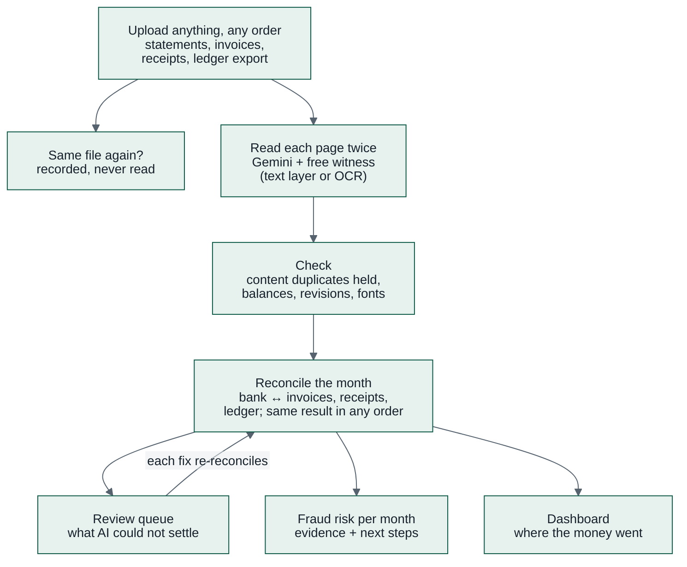

<p></p>

**Every number has a source.**

Kredibel is an AI finance workspace that checks a small business's own books. Upload bank statements,
sales and purchase invoices, receipts and your general-ledger export **in any order**. Kredibel reads
every number twice, catches **duplicates** and **edited documents** before they are counted,
**reconciles every month** automatically, sends the few things AI cannot match to a short **review
queue**, and shows a **fraud risk level** for each month with the evidence and the next steps.

> Google Cloud AI Builder Cup 2026 · Theme 1 — **BFSI: Intelligent Risk, Fraud & Financial Experiences**

**Try it now:** live app [kredibel.app](https://kredibel.app) (mirror [kredibel-app.web.app](https://kredibel-app.web.app)) · demo sign-in
`demo@kredibel.app` / `Kredibel-Demo-2026` (shared, synthetic books, reset nightly) · or your own
Google account with the [sample books on Drive](https://drive.google.com/drive/folders/1TUpbHZ-nRRoafvzEs4XX1j7rMkM40SfV?usp=sharing)
· [demo video](docs/submission/README.md#the-video) · [architecture](docs/diagrams/gcp-architecture.drawio.svg)
· [what to click](docs/submission/demo-walkthrough-guide.md)

---

## The problem

Small businesses close their books by hand. Invoices and receipts arrive all month; the bank statement
arrives at month end; someone matches them in a spreadsheet. The same statement gets uploaded twice, a
supplier invoice is entered again, a receipt is photographed by two people. A PDF can be edited in
minutes, and a supplier's "new bank account" can be a fraudster's. Mistakes surface weeks later, if at
all.

## How Kredibel works



1. **Duplicates first.** An exact copy is recorded and never read again; a re-exported statement, a
   re-scanned invoice or a re-photographed receipt is **held** until you decide.
2. **Read twice, pay once.** Gemini reads every page image; the PDF's own text layer (or Document AI
   OCR for scans and photos) is an independent witness. Every value carries its page and box. About
   USD 0.45 for a half-year of books.
3. **Ledger files by code.** Code proposes which column is which from the header words and the
   shape of the values (Gemini only for headers code cannot place); a new layout is confirmed once;
   code imports every row.
4. **Forensics.** Running balances, opening and closing totals, PDF revision history, odd fonts in
   amount columns, statement continuity, and a supplier paid to a bank account never seen before.
5. **Months that reconcile themselves.** Exact, split, net-of-tax and ledger matches with reasons;
   only unique, high-scoring matches are automatic; the result is the same whatever order you upload.
6. **A short, honest review queue.** Proposed matches, missing documents, possible duplicates and
   uncertain values, each with the evidence and only the fixes that make sense.
7. **Fraud risk you can explain.** A policy file sets the level; Gemini explains it and orders the
   next steps; a grounding guard checks every number it writes.

Around it: a **dashboard** with a money-flow Sankey and a profit and loss flow, a **free trial** for
individuals and companies (paid tiers and a **loan readiness report** shown as coming soon), a
**Finance Assistant** that answers from your books' figures and quotes the pages of your documents it
relied on (searched in Firestore vector search), **labels** people confirm or correct, a **Runs**
page with every workflow's stages, models and cost, a **Transactions** table with each bank line's
IFRS and US GAAP class, subledger and match, and a **demo company** with a guided tour for a first
look, also open to anyone through a **demo account** with email and password
([docs/25](docs/25-demo.md)). The assistant's agent with tools and Memory Bank, Model Armor screening and team invites
are planned (P1); [`docs/24`](docs/24-submission-checklist.md) lists what is built and what is not.

## Built on Google Cloud

| Need | Service |
|---|---|
| Agent orchestration | **Agent Development Kit (ADK) 2.x** workflows (per document, per month), traces in **Cloud Trace** |
| Models | **Gemini** on Gemini Enterprise Agent Platform (Flash, Flash-Lite, embeddings) |
| Document reading | **Gemini** on page images + **Document AI** Enterprise OCR for scans and photos |
| Prompt-injection defence | Documents are data in every prompt; **Model Armor** screening planned (P1) |
| Assistant memory | **Agent Platform Sessions** and **Memory Bank** planned (P1) |
| Runtime | **Cloud Run** (web + worker), **Cloud Tasks** |
| Data | **Firestore** (incl. vector search), **Cloud Storage** |
| Identity | **Firebase Authentication** |
| Delivery & ops | **Cloud Build**, **Artifact Registry**, Cloud Logging, Cloud Monitoring |


## Repository status

This repository is **specification-first**. The documents, contracts, design tokens and screen mocks
are complete; code is built spec by spec. See
[`docs/20-implementation-status.md`](docs/20-implementation-status.md).

| Start here | |
|---|---|
| The scope decision | [`docs/adr/ADR-015-scope-finance-workspace-not-loan-review.md`](docs/adr/ADR-015-scope-finance-workspace-not-loan-review.md) |
| The product | [`docs/01a-concept-deep-dive.md`](docs/01a-concept-deep-dive.md), [`docs/03-prd.md`](docs/03-prd.md) |
| How it's built | [`docs/05-architecture.md`](docs/05-architecture.md), [`docs/06-agent-design.md`](docs/06-agent-design.md), [`docs/08-risk-engine.md`](docs/08-risk-engine.md) |
| How it looks | [`docs/11-frontend.md`](docs/11-frontend.md), [`docs/12-design-system.md`](docs/12-design-system.md), [`design/mocks/`](design/mocks/index.html) |
| The plan to 18 Oct | [`docs/19-delivery-plan.md`](docs/19-delivery-plan.md) |
| All docs | [`docs/README.md`](docs/README.md) |
| Feature specs | [`docs/specs/README.md`](docs/specs/README.md) |
| For coding agents | [`AGENTS.md`](AGENTS.md) |

## Quick start

```bash
# 1. Install dependencies
make setup

# 2. Build design tokens
make tokens

# 3. Start local environment (Firestore emulator + Vite & FastAPI dev servers)
docker compose up -d
make dev

# 4. Run all quality gates (linting, type checking, architecture boundaries, repo checks, tests)
make check

# 5. Visual regression tests & Storybook
make test-visual
make storybook-build
```

### Live Deployment

Spec 001 Foundation is deployed on Google Cloud (`cloud-hack2skill`, `asia-southeast1`):
- **Web App (Firebase Hosting, custom domain)**: [https://kredibel.app](https://kredibel.app) (mirrors: [https://kredibel-app.web.app](https://kredibel-app.web.app), [https://kredibel-app.firebaseapp.com](https://kredibel-app.firebaseapp.com)). The root URL is the **public landing page** (works logged out, spec 020); the app dashboard is at `/dashboard`.
- **Cloud Run Web (Origin API & SPA)**: [https://kredibel-web-110491117045.asia-southeast1.run.app](https://kredibel-web-110491117045.asia-southeast1.run.app)
- **Cloud Run Worker (IAM only)**: [https://kredibel-worker-110491117045.asia-southeast1.run.app](https://kredibel-worker-110491117045.asia-southeast1.run.app)
- **Data Migration Job**: `kredibel-migrate` Cloud Run job with automated Cloud Build pipeline step.
- **Try it without a Google account**: sign in at [https://kredibel.app/login](https://kredibel.app/login)
  with `demo@kredibel.app` / `Kredibel-Demo-2026`: a shared copy of the synthetic demo company
  ([docs/25](docs/25-demo.md); what to click: [docs/submission/demo-walkthrough-guide.md](docs/submission/demo-walkthrough-guide.md)).
  The account is shared, so several people trying it at once see each other's changes.
- **Try it in a workspace of your own** (recommended for judges): sign in with your Google account,
  choose **Set up your business** (any name; the free trial needs no card), then upload the **sample
  books** from the shared Drive folder
  [AI-BUILDER-CUP-2026](https://drive.google.com/drive/folders/1TUpbHZ-nRRoafvzEs4XX1j7rMkM40SfV?usp=sharing) (`demo-aug-oct/pack`: 39 synthetic files of Sunrise
  Coffee Roasters, August–October 2026: three bank statements, invoices, receipts and a ledger export;
  upload them all at once, in any order). Reading takes a few minutes; each page is read twice and the
  months reconcile themselves. The same folder holds the demo video and its scripts. Please upload
  synthetic files only: every document in the sample pack is marked *SYNTHETIC, FOR TESTING*.
- **Submission pack**: the video, the brief description and the pitch-deck content are in
  [docs/submission](docs/submission/README.md).


## Results

**The demo company on production** (synthetic, August–October 2026, read by the deployed workflows;
measured 17 Oct 2026):

| Measure | Result |
|---|---|
| Bank lines matched automatically | 295 of 310 (95%) in 300 documents: August 95.2%, September 92.2%, October 98.0% |
| Planted cases found | Edited statement (August Critical), scanned copy held, payment to a supplier's new account (October High), two unpaid supplier invoices |
| Bank lines without a document matched to their ledger booking (scenario S1, test) | 84 of 87, none wrongly |
| Reading cost | About USD 0.43 for 80 documents (89 pages) |

_The eval suite (spec 012) fills the table below from `backend/evals/reports/`; it has not been run
yet, so no general accuracy is claimed._

| Measure | Result |
|---|---|
| Bank lines matched automatically (S1) | — |
| Wrong automatic matches | — |
| Seeded duplicates caught | — |
| Seeded tampering detected / false "tampered" verdicts | — |
| Reading cost per page | — |

## Data

All documents in this project are **synthetic**, generated by `tools/synthetic/` for a fictional bank
and fictional businesses, and marked "SYNTHETIC — FOR TESTING". No real customer data exists anywhere
in this repository or its cloud project.
