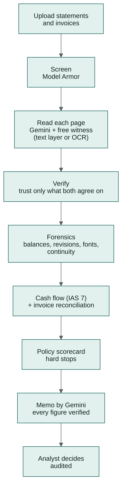

# kredibel

**Every number has a source.**

Kredibel is an agentic credit analyst for SME lenders. It turns a borrower's bank statements and
invoices into a **verified, evidence-linked cash-flow assessment** in minutes. It catches tampered
documents and revenue that never reached the bank, and leaves the decision to a human.

> Google Cloud AI Builder Cup 2026 · Theme 1 — **BFSI: Intelligent Risk, Fraud & Financial Experiences**

---

## The problem

SME lenders across Southeast Asia underwrite from documents the borrower controls. Analysts spend days
re-typing statements into spreadsheets. Edited PDFs and template-made statements are cheap to produce
and hard to spot by eye; bank statements are the document fraud teams consider most vulnerable. A
month later, nobody can trace where a memo's numbers came from.

## How Kredibel works



1. **Screen** every file for hidden instructions before any model reads it.
2. **Read twice, pay once**: Gemini reads every page image; the PDF's own text layer (or Document AI OCR
   for scans) is an independent witness; values carry their page and bounding box, and a fraud verdict
   needs both readings to agree. About USD 0.34 per case.
3. **Cross-examine**: running balances, opening/closing totals, PDF revision history, font anomalies
   in amount columns, month-to-month continuity, account-holder match.
4. **Follow the money**: IAS 7 cash-flow classes, average daily balance, debt-service coverage, and
   every invoice matched against real bank inflows.
5. **Score transparently** with a versioned policy file; models explain but never decide.
6. **Draft the memo** with Gemini from computed facts only; a grounding guard verifies every number.
7. **Decide** with guard rails: no approval over open critical findings; overrides need a risk lead
   and a reason; everything is audited.

Around the analysis:

- **Workspaces and a free trial.** A lender signs up, creates a workspace in one screen and starts a
  30-day free trial with clear, server-enforced limits. Paid tiers are shown as "coming soon".
- **Applicant onboarding.** Applicants are onboarded as individuals or companies (bank accounts,
  beneficial owners). Kredibel suggests what the documents reveal (accounts, tax ID, address, clients
  and partners), each with the page it came from, and the analyst accepts or rejects.
- **English UI**, built for more languages (listed as coming soon).

## Built on Google Cloud

| Need | Service |
|---|---|
| Agent orchestration | **Agent Development Kit (ADK) 2.x** workflows |
| Models | **Gemini** on Gemini Enterprise Agent Platform (Flash, Flash-Lite, Pro) |
| Document reading | **Gemini** on page images + **Document AI** Enterprise OCR for scans (Form/Invoice Parser for escalation, P1) |
| Prompt-injection defence | **Model Armor** |
| Conversation memory (assistant) | **Agent Platform Sessions** |
| Runtime | **Cloud Run** (web + worker), **Cloud Tasks** |
| Data | **Firestore**, **Cloud Storage** |
| Identity | **Firebase Authentication** |
| Delivery & ops | **Cloud Build**, **Artifact Registry**, Cloud Logging, Cloud Trace |


## Repository status

This repository is **specification-first**. The documents and contracts are complete; code is built
spec by spec. See [`docs/20-implementation-status.md`](docs/20-implementation-status.md).

| Start here | |
|---|---|
| Why this idea | [`docs/01-brainstorm-and-decision.md`](docs/01-brainstorm-and-decision.md) |
| What we build | [`docs/03-prd.md`](docs/03-prd.md) |
| How it's built | [`docs/05-architecture.md`](docs/05-architecture.md), [`docs/06-agent-design.md`](docs/06-agent-design.md) |
| The plan to 18 Oct | [`docs/19-delivery-plan.md`](docs/19-delivery-plan.md) |
| All docs | [`docs/README.md`](docs/README.md) |
| Feature specs | [`docs/specs/README.md`](docs/specs/README.md) |
| For coding agents | [`AGENTS.md`](AGENTS.md) |

## Quick start

_Available after spec 001._

```bash
make setup      # uv + npm installs
make synth      # generate synthetic scenarios S1–S3
make dev        # API :8000 (in-process worker) + web :5173
make check      # all quality gates
```

## Results

_Filled from the latest eval report (`backend/evals/reports/`). Numbers measured on synthetic data
only._

| Measure | Result |
|---|---|
| Seeded tampering detected | — |
| False "tampered" verdicts on clean documents | — |
| Consensus extraction F1 | — |
| Memo figures verified | — |
| Median time per case | — |

## Data

All documents in this project are **synthetic**, generated by `tools/synthetic/` for a fictional bank
and fictional businesses, and marked "SYNTHETIC — FOR TESTING". No real customer data exists anywhere
in this repository or its cloud project.
