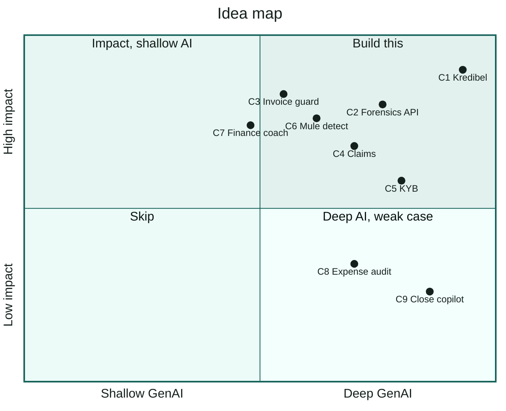

# 01 — Brainstorm & Decision

> **Status:** Draft for team review · **Theme:** 1 — BFSI: Intelligent Risk, Fraud & Financial Experiences
> **Decision owner:** whole team · **Review by:** 10 Oct 2026 (end of day)

This document records how we went from "we want Theme 1" to "we are building **Kredibel**".
It is the first thing to review. If the team picks a different idea, everything after
[`03-prd.md`](03-prd.md) changes; the architecture, patterns and infrastructure docs mostly do not.

---

## 1. Inputs

### 1.1 The theme, in its own words

> Build an AI-powered solution that addresses meaningful challenges across banking, financial
> services, insurance, or related industries. Solutions may focus on **detecting and mitigating
> fraud or risk**, **automating complex processes**, **improving customer interactions**, or
> delivering **more personalized and informed financial experiences**.

### 1.2 How we will be judged

| Criterion | Weight | What it means for idea selection |
|---|---|---|
| Technical Merit & Gen AI Implementation | **40%** | Real agentic work on Google Cloud AI, not a chat wrapper. Depth beats breadth. |
| Problem Alignment & Impact | 25% | A named BFSI problem with a measurable cost. |
| Innovation & Creativity | 25% | Something a judge has not seen ten times this week. |
| User Experience & Solution Design | 10% | A demo that is legible in 3 minutes. |

Source and caveats: [`02-research.md`](02-research.md) §1.

### 1.3 Our constraints

- **Google Cloud only** for managed services and AI: Gemini on Gemini Enterprise Agent Platform
  (formerly Vertex AI), Document AI, Cloud Run, Firestore, Cloud Storage, Cloud Tasks, Model Armor,
  Firebase Auth. Agent orchestration with **ADK**, not LangGraph.
- **Time:** prototype due **18 Oct 2026** (to be confirmed on the dashboard). About 7 build days.
- **Team:** 2–4 people, building with Antigravity using spec-driven development.
- **Data:** no real customer documents. Everything must work on synthetic data we generate.

### 1.4 What we already know how to do

From our previous **intelligent financial platform** (upload bank statements, invoices and receipts →
classify → extract → categorize against IFRS/GAAP → reconcile → live financial statements):

| Capability we have | Reusable here? |
|---|---|
| Document classification (statement / invoice / receipt) | Yes, directly |
| Field and table extraction from financial documents | Yes, directly |
| Transaction categorization against an accounting standard | Yes, re-aimed at **IAS 7** cash-flow classes |
| Invoice ↔ bank reconciliation | Yes, re-aimed at **revenue verification** |
| Financial statements and dashboards | Partly. A cash-flow view, not a full balance sheet |

**The lesson we take from it:** the platform was broad (every document type, every statement, every
standard). For a 7-day competition we want **one sharp problem** where those same four capabilities
become the *engine* and not the *product*.

---

## 2. Problem space scan (Theme 1)

| Area | Typical pain | Data we could simulate convincingly? |
|---|---|---|
| **SME lending: underwriting** | Analysts manually "spread" bank statements; forged statements get through | **Yes.** Statements and invoices are documents we can generate |
| Lending: invoice / receivables finance | Same invoice financed twice, fake invoices | Partly. Needs a multi-lender view |
| Payments: scams and mule accounts | Authorized push-payment scams, mule networks | Hard. Needs network-scale transaction graphs |
| Insurance claims | Inflated or forged claim documents | Yes, but a smaller fit with our reconciliation strength |
| Onboarding / KYB | Verifying business registration documents and owners | Partly. Needs registries and sanctions lists outside GCP |
| Personal finance | Gambling and illegal-lending exposure, poor money habits | Yes, but a consumer app is crowded and less "institutional" |
| Corporate finance ops | Expense fraud, month-end close | Yes, but weak alignment to *financial services* |

---

## 3. Candidate ideas

Each candidate gets a one-liner, the AI angle, how much of our past work it reuses, and the demo moment
a judge would remember.

### C1 — Kredibel: forensic cash-flow underwriting for SME loans ⭐

- **One-liner:** An agentic credit analyst that turns a borrower's bank statements and invoices into a
  verified, evidence-linked cash-flow credit memo, and catches tampered documents first.
- **User:** credit analyst at a bank SME unit, rural bank (BPR), multifinance company or P2P lending
  platform.
- **AI angle:** ADK graph workflow; every value is read twice, independently, and must agree before we
  trust it (Gemini on the page image plus the PDF text layer or Document AI OCR as a witness,
  [ADR-010](adr/ADR-010-adaptive-extraction-ai-reader-and-witness.md)); deterministic forensics; Gemini vision as a second opinion
  on tampering; Gemini drafts a memo that is then checked so every number traces to a computed fact.
- **Reuse:** high. Classify → extract → categorize → reconcile is the core pipeline.
- **Demo moment:** "The March statement was edited. Here is the cell, here is the original value
  recovered from the PDF's earlier revision, and here are five invoices that were never paid."

### C2 — Statement Forensics API

- Pure tampered-document detection for lenders: upload a statement, get an integrity verdict and evidence.
- Strong fraud story. A subset of C1, and narrower on impact (it detects but does not decide).
- **Role in our plan:** C1's fallback cut line. If we run out of time, C1 degrades into C2 plus a
  basic cash-flow view.

### C3 — Invoice Financing Guard

- Detect invoices that are fake or financed twice, across lenders.
- Innovative, but the value only shows up with a shared registry across many lenders, which is hard to
  demonstrate honestly with synthetic data.

### C4 — Claims Sentinel (insurance)

- Triage insurance claim packets: inconsistent bills, altered receipts, policy-coverage mismatches.
- Good fit for BFSI; reuses extraction; less use of our reconciliation strength.

### C5 — KYB Copilot

- Verify SME onboarding documents (business registration, tax ID, deed of establishment), extract
  beneficial owners, flag inconsistencies.
- Depends on registries and sanctions data that are not Google Cloud services. We would be mocking
  the important part.

### C6 — Mule Account Detector

- Detect money-mule behaviour in transaction streams.
- High impact, but mostly graph analytics and ML rather than generative AI, and the synthetic data
  would look synthetic.

### C7 — Personal Finance Guardian

- A consumer uploads e-statements; the agent detects exposure to online gambling and illegal lenders
  and coaches the user.
- Strong social impact in Indonesia, but a crowded consumer pattern, and the "financial institution"
  framing of Theme 1 is weaker.

### C8 — Expense Audit Agent

- Detect duplicate, altered or out-of-policy receipts in corporate expense claims.
- Fully reuses receipts work, but it is corporate finance, not financial services.

### C9 — SME Close Copilot (our previous platform, narrowed)

- Month-end close for SMEs: reconcile, categorize, produce IFRS-style statements.
- Maximum reuse, weakest alignment with "risk and fraud", and the broadest scope.

---

## 4. Scoring

Scores are 1 (weak) to 5 (strong) per judging criterion, weighted as in §1.2. Feasibility and reuse
are **gates**, not scores. An idea that fails a gate is risky regardless of its total.

| # | Idea | Tech & GenAI ×0.40 | Impact ×0.25 | Innovation ×0.25 | UX ×0.10 | **Weighted / 5** | Feasible in 7 days | Reuse |
|---|---|---|---|---|---|---|---|---|
| C1 | **Kredibel** | 5 | 5 | 4 | 5 | **4.75** | Yes, if scoped (§6) | High |
| C2 | Statement Forensics API | 4 | 4 | 4 | 3 | 3.90 | Yes | Medium |
| C4 | Claims Sentinel | 4 | 4 | 3 | 4 | 3.75 | Yes | Medium |
| C7 | Personal Finance Guardian | 3 | 5 | 3 | 4 | 3.60 | Yes | High |
| C3 | Invoice Financing Guard | 3 | 4 | 4 | 3 | 3.50 | Risky | High |
| C6 | Mule Account Detector | 3 | 5 | 3 | 3 | 3.50 | Risky | Low |
| C5 | KYB Copilot | 4 | 3 | 3 | 3 | 3.40 | Risky | Medium |
| C8 | Expense Audit Agent | 4 | 3 | 2 | 4 | 3.25 | Yes | High |
| C9 | SME Close Copilot | 4 | 3 | 2 | 4 | 3.25 | Risky | Very high |

x = technical merit and GenAI depth; y = impact plus innovation (both from the scores above).

**Why C1 wins on technical merit:** it naturally needs a multi-step agent workflow (classify → read
and verify → forensics → categorize → reconcile → score → memo → human review). It uses parallel
branches and a human checkpoint, and it uses Google's document AI *and* Gemini, each where it is
strongest. That depth comes from the problem itself, not from bolting on agents.

**Why C1 wins on impact:**
- SMEs are the bulk of Southeast Asian employment and GDP and are chronically under-financed. A
  frequently cited estimate puts the SME funding gap in Southeast Asia at about USD 300 billion.
- Bank statements are the document lenders rely on most, and they are the most manipulated. Industry
  data from a document-fraud vendor reports about 6% of submitted documents flagged as manipulated
  in 2025, with bank statements named the most vulnerable document type by 85.6% of surveyed fraud
  leaders.

These are vendor-reported or secondary figures; see [`02-research.md`](02-research.md) §3 before
quoting them.

**Why not C2 alone:** it is the most demoable piece of C1, but it stops at "this document looks
fake". Lenders need the next step too: is the business creditworthy, and how sure are we? C1 keeps
C2 as its sharpest feature.

---

## 5. Decision

**We build C1 — Kredibel.** The idea is elaborated in
[`01a-concept-deep-dive.md`](01a-concept-deep-dive.md): problem anatomy, the agent crew, hero
scenarios, differentiation, business model, roadmap and the judges' FAQ.

### 5.1 Positioning

> **For** SME lenders in Southeast Asia who underwrite from documents the borrower controls,
> **Kredibel** is an agentic credit analyst that turns bank statements and invoices into a verified,
> evidence-linked cash-flow assessment in minutes.
> **Unlike** OCR-based statement-spreading tools, Kredibel *cross-examines* every document: two
> independent readers, arithmetic and structural forensics, and cross-document reconciliation. It
> shows the exact place on the page behind every number, and it leaves the decision to a human.

### 5.2 Elevator pitch (30 seconds)

> A small business asks for a working-capital loan and uploads six bank statements and a stack of
> invoices. Today an analyst spends days re-typing those numbers, and still misses the one statement
> that was edited in a PDF editor the night before. Kredibel reads every page with Gemini, checks every
> value against what is really printed in the file, and trusts only what both agree on. It checks every running balance,
> inspects each PDF's revision history, and matches every invoice against real bank inflows. It
> builds an IAS 7 cash-flow view and drafts a credit memo in which every number links back to the
> page it came from. The analyst decides; Kredibel makes sure they decide on evidence.

### 5.3 The moments the demo must land

1. **Live agent pipeline:** documents move through screening → classification → page reading and verification →
   forensics → analysis, visibly and in real time.
2. **"Caught it":** one statement is flagged **TAMPERED**. The viewer highlights the edited cell,
   shows *printed* vs *computed* balance, the odd font, and the original value recovered from the
   PDF's earlier revision.
3. **"The revenue isn't real":** claimed invoice revenue vs inflows actually seen in the bank, and a
   list of invoices that were never paid.
4. **"Nice try":** an invoice with hidden text telling the AI to approve the applicant is caught by
   Model Armor and kept away from every model.
5. **Evidence-linked memo:** every figure has a citation chip; clicking it opens the source.
6. **Human decides:** the analyst cannot approve with an open critical finding; overrides need a reason
   and are written to the audit trail.

### 5.4 What we keep from the previous platform, and what we drop

| Keep (as engine) | Drop (out of scope) |
|---|---|
| Classification, extraction, categorization, reconciliation | General ledger, double-entry bookkeeping |
| Standards-based categorization (now IAS 7 / PSAK 207 cash-flow classes) | Full IFRS/GAAP balance sheet and P&L |
| Dashboard thinking (now a case workspace) | Multi-entity consolidation, real-time accounting |
| Receipts support (P2, via the Expense Parser) | Payments, bank-feed integrations, credit bureau APIs |

---

## 6. Scope guardrails (so it does not grow back into a platform)

- **One workflow:** an analyst assesses one SME loan application.
- **Two core document types:** bank statements and invoices (sales and purchase). Tax invoices and
  receipts are P1/P2.
- **One currency, one market in the demo:** IDR amounts, English-language statements and UI. Policy
  values are configurable so other markets are a config change, not a rewrite.
- **No model training.** The scorecard is transparent, rule-based policy-as-config. Gemini explains; it
  does not score.
- **No borrower-facing app in P0.** The analyst uploads on the borrower's behalf.
- **Cut line:** if day 5 arrives without an end-to-end run on Cloud Run, all P1 work stops and we ship
  the forensics + cash-flow core (C2 plus a minimal cash-flow view).

The full priority list (P0/P1/P2) is in [`03-prd.md`](03-prd.md) §6.

---

## 7. Name

| Candidate | Meaning | Verdict |
|---|---|---|
| **Kredibel** | Reads as *credible* and echoes *credit* | **Chosen.** Short, easy to say in any language, says "trust" and "credit" at once |
| Credence | Belief in something as true | Strong meaning, but a common word and likely taken |
| Proofline | "The line of proof behind every number" | Descriptive; less memorable |
| Witness | "Every number has a witness" | Strong concept, ambiguous as a brand |
| TraceCredit / Ledgerlens | English descriptive | Generic; likely taken |

**Tagline options:** "Every number has a source." · "Credit decisions you can trace." ·
"Underwriting that reads the fine print, twice."

**Action:** run a quick trademark/domain search before any public post (owner: TBD).

---

## 8. Idea-level risks

| Risk | Likelihood | Mitigation |
|---|---|---|
| Statement layouts vary by bank | Medium | Gemini reads any layout from the image; the text-layer/OCR witness is layout-independent; disagreement is reported, not hidden; low-agreement pages can be escalated to a Document AI parser. Spike on day 0. |
| Judges see "OCR + dashboard" | Medium | Lead the demo with forensics and the evidence viewer, not with charts. |
| Synthetic documents look fake | Medium | Generator mimics real statement structure: running balances, realistic English headers and descriptions. Tampering uses real techniques (incremental PDF edits, font swaps). |
| False accusations of fraud | Medium | Corroboration rule: an LLM signal alone can never make a document TAMPERED. Disagreement between readers is reported as *uncertain*, not as fraud. |
| Scope creep | High | §6 guardrails, cut line, P0 list frozen after review. |
| Rule interpretation ("Google only") | Low | Open-source libraries inside our own code; no third-party AI or SaaS. Confirm in the FAQ ([`02-research.md`](02-research.md) §1.4). |

---

## 9. Review checklist for the team

Tick each before we lock the docs and start building:

- [ ] We agree on **C1 — Kredibel** (or name the alternative and why).
- [ ] Primary user is the **lender's credit analyst** (not the borrower).
- [ ] Market framing: **Indonesia first, Southeast Asia next**.
- [ ] The name **Kredibel** is acceptable.
- [ ] The P0 list in [`03-prd.md`](03-prd.md) §6 fits our team size.
- [ ] The day-by-day plan in [`19-delivery-plan.md`](19-delivery-plan.md) has an owner on every line.
- [ ] Registration and team formation are confirmed on the Hack2skill dashboard.
