# 01a — Concept Deep-Dive: Kredibel

> The idea in depth after the scope change of 10 Oct 2026
> ([ADR-015](adr/ADR-015-scope-finance-workspace-not-loan-review.md)): the problem, who it is for,
> how the product behaves end to end, what makes it different, and how we pitch it. Requirements are
> in [`03-prd.md`](03-prd.md); how it is built is in [`05`](05-architecture.md)–[`08`](08-risk-engine.md).

---

## 1. The idea on one page

| | |
|---|---|
| **Name** | **Kredibel**: reads as *credible*; short and easy to say in any language |
| **Tagline** | *Every number has a source.* |
| **One-liner** | An AI finance workspace that checks your books: it reads every bank statement, invoice, receipt and ledger export you upload, reconciles each month in any upload order, catches duplicates and edited documents, and gives you a fraud risk level with the evidence. |
| **Primary user** | The owner or finance person of a small business, a freelancer with a business account, or their accountant |
| **Job it does** | Read → check → reconcile → review the exceptions → see where the money went |
| **Core insight** | AI can read documents but cannot be 100% right. People will only trust it if every number shows its source, duplicates and edited documents are caught **before** they are counted, and the 15–20% it cannot match goes to an honest review queue instead of being guessed. |
| **Theme fit** | Theme 1: *detecting fraud and risk*, *automating complex processes*, *more informed financial experiences* |
| **Built on** | ADK 2.x workflows · Gemini · Document AI · Agent Platform Sessions, Memory Bank (assistant, P1) · Model Armor · Cloud Run · Cloud Tasks · Firestore · Cloud Storage · Firebase Auth |

---

## 2. The problem

### 2.1 How a small business closes a month today

During the month someone types or uploads sales invoices, supplier invoices and receipts into an
accounting tool or a spreadsheet. At month end the bank statement arrives as a PDF. Then the slow
part: tick every bank line against an invoice, a receipt or a ledger entry, chase the ones that do not
match, and hope nothing was entered twice. For an SME with 200–600 bank lines a month this takes one
to three days, every month, and errors are found late or never.

### 2.2 What goes wrong

| Problem | Example | Cost |
|---|---|---|
| **Duplicates** | The February statement uploaded twice; a supplier invoice scanned again and entered as new; one receipt photographed by two people | Double-counted expenses, paying a supplier twice, wrong cash position |
| **Edited documents** | A statement whose credit was changed in a PDF editor before it was shared; a fake supplier invoice | Internal fraud, misstated revenue, failed audits |
| **Silent mismatches** | The ledger says paid, the bank says nothing; an invoice paid to an account the supplier never used before | Missing money discovered weeks later; payment-diversion fraud |
| **Unreadable trust** | An AI tool that "extracted" a number nobody can trace back to the page | People re-check everything by hand, so automation saves nothing |

### 2.3 Why the documents still matter

Bank feeds and e-invoicing are spreading, but most small businesses in our first market still work
from PDFs, photos and spreadsheet exports, and accountants receive documents from clients by chat and
email. The document is the source of truth people actually have, so checking it is where trust starts.

---

## 3. Who it is for

| User | Needs | In the hackathon build |
|---|---|---|
| Owner or finance person (individual or company) | Close the month quickly; know whether anything looks wrong | ✅ the only role: one owner per workspace |
| Accountant or bookkeeper | Upload daily, match, fix exceptions for one or several clients | P1 role `accountant` |
| Reviewer (owner, controller, external accountant) | Approve fixes, see the risk and the evidence | P1 role `reviewer` |

### 3.1 A month with and without Kredibel

| | Without | With Kredibel |
|---|---|---|
| During the month | Invoices typed into a spreadsheet; duplicates go unnoticed | Upload as they come; duplicates are flagged on upload, before they count |
| Month end | Statement printed, lines ticked by hand | Statement uploaded; 80–85% of lines matched in minutes, with the source of every match |
| Exceptions | Found by accident | A review queue with the page, the box and a suggested fix |
| Is anything wrong? | A feeling | A risk level per month and per document, with reasons and next steps |
| Where did the money go? | A pivot table, if anyone builds it | A money-flow diagram from clients to the account to suppliers, payroll, tax and the owner |

---

## 4. The product, end to end

```mermaid
%%{init: {"theme": "base", "themeVariables": {"fontFamily": "Arial, Helvetica, sans-serif", "fontSize": "14px", "primaryColor": "#E7F2EE", "primaryBorderColor": "#0E5A47", "primaryTextColor": "#16212B", "lineColor": "#56636F", "secondaryColor": "#E8ECEE", "tertiaryColor": "#FFFFFF", "clusterBkg": "#F2F4F5", "clusterBorder": "#B9C2CA", "noteBkgColor": "#FFF5D6", "noteTextColor": "#16212B"}, "htmlLabels": false, "flowchart": {"htmlLabels": false, "padding": 16, "nodeSpacing": 40, "rankSpacing": 50, "wrappingWidth": 220}, "sequence": {"wrap": true, "useMaxWidth": true, "noteFontFamily": "Arial, Helvetica, sans-serif", "messageFontFamily": "Arial, Helvetica, sans-serif", "actorFontFamily": "Arial, Helvetica, sans-serif"}}}%%
flowchart LR
    U["Upload in any order<br/>statements, invoices,<br/>receipts, ledger export"] --> D{"Duplicate?<br/>same file, period,<br/>invoice, receipt"}
    D -- "exact copy" --> X["Flagged and skipped<br/>(nothing is read twice)"]
    D -- "new" --> R["Read twice<br/>AI reader + witness;<br/>ledger parsed"]
    R --> C["Check the document<br/>integrity forensics,<br/>content duplicates"]
    C --> M["Reconcile the month<br/>bank ↔ invoices, receipts,<br/>ledger (incremental)"]
    M --> K["Risk level per month<br/>and document, with reasons<br/>and next steps"]
    M --> Q["Review queue<br/>the 15–20% AI could not match"]
    Q -- "fix" --> M
    K --> B["Dashboard<br/>money flow, month status,<br/>risk, review count"]
    Q --> B
```

### 4.1 Capabilities

| Capability | How | Priority |
|---|---|---|
| Upload and library | PDF, PNG, JPEG, CSV, XLSX; split into pages; plan limits | P0 |
| Duplicate detection | File hash on upload; content keys after reading (account + period, issuer + invoice number, merchant + date + total, ledger reference + amount); near-identical images | P0 |
| Reading | Gemini reads each page image; the PDF text layer or Document AI OCR is the independent witness; a verifier agrees every value ([ADR-010](adr/ADR-010-adaptive-extraction-ai-reader-and-witness.md)); ledger files are parsed by code after Gemini proposes the column mapping | P0 |
| Integrity forensics | Running balances, totals, PDF metadata and revisions, fonts, statement continuity | P0 |
| Reconciliation | Deterministic matching per month, any upload order, splits and net-of-tax payments; auto-match target 80–85% | P0 |
| Review queue | Match by hand, correct a value on the page, confirm a duplicate, ignore; audited | P0 |
| Fraud risk | Findings → level per document and month from `risk.v1.yaml`; Gemini explains and recommends next steps, citing findings | P0 |
| Dashboard | KPIs, money-flow Sankey, month strip, risk alerts | P0 |
| Profile and counterparties | Individual or company profile, bank accounts; Kredibel suggests accounts, tax ID, address, clients and suppliers from the documents | P0 (suggestions for accounts, tax ID, address) / P1 (people) |
| Finance Assistant | Ask about your books; tools for numbers, retrieval for documents and policy, Memory Bank for preferences ([ADR-014](adr/ADR-014-finance-assistant-tools-rag-memory.md)) | P1 |
| Team roles (ACL) | Owner, accountant, reviewer, viewer | P1 |
| Loan readiness report | Built on the verified months | Coming soon |

### 4.2 The agent crew (ADK)

| Workflow | Runs when | Does |
|---|---|---|
| `document_workflow` | A document is uploaded | inspect → classify → read pages (AI reader ∥ witness) → verify → checks → categorize → save → mark its months for reconciliation |
| `month_workflow` | A month has new or changed data | match → cross-document checks → risk level → explanation and next steps → month summary and money flows → review items |
| `finance_assistant` (P1) | The user asks a question | read-only tools over the workspace, retrieval over documents and policy, memory of preferences |

Models read and explain; code matches, counts and scores (constitution P2).

### 4.3 What makes the output trustworthy

- **Two readings** for every printed value; a disagreement is shown, never hidden (P6).
- **Duplicates are caught before they count**, so totals are not inflated by a second copy.
- **Every match says why** (amount, date, name, reference) and links to both sides.
- **The review queue is honest** about what AI could not decide.
- **Explanations cite findings and facts**; a number without a source is not shown.

---

## 5. Hero scenarios (what the demo shows)

All synthetic, for the workspace **Sunrise Coffee Roasters** (company, coffee roaster in Bandung),
January to June 2026 ([`18`](18-synthetic-data.md)).

| ID | Story | What Kredibel shows |
|---|---|---|
| **S1** | A normal half-year: 6 statements, 40 sales and purchase invoices, 24 receipts, a ledger export | ≥ 85% of bank lines matched automatically; low risk; the money-flow Sankey |
| **S2** | The March statement was edited (a credit changed) | `TAMPERED` with the lamp on the edited value; critical risk for March; next step "ask the bank for the original statement" |
| **S3** | Duplicates: the February statement uploaded twice, one invoice scanned again, one receipt photographed twice, one ledger line entered twice | All four caught; totals counted once; review items to confirm |
| **S4** | A supplier invoice paid to a new bank account, and two purchase invoices nobody paid | Payment-diversion warning with both accounts; unpaid invoices listed |
| **S5** | Uploaded in reverse order (statements first, invoices last) | Same final reconciliation as S1 (order independence) |
| **S6** | An invoice hiding instructions for the AI (P1) | Quarantined by Model Armor; nothing in the analysis changes |

---

## 6. What makes it different

| Typical tool | Kredibel |
|---|---|
| OCR that outputs numbers | Two independent readings per value, with the box on the page |
| Reconciliation that assumes clean inputs | Duplicates and edited documents are caught first |
| "AI matched it" | Every match lists its reasons; the rest is in a review queue |
| Fraud scores from a black box | A policy file decides the level; the model only explains, citing findings |
| Upload in a fixed order | Any order; months re-reconcile incrementally |

---

## 7. Roadmap

| Horizon | Items |
|---|---|
| Hackathon (P0) | Library, duplicates, reading, forensics, reconciliation, review queue, risk level, dashboard, profile suggestions |
| Next (P1) | Finance Assistant, team roles, Model Armor, visual forensics, month sign-off, exports |
| Later | **Loan readiness report** (coming soon in the UI), bank feeds, e-invoice validation, multi-currency, more languages, accounting-tool connectors |

---

## 8. Product risks and how we answer them

| Risk | Answer |
|---|---|
| "AI got a number wrong" | Two readings, the box on the page, and a review queue; the user can correct any value and the month re-reconciles |
| False fraud alarms | `TAMPERED` only on agreed values (P6); model opinions are capped at medium; risk levels come from a policy file |
| Statement layouts vary | Gemini reads any layout; the witness is layout-independent; low agreement goes to review |
| Duplicate detection too eager | Exact copies are skipped; content duplicates wait for confirmation in the review queue |
| Scope creep | ADR-015: no ledger editing, no payments, no tax filing; loan report only as coming soon |

---

## 9. Pitch kit

**Ten seconds:** *Kredibel checks your books. Upload statements, invoices, receipts and your ledger
in any order; it reads every number twice, catches duplicates and edited documents, matches 85% of
your bank lines and shows you the rest, with the source of every number.*

**Two minutes:** the problem (month-end in a spreadsheet, duplicates, edited PDFs) → upload S1 and
watch the month reconcile → S3 duplicates caught on upload → S2 the edited statement lit by the lamp,
risk critical with next steps → the review queue fixing the last items → the dashboard's money flow →
how it is built on Google Cloud (ADK workflows, Gemini, Document AI, Cloud Run).

**Questions judges may ask:**

| Question | Answer |
|---|---|
| Why not just OCR? | OCR gives numbers; Kredibel gives numbers you can trust: two readings, duplicates and tampering checked first |
| What does the AI actually decide? | Nothing final. It reads, categorizes and explains; code matches and scores; people fix the exceptions |
| How accurate is the matching? | Measured on synthetic scenarios with ground truth; target ≥ 85% automatic with zero wrong confirmed matches ([`15`](15-testing-and-evaluation.md)) |
| Can it handle scans? | Yes: Document AI OCR becomes the witness for pages without a text layer |
| What about real customer data? | None in the prototype (P8); synthetic documents only |
