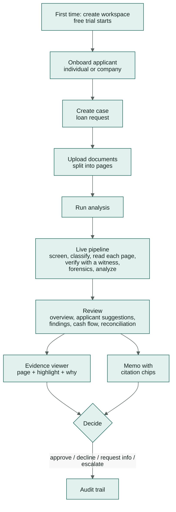

# 03 — Product Requirements (PRD)

> **Product:** Kredibel · **Version:** 1.0 (competition prototype) · **Status:** Draft for review

---

## 1. Problem

SME lenders across Southeast Asia (bank SME units, rural banks, multifinance companies and P2P
lending platforms) underwrite small businesses mostly from **documents the borrower supplies**: bank
statements, sales invoices and sometimes tax invoices. The work today is:

1. **Slow.** Analysts re-type or "spread" months of transactions into spreadsheets before any analysis
   starts.
2. **Easy to fool.** Edited PDFs, template-generated statements and invented invoices are cheap to make
   and hard to spot by eye. Bank statements are the document type fraud leaders consider the most
   vulnerable ([`02`](02-research.md) §3).
3. **Hard to audit.** Credit memos summarize numbers whose origin nobody can trace a month later.

**Cost of the status quo:** days per application, inconsistent decisions between analysts, and
losses from applications that should never have been approved.

## 2. Vision

> Every SME credit decision is made on **verified** numbers, and every number can be **traced** to the
> page it came from.

## 3. Users

| Persona | Goal | Pain today | What Kredibel gives them |
|---|---|---|---|
| **Rina, Credit Analyst** (primary) | Assess 5–10 SME applications a week accurately | Manual spreading; can't tell a good fake from a real statement | Minutes from upload to an evidence-backed recommendation; a viewer that shows *why* |
| **Budi, Risk Lead** (secondary) | Consistent decisions; catch fraud early; defend decisions to auditors | Inconsistent memos; overrides without rationale | Transparent policy; overrides gated by role and reason; complete audit trail |
| **Workspace admin** (often Budi) | Set up the lender's workspace and team; know what the plan allows | Tools that hide limits until they bite | One-screen onboarding, a free trial, visible usage and limits, a short settings page |
| **Sari, SME owner** (indirect) | Get a fair, fast answer | Long waits, repeated requests for documents | Faster decisions; a precise "information request" instead of vague follow-ups (P1) |

Sari does not use Kredibel in the prototype. The analyst onboards her business as an **applicant**
(individual or company) and uploads her documents; Kredibel suggests the profile details it finds in
them (accounts, tax ID, address, clients and partners) for the analyst to accept.

## 4. Jobs to be done

- **J1.** *When* an application arrives with statements and invoices, *I want* every transaction and
  invoice extracted and checked automatically, *so I can* start from analysis, not data entry.
- **J2.** *When* a document has been manipulated, *I want* to be told where and how, with evidence I
  can show my risk lead, *so I* don't approve a fraud or wrongly accuse an honest borrower.
- **J3.** *When* a borrower claims revenue, *I want* to see how much of it actually reached the bank,
  *so I can* size the loan on real cash flow.
- **J4.** *When* I write the memo, *I want* a draft where every figure is linked to its source, *so I
  can* review and sign it quickly.
- **J5.** *When* I decide, *I want* the system to stop me from approving over unresolved critical
  issues and to record my reasoning, *so* our decisions are defensible.
- **J6.** *When* I onboard an applicant, *I want* to enter only what I have and have the rest found in
  the documents with proof, *so* onboarding takes minutes and the profile is checked, not typed.
- **J7.** *When* my team evaluates Kredibel, *I want* to sign up and try it for free with clear limits,
  *so* we can judge it on our own cases without a sales call.

## 5. Core user journey (the demo path)

## 6. Scope and priorities

**P0** must work end-to-end on Cloud Run before any **P1** starts (constitution P9). **P2** is
documented for the "what's next" story only.

### 6.1 P0 — Must (the demo)

| ID | Capability |
|---|---|
| P0-01 | Sign in (Firebase Auth, email/password + Google) with org and role from custom claims |
| P0-02 | Onboard an applicant (individual or company, optional bank accounts and related parties) and create a case with a loan request (amount, tenor, purpose) |
| P0-03 | Upload PDF/PNG/JPEG documents within the plan's limits (free trial: ≤ 20 MB, ≤ 20 pages each, ≤ 20 per case), stored in Cloud Storage and **split into pages** with text-layer triage |
| P0-04 | Start an analysis run; asynchronous processing via Cloud Tasks; live progress in the UI |
| P0-05 | Document classification (bank statement, sales invoice, purchase invoice, other) with Gemini |
| P0-06 | **Adaptive reading**: Gemini reads each page image; the PDF text layer (free) or Document AI OCR (scans) is the independent witness; a verifier gives every value a status and a box ([ADR-010](adr/ADR-010-adaptive-extraction-ai-reader-and-witness.md)) |
| P0-07 | Deterministic forensics: running balance, opening/closing, invoice arithmetic, PDF metadata and revisions, font anomalies, statement continuity, account-holder match |
| P0-08 | Transaction categorization: rules first, Gemini for the rest, IAS 7 classes plus risk tags |
| P0-09 | Cash-flow metrics: monthly flows, average daily balance, negative days, existing debt service, DSCR proxy, maximum supportable installment |
| P0-10 | Invoice ↔ bank reconciliation and revenue verification ratio |
| P0-11 | Policy-as-config scorecard: score, grade, hard stops, recommendation |
| P0-12 | Credit memo drafted by Gemini, checked by the grounding guard, rendered with citation chips |
| P0-13 | Case workspace: overview, documents, findings, cash flow, reconciliation, memo |
| P0-14 | Evidence viewer: PDF page with highlighted regions and the facts behind a finding |
| P0-15 | Decision with rules: no approval over open critical findings; overrides need reason and role; audit trail |
| P0-16 | Synthetic data generator with scenarios S1–S3 and ground truth |
| P0-17 | Deployed on Cloud Run (web + worker), Firestore, Cloud Storage, Cloud Tasks |
| P0-18 | Self-serve workspace onboarding; **Free trial** plan with server-side limits; other tiers listed as **coming soon** |
| P0-19 | Settings: workspace profile, language (English only, others coming soon), plan & usage |
| P0-20 | Counterparty directory per case: clients, suppliers, lenders, own accounts, related parties |
| P0-21 | AI profile suggestions with evidence (bank accounts, tax ID, address, name aliases), accepted or rejected by the analyst; undeclared-account check |

### 6.2 P1 — Should (if P0 is green by day 5)

| ID | Capability |
|---|---|
| P1-01 | Model Armor screening of every uploaded document; quarantine from models on a match (scenario S6) |
| P1-02 | Visual forensics: Gemini examines rendered pages for signs of editing, under the corroboration rule |
| P1-03 | Revision recovery: show the value from the PDF's earlier revision next to the current value |
| P1-04 | Case assistant: ask questions about the case; answers cite evidence (ADK agent with read-only tools, Agent Platform Sessions) |
| P1-05 | Remaining forensic and behavioural checks (window dressing, round-tripping, concentration, etc.) |
| P1-06 | Pipeline timeline ("agent trace") view per run |
| P1-07 | Analyst edits memo; the grounding guard re-runs on save |
| P1-08 | Scenario evals with a results table in the README (S1–S6) |
| P1-09 | Information-request letter drafted for the borrower listing missing or doubtful documents |
| P1-10 | Analyst re-categorizes a transaction; metrics marked stale; re-run analysis |
| P1-11 | Workspace members: invite by email with a role, remove, seat limit |
| P1-12 | Credit-policy overrides: four bounded values per workspace |
| P1-13 | Related parties: suggestions, related-party flows (`B07`), invoice tax-ID check (`X07`), key client/supplier suggestions |
| P1-14 | Pre-fill applicant suggestions at upload time from the cached page-1 reading |
| P1-15 | Applicant directory page |
| P1-16 | "Split and upload" for PDFs longer than the plan's page limit |
| P1-17 | Escalation of low-agreement pages to Document AI parsers; `thorough` extraction mode for evals |

### 6.3 P2 — Could (roadmap slide only)

Borrower upload portal · receipts via Expense Parser · VAT e-invoice QR validation ·
cross-lender duplicate-invoice registry · BigQuery portfolio analytics · in-region processing for
data residency · memo export to PDF · more UI languages (Indonesian first; the language picker already
lists them as coming soon) · paid plans and billing (e.g. Google Cloud Marketplace) · signed-URL
uploads for large files · Agent Platform Evals for memo quality.

### 6.4 Explicitly out of scope

General ledger and double-entry accounting · full IFRS balance sheet and P&L · credit bureau,
e-KYC/KYB registry or bank API integrations · identity-document verification · payments, billing or
disbursement · ML model training · real customer data.

## 7. Functional requirements

Requirement IDs are stable and referenced by specs, tests and the traceability matrix
([`04`](04-requirements-traceability.md)).

### 7.1 Access & cases

- **FR-001** Users authenticate with Firebase Auth; the API rejects requests without a valid ID token.
- **FR-002** Every user belongs to exactly one organization, shown as the **workspace** (`orgId` custom
  claim), and has one role: `analyst`, `risk_lead` or `admin` (admin also manages settings, members
  and the plan).
- **FR-003** A user can only read or change cases of their own organization.
- **FR-004** An analyst can create a case for an existing or newly onboarded applicant, with requested
  amount (IDR), tenor (months) and purpose.
- **FR-005** Cases list shows reference, applicant, amount, status, grade and open finding counts,
  newest first, filterable by status and applicant.

### 7.2 Documents

- **FR-010** In status `DRAFT` or `INFO_REQUESTED`, a user can upload documents: PDF, PNG or JPEG
  (detected by content, not file name), within the plan's size, page and count limits (free trial:
  20 MB, 20 pages, 20 per case).
- **FR-011** An identical file (same SHA-256) uploaded twice to the same case is rejected with
  `DUPLICATE_DOCUMENT`.
- **FR-012** A user can remove a document while the case is `DRAFT`.
- **FR-013** A user can view any document page of their case in the browser.
- **FR-014** Each upload is split into pages; each page is rendered and triaged (usable text layer,
  none or unusable, blank), and the document shows whether it is digital or scanned.

### 7.3 Analysis pipeline

- **FR-020** Starting analysis requires ≥1 document and no run in progress; it returns immediately and
  processes asynchronously.
- **FR-021** Progress (stage, percent, message) is visible live, per case and per document.
- **FR-022** Each document is classified as `BANK_STATEMENT`, `SALES_INVOICE`, `PURCHASE_INVOICE`,
  `TAX_INVOICE`, `RECEIPT`, `OTHER` with a confidence; `OTHER` documents are kept but not analyzed.
- **FR-023** Every page of a bank statement or invoice is read by Gemini from the page image **and**
  checked against an independent witness (the PDF text layer, or Document AI OCR for scanned pages);
  each value stores its status (`AGREED`, `CONFLICT`, `SINGLE_SOURCE`), the raw strings of both
  readings, the agreement score and provenance (page, bounding box). Printed values the AI missed
  become witness-only rows.
- **FR-024** Documents whose extraction agreement is below the policy threshold get verdict
  `UNVERIFIABLE` and an `E01` finding.
- **FR-025** Forensic checks run per document and across documents, producing findings with code,
  severity, explanation and evidence ([`08`](08-risk-engine.md) §2).
- **FR-026** Each document gets an integrity verdict: `CLEAN`, `SUSPICIOUS`, `TAMPERED` or
  `UNVERIFIABLE`, following the corroboration rule.
- **FR-027** Transactions are categorized into IAS 7 classes, categories and risk tags; rules run before
  the model; the method and confidence are stored.
- **FR-028** Cash-flow metrics are computed per month and in aggregate ([`08`](08-risk-engine.md) §4).
- **FR-029** Sales invoices are matched to bank credits; unmatched and partially matched invoices are
  listed; the revenue verification ratio is computed.
- **FR-030** The scorecard produces score (0–100), grade (A–E), hard stops and a recommendation
  (`APPROVE`, `APPROVE_WITH_CONDITIONS`, `REFER`, `DECLINE`) from a versioned policy file.
- **FR-031** A memo is drafted with sections: summary, business & request, cash-flow analysis,
  document integrity, revenue verification, risks & mitigants, recommendation. Every figure carries a
  citation.
- **FR-032** The grounding guard verifies every number and citation in the memo; on failure it asks for
  one redraft (max 2 attempts) and otherwise marks the memo `UNVERIFIED` with the offending figures.
- **FR-033** A failed node does not fail the run silently: the run records the error, the case goes to
  `FAILED` with a message, and the analyst can retry.

### 7.4 Review & decision

- **FR-040** The case workspace shows overview, documents, findings, cash flow, reconciliation, memo and
  activity.
- **FR-041** Selecting a finding opens the evidence viewer at the right page with highlighted regions and
  the expected vs found values.
- **FR-042** An analyst can acknowledge a finding, or dismiss it with a mandatory reason.
- **FR-043** Decision outcomes: `APPROVE`, `DECLINE`, `REQUEST_INFO`, `ESCALATE`.
- **FR-044** `APPROVE` is blocked while any `CRITICAL` finding is `OPEN`.
- **FR-045** Deciding against a `DECLINE` recommendation or a hard stop requires role `risk_lead` (or `admin`) and a
  reason; an analyst can only `ESCALATE`.
- **FR-046** Every state change, decision, dismissal and run is appended to the case's audit events.

### 7.5 P1 requirements

- **FR-050** Uploaded documents are screened by Model Armor; on a prompt-injection match the document is
  flagged `S01` (critical) and excluded from every model call.
- **FR-051** Visual forensics findings from the model are capped at `MEDIUM` unless corroborated by a
  deterministic finding on the same region or row.
- **FR-052** When a PDF has more than one revision, the text of the earliest revision is diffed against
  the final one and changed values are shown.
- **FR-053** The case assistant answers questions using only read-only case tools and cites evidence.
- **FR-054** The analyst can edit memo sections; saving re-runs the grounding guard.
- **FR-055** The run timeline lists every pipeline stage with duration, model used and outcome.

### 7.6 Workspace & plans ([spec 013](specs/013-workspace-and-plans/spec.md))

- **FR-060** A signed-in user without a workspace can create one; they become its `admin` and the
  workspace starts on the free trial.
- **FR-061** Self-serve sign-up can be `open`, `invite_only` or `closed`, and is capped by
  `MAX_WORKSPACES`.
- **FR-062** Plans are defined in a versioned config file; only `AVAILABLE` plans can be assigned;
  `COMING_SOON` plans are listed and cannot be selected or bought.
- **FR-063** Plan limits (cases per month, documents per case, pages per document, file size, extracted
  pages per month, runs per day, AI spend per month, seats) are enforced by the server
  (`PLAN_LIMIT_REACHED`).
- **FR-064** After the trial ends, new cases, uploads and runs are blocked (`TRIAL_EXPIRED`); reading,
  reviewing and deciding still work.
- **FR-065** Every user can see the plan, the trial days left and the workspace's usage.
- **FR-066** Admins edit the workspace name, time zone and default language; only available languages
  (English today) can be selected; others are shown as coming soon.
- **FR-067** (P1) Admins invite members by email with a role and remove members, within the seat limit.
- **FR-068** (P1) Admins or risk leads set bounded credit-policy overrides; each run records the hash of
  the effective policy.

### 7.7 Applicants & profile intelligence ([spec 003](specs/003-case-intake/spec.md), [spec 014](specs/014-applicant-profile-intelligence/spec.md))

- **FR-070** An applicant is onboarded as `INDIVIDUAL` or `COMPANY` with type-specific required fields;
  address, contact, bank accounts and related parties are optional.
- **FR-071** Bank account numbers are stored masked plus a server-only hash; full numbers are never
  returned or logged. Only the last 4 digits of any ID number are collected.
- **FR-072** Company applicants can record related parties (beneficial owners, directors,
  shareholders, guarantors, signatories) with ownership percentages.
- **FR-073** A case belongs to one applicant and keeps an applicant snapshot that freezes once the case
  leaves `DRAFT`/`INFO_REQUESTED`.
- **FR-074** Every applicant change is written to the applicant's audit events.
- **FR-075** After a run, counterparties are derived with roles (client, supplier, lender, own account,
  related party, government, other) and totals, with transactions as evidence.
- **FR-076** After a run, profile suggestions (bank account, tax ID, address, name alias; P1: related
  party, key client/supplier) are generated with evidence and confidence.
- **FR-077** A suggestion changes the profile only when an analyst accepts it; rejected values are not
  suggested again.
- **FR-078** The holder check uses the applicant's names, aliases and declared holders; statement
  accounts that are not declared are flagged (`X06`).
- **FR-079** (P1) Sales-invoice tax IDs are checked against the profile (`X07`).
- **FR-080** (P1) Inflows from related parties are not counted as sales and are flagged above a
  threshold (`B07`).
- **FR-081** (P1) Header-based suggestions can be produced at upload time from the cached page-1
  reading, at no extra reading cost for the later run.

## 8. Non-functional requirements

| ID | Requirement | Target |
|---|---|---|
| NFR-01 | End-to-end analysis time, scenario S1 (6 statements + 10 invoices) | ≤ 3 minutes p50 |
| NFR-02 | UI progress latency (pipeline event → visible) | ≤ 2 seconds |
| NFR-03 | API latency for reads | ≤ 500 ms p95 |
| NFR-04 | Forensic detection on scenario set | All seeded tamper cases detected; 0 `TAMPERED` verdicts on clean documents |
| NFR-05 | Memo grounding | 100% of published memo figures trace to facts, or the memo is marked `UNVERIFIED` |
| NFR-06 | Security | Org isolation enforced in API **and** Firestore rules; no secrets in images or repo |
| NFR-07 | Cost per case (S1) | ≤ USD 0.50 per new case (adaptive reading) and ≤ USD 0.01 per page read; ≤ USD 0.25 per re-run of identical documents; measured and reported ([`21`](21-cost-analysis.md)) |
| NFR-08 | Accessibility | WCAG 2.1 AA for colour contrast; severity never conveyed by colour alone |
| NFR-09 | Reliability | Pipeline is idempotent per run; a Cloud Tasks retry never duplicates findings |
| NFR-10 | Observability | Every log line carries `caseId`, `runId`, `node`; traces exported to Cloud Trace |
| NFR-11 | Language | English UI; every user-visible string externalized (i18next resources); no hard-coded strings; adding a language needs no code change |
| NFR-12 | Personal data minimization | No full national ID numbers; account numbers masked in all readable data and never logged; applicant data workspace-scoped ([`14`](14-security-and-compliance.md) §6) |

## 9. Success metrics

**For the competition:** a judge can understand the problem in 20 seconds and watch tampering being
caught within the first 90 seconds of the video.

**For the product (pilot hypothesis):**

| Metric | Baseline (manual, to be validated with lenders) | Target |
|---|---|---|
| Time from documents to memo draft | 1–3 days | < 10 minutes |
| Share of manipulated statements caught before decision | Unknown | > 90% on known techniques |
| Decisions with a complete evidence trail | Low | 100% |

## 10. Assumptions & open questions

| # | Assumption / question | Owner | Status |
|---|---|---|---|
| A1 | Analysts are willing to upload on behalf of borrowers in a pilot | Product | Assumed |
| A2 | Six months of statements is the standard requirement | Product | Assumed (configurable) |
| A3 | Loan installment uses an annuity at the policy's assumed rate unless the analyst overrides it | Risk | Assumed |
| Q1 | Do we show the original-revision value (P1-03) in the main demo? | Team | Open |
| Q2 | Indonesian-language UI option for the finale? | Team | Decided: English only; Indonesian shown as "coming soon" (P2) |
| Q3 | Which paid tiers and prices? | Team | Open: tiers listed as "coming soon" without prices |
