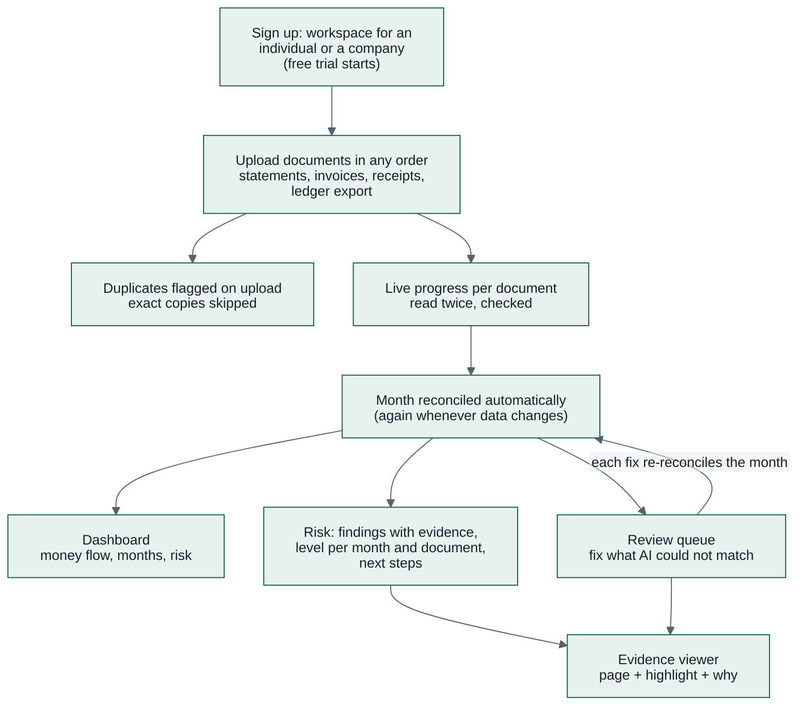

# 03 — Product Requirements (PRD)

> **Product:** Kredibel · **Version:** 2.0 (competition prototype, scope of
> [ADR-015](adr/ADR-015-scope-finance-workspace-not-loan-review.md)) · **Status:** Draft for review

---

## 1. Problem

Small businesses and the accountants who serve them close every month by hand: invoices, receipts and
ledger entries arrive during the month, the bank statement arrives at the end, and someone ticks
hundreds of bank lines against everything else in a spreadsheet. The work is:

1. **Slow.** One to three days a month for a business with a few hundred bank lines.
2. **Error-prone.** The same statement, invoice or receipt is entered twice; totals are inflated and
   suppliers get paid twice.
3. **Easy to fool.** An edited PDF statement or a fake supplier invoice looks like the real thing, and
   a supplier's "new bank account" is a classic way to divert payments.
4. **Hard to trust when automated.** AI extraction is never 100% right; if users cannot see where a
   number came from, they re-check everything and the automation saves nothing.

## 2. Vision

> Every number in a small business's books is **checked** before it is counted, and every number can
> be **traced** to the page it came from.

## 3. Users

| Persona | Goal | Pain today | What Kredibel gives them |
|---|---|---|---|
| **Maya, owner of a small business** (primary, the hackathon user) | Close the month quickly and know nothing is wrong | Spreadsheet matching; duplicates; no idea if a document was edited | Upload everything; most of the month matched automatically; a short review list; a risk level with reasons |
| **Rafi, accountant or bookkeeper** (P1 role) | Keep several clients' books current | Clients send documents twice, late or edited | Duplicates caught on upload; exceptions in one queue; evidence for every fix |
| **Dewi, reviewer or controller** (P1 role) | Approve the month; catch fraud early | Problems found after payments went out | Risk per month and document, payment-diversion warnings, an audit trail |

A workspace is one business or one person (individual or company). In the hackathon build each
workspace has one owner who does everything; team roles are P1 (§6.2).

## 4. Jobs to be done

- **J1.** *When* I receive a document, *I want* to drop it in without caring about order, *so* the
  books stay current without a process to follow.
- **J2.** *When* a document is a copy of one I already have, *I want* to be told before it is counted,
  *so* nothing is counted or paid twice.
- **J3.** *When* the bank statement arrives, *I want* most lines matched to invoices, receipts and
  ledger entries automatically, with the reason for each match, *so* I only look at the exceptions.
- **J4.** *When* something cannot be matched or read with confidence, *I want* to fix it in one place
  with the page in front of me, *so* the month closes cleanly.
- **J5.** *When* a document has been edited or a payment looks diverted, *I want* to know where and
  what to do next, *so* I can stop a loss early.
- **J6.** *When* I open Kredibel, *I want* a dashboard that shows where the money came from and went
  and which months need attention, *so* I understand my business in a minute.
- **J7.** *When* I set up, *I want* to enter only what I know and have the rest suggested from my
  documents with proof, *so* my profile is checked, not typed.
- **J8.** *When* I evaluate Kredibel, *I want* a free trial with visible limits, *so* I can try it
  without a sales call.

## 5. Core user journey (the demo path)

## 6. Scope and priorities

**P0** must work end-to-end on Cloud Run before any **P1** starts (constitution P9). **Coming soon**
items are visible in the UI and not built.

### 6.1 P0 — Must (the demo)

| ID | Capability |
|---|---|
| P0-01 | Sign in (Firebase Auth, email/password + Google); self-serve workspace for an **individual or a company**; **free trial** with server-side limits; other plans **coming soon** |
| P0-02 | Upload PDF, PNG, JPEG (statements, invoices, receipts) and CSV/XLSX (ledger exports) within plan limits; stored in Cloud Storage; PDFs **split into pages** with text-layer triage |
| P0-03 | **Duplicate detection:** exact file copies on upload (not read, not counted); content duplicates after reading (same account and statement period, same issuer and invoice number, same merchant, date and total, same ledger reference and amount, near-identical images) held for confirmation |
| P0-04 | Classification (statement, sales invoice, purchase invoice, receipt, ledger export, other) with Gemini |
| P0-05 | **Adaptive reading** of statements, invoices and receipts: Gemini reads each page image; the PDF text layer or Document AI OCR is the witness; a verifier agrees every value ([ADR-010](adr/ADR-010-adaptive-extraction-ai-reader-and-witness.md)) |
| P0-06 | **Ledger import:** CSV/XLSX parsed by code; Gemini proposes the column mapping from the header and sample rows; the user confirms it once per file layout |
| P0-07 | **Document integrity forensics:** running balance, opening/closing, invoice arithmetic, PDF metadata and revisions, font anomalies, statement continuity across months, account holder |
| P0-08 | Transaction categorization: rules first, Gemini for the rest; cash-flow classes (IAS 7) and risk tags |
| P0-09 | **Month reconciliation, any upload order:** bank lines ↔ invoices, receipts and ledger cash entries; exact, split and net-of-tax matches; incremental re-run when a month's data changes; every match has reasons |
| P0-10 | **Review queue:** unmatched bank lines, unpaid or unmatched documents, low-confidence values, possible duplicates, ledger-bank differences; fix by manual match, value correction on the page, duplicate confirmation, or ignore with a reason; audited |
| P0-11 | **Fraud risk:** findings with severity and evidence → risk level per document and per month from `risk.v1.yaml`; Gemini explains and recommends next steps, citing findings only |
| P0-12 | **Dashboard:** money in, money out, net, auto-match rate, review count; money-flow **Sankey**; month strip with status and risk; top alerts |
| P0-13 | Evidence viewer: page with the value highlighted, both readings, the calculation behind a finding |
| P0-14 | Profile and counterparties: entity profile and bank accounts; suggestions from documents (accounts, tax ID, address) accepted or rejected by the user; clients and suppliers derived from the books |
| P0-15 | Settings: profile, bank accounts, language (English; others coming soon), plan and usage |
| P0-16 | Synthetic data generator with scenarios S1–S5 and ground truth |
| P0-17 | Deployed on Cloud Run (web + worker), Firestore, Cloud Storage, Cloud Tasks |

### 6.2 P1 — Should (if P0 is green by day 5)

| ID | Capability |
|---|---|
| P1-01 | **Finance Assistant:** ask about your books; read-only tools for numbers, retrieval over document text and Kredibel's policy and help, Agent Platform Sessions and Memory Bank ([ADR-014](adr/ADR-014-finance-assistant-tools-rag-memory.md)) |
| P1-02 | **Team roles (ACL):** owner, accountant (uploads, matches), reviewer (resolves, dismisses, signs off), viewer; invite by email; seat limit |
| P1-03 | Model Armor screening of uploads; quarantine from models on a match (scenario S6) |
| P1-04 | Visual forensics under the corroboration rule |
| P1-05 | Month sign-off: a reviewer locks a reconciled month; later uploads for it need a reopen with a reason |
| P1-06 | Run graph: each workflow run as a graph of its nodes with status, duration, model and tokens (from ADK traces) |
| P1-07 | Exports: reconciliation and review log as CSV |
| P1-08 | Escalation of low-agreement pages to Document AI parsers; `thorough` mode for evals |
| P1-09 | "Split and upload" for PDFs longer than the plan's page limit |
| P1-10 | More anomaly checks: round-tripping, weekend or out-of-hours invoices, sequence gaps in invoice numbers |
| P1-11 | **Labels:** every document type, page type and category as a label with its confidence; a Labels page to confirm or correct them with the page's extraction; verified labels used as examples and measured in evals; IFRS or US GAAP per workspace ([ADR-016](adr/ADR-016-human-verified-labels-and-learning-loop.md)) |
| P1-12 | **Run history:** every model and tool call in BigQuery (ADK plugin), a Runs page with the waterfall, tokens, cost and the labels each call produced ([ADR-017](adr/ADR-017-agent-observability-on-google-cloud.md)) |

### 6.3 Coming soon and later (not built)

**Loan readiness report** (shown as coming soon) · tuning Gemini on consented, verified labels
([ADR-016](adr/ADR-016-human-verified-labels-and-learning-loop.md)) · bank feeds · e-invoice (QR) validation ·
currency conversion and documents in a second currency · accounting-tool connectors · more UI languages · paid plans and billing.

### 6.4 Explicitly out of scope

Editing the general ledger or posting journal entries · payments · tax filing · consolidation of
several entities · real customer data (P8).

## 7. Functional requirements

### 7.1 Access, workspace and plans

- **FR-001** Users sign in with Firebase Auth; the API verifies the ID token on every request.
- **FR-002** Every record belongs to one workspace; a user sees only their workspace's data (API and
  Firestore rules).
- **FR-003** A signed-in user without a workspace creates one: name, entity type (`INDIVIDUAL` or
  `COMPANY`), country (Indonesia; others coming soon), time zone; the free trial starts.
- **FR-004** Plan limits from `contracts/plans.v1.yaml` are enforced by the server (documents and pages
  per month, file size, pages per file, seats, AI spend); the UI shows usage before a limit is hit.
- **FR-005** Paid plans and the loan readiness report are listed as coming soon and cannot be selected.

### 7.2 Documents and duplicates

- **FR-010** Upload accepts PDF, PNG, JPEG, CSV and XLSX within the plan's limits; the original is
  stored unchanged; PDFs are split into page images.
- **FR-011** A file whose SHA-256 equals one already in the workspace is recorded as an **exact
  duplicate** of it, is not read and does not count against page limits.
- **FR-012** After reading, a document whose content key matches an existing document (statement:
  account + overlapping period; invoice: issuer + number, or issuer + date + total; receipt: merchant +
  date + total, or a perceptual image hash within threshold; ledger entry: date + amount + reference)
  is a **possible duplicate**: its values are excluded from totals and matching until the user confirms
  or rejects it in the review queue.
- **FR-013** The library lists documents with type, period, status, reading method, integrity verdict,
  risk level and duplicate state, with filters by type, month and status.

### 7.3 Reading and checking

- **FR-020** Each document is classified; low confidence asks the user to confirm the type.
- **FR-021** Statements, invoices and receipts are read by the AI reader and a witness per page; the
  verifier gives every value a status (`AGREED`, `CONFLICT`, `SINGLE_SOURCE`, `MISSING`) and a box.
- **FR-022** A ledger export is parsed by code with a confirmed column mapping; Gemini only proposes
  the mapping.
- **FR-023** Document integrity checks of [`08`](08-risk-engine.md) §2 run per document and produce
  findings with evidence and a verdict (`CLEAN`, `SUSPICIOUS`, `TAMPERED`, `UNVERIFIABLE`).
- **FR-024** Bank lines are categorized (rules, then Gemini) into cash-flow classes and risk tags.

### 7.4 Reconciliation and review

- **FR-030** Each calendar month is reconciled whenever its data changes; the result does not depend
  on the order of uploads.
- **FR-031** Matching is deterministic and explainable: each match records its method and reasons;
  only unique, high-scoring candidates are confirmed automatically.
- **FR-032** Supported matches: one bank line to one document; one to many (split payments, several
  invoices paid at once); net of withholding tax; bank line to ledger cash entry; document to ledger
  entry.
- **FR-033** Ambiguous matches, unpaid documents whose payment windows are covered, ledger-bank
  differences, low-confidence values and possible duplicates become **review items**. Missing bank
  support alone is informational; documents without covering statements wait (ADR-025).
- **FR-034** A review item is resolved by a manual match, a value correction, a duplicate decision or
  "ignore" with a reason; the resolution is audited and the month re-reconciles.
- **FR-035** A month's summary shows money in and out, opening and closing balance, auto-match rate,
  open review items and risk level.
- **FR-036** Bank cash totals use statement transactions once, independently of document support.
  Show bank evidence, support, processing and integrity separately. One statement's presence never
  proves month reconciliation; account/date coverage and actual computed results are required.
- **FR-037** A person can separately approve a document or confirm payment without a bank match,
  with an audited reason; payment confirmation includes amount, currency, date and method. It never
  invents bank cash or bank evidence. Later statement matching preserves history without counting
  payment twice; partial payments remain partial.
- **FR-038** A workspace uses the fixed currency selected at onboarding, with no FX conversion.
  A different or missing printed currency requires agreement to use the unchanged numbers as the
  workspace currency; preserve the printed currency and decision. Exclude pending documents from
  totals/matching. All tolerances use the workspace currency.

### 7.5 Fraud risk

- **FR-040** Cross-document checks of [`08`](08-risk-engine.md) §2.4 run per month (statement
  continuity, unpaid invoices, payment to a changed supplier account, ledger-bank mismatch).
- **FR-041** A risk level (`LOW`, `MEDIUM`, `HIGH`, `CRITICAL`) per document and per month is computed
  from findings by `risk.v1.yaml`; any `TAMPERED` document makes its month `CRITICAL`.
- **FR-042** Gemini writes a short explanation and recommended next steps per month and per critical
  or high finding; every number it uses must exist as a fact or finding (grounding guard), else the
  template text is shown.
- **FR-043** A finding can be acknowledged or dismissed; dismissing a critical finding requires a
  reason; both are audited.

### 7.6 Dashboard and insight

- **FR-050** The dashboard shows, for a selected period (month, quarter, all): money in, money out,
  net, auto-match rate, open review items, and the risk level of each month.
- **FR-051** A money-flow Sankey groups the money the way a cash-flow statement does under the
  workspace's accounting framework (IFRS by default, or US GAAP): revenue by client and other money in
  → bank accounts → activity (operating, investing, financing, kept) → statement line (cost of sales,
  payroll, rent, taxes, finance costs, loan repayments, owner drawings). Other views show the same
  numbers as bars, as a table, and grouped by client and supplier; each band opens the matching
  transactions.
- **FR-052** The month strip shows each month's statement presence, reconciliation state and risk.
- **FR-053** The dashboard shows money in and out by month (with net and month-end balance) and the
  cash-flow statement from opening to closing balance by activity; every chart takes the full content
  width, one per row.

### 7.7 Profile and counterparties

- **FR-060** The profile holds entity type, names, tax ID, address and bank accounts (masked).
- **FR-061** Kredibel suggests bank accounts, tax ID and address from the documents with evidence;
  nothing changes until the user accepts.
- **FR-062** Clients and suppliers are derived from the books with totals per month; a payment to an
  account not seen before for that supplier is flagged ([`08`](08-risk-engine.md) `X08`).

### 7.8 P1 requirements

- **FR-070** The Finance Assistant answers with read-only tools and retrieval, cites its sources, never
  changes data, and remembers user preferences in Memory Bank scoped to the workspace and user.
- **FR-071** Roles restrict actions: accountants upload and match; reviewers resolve, dismiss and sign
  off; viewers read.
- **FR-072** Uploaded documents are screened by Model Armor; on a prompt-injection match the document
  is quarantined from every model call (`S01`).
- **FR-073** The run graph shows every node of a workflow run with status, duration, model and tokens.
- **FR-074** Every classification and categorization is stored as a label with its confidence; a person
  can confirm or correct it, and a model never overwrites a person's label.
- **FR-075** Each category's cash-flow class follows the workspace's accounting framework (IFRS or US
  GAAP), from `contracts/policy/categories.v1.yaml`.
- **FR-076** Every model and tool call of a run is recorded in BigQuery with its span, tokens and
  latency and joined to people's feedback; prompts and responses are recorded only with synthetic data.

## 8. Non-functional requirements

| ID | Requirement | Target |
|---|---|---|
| NFR-01 | Time from upload to read and checked | ≤ 60 s p50 for a 3-page statement; month reconciliation ≤ 20 s p50 for S1 |
| NFR-02 | UI progress latency (pipeline event → visible) | ≤ 2 seconds |
| NFR-03 | API latency for reads | ≤ 500 ms p95 |
| NFR-04 | Detection on the scenario set | All seeded tamper techniques and duplicates detected; 0 `TAMPERED` verdicts on clean documents |
| NFR-05 | Automation | ≥ 85% of bank lines matched automatically on S1; **0 wrong automatic matches**; the rest in the review queue |
| NFR-06 | Security | Workspace isolation enforced in API **and** Firestore rules; no secrets in images or repo |
| NFR-07 | Cost | ≤ USD 0.01 per page read; ≤ USD 0.40 for S1's statements and invoices; exact duplicates cost nothing; measured and reported ([`21`](21-cost-analysis.md)) |
| NFR-08 | Accessibility | WCAG 2.1 AA for colour contrast; severity never conveyed by colour alone |
| NFR-09 | Reliability | Workflows idempotent; retries and re-uploads never duplicate records; month results independent of upload order |
| NFR-10 | Observability | Every log line carries `orgId`, `runId`, `node`; ADK traces exported to Cloud Trace |
| NFR-11 | Language | English UI; every string externalized; adding a language needs no code change |
| NFR-12 | Personal data minimization | Account and ID numbers masked in readable data and never logged; data workspace-scoped ([`14`](14-security-and-compliance.md) §6) |
| NFR-13 | Responsive and touch-friendly | Every screen usable from 360 to 1600 px wide with no horizontal page scroll; touch targets ≥ 44 px; review and evidence work on a phone ([`12`](12-design-system.md) §5) |
| NFR-14 | UI quality gates | Visual regression at 390/834/1440 px, axe with no serious or critical violations, Lighthouse (mobile) performance ≥ 85 and accessibility ≥ 95 on the dashboard and the review queue; design values only from tokens ([`15`](15-testing-and-evaluation.md) §2.6) |
| NFR-15 | Safe data evolution | Every document versioned; expand/migrate/contract without downtime; migrations idempotent, resumable and recorded; PITR and daily backups on ([`22`](22-data-migrations.md)) |

## 9. Success metrics

**For the competition:** a judge understands the problem in 20 seconds, sees a duplicate and an
edited statement caught in the first 90 seconds, and sees a month close with most lines matched.

**For the product (pilot hypothesis):**

| Metric | Baseline (manual, to be validated) | Target |
|---|---|---|
| Time to reconcile a month (300 bank lines) | 1–3 days | < 1 hour including review |
| Bank lines matched automatically | 0% | 80–85% |
| Duplicates counted in the books | Unknown | 0 |
| Edited documents caught before month close | Rare | > 90% on known techniques |

## 10. Assumptions & open questions

| # | Assumption / question | Owner | Status |
|---|---|---|---|
| A1 | One currency per workspace, chosen at onboarding from IDR, MYR, SGD, JPY, USD; fixed afterwards ([ADR-020](adr/ADR-020-workspace-currency-chosen-at-onboarding.md)) | Product | Decided |
| A2 | Months are calendar months in the workspace's time zone | Product | Assumed |
| A3 | Ledger exports have one row per entry with date, amount (or debit/credit), description and a reference | Product | Assumed; mapping confirmed by the user |
| A4 | Receipts paid in cash have no bank line; they are matched to ledger entries only | Product | Assumed |
| Q1 | Should a month auto-close after its statement is reconciled with no open review items? | Team | Open (P1 sign-off is manual) |
| Q2 | Indonesian UI for the finale? | Team | Decided: English only; others coming soon |
| Q3 | Paid tiers and prices | Team | Open: listed as coming soon without prices |
