# 05 — Architecture

> How Kredibel is put together on Google Cloud. Agent internals are in [`06`](06-agent-design.md);
> document handling in [`07`](07-document-intelligence.md); checks, reconciliation and risk in
> [`08`](08-risk-engine.md); data in [`09`](09-data-model.md).

---

## 1. Architectural drivers

| Driver | Consequence |
|---|---|
| Documents arrive one by one, in any order, all month | Each upload is processed on its own; each **month** is re-reconciled from all its data whenever it changes (pure function, order-independent) |
| Reading takes seconds to minutes, users expect live feedback | Asynchronous work (Cloud Tasks → worker); progress pushed through Firestore listeners, not long HTTP requests |
| Documents can be edited or sent twice; models must not decide | Deterministic duplicate checks, forensics, matching and risk levels; LLM calls behind schemas; read-only assistant tools ([ADR-005](adr/ADR-005-deterministic-scoring-llm-explains.md)) |
| AI cannot match everything | Exceptions become review items a person resolves; every fix is audited and re-reconciles the month |
| Every number must be traceable | Provenance on every read value; findings and matches carry evidence and reasons ([`07`](07-document-intelligence.md) §6) |
| 7 build days, 2–4 people, coding agent | Few moving parts: one container image, two Cloud Run services, serverless data stores, no VPC |
| Google Cloud only | Firestore, Cloud Storage, Cloud Tasks, Document AI, Gemini on Agent Platform, Model Armor, Firebase Auth, Agent Platform Sessions and Memory Bank |
| Cost must stay low for a free trial | Adaptive reading: one AI reading per page plus a free text-layer witness; OCR only for scans ([ADR-010](adr/ADR-010-adaptive-extraction-ai-reader-and-witness.md)); exact duplicates cost nothing; plan limits enforced server-side ([ADR-011](adr/ADR-011-workspaces-and-plans-free-trial-only.md)) |
| Data shape will change after launch | Versioned documents, read-path upcasters, forward-only migrations ([ADR-013](adr/ADR-013-versioned-documents-and-forward-migrations.md)) |

---

## 2. System context

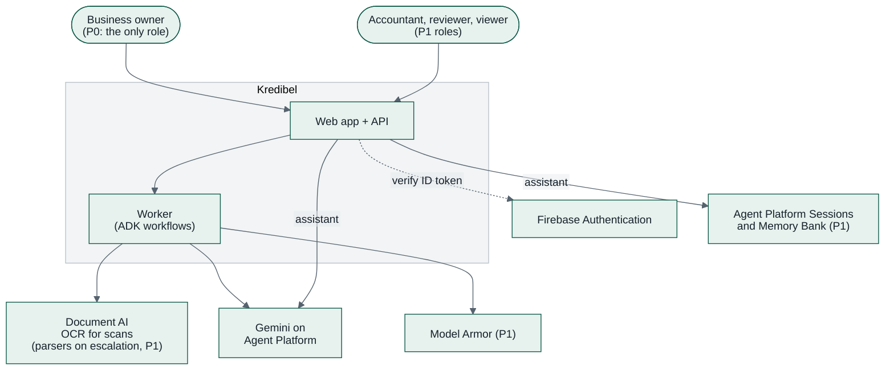

---

## 3. Containers

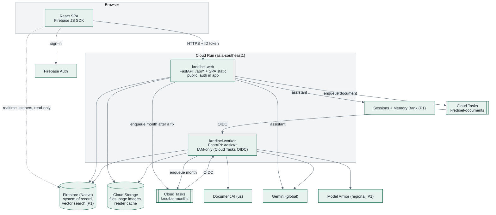

| Container | Responsibility | Scaling |
|---|---|---|
| **kredibel-web** | Serves the SPA; REST API; auth, roles and plan checks; workspace onboarding (sets custom claims); uploads with SHA-256 duplicate check, page split and triage; review resolutions, manual matches, finding decisions; enqueues document and month runs; Finance Assistant (P1) | 0–5 instances, concurrency 40 |
| **kredibel-worker** | Runs `document_workflow` and `month_workflow` (ADK); writes results and progress | 0–3 instances, concurrency 4, 2 vCPU / 2 GiB, timeout 15 min |
| **Cloud Tasks** `kredibel-documents` | One task per uploaded document; retries with backoff; caps model and OCR load | max dispatches 4, max attempts 3 |
| **Cloud Tasks** `kredibel-months` | One task per month and generation (`month-{orgId}-{yyyy-mm}-{generation}`), 20-second delay so a burst of changes becomes one run | max dispatches 2, max attempts 3 |
| **Firestore** | Workspace, usage, members, bank accounts, documents, bank lines, invoices, receipts, ledger entries, months, matches, review items, findings, counterparties, suggestions, runs, events; retrieval chunks with vector index (P1) | Serverless |
| **Cloud Storage** | Original files, rendered page PNGs, per-page reader output (cache), backups bucket | Serverless |
| **Sessions + Memory Bank** (P1) | Assistant conversations and per-user preferences; created once without deploying any agent code ([ADR-014](adr/ADR-014-finance-assistant-tools-rag-memory.md)) | Managed |

Both services run **the same image**; `APP_ROLE=web|worker` selects which routers are mounted
([ADR-002](adr/ADR-002-cloud-run-not-agent-runtime.md), [ADR-006](adr/ADR-006-async-jobs-cloud-tasks.md)).
A third entry point, `APP_ROLE=migrate`, runs data migrations as a Cloud Run job
([`22`](22-data-migrations.md)).

---

## 4. Backend components

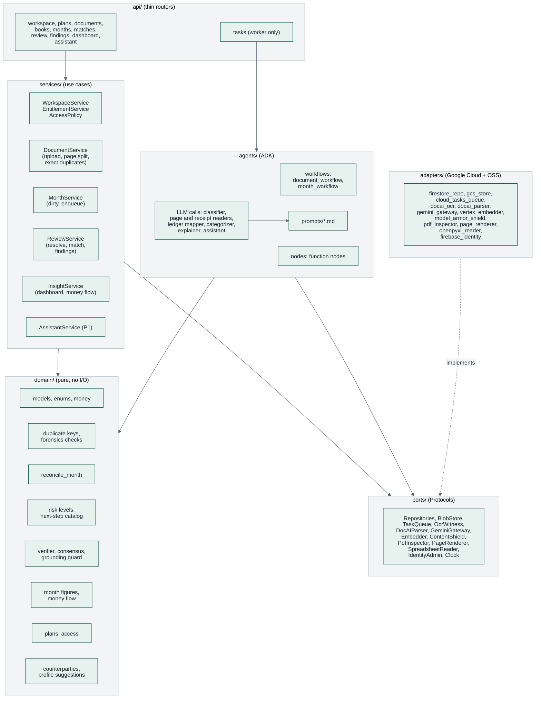

**Dependency rule:** `api → services/agents → domain + ports`; `adapters` implement `ports`; `domain`
imports nothing from the other layers. Enforced by an import-linter contract in CI
([`13`](13-design-patterns-and-conventions.md) §2).

---

## 5. Key flows

### 5.0 Create a workspace (first sign-in)

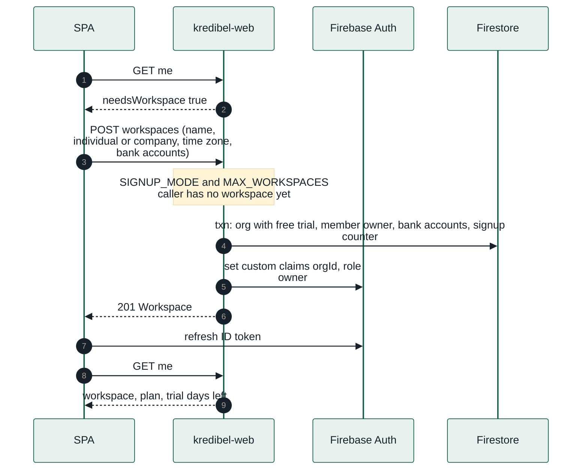

### 5.1 Upload a document

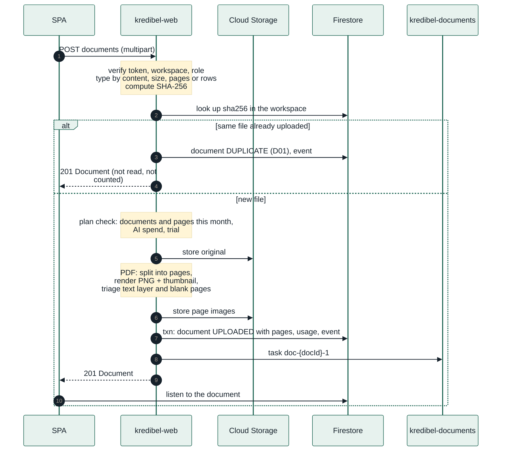

### 5.2 Read a document, then reconcile its months

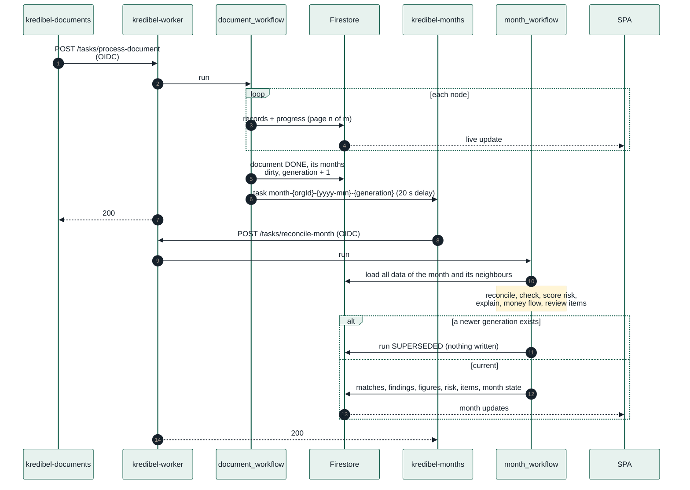

The same path by lane, from upload to a resolved review item:

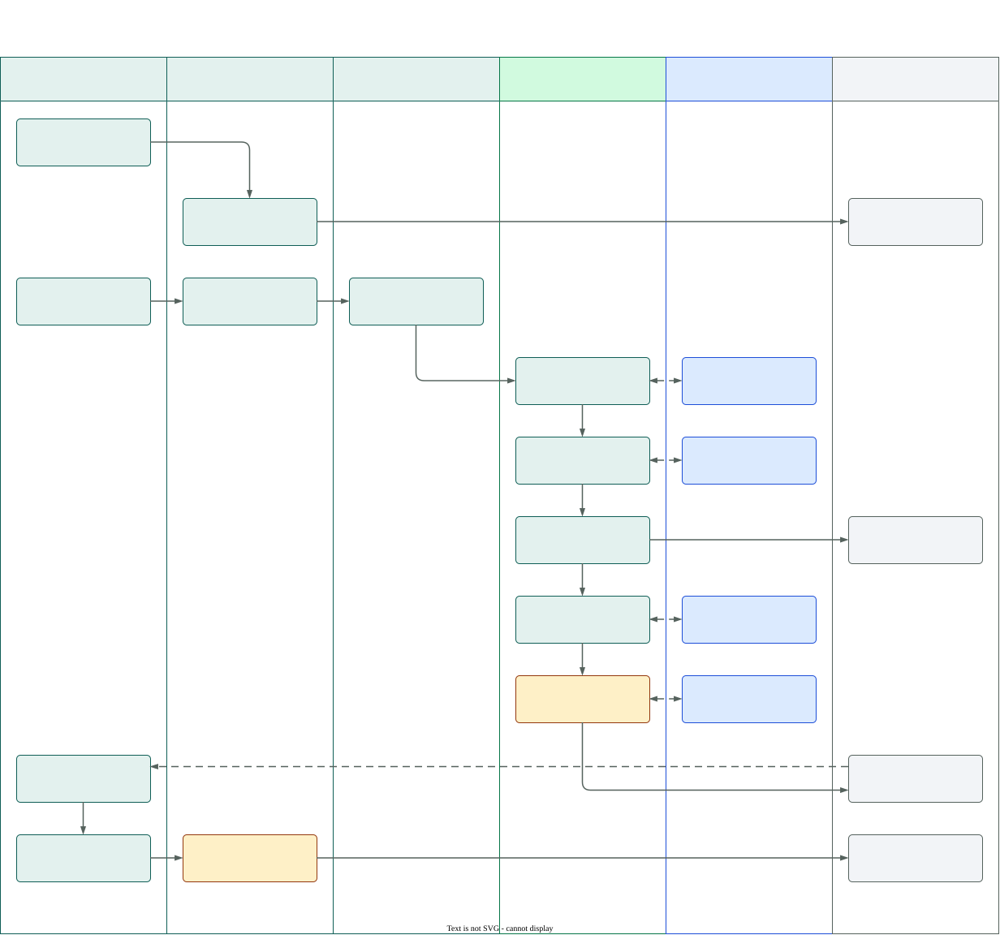

*Source: [`analysis-swimlane.drawio.svg`](diagrams/analysis-swimlane.drawio.svg). Open it in VS Code with the draw.io extension to edit; the file stays a valid SVG.*

### 5.3 Resolve a review item

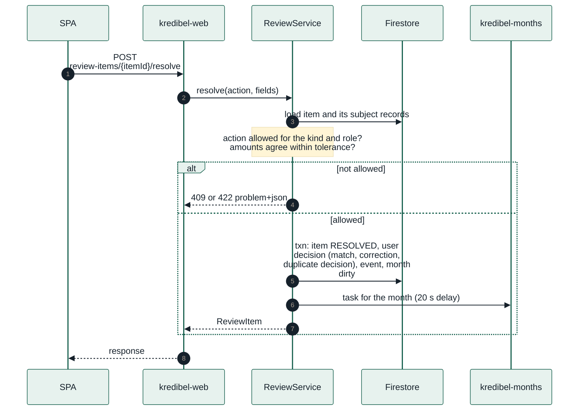

User decisions are stored as inputs (a manual match, a rejected proposal, a corrected value, a
duplicate decision) and `reconcile_month` treats them as fixed, so a re-run never undoes a person's
fix ([`08`](08-risk-engine.md) §6.1).

### 5.4 Ask the Finance Assistant (P1)

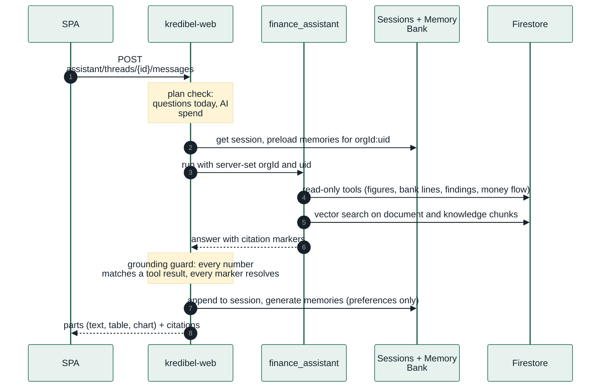

---

## 6. Month lifecycle

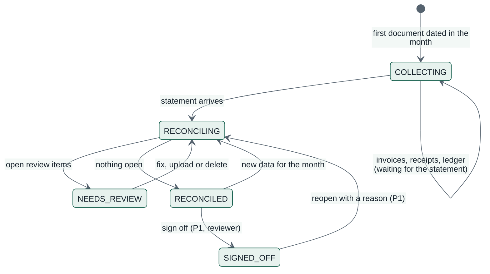

| Rule | Where |
|---|---|
| A month with no statement stays `COLLECTING`; its documents are "waiting for the bank statement", not unmatched | `reconcile_month`, `reconciliation.v1.yaml` `waitForStatement` |
| Any change to a month's data sets `dirty` and increments `generation`; only the run of the latest generation writes | `MonthService`, `finalize_month` |
| A signed-off month rejects changes with `409 MONTH_LOCKED` until reopened (P1) | `ReviewService`, `DocumentService` |

---

## 7. Deployment topology & regions


*Source: [`gcp-architecture.drawio.svg`](diagrams/gcp-architecture.drawio.svg). Open it in VS Code with the draw.io extension to edit; the file stays a valid SVG.*

| Component | Location | Why |
|---|---|---|
| Cloud Run, Cloud Tasks, Firestore, Cloud Storage | `asia-southeast1` (Singapore) | Close to users and to the finale; one region for all state |
| Document AI processors | `us` | Enterprise OCR (scans) and, for P1 escalation, Form Parser and Invoice Parser in one location |
| Gemini, embeddings | `global` endpoint | Widest model availability |
| Model Armor (P1) | regional endpoint, default `asia-southeast1` (confirm in spike S4) | Requires a regional endpoint |
| Sessions and Memory Bank (P1) | `asia-southeast1` if offered, else `us-central1` | Assistant conversations and preferences |

Synthetic data only, so cross-region processing is acceptable for the prototype. The production
residency path is in [ADR-009](adr/ADR-009-regions-and-data-residency.md).

---

## 8. Cross-cutting concerns

| Concern | Approach | Detail |
|---|---|---|
| Authentication | Firebase ID token verified by the Admin SDK on every `/api` request | [`14`](14-security-and-compliance.md) §3 |
| Authorization | `orgId` and `role` from custom claims; every repository call is workspace-scoped; actions checked by `domain/access.py`; Firestore rules mirror workspace isolation for client reads | [`10`](10-api-contract.md) §5, [`09`](09-data-model.md) §6 |
| Entitlements | `EntitlementService` + pure `domain/plans.py` read `contracts/plans.v1.yaml`; checked at upload, month run, assistant question, invite | [`specs/013`](specs/013-workspace-and-plans/spec.md) |
| Order independence | `reconcile_month` is pure over all of a month's data and the user's decisions; same inputs, same output | [`08`](08-risk-engine.md) §6.1 |
| Language | UI strings through i18next (`en` only today); API errors have stable codes; LLM outputs in English | [`11`](11-frontend.md) |
| Worker auth | Cloud Run IAM (`roles/run.invoker`) for the Cloud Tasks service account; `/tasks/*` is not mounted on `kredibel-web` | [`16`](16-infrastructure-and-deployment.md) §4 |
| Idempotency | Task names per document attempt and per month generation; nodes skip work whose output exists; deterministic record IDs | [`06`](06-agent-design.md) §8 |
| Errors | Domain errors → RFC 9457 problem+json with stable `code` | [`10`](10-api-contract.md) §3 |
| Config | `pydantic-settings`, env vars only, validated at startup; policy YAML versioned in `contracts/policy/` | [`16`](16-infrastructure-and-deployment.md) §6 |
| Observability | Structured JSON logs with `orgId`, `runId`, `node`; ADK OpenTelemetry spans to Cloud Trace; run stages in Firestore for the run graph | [`17`](17-observability.md) |
| Data evolution | `schemaVersion` on every document; upcasters on read; migrations as a Cloud Run job | [`22`](22-data-migrations.md) |
| Time | Injected `Clock` port; server-side UTC timestamps; document dates and months in the workspace's time zone | [`13`](13-design-patterns-and-conventions.md) §4 |
| Money | `Decimal` in Python, integer minor units in Firestore, decimal strings in JSON. **Never float.** | [`09`](09-data-model.md) §2 |

---

## 9. Limits that shape the design

| Limit | Value | Design response |
|---|---|---|
| Document AI online processing | 15 pages per request (OCR, Form Parser); Invoice Parser 10 | Pages are read one by one or in ≤ 15-page OCR batches, so the 20-page upload cap is independent of it |
| Cloud Tasks HTTP target deadline | up to 30 min | Document run budget 10 min, month run 2 min; per-node timeouts |
| Cloud Run request size (HTTP/1) | 32 MiB | Upload cap 20 MB (plan `fileSizeMb`); larger files would need signed-URL uploads (later) |
| Firestore document size | 1 MiB | Bank lines, invoices, entries, matches and items are their own documents, not arrays; month `flows` capped to 40 links |
| Firestore batched write | 500 operations | Repository writes in chunks of 400 |
| Firestore vector search | flat index, `find_nearest` limit 1,000 | Thousands of chunks per workspace are fine; revisit with RAG Engine beyond that ([ADR-014](adr/ADR-014-finance-assistant-tools-rag-memory.md)) |
| Gemini output length per call | model-dependent | Categorization in batches of 100 lines; one page per reading call |

---

## 10. Technology stack

| Layer | Choice | Version policy |
|---|---|---|
| Backend language | Python 3.12 | pinned in `pyproject.toml` |
| Dependency management | `uv` with committed `uv.lock` | |
| Web framework | FastAPI + Pydantic v2 + pydantic-settings | |
| Agents | ADK (`google-adk`) 2.11.x | pin minor; read release notes before bumping |
| Gemini SDK | `google-genai` (Agent Platform mode) | |
| Google clients | `google-cloud-firestore`, `-storage`, `-tasks`, `-documentai`, `-modelarmor`, `firebase-admin` | |
| PDF forensics | `pikepdf` (structure, metadata, revisions), `pdfplumber` (chars, fonts, positions), `pypdfium2` (render pages) | |
| Images | `Pillow`, `imagehash` (perceptual hash for receipt duplicates) | |
| Ledger files | `csv` (stdlib), `openpyxl` (read-only mode) | |
| Matching | `rapidfuzz` | |
| Evaluation | pytest-based eval harness; `deepeval` with a Gemini judge on Agent Platform for the assistant (P1) | |
| Synthetic data | `reportlab` + `pypdf` (incremental edits), `openpyxl` | |
| Frontend | React 19, Vite, TypeScript (strict), Tailwind CSS v4 with design tokens, TanStack Query v5, React Router v7, react-hook-form + zod, `react-pdf` (pdf.js), Recharts, `d3-sankey` | |
| i18n (frontend) | `i18next` + `react-i18next`, English resources only | |
| API types | `openapi-typescript` generated from `contracts/openapi.yaml` | |
| Tests | pytest, pytest-asyncio, hypothesis; Vitest + Testing Library; Storybook + axe; Playwright (smoke and visual) | |
| CI/CD | Cloud Build → Artifact Registry → Cloud Run | |

---

## 11. From prototype to production (talking points, not prototype scope)

1. **Residency:** run OCR and parsers in-region where offered and pin Gemini to a regional endpoint
   ([ADR-009](adr/ADR-009-regions-and-data-residency.md)).
2. **Volume:** signed-URL uploads for large files; bank feeds instead of statement uploads; BigQuery
   export for portfolio analytics across an accounting firm's clients.
3. **Billing:** map the coming-soon plans to Google Cloud Marketplace or a billing provider; the
   entitlement checks already exist.
4. **Network:** VPC Service Controls around Document AI, Agent Platform, Storage and Firestore; Cloud
   Armor in front of a load balancer.
5. **Model governance:** prompt and model versions recorded per run (already done), evaluations in
   the release process, match thresholds tuned on each customer's confirmed matches.
6. **Loan readiness report:** a lender-ready summary built from verified months (coming soon in the
   UI; [ADR-015](adr/ADR-015-scope-finance-workspace-not-loan-review.md)).
