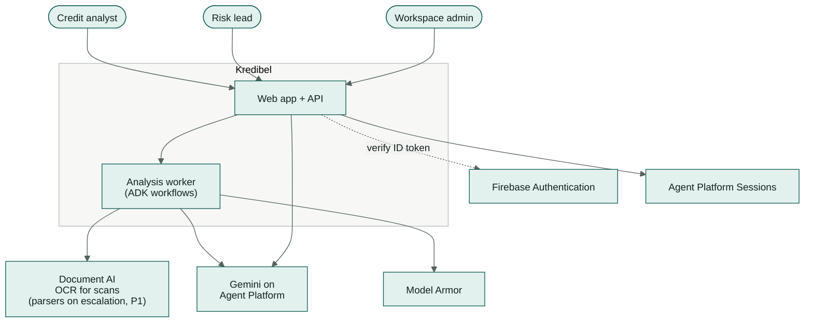
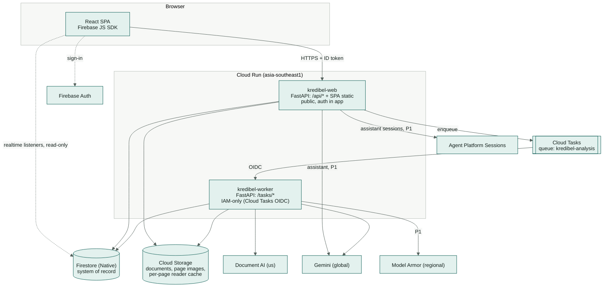
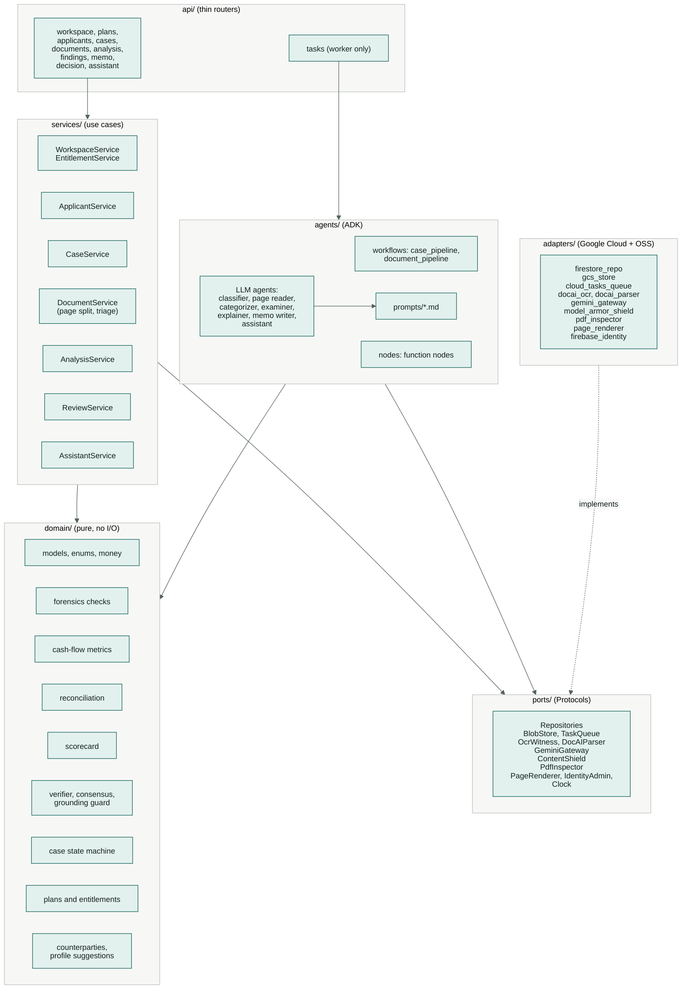
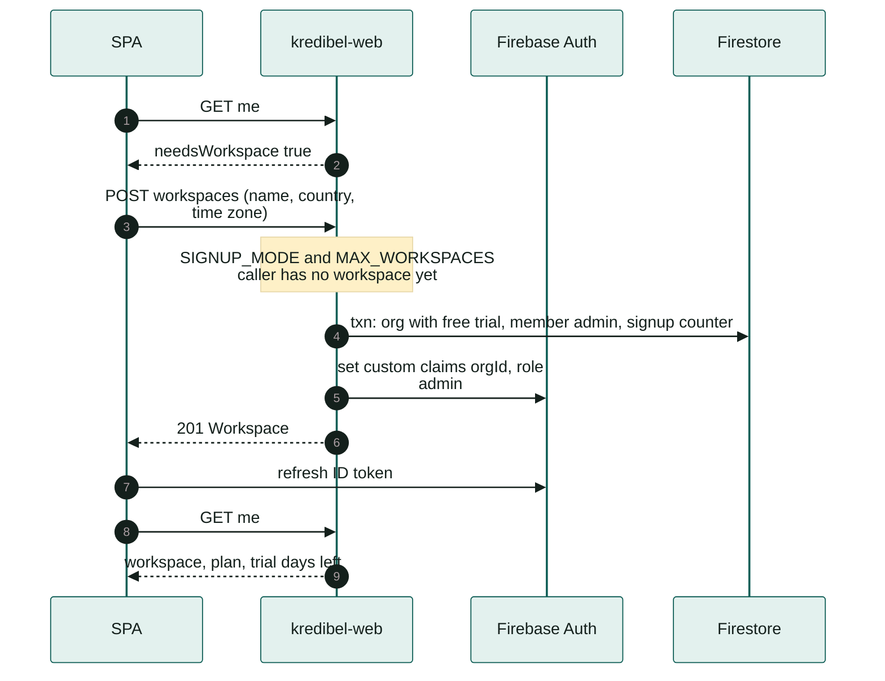
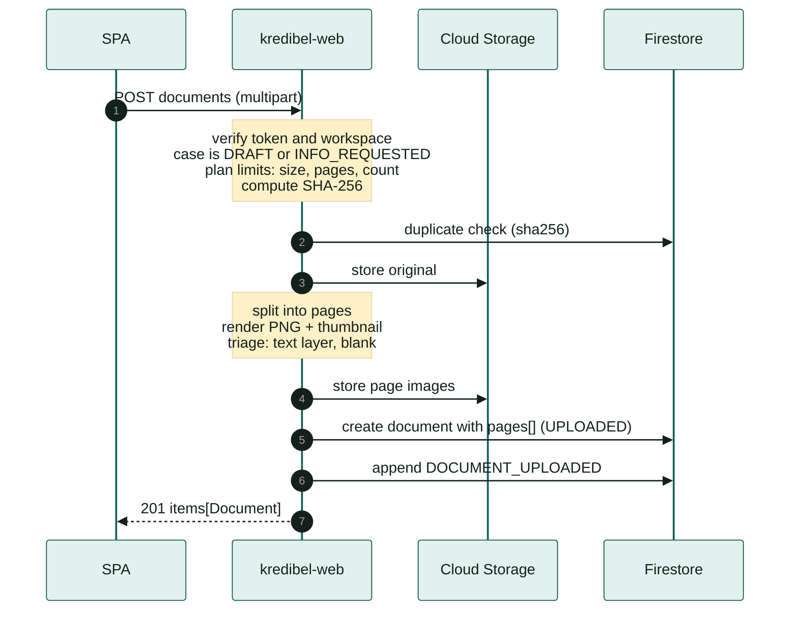
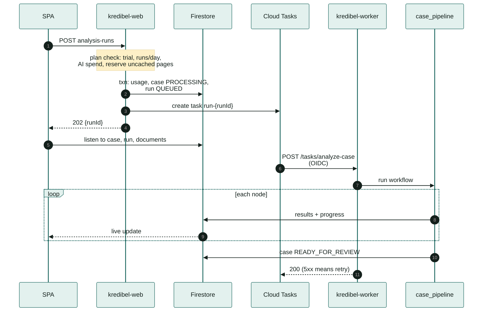
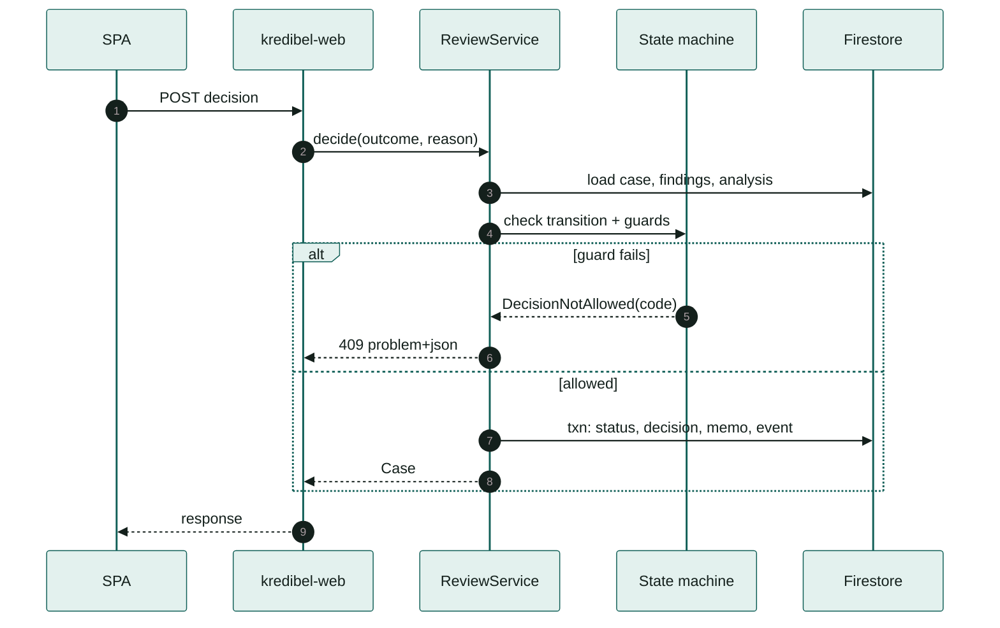
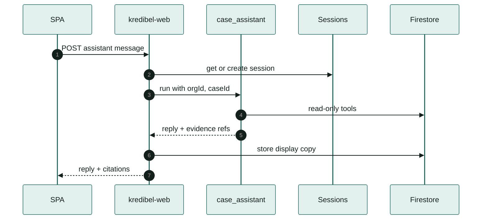
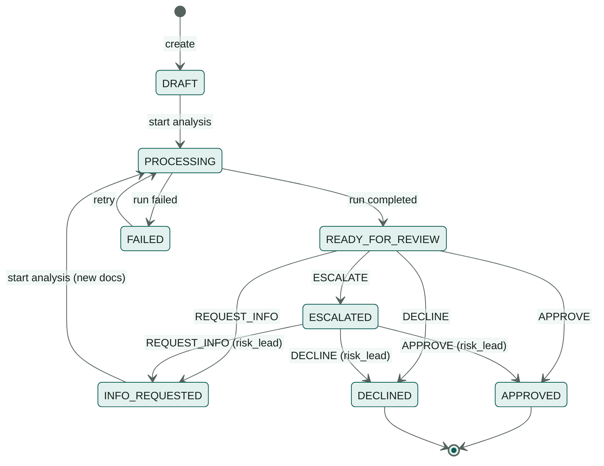

# 05 — Architecture

> How Kredibel is put together on Google Cloud. Agent internals are in [`06`](06-agent-design.md);
> document handling in [`07`](07-document-intelligence.md); data in [`09`](09-data-model.md).

---

## 1. Architectural drivers

| Driver | Consequence |
|---|---|
| Analysis takes minutes, users expect live feedback | Asynchronous runs (Cloud Tasks → worker); progress pushed through Firestore listeners, not long HTTP requests |
| Documents are adversarial; LLMs must not decide | Deterministic domain core; LLM calls behind schemas; read-only agent tools ([ADR-005](adr/ADR-005-deterministic-scoring-llm-explains.md)) |
| Every number must be traceable | Provenance on every extracted field; findings carry evidence references ([`07`](07-document-intelligence.md) §6) |
| 7 build days, 2–4 people, coding agent | Few moving parts: one container image, two Cloud Run services, serverless data stores, no VPC |
| Google Cloud only | Firestore, GCS, Cloud Tasks, Document AI, Gemini on Agent Platform, Model Armor, Firebase Auth |
| Cost per case must stay low for a free trial | Adaptive reading: one AI reading per page plus a free text-layer witness; Document AI OCR only for scans ([ADR-010](adr/ADR-010-adaptive-extraction-ai-reader-and-witness.md)); plan entitlements enforced server-side ([ADR-011](adr/ADR-011-workspaces-and-plans-free-trial-only.md)) |
| Lenders onboard different kinds of applicants | Applicant profile (individual or company) reused across cases; AI suggests, analyst accepts ([ADR-012](adr/ADR-012-applicant-profile-with-ai-suggestions.md)) |

---

## 2. System context

---

## 3. Containers

| Container | Responsibility | Scaling |
|---|---|---|
| **kredibel-web** | Serves the SPA; REST API; auth, workspace and plan checks; workspace onboarding (sets custom claims); applicants; uploads with page split and triage; enqueues runs; decisions; assistant (P1) | 0–5 instances, concurrency 40 |
| **kredibel-worker** | Executes analysis runs: the ADK `case_pipeline` workflow; writes results and progress | 0–3 instances, concurrency 2, 2 vCPU / 2 GiB, timeout 30 min |
| **Cloud Tasks** `kredibel-analysis` | Durable hand-off, retries with backoff, de-duplication by task name, concurrency cap protecting model and OCR quotas | max dispatches 4, max attempts 3 |
| **Firestore** | Workspaces, usage, members, applicants, suggestions, cases, documents, transactions, invoices, counterparties, findings, analysis, memo, runs, events | Serverless |
| **Cloud Storage** | Original files, rendered page PNGs, per-page reader output (cache) | Serverless |

Both services run **the same image**; `APP_ROLE=web|worker` selects which routers are mounted
([ADR-002](adr/ADR-002-cloud-run-not-agent-runtime.md), [ADR-006](adr/ADR-006-async-jobs-cloud-tasks.md)).

---

## 4. Backend components

**Dependency rule:** `api → services/agents → domain + ports`; `adapters` implement `ports`; `domain`
imports nothing from the other layers. Enforced by an import-linter contract in CI
([`13`](13-design-patterns-and-conventions.md) §2).

---

## 5. Key flows

### 5.0 Create a workspace (first sign-in)

### 5.1 Upload a document

### 5.2 Run an analysis

The same run by lane, from upload to decision:

*Source: [`analysis-swimlane.drawio.svg`](diagrams/analysis-swimlane.drawio.svg). Open it in VS Code with the draw.io extension to edit; the file stays a valid SVG.*

### 5.3 Decide

### 5.4 Ask the assistant (P1)

## 6. Case lifecycle

Guards (enforced in `domain/case_state.py`, tested exhaustively):

| Transition | Guard |
|---|---|
| any → `APPROVED` | No `CRITICAL` finding with status `OPEN` |
| any → `APPROVED` when recommendation is `DECLINE` or a hard stop exists | Actor role at least `risk_lead` (`risk_lead` or `admin`) and non-empty reason |
| `ESCALATED` → * | Actor role at least `risk_lead` |
| `DRAFT`/`INFO_REQUESTED` → `PROCESSING` | ≥1 document; no other run `QUEUED`/`RUNNING` |
| `DECLINE`, `REQUEST_INFO`, `ESCALATE` | Non-empty reason |

---

## 7. Deployment topology & regions

*Source: [`gcp-architecture.drawio.svg`](diagrams/gcp-architecture.drawio.svg). Open it in VS Code with the draw.io extension to edit; the file stays a valid SVG.*

| Component | Location | Why |
|---|---|---|
| Cloud Run, Cloud Tasks, Firestore, Cloud Storage | `asia-southeast1` (Singapore) | Close to users and to the finale; one region for all state |
| Document AI processors | `us` | Enterprise OCR (scans) and, for P1 escalation, Form Parser and Invoice Parser in one location |
| Gemini | `global` endpoint | Widest model availability, including preview models |
| Model Armor | regional endpoint, default `asia-southeast1` (confirm in spike S4) | Requires a regional endpoint |
| Agent Platform Sessions (P1) | `asia-southeast1` (or `us-central1` if unavailable) | Sessions for the assistant |

Synthetic data only, so cross-region processing is acceptable for the prototype. The production
residency path is in [ADR-009](adr/ADR-009-regions-and-data-residency.md).

---

## 8. Cross-cutting concerns

| Concern | Approach | Detail |
|---|---|---|
| Authentication | Firebase ID token verified by the Admin SDK on every `/api` request | [`14`](14-security-and-compliance.md) §3 |
| Authorization | `orgId` (workspace) and `role` from custom claims; every repository call is workspace-scoped; Firestore rules mirror it for client reads | [`09`](09-data-model.md) §6 |
| Entitlements | `EntitlementService` + pure `domain/plans.py` read `contracts/plans.v1.yaml`; checked at create case, upload, start run, invite | [`specs/013`](specs/013-workspace-and-plans/spec.md) |
| Language | UI strings through i18next (`en` only today); API errors have stable codes; LLM outputs in English | [`11`](11-frontend.md) §10 |
| Worker auth | Cloud Run IAM (`roles/run.invoker`) for the Cloud Tasks service account; `/tasks/*` is not mounted on `kredibel-web` | [`16`](16-infrastructure-and-deployment.md) §4 |
| Idempotency | Task name = `run-{runId}`; nodes skip work whose output already exists for the run; deterministic finding IDs | [`06`](06-agent-design.md) §7 |
| Errors | Domain errors → RFC 9457 problem+json with stable `code` | [`10`](10-api-contract.md) §3 |
| Config | `pydantic-settings`, env vars only, validated at startup; policy YAML versioned in `contracts/policy/` | [`16`](16-infrastructure-and-deployment.md) §6 |
| Observability | Structured JSON logs with `caseId`, `runId`, `node`; OpenTelemetry traces to Cloud Trace; run timeline in Firestore | [`17`](17-observability.md) |
| Time | Injected `Clock` port; server-side UTC timestamps; dates on documents kept as local calendar dates | [`13`](13-design-patterns-and-conventions.md) §4 |
| Money | `Decimal` in Python, integer minor units in Firestore, decimal strings in JSON. **Never float.** | [`09`](09-data-model.md) §2 |

---

## 9. Limits that shape the design

| Limit | Value | Design response |
|---|---|---|
| Document AI online processing | 15 pages per request (OCR, Form Parser); Invoice Parser 10 | Pages are read individually or in ≤ 15-page OCR batches, so the upload cap (20 pages, plan-dependent) is independent of it |
| Cloud Tasks HTTP target deadline | up to 30 min | Run budget 10 min; per-node timeouts |
| Cloud Run request size (HTTP/1) | 32 MiB | Upload cap 20 MB (plan `fileSizeMb`); larger files would need signed-URL uploads (P2) |
| Firestore document size | 1 MiB | Transactions, findings, invoices are subcollection documents, not arrays |
| Firestore batched write | 500 operations | Repository writes in chunks of 400 |
| Gemini output length per call | model-dependent | Categorization in batches of 100 transactions; reading one page per call |

---

## 10. Technology stack

| Layer | Choice | Version policy |
|---|---|---|
| Backend language | Python 3.12 | pinned in `pyproject.toml` |
| Dependency management | `uv` with committed `uv.lock` | |
| Web framework | FastAPI + Pydantic v2 + pydantic-settings | |
| Agents | ADK (`google-adk`) 2.11.x | pin minor; read release notes before bumping |
| Gemini SDK | `google-genai` (Agent Platform mode) | |
| Google clients | `google-cloud-firestore`, `-storage`, `-tasks`, `-documentai`, `-modelarmor`, `firebase-admin` | |
| PDF forensics | `pikepdf` (structure, metadata, revisions), `pdfplumber` (chars, fonts, positions), `pypdfium2` (render pages) | |
| Matching | `rapidfuzz` |
| i18n (frontend) | `i18next` + `react-i18next`, English resources only | | |
| Synthetic data | `reportlab` + `pypdf` (incremental edits) | |
| Frontend | React 19, Vite, TypeScript (strict), Tailwind CSS v4, TanStack Query v5, React Router v7, react-hook-form + zod, `react-pdf` (pdf.js), Recharts | |
| API types | `openapi-typescript` generated from `contracts/openapi.yaml` | |
| Tests | pytest, pytest-asyncio, hypothesis; Vitest + Testing Library; Playwright (smoke) | |
| CI/CD | Cloud Build → Artifact Registry → Cloud Run | |

---

## 11. From prototype to production (talking points, not prototype scope)

1. **Residency:** run OCR and parsers in-region where offered and pin Gemini to a regional endpoint
   ([ADR-009](adr/ADR-009-regions-and-data-residency.md)).
2. **Volume:** signed-URL uploads for large files; Cloud Tasks per document; BigQuery export for
   portfolio analytics.
3. **Billing:** map the coming-soon plans to Google Cloud Marketplace or a billing provider; the
   entitlement checks already exist.
4. **Network:** VPC Service Controls around Document AI, Agent Platform, Storage and Firestore; Cloud
   Armor in front of a load balancer.
5. **Model governance:** prompt and model versions recorded per run (already done), Agent Platform
   Evals in the release process, scorecard calibrated on the lender's own outcomes.
