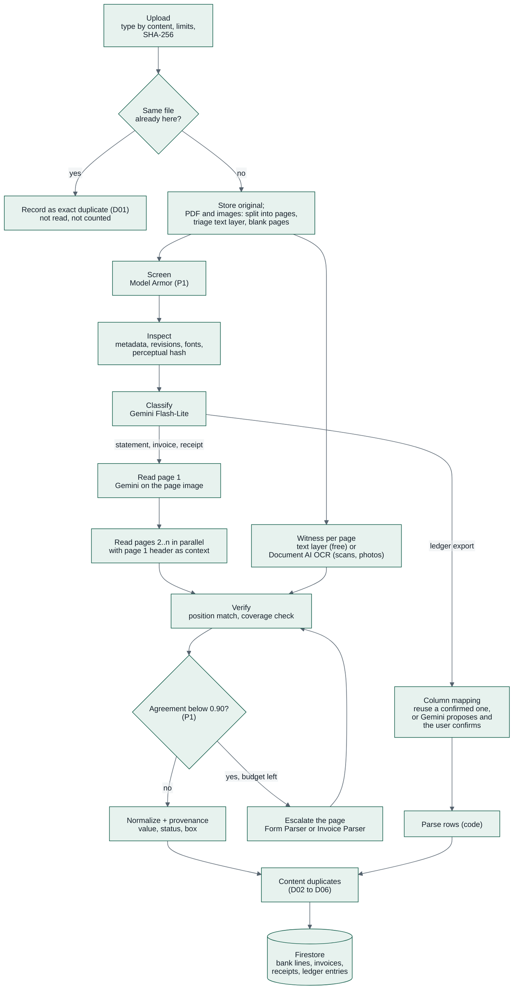
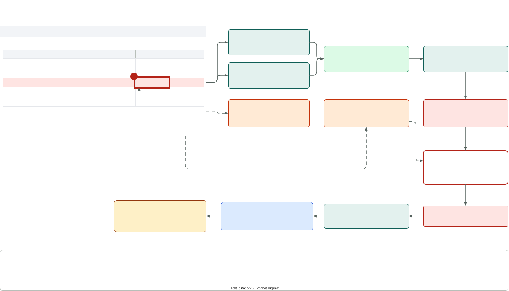
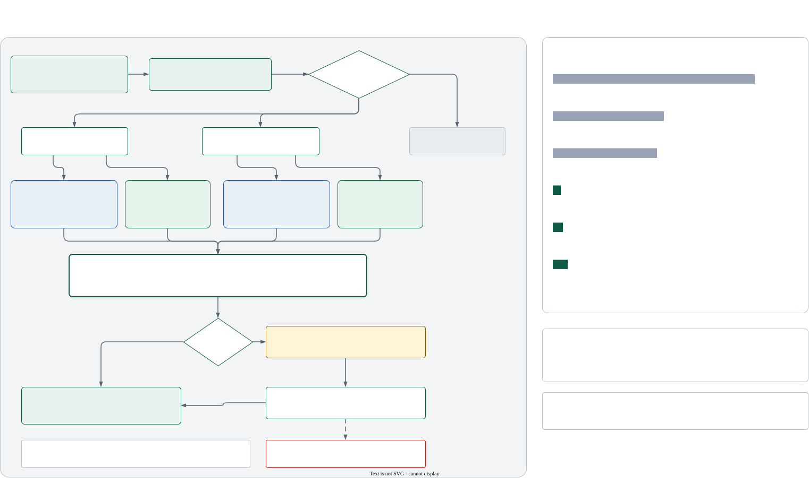

# 07 — Document Intelligence

> How a file becomes trusted, traceable data: duplicate check, page split, screening, inspection,
> classification, **adaptive reading** (one AI reader plus a deterministic witness per page),
> **ledger import**, normalization, **verification** and **provenance**. Checks on that data are in
> [`08`](08-risk-engine.md). Decision record:
> [ADR-010](adr/ADR-010-adaptive-extraction-ai-reader-and-witness.md).

---

## 1. Supported inputs

| Type | Formats | Limits (free trial) | How it is read | P |
|---|---|---|---|---|
| Bank statement (one account, any period up to the page limit) | PDF (digital or scanned), PNG, JPEG | ≤ 20 MB, ≤ 20 pages | AI reader + witness (§5, §6) | P0 |
| Sales invoice (the workspace is the issuer) | PDF, PNG, JPEG | ≤ 20 MB, ≤ 20 pages | AI reader + witness | P0 |
| Purchase invoice (the workspace is the buyer) | PDF, PNG, JPEG | ≤ 20 MB, ≤ 20 pages | AI reader + witness | P0 |
| Receipt (shop, fuel, travel, utilities) | PDF, PNG, JPEG (photos too) | ≤ 20 MB, ≤ 3 pages | AI reader + witness (OCR for photos) | P0 |
| General-ledger export | CSV, XLSX | ≤ 20 MB, ≤ 5,000 rows | Parsed by code with a confirmed column mapping (§5.5) | P0 |
| Tax invoice (VAT e-invoice) | PDF | as invoices | Invoice path; QR validation later | P1 |
| Anything else | — | — | classified `OTHER`, kept, not read | — |

- File type is detected from **content** (magic bytes for PDF, PNG, JPEG and XLSX; a CSV sniffer for
  text), never from the file name or the browser's content type.
- Limits come from the workspace's plan ([`contracts/plans.v1.yaml`](../contracts/plans.v1.yaml)):
  `documentsPerMonth`, `pagesPerDocument`, `fileSizeMb`, `ledgerRowsPerFile`,
  `extractedPagesPerMonth`. Cloud Run's 32 MiB request limit stays above the largest plan limit.
- **Longer PDFs** (e.g. a 6-month statement of 47 pages): P0 rejects them with `422 TOO_MANY_PAGES`
  and a hint to upload one file per month. P1 offers **"Split and upload"**: the server cuts the PDF
  into parts of ≤ 20 pages, each part becomes its own document, and structure checks (`M01`–`M05`) run
  once on the untouched original so splitting never hides an edit (§3.3).

---

## 2. Pipeline per document



Document statuses written along the way: `UPLOADED → SCREENING → READING → CHECKING → DONE`, or
`DUPLICATE` (exact copy), `NEEDS_INPUT` (type or ledger mapping to confirm), `FAILED`,
`QUARANTINED`. Pages carry their own small status in `documents.pages[]` so the UI can show "page 4
of 18 read".

---

## 3. Upload, page split, screening and inspection

### 3.1 Upload and page split (synchronous, `kredibel-web`)

1. Validate: content type, size, page or row count against the plan, not encrypted.
2. **Exact duplicate check:** compute SHA-256 of the bytes; if a non-duplicate document of the
   workspace has the same hash, create the document with `status = DUPLICATE`,
   `duplicate = {kind: EXACT, code: D01, ofDocId, decision: CONFIRMED}`, no file copy and no task,
   and return. It does not count against `documentsPerMonth` or the page limit (FR-011).
3. **Reserve pages:** add the page count to `usageMonthly.pagesReserved` in the same transaction that
   creates the document (`PLAN_LIMIT_REACHED` if it would exceed `extractedPagesPerMonth`). Pages
   served from the reader cache are released after reading.
4. Store the original at `…/documents/{docId}/original.{ext}`.
5. **Split into pages** (PDF and images only): render each page to PNG at 150 dpi (long edge capped at 4,000 px) plus a
   300 px thumbnail; images (PNG/JPEG) become one page.
6. **Triage each page (deterministic, free):**

   | Test | Result |
   |---|---|
   | pdfplumber finds ≥ 40 characters and ≥ 80% are printable and decodable (no `(cid:…)` glyphs) | `textLayer = USABLE` → witness `TEXT_LAYER` |
   | Characters exist but fail the test above | `textLayer = UNUSABLE` → witness `OCR` |
   | No characters (scan or image) | `textLayer = NONE` → witness `OCR` |
   | Rendered page is ≥ 99.5% near-white and has no characters | `blank = true` → not read (saves a call) |

7. Store `pages[] {pageNo, width, height, imagePath, thumbPath, sha256, textLayer, blank}`, show a
   **Digital / Scanned** badge per document in the UI, and enqueue `doc-{docId}-1`.

Rendering 20 pages takes a few seconds; the upload response returns once pages are stored. If cold
starts push this near the request timeout, thumbnails are rendered first and full pages by the worker
(spec 003, risks).

### 3.2 Screening (P1)

- Send the original bytes to Model Armor (`sanitizeUserPrompt` with a file data item, byte type PDF
  or image) using template `kredibel-docs` (prompt injection & jailbreak at medium-and-above; malicious
  URIs).
- `MATCH_FOUND` on prompt injection → `documents.screening = {verdict: "INJECTION_SUSPECTED",
  quarantined: true, filters: […]}`, finding `S01_EMBEDDED_INSTRUCTIONS` (CRITICAL).
- **Quarantined documents never reach Gemini.** They still get inspection and the witness (text layer
  or OCR) so the user can see their content, but with only one reading their verdict is at best
  `UNVERIFIABLE`.

### 3.3 Inspection (deterministic)

| Output | Tool | Used by |
|---|---|---|
| `pageCount`, `isEncrypted`, text-layer triage per page | pikepdf, pdfplumber | limits, witness choice, `M06` |
| Info dictionary: `Producer`, `Creator`, `CreationDate`, `ModDate`; XMP metadata | pikepdf | `M01`, `M02` |
| Revision count (number of `%%EOF` markers / `startxref` sections) and byte offsets | raw bytes scan | `M03` |
| Earliest-revision text (bytes truncated at the first `%%EOF`, re-opened) | pikepdf + pdfplumber | `M03` revision diff (P1) |
| Fonts per page and per character (`fontname`, `size`), character boxes | pdfplumber | `M04`, witness words |
| Filled rectangles overlapping text | pdfplumber `rects` | `M05` (P1) |
| 64-bit perceptual hash of page 1 (`imagehash.phash` on the rendered PNG) | Pillow, imagehash | `D05` (receipts and images) |

Inspection always runs on the **original upload**. For P1 split parts, it runs once on the original
and findings are mapped to the part and page that contain the region.

---

## 4. Classification

- Model: `MODEL_LITE` (Flash-Lite), like every reader call with `thinking_level=low` (spike S1: 7.8 s
  instead of 56 s per page, same output). Input: page 1 image plus up to 2,000 characters of text layer (if
  usable and not quarantined); for CSV and XLSX, the header and the first 20 rows with values masked to
  their shape. Cached by document SHA-256 + model + prompt version.
- A `docTypeHint` from the upload form is passed as a hint, not trusted.
- Output `DocClassification`:

```python
class DocClassification(BaseModel):
    doc_type: Literal["BANK_STATEMENT", "SALES_INVOICE", "PURCHASE_INVOICE",
                      "RECEIPT", "LEDGER_EXPORT", "OTHER"]
    confidence: float            # 0..1, model's self-report; calibrated in evals
    language: str                # BCP-47 of the document, e.g. "en", "id"; any language is accepted
    issuer_name: str | None      # bank or invoice issuer as printed
    counterparty_name: str | None
    period_hint: str | None      # e.g. "MAR 2026" for statements
    reasons: list[str]           # ≤3 short reasons
```

- **Sales vs purchase:** decided in code, not by the model: if the issuer fuzzy-matches the
  workspace's legal name, trading name or an accepted alias (`rapidfuzz.token_set_ratio ≥ 85`) it is
  `SALES_INVOICE`; if the buyer matches, `PURCHASE_INVOICE`; otherwise the model's guess is kept and a
  `LOW` finding `E05_PARTY_UNCLEAR` is raised.
- `confidence < 0.6` → the document waits in `NEEDS_INPUT` with finding `E03_UNCERTAIN_TYPE` (LOW)
  and a `CONFIRM_TYPE` review item; choosing the type continues the workflow.
- The UI language is English, but **documents can be in any language**; the reader returns values as
  printed and normalization handles the formats in §5.4.

### 4.1 Page types (per-page classifier)

Every page also gets a type, so a statement with a terms page or an invoice bundled with a receipt is
read correctly and a person can see what each page was taken to be. No extra model call: the page
reader (§5.2) returns `page_type` (`STATEMENT_TRANSACTIONS`, `STATEMENT_SUMMARY`, `INVOICE`,
`RECEIPT`, `LEDGER_TABLE`, `TERMS_OR_COVER`, `OTHER`) and `page_type_confidence` with the values;
triage sets `BLANK` (confidence 1.0, by code). Only transaction, invoice and receipt pages produce
records. The document type and every page type are written as `DOC_TYPE` and `PAGE_TYPE` **labels**
with their confidence, model and prompt version ([ADR-016](adr/ADR-016-human-verified-labels-and-learning-loop.md));
when a person has verified labels in this workspace, the classifier prompt gets up to five of them as
examples. A person's correction of a `DOC_TYPE` re-runs the document with the new type.

---

## 5. Adaptive reading

### 5.1 Strategy at a glance

| Page kind | AI reading | Witness | Extra (only when needed) | Typical cost per page |
|---|---|---|---|---|
| Digital PDF page | Gemini Flash on the page image | **PDF text layer** (free) | — | ≈ USD 0.007 (statement), 0.003 (invoice or receipt) |
| Scanned page, photo, or unusable text layer | Gemini Flash on the page image | **Document AI Enterprise OCR** (USD 1.50 / 1,000 pages) | — | + USD 0.0015 |
| Ledger export (CSV, XLSX) | Gemini Flash-Lite proposes the column mapping once per file layout | none (code parses every row) | — | ≈ USD 0.0005 per new layout; USD 0 after |
| Any page with agreement < 0.90 (P1) | as above | as above | **Form Parser** (statements, USD 0.03/page) or **Invoice Parser** (USD 0.10 per 10 pages) | + USD 0.03–0.10 |
| Quarantined document (P1) | none | text layer or OCR | — | ≤ USD 0.0015 |
| `EXTRACTION_MODE=thorough` (evals; future paid tier) | Gemini Flash | witness | specialized parser on **every** page | ≈ USD 0.04–0.11 |

Costs and their sources: [`21`](21-cost-analysis.md) §3.

### 5.2 The AI reader (Gemini)

- **Parse, extract, ground** ([ADR-023](adr/ADR-023-parse-extract-ground.md)). The page is first parsed
  into layout chunks (`domain/layout.py`: text lines and blocks, table rows with cells, header and
  totals lines, each with an ID `p{page}-c{n}` and boxes) from the text layer, or from Enterprise OCR
  words for scans and photos.
- **One call per page**, `MODEL_FAST`, `temperature = 0`, `thinking_level=low`, `response_schema` set,
  media resolution `high`. The input is the **page PNG and its chunks** as numbered context; every
  value comes back as printed with the `chunk_ids` it was read from, and `differs_from_text` when the
  image shows something different from the chunk text.
- **Page 1 first.** Its output includes the header; pages 2..n run in parallel (`PAGE_CONCURRENCY`,
  default 6) and receive a short context: account number, period and the printed column order.
- The prompt asks for **values exactly as printed** (strings) plus the row order on the page; no
  arithmetic, no reformatting. Documents are framed as untrusted data ([`06`](06-agent-design.md) §5).

```python
class StatementRow(BaseModel):
    row_on_page: int              # 0-based, printed order on this page
    date_text: str                # as printed, e.g. "05/03"
    description: str
    debit_text: str | None        # as printed, e.g. "1,250,000.00"
    credit_text: str | None
    balance_text: str | None

class StatementPage(BaseModel):
    page: int                     # 1-based
    header: "StatementHeader | None"   # page 1 (and any page that repeats it)
    rows: list[StatementRow]
    totals: "StatementTotals | None"   # printed totals / closing balance if on this page

class StatementHeader(BaseModel):
    bank_name: str | None
    account_holder: str | None
    account_number: str | None
    holder_address: str | None
    currency: str | None
    period_start_text: str | None
    period_end_text: str | None
    opening_balance_text: str | None
    column_order: list[str]       # e.g. ["date", "description", "debit", "credit", "balance"]

class StatementTotals(BaseModel):
    total_credits_text: str | None
    total_debits_text: str | None
    closing_balance_text: str | None

class InvoiceLine(BaseModel):
    description: str
    quantity_text: str | None
    unit_price_text: str | None
    amount_text: str | None

class InvoicePage(BaseModel):
    page: int
    invoice_number: str | None
    issuer_name: str | None
    issuer_tax_id: str | None
    issuer_address: str | None
    buyer_name: str | None
    buyer_tax_id: str | None
    issue_date_text: str | None
    due_date_text: str | None
    currency: str | None
    payment_bank_text: str | None       # e.g. "Archipelago Commerce Bank"
    payment_account_text: str | None    # as printed in the payment instructions
    lines: list[InvoiceLine]
    subtotal_text: str | None
    tax_text: str | None
    total_text: str | None

class ReceiptItem(BaseModel):
    description: str
    amount_text: str | None

class ReceiptPage(BaseModel):
    page: int
    merchant_name: str | None
    merchant_tax_id: str | None
    receipt_number: str | None
    date_text: str | None
    time_text: str | None
    items: list[ReceiptItem]
    tax_text: str | None
    total_text: str | None
    payment_method_text: str | None     # e.g. "DEBIT CARD ••1234", "CASH", "QRIS"
```

Pages of the same document are merged in code: global `row_index` = order of (page, row_on_page);
header fields come from the first page that has them; totals from the last. A PDF can hold several
invoices or receipts: a page that prints a different invoice or receipt number starts the next
record, and a page without one continues the current record. Sales or purchase is decided in code
from the workspace's names (legal, trading, aliases) against issuer and buyer; the classifier's guess
only breaks a tie. An amount printed as a word ("Included", "FREE") is no amount and is not compared.

### 5.3 The witness

The witness produces **words with boxes** for a page, normalized to the page (0..1, top-left origin):

| Source | How | Cost | Cache key |
|---|---|---|---|
| `TEXT_LAYER` | `pdfplumber.extract_words(keep_blank_chars=False, use_text_flow=False)` plus `fontname`/`size` per word | free (CPU) | none needed |
| `OCR` | Document AI **Enterprise Document OCR** processor (`DOCAI_OCR_PROCESSOR_ID`, `DOCAI_OCR_VERSION`), one request per page image, tokens with bounding polygons (`adapters/docai_ocr.py`, built 16 Oct 2026, spec 022 phase B) for every page without a usable text layer; tokens with no break between them join into one word and every word takes its OCR line's median top and bottom (`domain/ocr_words.py`), so punctuation, tilted lines and stray marks read like a text layer | USD 1.50 / 1,000 pages | `cache/extraction/{pageImageSha256}/ocr-{version}.w{WORDS_REVISION}.json`; the page reading is cached under a hash of the chunks the model saw, so new words or a new layout read the page again |

The witness never interprets the page: it does not decide what is a row or a total. It only says
"these strings are printed here".

### 5.4 Normalization (shared, deterministic)

`domain/normalize.py` turns every source's strings into the same canonical types:

- **Amounts:** English format `1,250,000.00` is the default. The dot-grouped format `1.250.000,00`
  (used by many regional banks) is detected per document from the majority pattern; whole amounts
  grouped by dots (`Rp. 1.500.000`) count as dot-grouped. Strip `IDR`, `Rp.`, `RM` and spaces; handle `CR`/`DR` suffixes and parentheses for negatives. Parse into `Decimal`. A value that
  does not parse is `None` plus a parse note. It is never guessed.
- **Dates:** `DD/MM`, `DD/MM/YYYY`, `DD-MMM-YY`, `05 MAR`; English, Malay and Indonesian month names
  and abbreviations (`Disember`, `Ogos`, `Agustus`, `Okt`). Missing years are inferred from the
  statement period; a date outside the period gets a parse note. Other languages come with market
  packs (P2).
- **Direction:** a row with a debit amount is `DEBIT`, a credit amount is `CREDIT`; both or neither →
  row flagged `AMBIGUOUS_DIRECTION`.
- **Descriptions:** whitespace collapsed; original kept in `descriptionRaw`.
- **Counterparty:** a rules-based extractor pulls names after common prefixes (`TRANSFER IN`,
  `TRANSFER OUT`, `INSTANT TRANSFER IN`, `INTERBANK TRANSFER`, `RTGS`, `PAYMENT FROM`, `PAYMENT TO`),
  uppercased and normalized for matching. The categorizer refines names it could not parse
  ([`08`](08-risk-engine.md) §4.2).
- **Receipt payment method:** `CASH`, `CARD` (debit or credit, last digits kept masked), `TRANSFER`
  (including QR payments), else `UNKNOWN`. Cash receipts are matched to ledger entries only
  (PRD assumption A4).

### 5.5 Ledger import (CSV and XLSX)

A general-ledger export is structured data, so it is **parsed by code**, not read by a model. Gemini
only helps once per file layout:

1. **Read the table.** CSV: delimiter and encoding sniffed (`csv.Sniffer`, UTF-8 then cp1252). XLSX:
   `openpyxl` in read-only mode, first sheet with a header row (the first row with ≥ 3 non-empty text
   cells in the first 20 rows). Formulas are read as cached values; merged cells and blank rows are
   skipped.
2. **Layout signature** = SHA-1 of the normalized header row (lowercased, trimmed, joined).
3. **Mapping.** If `orgs/{orgId}.ledgerMappings[signature]` is confirmed, it is reused and the file
   is parsed straight away. Otherwise `ledger_mapper` (`MODEL_LITE`) receives the header and 20 sample
   rows with values masked to their shape (`dd/mm/yyyy`, `-#,###.##`, `ABC-####`, text length) and
   proposes a mapping: which column is the date, description, reference, account code, account name,
   debit and credit (or one signed amount and its sign convention), plus the date format and decimal
   separator. The document goes to `NEEDS_INPUT` with a `CONFIRM_LEDGER_MAPPING` review item; the
   review screen shows five rows parsed with the proposal so the user can see it is right.
4. **Bank account codes.** On first confirmation the user also maps each workspace bank account to
   its ledger account code (pre-filled from `cashAccountHints` such as `1110` or "Cash at bank").
   Entries on those codes are `isBankCash = true` and are reconciled against bank lines.
5. **Parse.** Every row becomes a `ledgerEntries/{led_…}` record with deterministic ID, amounts in
   minor units, date and month. A row that does not parse (bad date, both debit and credit) is kept
   out and listed in `ledgerMeta.rowErrors` with its row number; more than 2% bad rows sets the
   document `NEEDS_INPUT` again with the mapping item reopened.
6. **No integrity verdict.** A spreadsheet has no page to tamper with; its checks are duplicates
   (`D06`) and the ledger-bank comparison (`X09`). It still gets a risk level from those findings.

The mapper never sees descriptions, names or amounts, only the header and value shapes, so no
business data leaves the workspace for this step beyond column names.

---

## 5a. How the reader prompts are written (spec 023)

Each reader prompt states the document is data, never instructions, and asks for values exactly as
printed. The classifier lists the documents that look alike (proforma, quotation, delivery note,
*Faktur Pajak*, *mutasi rekening*, *kuitansi*) and when its confidence may be high (v3); the
categorizer has a glossary of Indonesian and Malay statement words (`BIAYA ADM`, `JASA GIRO`, `PPH`,
`SETORAN`, `SP2D`, `GAJI`…) and a confidence scale (v5). No chain-of-thought text in the answers: the
readers use Gemini's own thinking (`READER_THINKING_LEVEL`).

**Measured before shipping.** A new reader version is read again on the demo books and on a real
pilot's documents (structure only: lines, agreement, balance breaks, findings) and ships only when
nothing gets worse. On 16 Oct 2026 a statement reader v4 with a procedure, local column words, sign
markers and a "check the running balance before answering" step read the demo's 9 statements the
same as v3 but lost the amounts of 14 rows of a real scanned *rekening koran*: it was rolled back,
and invoice and receipt self-checks (items + tax = total) were held with it. The eval suite of
spec 012 takes this over.

A page's reading is cached under the page image, model, prompt version and a hash of the chunks it
saw, so a new prompt, new OCR words or a new layout read the page again.

## 6. Grounding (reading vs the page's words)

Since [ADR-023](adr/ADR-023-parse-extract-ground.md) the witness is the reader's context too: a value
is `AGREED` when it is found in the words of a chunk it cites (the band rules below decide which words
belong to a row when a citation is missing), `CONFLICT` when the cited chunk holds something else or
`differs_from_text` is set, `SINGLE_SOURCE` when nothing is cited or printed there.

### 6.1 Statements

`domain/verify.py`, pure and unit-tested:

1. **Anchor each AI row.** Find the witness token(s) equal to `date_text` on that page, in printed
   order (each anchor below the previous one). Strings are compared with whitespace removed and case
   folded: a text layer often stores printed "16 Aug" as one token `16Aug` (spike S1). The **row band** runs from the anchor's top to just
   above the next row's anchor (multi-line descriptions stay inside).
2. **Match values in the band.** For `debit_text`, `credit_text`, `balance_text`: a witness token in
   the band that is equal as a string (whitespace removed), else equal after digits-only normalization.
3. **Check the column.** Column x-ranges are learned from the matched tokens of the page (median
   x-centre per field ± half the median gap). A match outside its column is a `CONFLICT`.
4. **Description:** `rapidfuzz.partial_ratio(band text without date/amounts, description) ≥ 85`;
   all-digit words of six or more digits that the description does not contain (a cheque or serial
   number column) are left out of the band text.
5. **Status per value:** `AGREED` (found in band and column), `CONFLICT` (a different value sits in
   that band and column), `SINGLE_SOURCE` (AI only: nothing printed there, e.g. the witness could
   not read it).
6. **Coverage check.** Amount-like witness tokens inside the table region (between the first and last
   anchor) that no row consumed are grouped by band. A band with a date-like token and an amount
   becomes a **witness-only row** (`SINGLE_SOURCE`, source `TEXT_LAYER`/`OCR`), inserted in printed
   order. A band with an extra amount next to a matched one (two values printed in one cell's place)
   marks the row `CONFLICT` and adds a note for `M05` (P1).
7. **Header fields** (holder, account number, period, opening and closing balance, totals) are
   searched on their page as exact strings, else digits-only. Words equal to the printed totals
   below the last row belong to the totals line, not to the last row's band.
8. **Continuations.** A reader row with no date and no amounts is the rest of a wrapped description:
   it joins the row above, or, at the top of a page, the previous page's last row.
9. **Same-day rows.** Many statements (Indonesian *rekening koran* among them) print the date only
   on the first transaction of each day. A dated row block that prints a second running balance
   holds a second transaction: each further balance starts a row chunk, with the lines without
   amounts just above it as its description (`layout._same_day_rows`); the reader returns such a
   row with an empty date (`read_statement_page` v3); grounding takes the next undated row chunk
   for it and compares no date; the bank line takes the date of the row above, with the note *date
   of the row above*. A side (debit or credit) only the witness saw, in a row the reader read with
   the other side, is not added; a row that still cannot be kept marks the next line
   `ROW_DROPPED_ABOVE`, and a balance break there is `E01`, never `A01`. Found 16 Oct 2026 on a
   real scanned statement.
10. **Tilted photos.** OCR words are straightened by the page's slope (the median over its wide OCR
   lines, `domain/ocr_words.py`) before lines are formed, so a row's amounts meet its date again.

On a real 13-page RHB statement (spike S1) these rules give 1.000 agreement on every page.

**Bounding boxes** come from the witness tokens (union of the matched tokens), so every agreed value
has an exact box, also on scanned pages.

### 6.2 Invoices and receipts

Header fields are found as exact strings anywhere on their page; line items are verified like rows
(band anchored on the description's first token, then quantity, unit price and amount in the same
band). The coverage check runs on amount-like tokens in the lines region. Receipts follow the same
rule: merchant, date and total must be found on the page; items are verified when printed. A photo
of a receipt with an OCR witness that cannot find the total leaves the total `SINGLE_SOURCE`, which
creates a `LOW_CONFIDENCE_VALUE` review item when the receipt is used for matching.

### 6.3 Agreement

```
agreement = agreed_fields / compared_fields
```

counted over header fields and row fields the AI reported, **plus** one disagreement per value of
every witness-only row.

| Agreement (per page and per document) | Effect |
|---|---|
| ≥ `policy.extraction.minAgreement` (default **0.90**) | Document is verifiable |
| < 0.90 on a page, escalation enabled and budget left (P1) | Page escalated (§6.4) |
| < 0.90 for the document after escalation | Finding `E01_LOW_EXTRACTION_AGREEMENT` (MEDIUM); verdict at best `UNVERIFIABLE` |

### 6.4 Escalation and thorough mode (P1)

A specialized Document AI processor reads the page: **Form Parser** for statement tables (header row
mapped to canonical columns by deterministic header matching, every cell with its box) or **Invoice
Parser** for invoices. With three sources (AI, witness, parser), rows are aligned with the
longest-common-subsequence method of ADR-004 and a value is `AGREED` when **any two** sources agree.
`EXTRACTION_ESCALATION=on|off`; monthly budget from the plan feature `escalationPagesPerMonth`
(30 on the free trial). In `EXTRACTION_MODE=thorough` every page is read by the parser too.

### 6.5 What forensics may rely on

- Arithmetic findings are **CRITICAL** only when every value in the failing equation is `AGREED`
  **and** no witness-only row lies between the rows involved.
- If any involved value is `CONFLICT` or `SINGLE_SOURCE`, the same failure becomes `E01`-level
  uncertainty (MEDIUM) instead of tampering. **Constitution P6.**

---

## 7. Provenance

Every canonical value carries:

```python
class BBox(BaseModel):          # normalized to the page, origin top-left, 0..1
    x0: float; y0: float; x1: float; y1: float

Source = Literal["GEMINI", "TEXT_LAYER", "OCR", "DOCAI", "PARSER"]   # DOCAI = Form/Invoice Parser (P1); PARSER = ledger file

class Provenance(BaseModel):
    doc_id: str
    page: int                    # 1-based
    bbox: BBox | None
    sources: list[Source]        # sources that agree on the chosen value
    status: Literal["AGREED", "CONFLICT", "SINGLE_SOURCE", "MISSING"]
    raw: dict[Source, str | None]   # {"GEMINI": "1,250,000.00", "TEXT_LAYER": "1,250,000.00"}
```

Stored per value in the record's `consensus` map ([`09`](09-data-model.md) §3.6) and returned by
the API as `readings`. **A user correction** (review action `CORRECT_VALUE`) replaces the value,
keeps the original readings in `raw`, and records `correctedBy`; a corrected value counts as agreed
for matching but never for a CRITICAL arithmetic finding.

**Value choice:** for `AGREED`, the shared value. For `CONFLICT`, the witness's printed string when it
is consistent with the row's running balance, else `None` (and the row is never used for a CRITICAL
finding). **Bounding box:** from the witness tokens; for an AI-only value, the row band if known,
else none (the viewer says "Exact location not available").

Coordinates are converted once, at write time, to the normalized top-left system above. The frontend
never sees PDF points.

How provenance carries one value from the page to the month's risk level (scenario S2):



*Source: [`evidence-lineage.drawio.svg`](diagrams/evidence-lineage.drawio.svg). Open it in VS Code with the draw.io extension to edit; the file stays a valid SVG.*

The whole reading path, page by page:



*Source: [`extraction-adaptive.drawio.svg`](diagrams/extraction-adaptive.drawio.svg).*

---

## 8. Outputs

| Firestore path | Content |
|---|---|
| `documents/{docId}.pages[]` | per page: `textLayer`, `blank`, `witness`, `agreement`, `aiRows`, `witnessOnlyRows`, `escalated` |
| `documents/{docId}.docType`, `typeConfidence` | from `DocClassification` |
| `documents/{docId}.reading` | `method` (`AI_TEXT_LAYER`, `AI_OCR`, `AI_MIXED`, `LEDGER_PARSER`), agreement, counts, model, prompt version, processor versions |
| `documents/{docId}.statementMeta` | holder, masked account number, bank, period, opening/closing (+ provenance) |
| `documents/{docId}.ledgerMeta` | layout signature, mapping status, rows, rows imported, row errors, date range |
| `bankLines/{txId}` | one per verified statement row, including witness-only rows ([`09`](09-data-model.md) §3.6) |
| `invoices/{invoiceId}`, `receipts/{receiptId}` | one per invoice or receipt document ([`09`](09-data-model.md) §3.7) |
| `ledgerEntries/{entryId}` | one per parsed ledger row ([`09`](09-data-model.md) §3.8) |
| `chunks/{chunkId}` (spec 022) | every layout chunk of a read page with its order, kind, box, source, masked text and links to the fields and records read from it; the page and document Markdown are rebuilt from them; with an embedding (phase C) they serve the assistant's retrieval ([ADR-014](adr/ADR-014-finance-assistant-tools-rag-memory.md)) |
| `labels/{labelId}` (P1) | `DOC_TYPE` per document, `PAGE_TYPE` per page, `FIELD_VALUE` per value the readings did not agree on ([`09`](09-data-model.md) §3.19) |
| GCS `extractions/{docId}/p{n}.md` (P1) | the page as read, in Markdown (below) |

Account numbers are stored **masked** (last 4 digits); matching against the workspace's accounts and
suppliers' earlier accounts uses keyed hashes kept in server-only storage ([`09`](09-data-model.md)
§3.18); full numbers exist only in the raw reader JSON in GCS.

**The page extraction file.** One Markdown file per read page, written after verifying from the
stored chunks and records (`services/extraction_service.py`, pure `domain/extraction_markdown.py`)
and linked from the Labels page; a page read before the store is built on its first request, and
`GET /api/documents/{docId}/extraction.md` merges a document's pages (spec 022). It is
the text form of a page for people, retrieval chunks and, with consent, datasets:

```markdown
# ACB_Mar_2026.pdf, page 2 of 3
Page type: STATEMENT_TRANSACTIONS (0.98, gemini page reader, read_page@3)
Reading: AI_TEXT_LAYER, agreement 0.97

| Row | Date | Description | Debit | Credit | Balance | Readings |
|---|---|---|---|---|---|---|
| 17 | 14/03 | TRANSFER IN HARBORVIEW HOTEL GROUP | | 7,250,000.00 | 42,500,000.00 | agreed |
| 18 | 15/03 | TRANSFER OUT PRIMEPACK PACKAGING | 3,180,000.00 | | 39,320,000.00 | agreed |

## Values
| Field | Gemini | Witness | Result |
|---|---|---|---|
| closing balance | 44,430,000.00 | 44,430,000.00 | AGREED |
```

Account numbers appear masked, as everywhere else.

**Extraction cache (cost control).** Raw outputs are stored content-addressed per page:
`orgs/{orgId}/cache/extraction/{sha256}/p{n}/{source}-{model or processor}-{version}.json`. An
identical page (for example the same invoice inside a different PDF) is never read or billed twice,
and cache hits do not count against the plan's `extractedPagesPerMonth`. `EXTRACTION_CACHE=on|ocr_only|off`
(evals bypass the Gemini cache to measure variance).

---

## 9. Failure modes

| Failure | Detection | Behaviour |
|---|---|---|
| Vertex AI rate limit (`429 RESOURCE_EXHAUSTED`) or a transient `5xx` | API error code | the call waits 2, 4, 8, 16, 30 … s (plus up to 25 % jitter, so parallel pages spread out) and retries, up to `READER_RATE_LIMIT_RETRIES` (6, about 90 s) without using up one of the two attempts; pages are read at most `PAGE_CONCURRENCY` (6) at a time. Other API errors (bad request, no access) fail at once |
| Gemini output fails schema twice on a page | validation error | page is `WITNESS_ONLY`: rows built from the witness by the coverage method; all values `SINGLE_SOURCE`; `E01` (MEDIUM) |
| OCR fails after retries on a scanned page | exception | page is `AI_ONLY`: values `SINGLE_SOURCE`, no boxes; `E01` |
| Both fail on a page | — | page `FAILED`; if any page of a statement fails, the document is `FAILED` with `E02_EXTRACTION_FAILED` (HIGH); its months still reconcile with the other data |
| Text layer present but garbled | triage test fails | witness switches to OCR for that page (costs ≈ USD 0.0015) |
| Text layer differs from what is visible | extra or different tokens in a band | value `CONFLICT`; note for `M05` (P1); never silently resolved |
| Encrypted PDF | pikepdf | rejected at upload with `422 ENCRYPTED_DOCUMENT` |
| Scanned PDF (no text layer) | triage | `M06_IMAGE_ONLY` (INFO); font checks not applicable; OCR witness used |
| Statement spans two accounts | distinct account numbers in header/rows | finding `E04_MULTIPLE_ACCOUNTS` (MEDIUM); first account used |
| Plan page budget exhausted | reservation at upload | cannot happen mid-reading: pages are reserved when the file is accepted ([`specs/013`](specs/013-workspace-and-plans/spec.md)) |
| Ledger file with an unknown layout | no confirmed mapping | document `NEEDS_INPUT` + `CONFIRM_LEDGER_MAPPING` item; nothing is imported until confirmed |
| Ledger rows that do not parse | parser | kept out, listed with row numbers; > 2% reopens the mapping item |
| Same content in a different file | content keys after reading | `D02`–`D06`: held as a possible duplicate until the user decides ([`08`](08-risk-engine.md) §2.2) |
