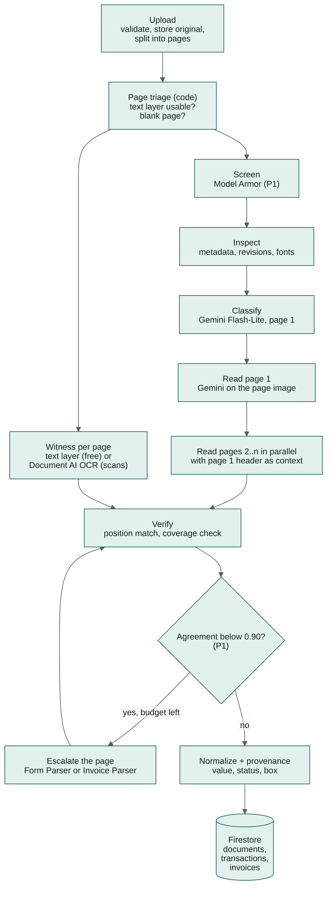

# 07 — Document Intelligence

> How a file becomes trusted, traceable data: page split, screening, inspection, classification,
> **adaptive reading** (one AI reader plus a deterministic witness per page), normalization,
> **verification** and **provenance**. Checks on that data are in [`08`](08-risk-engine.md).
> Decision record: [ADR-010](adr/ADR-010-adaptive-extraction-ai-reader-and-witness.md).

---

## 1. Supported inputs

| Type | Formats | Limits (free trial) | Analyzed in |
|---|---|---|---|
| Bank statement (monthly, one account) | PDF (digital or scanned), PNG, JPEG | ≤ 20 MB, ≤ 20 pages | P0 |
| Sales invoice (applicant is issuer) | PDF, PNG, JPEG | ≤ 20 MB, ≤ 20 pages | P0 |
| Purchase invoice (applicant is buyer) | PDF, PNG, JPEG | ≤ 20 MB, ≤ 20 pages | P0 (extracted; used in reconciliation as outflows) |
| Tax invoice (VAT e-invoice) | PDF | as above | P1 extraction via invoice path; QR validation P2 |
| Receipt | PDF, PNG, JPEG | ≤ 10 pages | P2 |
| Anything else | — | — | classified `OTHER`, kept, not analyzed |

- File type is detected from **magic bytes**, never from the file name or the browser's content type.
- Limits come from the workspace's plan ([`contracts/plans.v1.yaml`](../contracts/plans.v1.yaml)):
  `pagesPerDocument`, `fileSizeMb`, `documentsPerCase`. Cloud Run's 32 MiB request limit stays above
  the largest plan limit.
- **Longer PDFs** (e.g. a 6-month statement of 47 pages): P0 rejects them with `422 TOO_MANY_PAGES`
  and a hint to upload one file per month. P1 offers **"Split and upload"**: the server cuts the PDF
  into parts of ≤ 20 pages, each part becomes its own document, and structure checks (`M01`–`M05`) run
  once on the untouched original so splitting never hides an edit (§3.3).

---

## 2. Pipeline per document



Document statuses written along the way: `UPLOADED → SCREENING → INSPECTING → CLASSIFYING →
EXTRACTING → CHECKING → DONE` (or `SKIPPED`, `FAILED`, `QUARANTINED`). Pages carry their own small
status in `documents.pages[]` so the UI can show "page 4 of 18 read".

---

## 3. Upload, page split, screening and inspection

### 3.1 Upload and page split (synchronous, `kredibel-web`)

1. Validate: magic bytes, size, page count against the plan, not encrypted, not a duplicate (SHA-256).
2. Store the original at `…/documents/{docId}/original.{ext}`.
3. **Split into pages:** render each page to PNG at 150 dpi (long edge capped at 4,000 px) plus a
   300 px thumbnail; images (PNG/JPEG) become one page.
4. **Triage each page (deterministic, free):**

   | Test | Result |
   |---|---|
   | pdfplumber finds ≥ 40 characters and ≥ 80% are printable and decodable (no `(cid:…)` glyphs) | `textLayer = USABLE` → witness `TEXT_LAYER` |
   | Characters exist but fail the test above | `textLayer = UNUSABLE` → witness `OCR` |
   | No characters (scan or image) | `textLayer = NONE` → witness `OCR` |
   | Rendered page is ≥ 99.5% near-white and has no characters | `blank = true` → not read (saves a call) |

5. Store `pages[] {pageNo, width, height, imagePath, thumbPath, sha256, textLayer, blank}` and show a
   **Digital / Scanned** badge per document in the UI.

Rendering 20 pages takes a few seconds; the upload response returns once pages are stored. If cold
starts push this near the request timeout, thumbnails are rendered first and full pages by the worker
(plan 003, risks).

### 3.2 Screening (P1)

- Send the original bytes to Model Armor (`sanitizeUserPrompt` with a file data item, byte type PDF
  or image) using template `kredibel-docs` (prompt injection & jailbreak at medium-and-above; malicious
  URIs).
- `MATCH_FOUND` on prompt injection → `documents.screening = {verdict: "INJECTION_SUSPECTED",
  quarantined: true, filters: […]}`, finding `S01_EMBEDDED_INSTRUCTIONS` (CRITICAL).
- **Quarantined documents never reach Gemini.** They still get inspection and the witness (text layer
  or OCR) so the analyst can see their content, but with only one reading their verdict is at best
  `UNVERIFIABLE`.

### 3.3 Inspection (deterministic)

| Output | Tool | Used by |
|---|---|---|
| `pageCount`, `isEncrypted`, text-layer triage per page | pikepdf, pdfplumber | limits, witness choice, `M06` |
| Info dictionary: `Producer`, `Creator`, `CreationDate`, `ModDate`; XMP metadata | pikepdf | `M01`, `M02` |
| Revision count (number of `%%EOF` markers / `startxref` sections) and byte offsets | raw bytes scan | `M03` |
| Earliest-revision text (bytes truncated at the first `%%EOF`, re-opened) | pikepdf + pdfplumber | `M03` revision diff (P1) |
| Fonts per page and per character (`fontname`, `size`), character boxes | pdfplumber | `M04`, witness words |
| Filled rectangles overlapping text | pdfplumber `rects` | `M05` (P1) |

Inspection always runs on the **original upload**. For P1 split parts, it runs once on the original
and findings are mapped to the part and page that contain the region.

---

## 4. Classification

- Model: `MODEL_LITE` (Flash-Lite). Input: page 1 image plus up to 2,000 characters of text layer (if
  usable and not quarantined). Cached by document SHA-256 + model + prompt version.
- Output `DocClassification`:

```python
class DocClassification(BaseModel):
    doc_type: Literal["BANK_STATEMENT", "SALES_INVOICE", "PURCHASE_INVOICE",
                      "TAX_INVOICE", "RECEIPT", "OTHER"]
    confidence: float            # 0..1, model's self-report; calibrated in evals
    language: str                # BCP-47 of the document, e.g. "en", "id"; any language is accepted
    issuer_name: str | None      # bank or invoice issuer as printed
    counterparty_name: str | None
    period_hint: str | None      # e.g. "MAR 2026" for statements
    reasons: list[str]           # ≤3 short reasons
```

- **Sales vs purchase:** decided in code, not by the model: if the issuer fuzzy-matches the
  applicant's name, trading name or an accepted alias (`rapidfuzz.token_set_ratio ≥ 85`) it is
  `SALES_INVOICE`; if the buyer matches, `PURCHASE_INVOICE`; otherwise the model's guess is kept and a
  `LOW` finding `E05_PARTY_UNCLEAR` is raised.
- `confidence < 0.6` → `doc_type = OTHER` with finding `E03_UNCERTAIN_TYPE` (LOW). The analyst can
  override the type (P1) and re-run.
- The UI language is English, but **documents can be in any language**; the reader returns values as
  printed and normalization handles the formats in §5.4.

---

## 5. Adaptive reading

### 5.1 Strategy at a glance

| Page kind | AI reading | Witness | Extra (only when needed) | Typical cost per page |
|---|---|---|---|---|
| Digital PDF page | Gemini Flash on the page image | **PDF text layer** (free) | — | ≈ USD 0.007 (statement), 0.003 (invoice) |
| Scanned page, photo, or unusable text layer | Gemini Flash on the page image | **Document AI Enterprise OCR** (USD 1.50 / 1,000 pages) | — | + USD 0.0015 |
| Any page with agreement < 0.90 (P1) | as above | as above | **Form Parser** (statements, USD 0.03/page) or **Invoice Parser** (USD 0.10 per 10 pages) | + USD 0.03–0.10 |
| Quarantined document (P1) | none | text layer or OCR | — | ≤ USD 0.0015 |
| `EXTRACTION_MODE=thorough` (evals; future paid tier) | Gemini Flash | witness | specialized parser on **every** page | ≈ USD 0.04–0.11 |

Costs and their sources: [`21`](21-cost-analysis.md) §3.

### 5.2 The AI reader (Gemini)

- **One call per page**, `MODEL_FAST`, `temperature = 0`, `response_schema` set, media resolution
  `high` (1,120 image tokens; spike S1 compares `ultra_high`). The input is the **page PNG only**; the
  text layer is never sent, so the reader stays independent of the witness.
- **Page 1 first.** Its output includes the header; pages 2..n run in parallel (`PAGE_CONCURRENCY`,
  default 6) and receive a short context: account number, period and the printed column order.
- The prompt asks for **values exactly as printed** (strings) plus the row order on the page; no
  arithmetic, no reformatting. Documents are framed as untrusted data ([`06`](06-agent-design.md) §5).

```python
class StatementRow(BaseModel):
    row_on_page: int              # 0-based, printed order on this page
    date_text: str                # as printed, e.g. "05/03"
    description: str
    debit_text: str | None        # as printed, e.g. "1,250,000.00"
    credit_text: str | None
    balance_text: str | None

class StatementPage(BaseModel):
    page: int                     # 1-based
    header: "StatementHeader | None"   # page 1 (and any page that repeats it)
    rows: list[StatementRow]
    totals: "StatementTotals | None"   # printed totals / closing balance if on this page

class StatementHeader(BaseModel):
    bank_name: str | None
    account_holder: str | None
    account_number: str | None
    holder_address: str | None
    currency: str | None
    period_start_text: str | None
    period_end_text: str | None
    opening_balance_text: str | None
    column_order: list[str]       # e.g. ["date", "description", "debit", "credit", "balance"]

class StatementTotals(BaseModel):
    total_credits_text: str | None
    total_debits_text: str | None
    closing_balance_text: str | None

class InvoiceLine(BaseModel):
    description: str
    quantity_text: str | None
    unit_price_text: str | None
    amount_text: str | None

class InvoicePage(BaseModel):
    page: int
    invoice_number: str | None
    issuer_name: str | None
    issuer_tax_id: str | None
    issuer_address: str | None
    buyer_name: str | None
    buyer_tax_id: str | None
    issue_date_text: str | None
    due_date_text: str | None
    currency: str | None
    payment_bank_text: str | None       # e.g. "Archipelago Commerce Bank"
    payment_account_text: str | None    # as printed in the payment instructions
    lines: list[InvoiceLine]
    subtotal_text: str | None
    tax_text: str | None
    total_text: str | None
```

Pages of the same document are merged in code: global `row_index` = order of (page, row_on_page);
header fields come from the first page that has them; totals from the last.

### 5.3 The witness

The witness produces **words with boxes** for a page, normalized to the page (0..1, top-left origin):

| Source | How | Cost | Cache key |
|---|---|---|---|
| `TEXT_LAYER` | `pdfplumber.extract_words(keep_blank_chars=False, use_text_flow=False)` plus `fontname`/`size` per word | free (CPU) | none needed |
| `OCR` | Document AI **Enterprise Document OCR** processor (`DOCAI_OCR_PROCESSOR_ID`), one request per ≤ 15 pages, tokens with bounding polygons | USD 1.50 / 1,000 pages | `cache/extraction/{sha256}/p{n}/ocr-{version}.json` |

The witness never interprets the page: it does not decide what is a row or a total. It only says
"these strings are printed here".

### 5.4 Normalization (shared, deterministic)

`domain/normalize.py` turns every source's strings into the same canonical types:

- **Amounts:** English format `1,250,000.00` is the default. The dot-grouped format `1.250.000,00`
  (used by many regional banks) is detected per document from the majority pattern. Strip `IDR` and
  spaces; handle `CR`/`DR` suffixes and parentheses for negatives. Parse into `Decimal`. A value that
  does not parse is `None` plus a parse note. It is never guessed.
- **Dates:** `DD/MM`, `DD/MM/YYYY`, `DD-MMM-YY`, `05 MAR`, English month names. Missing years are
  inferred from the statement period; a date outside the period gets a parse note. Local-language
  month names come with market packs (P2).
- **Direction:** a row with a debit amount is `DEBIT`, a credit amount is `CREDIT`; both or neither →
  row flagged `AMBIGUOUS_DIRECTION`.
- **Descriptions:** whitespace collapsed; original kept in `descriptionRaw`.
- **Counterparty:** a rules-based extractor pulls names after common prefixes (`TRANSFER IN`,
  `TRANSFER OUT`, `INSTANT TRANSFER IN`, `INTERBANK TRANSFER`, `RTGS`, `PAYMENT FROM`, `PAYMENT TO`),
  uppercased and normalized for matching. The categorizer refines names it could not parse
  ([`08`](08-risk-engine.md) §4.3).

---

## 6. Verification (AI reader vs witness)

### 6.1 Statements

`domain/verify.py`, pure and unit-tested:

1. **Anchor each AI row.** Find the witness token(s) equal to `date_text` on that page, in printed
   order (each anchor below the previous one). The **row band** runs from the anchor's top to just
   above the next row's anchor (multi-line descriptions stay inside).
2. **Match values in the band.** For `debit_text`, `credit_text`, `balance_text`: a witness token in
   the band that is equal as a string, else equal after digits-only normalization.
3. **Check the column.** Column x-ranges are learned from the matched tokens of the page (median
   x-centre per field ± half the median gap). A match outside its column is a `CONFLICT`.
4. **Description:** `rapidfuzz.partial_ratio(band text without date/amounts, description) ≥ 85`.
5. **Status per value:** `AGREED` (found in band and column), `CONFLICT` (a different value sits in
   that band and column), `SINGLE_SOURCE` (AI only: nothing printed there, e.g. the witness could
   not read it).
6. **Coverage check.** Amount-like witness tokens inside the table region (between the first and last
   anchor) that no row consumed are grouped by band. A band with a date-like token and an amount
   becomes a **witness-only row** (`SINGLE_SOURCE`, source `TEXT_LAYER`/`OCR`), inserted in printed
   order. A band with an extra amount next to a matched one (two values printed in one cell's place)
   marks the row `CONFLICT` and adds a note for `M05` (P1).
7. **Header fields** (holder, account number, period, opening and closing balance, totals) are
   searched on their page as exact strings, else digits-only.

**Bounding boxes** come from the witness tokens (union of the matched tokens), so every agreed value
has an exact box, also on scanned pages.

### 6.2 Invoices

Header fields are found as exact strings anywhere on their page; line items are verified like rows
(band anchored on the description's first token, then quantity, unit price and amount in the same
band). The coverage check runs on amount-like tokens in the lines region.

### 6.3 Agreement

```
agreement = agreed_fields / compared_fields
```

counted over header fields and row fields the AI reported, **plus** one disagreement per value of
every witness-only row.

| Agreement (per page and per document) | Effect |
|---|---|
| ≥ `policy.extraction.minAgreement` (default **0.90**) | Document is verifiable |
| < 0.90 on a page, escalation enabled and budget left (P1) | Page escalated (§6.4) |
| < 0.90 for the document after escalation | Finding `E01_LOW_EXTRACTION_AGREEMENT` (MEDIUM); verdict at best `UNVERIFIABLE` |

### 6.4 Escalation and thorough mode (P1)

A specialized Document AI processor reads the page: **Form Parser** for statement tables (header row
mapped to canonical columns by deterministic header matching, every cell with its box) or **Invoice
Parser** for invoices. With three sources (AI, witness, parser), rows are aligned with the
longest-common-subsequence method of ADR-004 and a value is `AGREED` when **any two** sources agree.
`EXTRACTION_ESCALATION=on|off`; budget `ESCALATION_MAX_PAGES_PER_CASE` (plan feature
`escalationPagesPerCase`, default 10). In `EXTRACTION_MODE=thorough` every page is read by the parser
too.

### 6.5 What forensics may rely on

- Arithmetic findings are **CRITICAL** only when every value in the failing equation is `AGREED`
  **and** no witness-only row lies between the rows involved.
- If any involved value is `CONFLICT` or `SINGLE_SOURCE`, the same failure becomes `E01`-level
  uncertainty (MEDIUM) instead of tampering. **Constitution P6.**

---

## 7. Provenance

Every canonical value carries:

```python
class BBox(BaseModel):          # normalized to the page, origin top-left, 0..1
    x0: float; y0: float; x1: float; y1: float

Source = Literal["GEMINI", "TEXT_LAYER", "OCR", "DOCAI"]   # DOCAI = Form/Invoice Parser (P1)

class Provenance(BaseModel):
    doc_id: str
    page: int                    # 1-based
    bbox: BBox | None
    sources: list[Source]        # sources that agree on the chosen value
    status: Literal["AGREED", "CONFLICT", "SINGLE_SOURCE", "MISSING"]
    raw: dict[Source, str | None]   # {"GEMINI": "1,250,000.00", "TEXT_LAYER": "1,250,000.00"}
```

**Value choice:** for `AGREED`, the shared value. For `CONFLICT`, the witness's printed string when it
is consistent with the row's running balance, else `None` (and the row is never used for a CRITICAL
finding). **Bounding box:** from the witness tokens; for an AI-only value, the row band if known,
else none (the viewer says "Exact location not available").

Coordinates are converted once, at write time, to the normalized top-left system above. The frontend
never sees PDF points.

How provenance carries one value from the page to the decision (scenario S2):


*Source: [`evidence-lineage.drawio.svg`](diagrams/evidence-lineage.drawio.svg). Open it in VS Code with the draw.io extension to edit; the file stays a valid SVG.*

The whole reading path, page by page:


*Source: [`extraction-adaptive.drawio.svg`](diagrams/extraction-adaptive.drawio.svg).*

---

## 8. Outputs

| Firestore path | Content |
|---|---|
| `documents/{docId}.pages[]` | per page: `textLayer`, `blank`, `witness`, `agreement`, `aiRows`, `witnessOnlyRows`, `escalated` |
| `documents/{docId}.classification` | `DocClassification` + `runId` |
| `documents/{docId}.extraction` | `method` (`AI_TEXT_LAYER`, `AI_OCR`, `AI_MIXED`, `AI_ONLY`, `WITNESS_ONLY`, `THOROUGH`), agreement, counts, pages by witness, escalated pages, model, prompt version, processor versions |
| `documents/{docId}.statementMeta` | holder, masked account number, bank, holder address, period, opening/closing (+ provenance) |
| `documents/{docId}.invoiceMeta` | number, parties, tax IDs, payment account (masked), dates, totals (+ provenance) |
| `transactions/{txId}` | one per verified row, including witness-only rows ([`09`](09-data-model.md) §3.5) |
| `invoices/{invoiceId}` | one per invoice document ([`09`](09-data-model.md) §3.6) |

Account numbers are stored **masked** (last 4 digits); matching against declared accounts uses a hash
kept in server-only storage ([`09`](09-data-model.md) §3.17); full numbers exist only in the raw
reader JSON in GCS.

**Extraction cache (cost control).** Raw outputs are stored content-addressed per page:
`orgs/{orgId}/cache/extraction/{sha256}/p{n}/{source}-{model or processor}-{version}.json`. An
identical file uploaded again (any case of the same workspace) is never read or billed twice, and
cache hits do not count against the plan's `extractedPagesPerMonth`. `EXTRACTION_CACHE=on|ocr_only|off`
(evals bypass the Gemini cache to measure variance).

---

## 9. Failure modes

| Failure | Detection | Behaviour |
|---|---|---|
| Gemini output fails schema twice on a page | validation error | page is `WITNESS_ONLY`: rows built from the witness by the coverage method; all values `SINGLE_SOURCE`; `E01` (MEDIUM) |
| OCR fails after retries on a scanned page | exception | page is `AI_ONLY`: values `SINGLE_SOURCE`, no boxes; `E01` |
| Both fail on a page | — | page `FAILED`; if any page of a statement fails, the document is `FAILED` with `E02_EXTRACTION_FAILED` (HIGH); case continues |
| Text layer present but garbled | triage test fails | witness switches to OCR for that page (costs ≈ USD 0.0015) |
| Text layer differs from what is visible | extra or different tokens in a band | value `CONFLICT`; note for `M05` (P1); never silently resolved |
| Encrypted PDF | pikepdf | rejected at upload with `422 ENCRYPTED_DOCUMENT` |
| Scanned PDF (no text layer) | triage | `M06_IMAGE_ONLY` (INFO); font checks not applicable; OCR witness used |
| Statement spans two accounts | distinct account numbers in header/rows | finding `E04_MULTIPLE_ACCOUNTS` (MEDIUM); first account used |
| Plan page budget exhausted mid-case | reservation at run start | cannot happen mid-run: pages are reserved before the run starts ([`specs/013`](specs/013-workspace-and-plans/spec.md)) |
