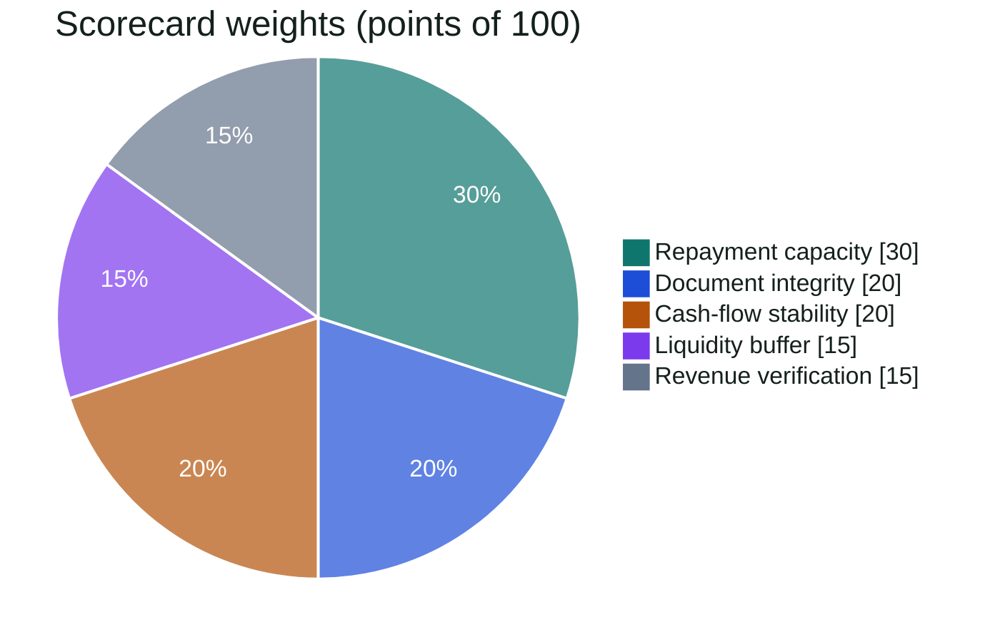

# 08 — Risk Engine

> Everything deterministic that turns extracted data into findings, metrics, a score and a
> recommendation. All of it lives in `backend/app/domain/` as pure, unit-tested functions.
> Policy values come from versioned YAML in `contracts/policy/`, never from code constants.

---

## 1. Findings: the common shape

```python
class EvidenceRef(BaseModel):
    doc_id: str | None = None
    page: int | None = None
    bbox: BBox | None = None          # normalized 0..1, top-left origin
    tx_id: str | None = None
    invoice_id: str | None = None
    fact_id: str | None = None        # e.g. "fact:dscr_proxy"
    label: str | None = None          # short caption shown in the viewer

class Finding(BaseModel):
    finding_id: str                   # fnd_{sha1(runId|code|anchor)[:16]}
    run_id: str
    code: str                         # e.g. "A01_RUNNING_BALANCE_BREAK"
    category: Literal["SCREENING", "EXTRACTION", "ARITHMETIC", "STRUCTURE", "VISUAL",
                      "CROSS_DOCUMENT", "RECONCILIATION", "CASHFLOW", "BEHAVIOURAL"]
    severity: Literal["CRITICAL", "HIGH", "MEDIUM", "LOW", "INFO"]
    title: str                        # templated, short
    facts: dict[str, str]             # e.g. {"expected": "12500000.00", "printed": "18500000.00"}
    explanation: str | None           # plain language, from finding_explainer or template
    evidence: list[EvidenceRef]
    detected_by: Literal["RULE", "MODEL", "MODEL_ARMOR"]
    corroborated_by: list[str] = []   # finding IDs
    status: Literal["OPEN", "ACKNOWLEDGED", "DISMISSED"] = "OPEN"
```

Every check implements one interface (`domain/forensics/base.py`):

```python
class Check(Protocol):
    code: str
    scope: Literal["DOCUMENT", "CASE"]
    def applies_to(self, ctx: CheckContext) -> bool: ...
    def run(self, ctx: CheckContext) -> list[Finding]: ...
```

Checks are registered in `domain/forensics/registry.py`. A check is enabled when its code is listed in
`contracts/policy/forensics.v1.yaml`.

---

## 2. Check catalog

Severity shown is the default. "Agreed" means every value used was `AGREED` by two independent
readings, the AI reader and the witness ([`07`](07-document-intelligence.md) §6.5).

### 2.1 Screening & extraction

| Code | Detects | Severity | P |
|---|---|---|---|
| `S01_EMBEDDED_INSTRUCTIONS` | Model Armor prompt-injection match in the file | CRITICAL | P1 |
| `E01_LOW_EXTRACTION_AGREEMENT` | Agreement < `minAgreement`, or a failing equation with non-agreed values | MEDIUM | P0 |
| `E02_EXTRACTION_FAILED` | Neither reader produced usable output | HIGH | P0 |
| `E03_UNCERTAIN_TYPE` | Classification confidence < 0.6 | LOW | P0 |
| `E04_MULTIPLE_ACCOUNTS` | More than one account number in a statement | MEDIUM | P1 |
| `E05_PARTY_UNCLEAR` | Invoice issuer and buyer both differ from the applicant (names and accepted aliases) | LOW | P0 |

### 2.2 Arithmetic (per document)

| Code | Rule | Severity | P |
|---|---|---|---|
| `A01_RUNNING_BALANCE_BREAK` | For consecutive rows: `|balance[i-1] + credit[i] − debit[i] − balance[i]| > tol` (tol = 1 unit). The first row uses the opening balance. Witness-only rows are included in the sequence. | CRITICAL if agreed and no witness-only row sits between, else `E01` | P0 |
| `A02_OPENING_CLOSING_MISMATCH` | `opening + Σcredits − Σdebits ≠ closing` | CRITICAL if agreed, else `E01` | P0 |
| `A03_PRINTED_TOTALS_MISMATCH` | Printed total credits/debits ≠ sum of rows | HIGH | P1 |
| `A04_INVOICE_TOTAL_MISMATCH` | `Σ line amounts ≠ subtotal`, or `subtotal + tax ≠ total`, or `qty × unit price ≠ line amount` (tol = 1 unit per line) | HIGH | P0 |
| `A05_TAX_RATE_INCONSISTENT` | `tax / subtotal` not within ±0.5 pp of any rate in `policy.vatRates` | MEDIUM | P1 |

A01 reports **one finding per broken row**, anchored to the row; the explanation names the printed
and the expected balance. When the next row's balance is consistent with the *printed* (wrong)
balance, the break was introduced at that row and not corrected later. The finding states this.

### 2.3 Structure (per document, PDF only)

| Code | Rule | Severity | P |
|---|---|---|---|
| `M01_EDITING_SOFTWARE_PRODUCER` | `Producer`/`Creator` matches a pattern in `policy.editorProducerPatterns` | MEDIUM | P0 |
| `M02_MODIFIED_AFTER_CREATION` | `ModDate − CreationDate > policy.modifiedAfterCreationMinutes` (default 10) | MEDIUM | P0 |
| `M03_MULTIPLE_REVISIONS` | >1 revision. MEDIUM if later revisions only add signatures/annotations; HIGH if a later revision replaces page content streams; CRITICAL (P1) if the revision diff shows changed numeric values | MEDIUM / HIGH / CRITICAL | P0 (detect) / P1 (diff) |
| `M04_FONT_ANOMALY_IN_VALUES` | In a numeric column, characters of one value use a font name or size not used by ≥90% of that column's values on the page | HIGH | P0 |
| `M05_COVERED_TEXT` | A filled rectangle overlaps existing characters and new characters are drawn on top | HIGH | P1 |
| `M06_IMAGE_ONLY` | No text layer on a page | INFO | P0 |

**Why M03 is graded:** genuine bank statements are often digitally signed, and signing appends a
revision. A revision is suspicious only when it changes what the page shows.

### 2.4 Visual (per page, P1)

| Code | Rule | Severity |
|---|---|---|
| `V01_VISUAL_EDIT_SUSPECTED` | Gemini reports a region with signs of editing (misaligned digits, different weight or kerning, halo or background mismatch, inconsistent column alignment) | MEDIUM; **HIGH** if corroborated by `A01`, `M04` or `M05` on the same row or a box overlapping by IoU ≥ 0.3. Never CRITICAL. |

### 2.5 Cross-document (per case)

| Code | Rule | Severity | P |
|---|---|---|---|
| `X01_STATEMENT_DISCONTINUITY` | For the same account, `closing(month N) ≠ opening(month N+1)` | HIGH (anchored to the later statement) | P0 |
| `X02_PERIOD_GAP` | Missing calendar months within the covered range | MEDIUM | P1 |
| `X03_DUPLICATE_CONTENT` | Two invoices with the same number, issuer and total | LOW | P1 |
| `X04_INVOICE_NUMBER_REUSED` | Same invoice number and issuer with a different total or date | HIGH | P1 |
| `X05_ACCOUNT_HOLDER_MISMATCH` | Statement holder matches none of: applicant legal/full name, trading name, accepted aliases, declared account holders (`token_set_ratio < 80`) | HIGH | P0 |
| `X06_UNDECLARED_ACCOUNT` | A statement's account matches none of the applicant's declared accounts (only when ≥ 1 is declared). Also creates a `BANK_ACCOUNT` suggestion | LOW | P0 |
| `X07_TAX_ID_MISMATCH` | A sales invoice's issuer tax ID differs from the applicant's tax ID (company profile or accepted suggestion) | HIGH | P1 |

### 2.6 Reconciliation, cash flow, behaviour (per case)

| Code | Rule | Severity | P |
|---|---|---|---|
| `R01_UNMATCHED_SALES_INVOICES` | Revenue verification ratio < 0.8 (MEDIUM) or < 0.5 (HIGH); evidence lists each unmatched invoice | MEDIUM / HIGH | P0 |
| `R02_REVENUE_INFLATION` | Invoiced sales in window > 1.5 × operating inflows in the same window | HIGH | P0 |
| `R03_PAID_BEFORE_ISSUE` | Matched payment dated > 3 days before the invoice issue date | MEDIUM | P1 |
| `C01_LOW_DSCR` | DSCR proxy < 1.25 (MEDIUM) or < 1.0 (HIGH) | MEDIUM / HIGH | P0 |
| `C02_NEGATIVE_BALANCE_DAYS` | Days with end-of-day balance < 0 ≥ `policy.negativeDaysThreshold` (3) | MEDIUM | P0 |
| `C03_VOLATILE_INFLOWS` | Operating inflow coefficient of variation > 0.5 | MEDIUM | P1 |
| `C04_WINDOW_DRESSING` | A credit in the last 3 days of a period ≥ 30% of that month's inflows, followed by a debit of ≥ 90% of it within the first 5 days of the next period | HIGH | P1 |
| `B01_GAMBLING_INDICATORS` | ≥1 transaction tagged `GAMBLING` | HIGH | P0 |
| `B02_P2P_LENDING_DEPENDENCE` | Repayments tagged `P2P_LENDING` in ≥ 3 months | MEDIUM | P1 |
| `B03_ROUND_TRIPPING` | Same counterparty in and out within 2 days at ±2%, ≥ 2 occurrences | HIGH | P1 |
| `B04_RETURNED_ITEMS` | ≥1 transaction tagged `RETURNED_ITEM` (≥3 → HIGH) | MEDIUM / HIGH | P0 |
| `B05_CASH_HEAVY_INFLOWS` | Cash deposits > 50% of operating inflows | LOW | P1 |
| `B06_CUSTOMER_CONCENTRATION` | Top client (counterparty directory, §4.3) > 50% of operating inflows | LOW | P1 |
| `B07_RELATED_PARTY_FLOWS` | Inflows from declared related parties ≥ 10% of operating inflows, or outflows to them ≥ 20% of operating outflows; those inflows are already re-classed as `OWNER_CAPITAL` (§4.2), the finding explains the effect | MEDIUM | P1 |

---

## 3. Document integrity verdict

Computed per document by `document_verdict` from its own findings (categories SCREENING, EXTRACTION,
ARITHMETIC, STRUCTURE, VISUAL, plus `X01` anchored to it), evaluated top-down:

| Verdict | Rule |
|---|---|
| `TAMPERED` | ≥1 **CRITICAL** finding from `A01`, `A02` or `M03`-with-diff (all deterministic, all agreed) |
| `SUSPICIOUS` | `S01`, or ≥1 HIGH integrity finding, or ≥2 MEDIUM integrity findings |
| `UNVERIFIABLE` | `E01` or `E02` present |
| `CLEAN` | none of the above |

An **integrity score** (0–100) is also stored for display: `100 − 40·critical − 20·high − 8·medium −
2·low`, floored at 0. The verdict, not the score, drives decisions.

---

## 4. Transaction categorization

### 4.1 Taxonomy (IAS 7 / PSAK 207 aligned)

| `cashflowClass` | `category` | Direction |
|---|---|---|
| `OPERATING` | `SALES_RECEIPT`, `OTHER_OPERATING_INCOME` | in |
| `OPERATING` | `SUPPLIER_PAYMENT`, `PAYROLL`, `RENT`, `UTILITIES`, `TAX_PAYMENT`, `BANK_FEES`, `OTHER_OPERATING_EXPENSE` | out |
| `INVESTING` | `ASSET_SALE` / `ASSET_PURCHASE` | in / out |
| `FINANCING` | `LOAN_DISBURSEMENT`, `OWNER_CAPITAL` | in |
| `FINANCING` | `LOAN_REPAYMENT`, `OWNER_DRAWING` | out |
| `NON_CASH` | `INTERNAL_TRANSFER`, `REVERSAL` | either |
| `UNCLASSIFIED` | `UNKNOWN` | either |

**Risk tags** (zero or more): `GAMBLING`, `CRYPTO`, `P2P_LENDING`, `CASH_DEPOSIT`, `CASH_WITHDRAWAL`,
`RETURNED_ITEM`, `ROUND_TRIP`.

**Policy choice, stated openly:** loan repayments (principal and interest) are `FINANCING`, so that
existing debt service is measured separately. Gambling and other personal spending are
`OWNER_DRAWING` with the relevant tag.

### 4.2 Order of precedence

1. **Analyst override** (P1): `categorizedBy = ANALYST`. Never overwritten by a re-run.
2. **Internal-transfer rule (code):** counterparty `token_set_ratio ≥ 90` with the applicant's names or
   a declared/accepted own account → `INTERNAL_TRANSFER`.
3. **Related-party rule (code, P1 with `B07`):** counterparty `token_set_ratio ≥ 90` with a declared or
   accepted related party → credit `OWNER_CAPITAL` (financing, not sales), debit `OWNER_DRAWING`.
4. **Keyword rules** from `contracts/policy/categorization-rules.v1.yaml`, evaluated in order, first
   match wins: `categorizedBy = RULE`, confidence 0.95.
5. **Model** (`txn_categorizer`, batches of 100) for the rest: `categorizedBy = MODEL`. Confidence
   < 0.5 → `UNKNOWN`. The same call returns a cleaned **counterparty name** and **kind** (`PERSON`,
   `BUSINESS`, `GOVERNMENT`, `BANK`, `UNKNOWN`) for rows whose name the rules could not parse (§4.3).

Rule examples (the YAML is authoritative):

| Pattern (case-insensitive) | Direction | Result |
|---|---|---|
| `\b(PAYROLL\|SALARY\|SALARIES\|WAGES)\b` | out | `PAYROLL` |
| `\b(ELECTRICITY\|WATER BILL\|INTERNET\|TELEPHONE\|UTILITY)\b` | out | `UTILITIES` |
| `\b(VAT PAYMENT\|TAX PAYMENT\|INCOME TAX\|WITHHOLDING TAX)\b` | out | `TAX_PAYMENT` |
| `\b(ADMIN FEE\|TRANSFER FEE\|SERVICE CHARGE\|STAMP DUTY)\b` | out | `BANK_FEES` |
| `\b(RENT\|LEASE)\b` | out | `RENT` |
| `\b(ONLINE LOAN\|P2P\|PAYDAY\|QUICKCASH)\b` | out | `LOAN_REPAYMENT` + `P2P_LENDING` |
| `\b(LOAN INSTALLMENT\|INSTALLMENT\|LOAN REPAYMENT)\b` | out | `LOAN_REPAYMENT` |
| `\b(SLOT\|CASINO\|JACKPOT\|BETTING\|LOTTERY\|GAMBLING)\b` | out | `OWNER_DRAWING` + `GAMBLING` |
| `\b(RETURNED\|REJECTED\|REVERSAL\|BOUNCED)\b` | either | `REVERSAL` + `RETURNED_ITEM` |
| `\b(CASH DEPOSIT)\b` | in | tag `CASH_DEPOSIT` (category left to model) |
| `\b(CASH WITHDRAWAL\|ATM WITHDRAWAL)\b` | out | tag `CASH_WITHDRAWAL` (category left to model) |
| `\b(INTEREST CREDIT\|INTEREST)\b` | in | `OTHER_OPERATING_INCOME` |

Rules are English for the prototype. Local-language bank descriptions for other markets are added as
separate market-pack rule files (P2); the model already handles any language for the long tail.

### 4.3 Counterparty directory (spec 014)

After categorization and reconciliation, `build_counterparties` (pure) groups transactions by
normalized counterparty name (`rapidfuzz.token_set_ratio ≥ 90` merges spellings; the longest spelling
wins) and assigns **roles in code**:

| Role | Rule |
|---|---|
| `CLIENT` | Buyer on ≥ 1 sales invoice, **or** counterparty of ≥ 1 credit categorized `SALES_RECEIPT` |
| `SUPPLIER` | Issuer of ≥ 1 purchase invoice, **or** counterparty of ≥ 1 debit categorized `SUPPLIER_PAYMENT` |
| `LENDER` | Counterparty of `LOAN_REPAYMENT` or `LOAN_DISBURSEMENT` |
| `OWN_ACCOUNT` | Matches the applicant's names or own accounts (`INTERNAL_TRANSFER`) |
| `RELATED_PARTY` | Matches a declared or accepted related party |
| `GOVERNMENT` | Counterparty of `TAX_PAYMENT`, or kind `GOVERNMENT` |
| `OTHER_PAYEE` / `OTHER_PAYER` | Named party with debits / credits and none of the roles above |

Rows without a parsable name (e.g. `LOAN INSTALLMENT 0042`, `VAT PAYMENT MAR`) are grouped by category
into a named bucket ("Loan installments", "VAT payments", "Payroll", "Bank fees") with kind `UNKNOWN`
and a role from the category (`LENDER` for loans, `GOVERNMENT` for tax, `OTHER_PAYEE` or
`OTHER_PAYER` otherwise), so totals stay complete. A party can hold several roles (e.g. a client that is
also a related party). Each counterparty stores
inflow, outflow, counts, first/last date, invoiced and matched totals, its share of operating inflow,
and up to 10 sample transactions as evidence. The directory feeds `B03`, `B06`, `B07`, the
`KEY_CLIENT`/`KEY_SUPPLIER` suggestions (§4.4) and the memo's "business" section.

### 4.4 Applicant profile suggestions (spec 014)

`build_applicant_profile` (pure) compares what the documents show with the applicant's profile and
proposes changes. Nothing is written to the profile until an analyst accepts.

| Suggestion | Source | Confidence |
|---|---|---|
| `BANK_ACCOUNT` | Statement header (bank, holder, account number) not among declared accounts; also invoice payment instructions | `HIGH` if the header values are `AGREED`, else `MEDIUM` |
| `TAX_ID` | Issuer tax ID printed on sales invoices (most frequent value), when the profile has none | `HIGH` if agreed on ≥ 2 invoices |
| `ADDRESS` | Statement holder address or invoice issuer address, when the profile has none | `MEDIUM` |
| `LEGAL_NAME` | Statement holder or invoice issuer name that differs in spelling only (`token_set_ratio ≥ 90`), proposed as an **alias** | `MEDIUM` |
| `RELATED_PARTY` | A `PERSON` counterparty receiving `OWNER_DRAWING` debits in ≥ 3 months, or sending credits in ≥ 2 months, and not already declared | `LOW` |
| `KEY_CLIENT` / `KEY_SUPPLIER` | Top clients/suppliers by flow with share ≥ 10% (max 5 each) | `MEDIUM` |

A suggestion whose value contradicts a single-valued profile field (tax ID, legal name) is stored as
`CONFLICT` with the current value, and the related check (`X05`, `X07`) carries the evidence. A value
an analyst rejected is never suggested again for that applicant (deterministic suggestion ID).

---

## 5. Cash-flow metrics

All computations use `Decimal`. Months are the calendar months fully covered by statements of the
applicant's accounts (every statement in the case, declared or not). Flows are summed across accounts after excluding `NON_CASH`.

### 5.1 Per month `m`

| Metric | Formula |
|---|---|
| `operating_inflow[m]` | Σ credits with class `OPERATING` |
| `operating_outflow[m]` | Σ debits with class `OPERATING` |
| `owner_drawings[m]` | Σ debits with category `OWNER_DRAWING` |
| `debt_service[m]` | Σ debits with category `LOAN_REPAYMENT` |
| `nocf[m]` | `operating_inflow − operating_outflow` |
| `cads[m]` (cash available for debt service) | `nocf − owner_drawings` |
| `eod_balance[d]` | balance after the last transaction of day `d`; carried forward on days without transactions; the opening balance before the first row |
| `adb[m]` (average daily balance) | mean of `eod_balance[d]` over the days of `m` inside the statement period |
| `min_balance[m]` | min of `eod_balance[d]` |
| `negative_days[m]` | count of days with `eod_balance[d] < 0` |

### 5.2 Aggregates

| Metric | Formula |
|---|---|
| `coverage_months` | number of months |
| `avg_operating_inflow`, `avg_cads`, `avg_debt_service`, `adb_avg` | arithmetic means over months |
| `inflow_cv` | population std-dev / mean of `operating_inflow[m]` (None if mean = 0) |
| `inflow_trend_pct` | OLS slope of `operating_inflow[m]` vs month index, ÷ mean × 100 (% per month) |
| `negative_days_total` | Σ `negative_days[m]` |
| `proposed_installment` | analyst override, else annuity: `P·r / (1 − (1+r)^−n)` with `r = policy.pricing.assumedAnnualRate / 12`, `n = tenorMonths` (`P/n` if `r = 0`) |
| `dscr_proxy` | `avg_cads / (avg_debt_service + proposed_installment)` |
| `max_supportable_installment` | `max(0, avg_cads / policy.pricing.targetDscr − avg_debt_service)` |
| `max_supportable_amount` | `max_supportable_installment · (1 − (1+r)^−n) / r` |
| `liquidity_buffer` | `adb_avg / proposed_installment` (months of installments held on average) |
| `sales_invoiced` | Σ totals of `SALES_INVOICE`s issued within the coverage window, excluding `NOT_DUE` |
| `sales_matched` | Σ matched amounts of those invoices |
| `revenue_verification_ratio` | `sales_matched / sales_invoiced` (None if no invoices) |
| `invoice_to_inflow_ratio` | `sales_invoiced / Σ operating_inflow` over the same window |

Every aggregate is published as a **fact** with ID `fact:<name>`, its value as a decimal string, its
unit, and the IDs of its inputs. Facts are what the memo cites.

---

## 6. Invoice ↔ bank reconciliation

For each `SALES_INVOICE` (total `T`, issue date `dᵢ`, due date `d_d`, default `dᵢ + policy.defaultTermsDays` (30)):

1. **Window:** credits dated in `[dᵢ − 3 days, d_d + policy.graceDays (30)]`, class `OPERATING` or
   `UNCLASSIFIED`, not yet matched. If `d_d` is after the coverage end, the invoice is `NOT_DUE` and
   leaves the ratio.
2. **Score each candidate credit `c`:**
   - `amount_score` = 1.0 if `|c − T| ≤ tol` (tol = max(IDR 1,000, 0.5% of T)); 0.8 if
     `T·(1 − policy.maxWithholding) ≤ c < T` (net of withholding tax, default 2%); else 0.
   - `party_score` = `token_set_ratio(buyer, counterparty or description) / 100`.
   - `date_score` = `1 − min(1, |date − d_d| / window_days)`.
   - `score = 0.5·amount + 0.35·party + 0.15·date`.
3. **Single match:** best candidate with `score ≥ policy.minMatchScore` (0.75) → `MATCHED`
   (`EXACT` or `NET_OF_TAX`).
4. **Split payment:** otherwise, combinations of 2–3 credits from candidates with `party_score ≥ 0.8`
   whose sum is within tol → `MATCHED` (`SPLIT`).
5. **Partial:** otherwise, one credit with `party_score ≥ 0.8` and `0.3·T ≤ c < T·(1 − maxWithholding)`
   → `PARTIAL` with `matchedAmount = c`.
6. Else `UNMATCHED`.

Assignment is greedy, ordered by issue date, then by score; a credit is used at most once. The
algorithm is deterministic for equal inputs (ties broken by transaction date, then ID).

Purchase invoices are matched against debits the same way (P1, informational only).

---

## 7. Scorecard and recommendation

The authoritative policy is [`contracts/policy/scorecard.v1.yaml`](../contracts/policy/scorecard.v1.yaml).
Summary:

| Component | Weight | Metric | Points |
|---|---|---|---|
| Repayment capacity | 30 | `dscr_proxy` | ≥2.0: 100 · ≥1.5: 80 · ≥1.25: 60 · ≥1.0: 30 · else 0 |
| Cash-flow stability | 20 | `inflow_cv` (lower is better), minus 5 per negative-balance day | ≤0.2: 100 · ≤0.35: 75 · ≤0.5: 50 · ≤0.8: 25 · else 0 |
| Liquidity buffer | 15 | `liquidity_buffer` | ≥3: 100 · ≥2: 75 · ≥1: 50 · ≥0.5: 25 · else 0 |
| Revenue verification | 15 | `revenue_verification_ratio` | ≥0.9: 100 · ≥0.75: 75 · ≥0.5: 40 · else 0 · no invoices: 50 |
| Document integrity | 20 | worst document verdict | CLEAN 100 · UNVERIFIABLE 50 · SUSPICIOUS 20 · TAMPERED 0 |




`score = round(Σ weight × points / 100)` → grade **A** ≥80, **B** ≥65, **C** ≥50, **D** ≥35, **E** <35.

| Grade | Recommendation |
|---|---|
| A | `APPROVE` |
| B | `APPROVE_WITH_CONDITIONS` |
| C | `REFER` |
| D, E | `DECLINE` |

**Hard stops** override the grade. The final recommendation is the most severe of the grade's
recommendation and every triggered hard stop (`APPROVE < APPROVE_WITH_CONDITIONS < REFER < DECLINE`):

| Hard stop | Trigger | Recommendation |
|---|---|---|
| `TAMPERED_DOCUMENT` | any document `TAMPERED` | `DECLINE` (and refer to fraud review) |
| `SUSPICIOUS_DOCUMENT` | any document `SUSPICIOUS` | `REFER` |
| `EMBEDDED_INSTRUCTIONS` | any `S01` | `REFER` |
| `REVENUE_NOT_EVIDENCED` | `revenue_verification_ratio < 0.5` (only when sales invoices were supplied) | `REFER` |
| `DSCR_BELOW_ONE` | `dscr_proxy < 1.0` | `DECLINE` |
| `HOLDER_MISMATCH` | any `X05` | `REFER` |
| `INSUFFICIENT_COVERAGE` | `coverage_months < policy.coverage.minMonths` (3) | `REFER` |

**Conditions** (for `APPROVE_WITH_CONDITIONS`) are templated per component scoring < 60 points, e.g.
"Reduce the amount to the maximum supportable: IDR {max_supportable_amount}" or "Provide 3 further
months of statements".

**Workspace overrides (P1).** A workspace may tune four values within bounds set in
[`contracts/plans.v1.yaml`](../contracts/plans.v1.yaml) (`policyOverrideBounds`): `pricing.assumedAnnualRate`
(6–36%), `pricing.targetDscr` (1.00–2.00), `coverage.requiredMonths` (3–12) and `coverage.minMonths`
(≤ required). Weights, bands and hard stops are not tunable. Each run stores the effective policy's
hash (`case.policyHash`) so a decision can always be traced to the exact numbers used.

> **Honesty note for the pitch:** this scorecard is an illustrative, transparent policy for a
> prototype. A lender would calibrate weights and bands on its own repayment outcomes. Kredibel's
> value is that the policy is explicit, versioned and explainable, not that these particular numbers
> are right.

---

## 8. Determinism and testing

- Every function in this document is pure: same inputs, same outputs, no clock, no I/O.
- Unit tests cover every rule boundary (just below / at / above thresholds) and use **hypothesis**
  property tests for arithmetic (e.g. a generated consistent statement never yields A01; flipping one
  digit of one balance always does).
- Scenario ground truth ([`18`](18-synthetic-data.md)) lists the expected codes per scenario; the
  scenario test asserts exactly those (no more, no fewer) for P0 codes.
