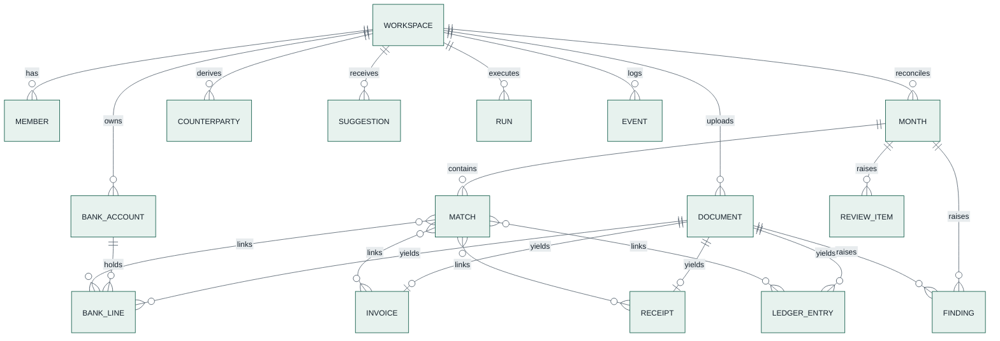

# 09 — Data Model

> Firestore is the system of record ([ADR-003](adr/ADR-003-firestore-system-of-record.md)); Cloud
> Storage holds files. This page is normative: repository code and `contracts/openapi.yaml` follow it.
> Changes follow [`22-data-migrations.md`](22-data-migrations.md).

---

## 1. Conventions

| Topic | Rule |
|---|---|
| Field names | `camelCase` in Firestore and JSON; `snake_case` in Python. Pydantic models use `alias_generator=to_camel, populate_by_name=True`. |
| IDs | ULIDs with a type prefix: `doc_`, `run_`, `evt_`, `itm_` (review item), `mat_` (match), `ivt_` (invite), `thr_` (assistant thread). Content-derived IDs are deterministic (§4). |
| Timestamps | Firestore `Timestamp` (UTC), set by the server. Document dates are `YYYY-MM-DD` strings (calendar dates, not instants). |
| Months | `YYYY-MM` strings in the workspace's time zone. |
| Enums | UPPER_SNAKE strings. |
| Workspace scoping | Every record lives under `orgs/{orgId}/…`. "Workspace" in the UI = `org` in data and code. Server-only data lives under `orgPrivate/{orgId}/…` and `system/…`, which clients can never read. |
| Schema version | Every document has `schemaVersion` (integer per collection, starting at 1; missing = 1). Reads upcast; writes write the latest ([ADR-013](adr/ADR-013-versioned-documents-and-forward-migrations.md)). |
| Parent IDs | Every document stores its parent IDs as fields (`orgId`, and `docId`, `month`, `runId` where they apply). |
| Held values | Records of a **possible duplicate** carry `heldAsDuplicate: true` and are excluded from figures and matching until decided (FR-012). |

## 2. Money

- **Python:** `Decimal`, wrapped in `Money(amount, currency)`. **Never `float`.**
- **Currency:** one per workspace (`orgs/{orgId}.currency`: `IDR`, `MYR`, `SGD`, `JPY` or `USD`), chosen
  at onboarding and fixed afterwards ([ADR-020](adr/ADR-020-workspace-currency-chosen-at-onboarding.md)).
- **Firestore:** integer **hundredths** in fields suffixed `Minor` for every currency
  (`amountMinor: 125000000` = IDR 1,250,000.00; ¥3,000 is `300000`).
- **API JSON:** `{"amount": "1250000.00", "currency": "MYR"}`, decimal string, two places.
- **Display:** `formatMoney` with the workspace currency: `IDR 1,250,000`, `MYR 1,250.50`, `¥3,000`;
  compact `IDR 1.25 M`.

---

## 3. Collections



### 3.1 `orgs/{orgId}` (workspace = the business or person whose books are checked)

| Field | Type | Notes |
|---|---|---|
| `name` | string | Display name |
| `entityType` | `INDIVIDUAL` \| `COMPANY` | Set at creation; cannot change |
| `profile` | map | `legalName`, `tradingName?`, `legalForm?` (company), `industry?`, `taxIdMasked?`, `address?` {`line1`, `city`}, `aliases[]` (accepted spellings) |
| `country`, `timezone`, `currency`, `defaultLanguage` | string | `ID`, `Asia/Jakarta`, the chosen currency (`IDR`, `MYR`, `SGD`, `JPY`, `USD`; fixed after onboarding), `en` |
| `profile.accountingFramework` | `IFRS` \| `US_GAAP` | Decides each category's cash-flow class (`contracts/policy/categories.v1.yaml`); default `IFRS` ([ADR-016](adr/ADR-016-human-verified-labels-and-learning-loop.md)) |
| `learning` | map | `shareVerifiedLabels` (bool, default `false`): consent to use masked verified labels in tuning datasets (later) |
| `ledgerMappings` | map | per file layout signature → confirmed column mapping (§3.8); bank account → ledger account code |
| `subscription` | map | `planId`, `status` (`TRIALING`, `TRIAL_EXPIRED`, `ACTIVE`), `trialStartedAt`, `trialEndsAt`, `limitOverrides?` |
| `counts` | map | `documents`, `openReviewItems`, `openFindingsBySeverity` — for the dashboard header |
| `createdBy`, `createdAt` | | |

### 3.2 `orgs/{orgId}/usageMonthly/{yyyy-mm}` and `usage/{yyyy-mm-dd}`

| Field | Notes |
|---|---|
| `documentsUploaded` | enforces `documentsPerMonth` (exact duplicates not counted) |
| `pagesReserved`, `pagesRead`, `pagesCached`, `ocrPages`, `parserPages` | enforces `extractedPagesPerMonth` |
| `aiSpendUsd` (decimal string) | enforces `aiSpendUsdPerMonth` |
| `monthRuns` (daily doc) | enforces `monthRunsPerDay` |
| `assistantQuestions` (daily doc, P1) | enforces `assistantQuestionsPerDay` |

### 3.3 `orgs/{orgId}/members/{uid}` and `invites/{inviteId}` (P1)

`members`: `email`, `displayName`, `role` (`owner` in P0; P1 adds `accountant`, `reviewer`, `viewer`;
authorization uses the custom claim), `language`, `createdAt`. `invites`: `email`, `role`, `status`
(`PENDING`, `ACCEPTED`, `REVOKED`, `EXPIRED`), `createdBy`, `expiresAt`.

### 3.4 `orgs/{orgId}/bankAccounts/{accountId}`

| Field | Type | Notes |
|---|---|---|
| `bankName`, `holderName` | string | |
| `accountMasked` | string | `••••4821`; the full number is never stored readable |
| `source` | `DECLARED` \| `DETECTED` | `DETECTED` = accepted from a suggestion |
| `ledgerAccountCode?` | string | Mapping for ledger reconciliation |
| `firstMonth`, `lastMonth` | string | Months covered by statements |

The salted hash of the full number lives in `orgPrivate/{orgId}/accountHashes/{accountId}`.

### 3.5 `orgs/{orgId}/documents/{docId}`

| Field | Type | Notes |
|---|---|---|
| `fileName`, `contentType`, `sizeBytes`, `pageCount` | | `contentType` from magic bytes |
| `sha256` | string | Exact-duplicate key (unique per workspace among non-duplicates) |
| `pHash` | string? | 64-bit perceptual hash of page 1 (images, receipts) |
| `gcsPath` | string | Never a public URL |
| `docType`, `typeConfidence`, `typeSetBy?` | `BANK_STATEMENT` \| `SALES_INVOICE` \| `PURCHASE_INVOICE` \| `RECEIPT` \| `LEDGER_EXPORT` \| `OTHER` \| `UNKNOWN`; decimal; the uid of the person who chose the type through the `CONFIRM_TYPE` item | The classifier never overrides a type a person set (AC-005-2) |
| `status`, `statusDetail?` | `UPLOADED` \| `SCREENING` \| `READING` \| `CHECKING` \| `DONE` \| `DUPLICATE` \| `NEEDS_INPUT` \| `FAILED` \| `QUARANTINED`; plain-language reason | **Realtime channel.** `NEEDS_INPUT` = type or ledger mapping to confirm |
| `duplicate` | map? | `kind` (`EXACT`, `CONTENT`), `ofDocId`, `code` (`D01`…`D06`), `decision` (`PENDING`, `CONFIRMED`, `REJECTED`), `decidedBy?`, `decidedAt?` |
| `heldAsDuplicate` | bool | true while a content duplicate is `PENDING` or `CONFIRMED` |
| `months` | string[] | Months the document's values fall in (statement period, invoice/receipt date, ledger dates) |
| `pages` | array | `{pageNo, imagePath, thumbPath, sha256, textLayer, blank, witness, status, agreement?}` — **realtime** "page n of m" |
| `reading` | map? | `method` (`AI_TEXT_LAYER`, `AI_OCR`, `AI_MIXED`, `LEDGER_PARSER`), `agreement`, `fieldsCompared`, `fieldsAgreed`, `model`, `promptVersion` |
| `statementMeta` | map? | `bankName`, `accountHolder`, `accountMasked`, `accountId?`, `periodStart`, `periodEnd`, `openingMinor`, `closingMinor`, `provenance`. The statement's account is the first line of `bankName` with spaces collapsed plus `accountMasked` (`domain/accounts.statement_account`): a branch line read on some pages only ("…Bank\nBandung Dago Branch") does not make a second account |
| `ledgerMeta` | map? | `layoutSignature`, `mappingStatus` (`PROPOSED`, `CONFIRMED`), `rows`, `rowsImported`, `rowErrors[]` {`row`, `reason`} (≤ 100), `dateRange` |
| `pdf` | map? | `producer`, `creator`, `creationDate`, `modDate`, `revisions`, `hasTextLayer`, `fonts[]` |
| `integrity` | map? | `verdict` (`CLEAN`, `SUSPICIOUS`, `TAMPERED`, `UNVERIFIABLE`), `findingIds[]` |
| `risk` | map? | `level`, `score` |
| `screening` | map? | P1 Model Armor result; `quarantined` |
| `uploadedBy`, `uploadedAt`, `lastRunId` | | |

### 3.6 `orgs/{orgId}/bankLines/{txId}`

| Field | Type | Notes |
|---|---|---|
| `docId`, `accountId?`, `rowIndex`, `page` | | |
| `date`, `month` | string | |
| `description` | string | As printed (never logged) |
| `counterpartyId?`, `counterpartyName?` | string | |
| `amountMinor` | int | Signed: + credit, − debit |
| `balanceMinor?` | int | Printed running balance |
| `category`, `cashflowClass`, `riskTags[]`, `categorizedBy` (`RULE`, `MODEL`, `MATCH`, `USER`), `categoryConfidence` | | [`08`](08-risk-engine.md) §4 |
| `consensus` | map | per field: `status` (`AGREED`, `CONFLICT`, `SINGLE_SOURCE`, `MISSING`), `bbox`, `raw` |
| `match` | map | `state` (`UNMATCHED`, `AUTO`, `MANUAL`, `PROPOSED`, `EXCLUDED`), `matchIds[]`, `matchedMinor` |
| `heldAsDuplicate` | bool | From a held statement |
| `source`, `chunkIds[]`, `notes[]` | | `AI` or `WITNESS` (a row only the page's words have); the layout chunks the row was read from ([ADR-023](adr/ADR-023-parse-extract-ground.md)); parse and grounding notes |
| `correctedFields[]?`, `correctedBy?`, `correctedAt?` | | Set when a user corrected a value (`amount`, `date`; the original stays in `consensus.raw`) |

### 3.7 `orgs/{orgId}/invoices/{invoiceId}` and `receipts/{receiptId}`

| Field (invoices) | Notes |
|---|---|
| `docId`, `kind` (`SALES`, `PURCHASE`) | |
| `number`, `issuerName`, `issuerTaxId?`, `buyerName`, `buyerTaxId?` | |
| `issueDate`, `dueDate?`, `month` | `month` of the issue date |
| `subtotalMinor`, `taxMinor`, `totalMinor` | |
| `payTo` | `bankName`, `accountMasked`, `accountHashRef` (to `orgPrivate`); feeds `X08` |
| `lines[]` | `{description, qty, unitPriceMinor, amountMinor}` |
| `supplyKind` | `GOODS` \| `SERVICES` \| `MIXED` (purchase invoices; from the reader, a `FIELD_VALUE` label); decides `INVENTORY_PURCHASE` or `SUPPLIER_PAYMENT` ([`08`](08-risk-engine.md) §4.1) |
| `payment` | `state` (`UNPAID`, `PAID`, `PARTIAL`, `NOT_DUE`, `WAITING_FOR_STATEMENT`), `paidMinor`, `matchIds[]` |
| `currency`, `pages[]`, `notes[]` | Currency as printed (else the workspace's); the pages it was read from; parse notes |
| `consensus`, `heldAsDuplicate`, `counterpartyId?` | Per field (`number`, `issuerName`, `total`, `lines.{i}.amount`, …): status, page, box, raw readings; `payTo` raw readings masked |
| `dupKey`, `dupKeyAlt` | Content keys for `D03`/`D04` (issuer + number; issuer + date + total), single-field indexed |
| `correctedFields[]`, `correctedBy?`, `correctedAt?` | Fields a person corrected through review (`total`, `issueDate`); the readings stay in `consensus.raw` and a re-run never undoes them |

Receipts: `docId`, `merchantName`, `merchantTaxId?` (masked), `number?`, `date`, `time?`, `month`,
`currency`, `totalMinor`, `taxMinor?`, `paymentMethod` (`CASH`, `CARD`, `TRANSFER`, `UNKNOWN`),
`items[]?`, `pages[]`, `notes[]`, `payment` (as above), `consensus`,
`heldAsDuplicate`, `dupKey` (merchant + date + total, for `D05`; the perceptual hash is on the
document), `correctedFields[]` (`total`, `date`), `correctedBy?`, `correctedAt?` as for invoices.

### 3.8 `orgs/{orgId}/ledgerEntries/{entryId}`

| Field | Type | Notes |
|---|---|---|
| `docId`, `rowNumber` | | Source file and row |
| `date`, `month` | string | |
| `accountCode`, `accountName` | string | From the mapped columns |
| `description`, `reference?` | string | |
| `debitMinor`, `creditMinor` | int | One of them non-zero |
| `isBankCash` | bool | Account code mapped to one of the workspace's bank accounts |
| `match` | map | as for bank lines |
| `heldAsDuplicate` | bool | `D06` |
| `dupKey` | string | date + amount + account + reference, for `D06` |

For spec 018 reporting, optional `postingStatus` defaults to `UNKNOWN` (`POSTED` is required to
contribute), `currency` defaults to null (must equal the workspace currency), and `journalId`
defaults to null. `entryKind` defaults to `ACTIVITY`; explicit `OPENING`/`CLOSING` rows are
excluded from period performance. Rows missing posting/currency evidence are excluded explicitly. This is an
additive v1 persistence model; no legacy row is assumed posted. Each row stores `orgId` and `entryId`.

`orgs/{orgId}/accountClassifications/{sha256(accountCode)}` (v1): `orgId`, `accountCode`, `pnlLine`,
`subledger`, `confirmedBy`, `confirmedAt`, `schemaVersion`. Mappings are confirmed only through the
API by an owner/accountant; classification plus audit event is atomic. No backfill. Catalog in
`contracts/policy/profit-loss.v1.yaml`; row-level source remains `docId` / `rowNumber`.

**Ledger column mapping** (`orgs/{orgId}.ledgerMappings[layoutSignature]`): `{date, description,
reference?, accountCode, accountName?, debit?, credit?, amount?, signConvention?, dateFormat,
decimalSeparator, confirmedBy, confirmedAt}`. The layout signature is a hash of the normalized header
row. Gemini proposes; the user confirms once per layout.

### 3.9 `orgs/{orgId}/months/{yyyy-mm}`

| Field | Type | Notes |
|---|---|---|
| `month` | string | |
| `state` | `COLLECTING` \| `RECONCILING` \| `NEEDS_REVIEW` \| `RECONCILED` \| `SIGNED_OFF` (P1) | `COLLECTING` = awaiting statement coverage or computation. While the workflow is a skeleton, `note` explains that reconciliation is unavailable (ADR-025). **Realtime channel.** |
| `dirty` | bool | Set by any change to the month's data; cleared by the month run |
| `generation` | int | Incremented with every change; only the month run started for the latest generation writes ([`06`](06-agent-design.md) §3) |
| `signedOff?` | map | `by`, `at` (P1); reopening records `reopened {by, at, reason}` |
| `statements` | array | `{accountId, docId}` present for the month |
| `figures` | map | Facts of [`08`](08-risk-engine.md) §5 as minor units or decimal strings |
| `risk` | map | `level`, `score`, `reasons[]` (finding IDs), `summary` (explainer text), `nextSteps[]`, `grounding` (`VERIFIED`, `TEMPLATE`) |
| `flows` | map | Money-flow totals for the month by account, counterparty and category; both views and both frameworks are assembled from them when read ([`08`](08-risk-engine.md) §5.1, §5.2) |
| `lastRunId`, `updatedAt` | | |

### 3.10 `orgs/{orgId}/matches/{matchId}`

| Field | Type | Notes |
|---|---|---|
| `month` | string | Month of the bank line (or of the document for document ↔ ledger matches) |
| `kind` | `BANK_SALES_INVOICE` \| `BANK_PURCHASE_INVOICE` \| `BANK_RECEIPT` \| `BANK_LEDGER` \| `DOCUMENT_LEDGER` | |
| `bankLineIds[]`, `invoiceIds[]`, `receiptIds[]`, `ledgerEntryIds[]` | | |
| `amountMinor` | int | |
| `method` | `AUTO` \| `MANUAL` | |
| `status` | `CONFIRMED` \| `PROPOSED` \| `REJECTED` | Rejected proposals are kept so they are not proposed again |
| `score`, `reasons[]` | | `AMOUNT_EXACT`, `NET_OF_TAX`, `PARTY_MATCH`, `REFERENCE_IN_TEXT`, `DATE_NEAR`, `SPLIT` |
| `createdBy` (`system` or uid), `createdAt`, `runId` | | |

### 3.10a Evidence and support fields (ADR-025)

Invoices and receipts carry `evidence` {`payment` (`PaymentEvidence`), `covered`, `bankPaidMinor`,
`confirmedPaidMinor`, `outstandingMinor`, `printedCurrency`, `approved`, `matchIds[]`}; bank lines
carry `support` (`EXCLUDED`, `MATCHED`, `PROPOSED`, `NOT_REQUIRED`, `NO_SUPPORT`). Both are derived
by the month run from matches, statement coverage and decisions ([`08`](08-risk-engine.md) §6) and
are optional until it has run (no migration: new optional fields).

### 3.11 `orgs/{orgId}/reviewItems/{itemId}`

| Field | Type | Notes |
|---|---|---|
| `kind` | see [`08`](08-risk-engine.md) §7 | |
| `month?`, `docId?` | string | |
| `subject` | map | IDs of the bank line, document, entry or match concerned |
| `status` | `OPEN` \| `RESOLVED` \| `DISMISSED` | |
| `priority` | int | Sorting: duplicates and high-risk first |
| `suggestion?` | map | Proposed fix (candidates for a match, the other reading for a value) |
| `resolution?` | map | `action` (the person's action of [`10`](10-api-contract.md) §4; absent when the system closed the item because its cause is gone), `note?`, `resolvedBy` (a uid or `system`), `resolvedAt` |
| `key` | string | Deterministic ID input, so a re-run never duplicates an item (§4) |

### 3.12 `orgs/{orgId}/findings/{findingId}`

As [`08`](08-risk-engine.md) §1 (`code`, `category`, `scope`, `docId?`, `month?`, `severity`,
`title`, `facts`, `explanation`, `nextSteps[]`, `evidence[]`, `detectedBy`, `status`, `dismissal?`
{`reason`, `by`, `at`}, `lastSeenRunId`).

### 3.12a `orgs/{orgId}/decisions/{decisionId}` (ADR-025)

A person's audited decisions; none creates bank cash or a match. Written with a `DECISION_RECORDED`
or `DECISION_WITHDRAWN` event in the same batch; never deleted.

| Field | Type | Notes |
|---|---|---|
| `kind` | `DOCUMENT_APPROVAL` \| `PAYMENT_CONFIRMATION` \| `CURRENCY_AGREEMENT` \| `SUPPORT_NOT_REQUIRED` | |
| `docId?`, `invoiceId?`, `receiptId?`, `txId?`, `recordId?` | string | Subject; `recordId` is the invoice, receipt or bank line, for one-field queries |
| `amountMinor?`, `currency?`, `paidOn?`, `method?` | | Payment confirmation, in the workspace currency (no conversion); several per document for partial payments |
| `printedCurrency?` | string | Currency agreement: what the document prints, kept unchanged |
| `reason?` | string | Required for payment confirmation and support not required |
| `months[]` | string | Months that re-reconcile |
| `status` | `ACTIVE` \| `WITHDRAWN` | Approval, agreement and not-required: one active per subject (deterministic ID) |
| `decidedBy`, `decidedAt`, `withdrawnBy?`, `withdrawnAt?` | | |

### 3.13 `orgs/{orgId}/counterparties/{counterpartyId}`

`name`, `aliases[]`, `kind` (`PERSON`, `BUSINESS`, `GOVERNMENT`, `BANK`, `UNKNOWN`), `roles[]`,
`totalsByMonth` {month → `inMinor`, `outMinor`, `count`}, `accountsSeen[]` {`accountMasked`,
`firstSeen`, `lastSeen`} (hashes in `orgPrivate/{orgId}/counterpartyAccounts/…`), `firstDate`,
`lastDate`, `sampleEvidence[]`.

### 3.14 `orgs/{orgId}/suggestions/{suggestionId}`

`field` (`BANK_ACCOUNT`, `TAX_ID`, `ADDRESS`, `ALIAS`, `RELATED_PARTY`), `value`, `display`,
`confidence`, `basis`, `evidence[]`, `status` (`PENDING`, `CONFLICT`, `ACCEPTED`, `REJECTED`),
`conflictWith?`, `decidedBy?`, `decidedAt?`. A `BANK_ACCOUNT` suggestion's keyed hash lives in
`orgPrivate/{orgId}/suggestionSecrets/{suggestionId}`, never in the readable document.

### 3.15 `orgs/{orgId}/runs/{runId}`

| Field | Notes |
|---|---|
| `kind` | `DOCUMENT` \| `MONTH` |
| `target` | `docId` or `month` |
| `status` | `QUEUED`, `RUNNING`, `DONE`, `FAILED`, `SUPERSEDED` (a newer month run started) |
| `stages[]` | `{node, parent?, status, startedAt, endedAt, model?, tokensIn?, tokensOut?, summary?, traceSpanId?}`; feeds the run graph (P1, [`17`](17-observability.md) §5) |
| `traceId` | Cloud Trace ID ([`17`](17-observability.md)) |
| `models[]`, `promptVersions` | Models used and prompt file → version, for the Runs page and BigQuery joins |
| `labels` | `{proposed, verified, corrected}` counts, updated when a person decides one of this run's labels (P1) |
| `usage` | pages read, cached, OCR, parser, tokens, `estimatedUsd` |
| `policyHashes` | `forensics`, `reconciliation`, `risk` versions and hashes used |

### 3.16 `orgs/{orgId}/events/{eventId}` (append-only audit)

`type` (`WORKSPACE_CREATED`, `CURRENCY_CHANGED` (support only), `DOCUMENT_UPLOADED`, `DUPLICATE_RECORDED`, `DOCUMENT_REMOVED`, `DUPLICATE_CONFIRMED`,
`DUPLICATE_REJECTED`, `VALUE_CORRECTED`, `CATEGORY_CHANGED`, `MATCH_CREATED`, `MATCH_CONFIRMED` (a person confirms a proposal), `MATCH_REJECTED`,
`REVIEW_ITEM_RESOLVED`, `FINDING_ACKNOWLEDGED`,
`FINDING_DISMISSED`, `SUGGESTION_ACCEPTED`, `SUGGESTION_REJECTED`, `LEDGER_MAPPING_CONFIRMED`,
`BANK_ACCOUNT_ADDED`, `PROFILE_UPDATED`, `LABEL_CONFIRMED`, `LABEL_CORRECTED`, `WORKSPACE_RULE_CREATED`,
`DATASET_EXPORTED`, `MONTH_SIGNED_OFF` (P1), `MONTH_REOPENED` (P1), `MEMBER_*` (P1)), `actorUid`, `actorRole`, `at`, `subject` (IDs), `details`
(no document content, no full account numbers). Written in the same transaction as the change.

### 3.17 `orgs/{orgId}/assistantThreads/{threadId}`, `retrievalChunks/{chunkId}` and `knowledgeChunks` (P1)

`assistantThreads`: `title`, `scope` (`WORKSPACE` or a month), `createdBy`, `createdAt`,
`lastMessageAt`, `agentSessionId` (Agent Platform Sessions). Messages live in the managed session;
the API reads them from there ([ADR-014](adr/ADR-014-finance-assistant-tools-rag-memory.md)).
`retrievalChunks`: `docId`, `docType`, `page` (or ledger row range), `months`, `text` (≤ 2,000
characters), `embedding_v1` (vector, 768 dimensions, `gemini-embedding-001`), `schemaVersion`.
Written by the `document_workflow` after reading; deleted with the document.
`knowledgeChunks/{chunkId}` (top level, server only): passages from the policy files, the check
catalog and help pages, `source` (file path), `text`, `embedding_v1`. Rebuilt at deploy by
`tools/knowledge/build.py`. Both are searched with `find_nearest` (cosine, top 8).

### 3.18 Server only

| Path | Content |
|---|---|
| `orgPrivate/{orgId}/accountHashes/{accountId}` | Salted hash of a full bank account number (HMAC with a Secret Manager key in production) |
| `orgPrivate/{orgId}/counterpartyAccounts/{id}` | Hashes of supplier and client accounts seen (for `X08`) |
| `system/signup` | `{workspacesCreated}`; enforces `MAX_WORKSPACES` |
| `system/signup/users/{uid}` | `{orgId, role, createdAt}`: the user's one workspace, written in the creating transaction. A second create before the token carries the claim (double submit) finds it and gets `409 ALREADY_IN_WORKSPACE`; the server re-sets the claims from it if they were lost |
| `orgs/{orgId}/fileHashes/{sha256}` | `{docId, claimedAt}`: which document holds this exact content. Created in one transaction with the lookup before any work on an upload, so two simultaneous uploads of the same file cannot both become originals (spec 003 plan); released if the upload fails, deleted with the original; a claim older than 10 minutes whose document never appeared is taken over. Documents uploaded before the registry are found by `sha256` and registered on first sight |
| `knowledgeChunks/{chunkId}` (P1) | Shared help and policy passages for the assistant (§3.17) |
| `system/migrations/{migrationId}`, `system/migrationLock` | Migration registry and lease ([`22`](22-data-migrations.md) §5) |

### 3.19 `orgs/{orgId}/labels/{labelId}` (P1, [ADR-016](adr/ADR-016-human-verified-labels-and-learning-loop.md))

One per AI decision a person can check.

| Field | Type | Notes |
|---|---|---|
| `task` | `DOC_TYPE` \| `PAGE_TYPE` \| `CATEGORY` \| `COUNTERPARTY_ROLE` \| `FIELD_VALUE` | |
| `subject` | map | `docId?`, `pageNo?`, `field?`, `txId?`, `counterpartyId?`, `display` |
| `month?` | string | For filters |
| `ai` | map | Latest automatic decision: `value`, `confidence?`, `source` (`MODEL`, `RULE`, `MATCH`), `model?`, `promptVersion?`, `runId`, `traceId?`, `spanId?`, `at` |
| `final` | map | `value`, `source` (`MODEL`, `RULE`, `MATCH`, `PERSON`) |
| `status` | `AI_PROPOSED` \| `VERIFIED` \| `CORRECTED` | A run never changes `final` once a person decided |
| `needsCheck` | bool | `ai.confidence` below the task's threshold in `learning.v1.yaml` and not decided |
| `aiDisagreesWithPerson` | bool | Set when a later run proposes a different value than the person's |
| `framework?`, `cashflowClass?` | string | `CATEGORY` only; class derived from `categories.v1.yaml` |
| `decidedBy?`, `decidedAt?`, `note?` | | |
| `dataset` | map | `use` (`TRAIN`, `EVAL`, `EXCLUDED`), `reason?`; split fixed by hash of `labelId` (20% eval) |
| `embedding_v1?` | vector | `CATEGORY` and `DOC_TYPE` labels a person decided: embedding of the description or first-page text, for verified examples (768 dimensions) |
| `schemaVersion` | int | |

### 3.20 `orgs/{orgId}/workspaceRules/{ruleId}` (P1)

Rules a person created with "Apply to similar lines": `match` {`counterpartyId`, `direction`},
`category`, `sourceLabelId`, `createdBy`, `createdAt`, `active`. Applied by code after matches and
before the keyword rules ([`08`](08-risk-engine.md) §4.1).

---

## 4. Deterministic IDs

| Entity | ID |
|---|---|
| Bank line | `tx_` + 16 hex of `sha1(docId + "|" + rowIndex)` |
| Invoice / receipt | `inv_` / `rcp_` + 16 hex of `sha1(docId)` |
| Ledger entry | `led_` + 16 hex of `sha1(docId + "|" + rowNumber)` |
| Match | `mat_` + 16 hex of `sha1(kind + "|" + sorted member IDs)` |
| Review item | `itm_` + 16 hex of `sha1(kind + "|" + subject key)` |
| Finding | `fnd_` + 16 hex of `sha1(code + "|" + anchor)`; anchor = `docId:rowIndex`, `docId`, `month`, or `month:subjectId` |
| Counterparty | `cp_` + 16 hex of `sha1(orgId + "|" + nameNormalized)` |
| Suggestion | `sug_` + 16 hex of `sha1(orgId + "|" + field + "|" + normalizedValue)` |
| Bank account | `acc_` + 16 hex of `sha1(orgId + "|" + bankNameNormalized + "|" + digits)` |
| Label | `lbl_` + 16 hex of `sha1(task + "|" + subject key)`; subject key = `docId`, `docId:pageNo`, `txId`, `counterpartyId` or `docId:field` |
| Workspace rule | `rul_` + 16 hex of `sha1(counterpartyId + "|" + direction)` |

Re-runs upsert by these IDs, so retries and re-uploads never duplicate records (NFR-09).

---

## 5. Indexes (`contracts/firestore.indexes.json`)

| Collection | Fields | Serves |
|---|---|---|
| `documents` | `docType` ASC, `uploadedAt` DESC | Library filtered by type |
| `documents` | `status` ASC, `uploadedAt` DESC | Library filtered by status |
| `documents` | `months` CONTAINS, `uploadedAt` DESC | Library filtered by month |
| `documents` | `months` CONTAINS, `docType` ASC, `uploadedAt` DESC | Library filtered by month and type (the list always orders by `uploadedAt`) |
| `bankLines` | `month` ASC, `date` ASC | Month view |
| `bankLines` | `month` ASC, `match.state` ASC, `date` ASC | Unmatched lines of a month |
| `bankLines` | `counterpartyId` ASC, `date` ASC | Lines of a counterparty (money-flow drill-down) |
| `bankLines` | `month` ASC, `category` ASC | Lines of a flow |
| `invoices` | `kind` ASC, `issueDate` ASC | Invoice list |
| `invoices` | `month` ASC, `payment.state` ASC | Unpaid invoices of a month |
| `receipts` | `month` ASC, `date` ASC | Receipts of a month |
| `ledgerEntries` | `month` ASC, `isBankCash` ASC, `date` ASC | Ledger cash entries of a month |
| `matches` | `month` ASC, `status` ASC, `kind` ASC | Reconciliation view |
| `reviewItems` | `status` ASC, `priority` DESC, `month` DESC | Review queue |
| `reviewItems` | `month` ASC, `status` ASC | Items of a month |
| `findings` | `status` ASC, `severityRank` ASC, `month` DESC | Risk page |
| `findings` | `docId` ASC, `severityRank` ASC | Findings of a document |
| `counterparties` | `roles` CONTAINS, `lastDate` DESC | Clients, suppliers |
| `suggestions` | `status` ASC, `createdAt` DESC | Pending suggestions |
| `retrievalChunks` (P1) | vector `embedding_v1` (768, flat); and `docType` ASC + vector | `search_documents` (optionally by type; month filter applied to the top 30) |
| `knowledgeChunks` (P1) | vector `embedding_v1` (768, flat) | `search_knowledge` |

Single-field lookups (`documents.sha256`, `months.dirty`) use Firestore's automatic indexes.

---

## 6. Security rules (`contracts/firestore.rules`)

**Clients read, the server writes.** The browser may read its own workspace's data (used for
realtime progress); every write goes through the API, whose Admin SDK bypasses rules.

```
rules_version = '2';
service cloud.firestore {
  match /databases/{database}/documents {
    function inOrg(orgId) {
      return request.auth != null && request.auth.token.orgId == orgId;
    }
    match /orgs/{orgId}/{document=**} {
      allow read: if inOrg(orgId);
      allow write: if false;
    }
    match /{document=**} {
      allow read, write: if false;
    }
  }
}
```

The frontend uses listeners only as a **change signal** (document status, month state) and fetches
data through the API ([`11`](11-frontend.md) §5).

---

## 7. Cloud Storage layout

Bucket `{PROJECT_ID}-kredibel-docs` in `asia-southeast1`; uniform bucket-level access; public access
prevention; object versioning (noncurrent kept 7 days); lifecycle: delete after 90 days (synthetic data).

```
orgs/{orgId}/documents/{docId}/
  original.{pdf|png|jpg|csv|xlsx}
  pages/{n}.png                         150 dpi render (the AI reader's input and the viewer's image)
  thumbs/{n}.png                        300 px wide
  extraction/pointers.json              which cache objects this document used (audit)
orgs/{orgId}/extractions/{docId}/p{n}.md       the page as read, in Markdown (ADR-016); served by the API
orgs/{orgId}/cache/extraction/{fileSha256}/p{n}/chunks-v1.json   layout chunks of a page (ADR-023)
orgs/{orgId}/cache/extraction/{pageSha256}/{model}-{prompt}.json  reader output per page (cost control, docs/21 §5)
  classification-{model}-{promptId}@{version}.json
  p{n}/gemini-{model}-{promptId}@{version}.json
  p{n}/ocr-{processorVersion}.json
```

Exact duplicates store no second copy: the duplicate document points at the original's objects.
Bucket `{PROJECT_ID}-kredibel-agent-content` (P1, [ADR-017](adr/ADR-017-agent-observability-on-google-cloud.md)):
large prompt and response text offloaded by the BigQuery Agent Analytics plugin, only where
`AI_CONTENT_CAPTURE=synthetic`; deleted after 30 days.

**BigQuery** (P1): dataset `kredibel_agent_analytics` in `asia-southeast1`, table `agent_events`
(written by the plugin, partitioned by day) and its per-event views; dataset `kredibel_learning`
with table `labels`, refreshed by `make evals` (P1) and by dataset exports (later). Neither is a
system of record.

Backups bucket `{PROJECT_ID}-kredibel-backups`: Firestore exports before migrations, deleted after 30
days. Files are served only through the API after a workspace check.

---

## 8. Retention & deletion

- Prototype: synthetic data, 90-day object lifecycle.
- Deleting a document (owner action) removes its records, re-marks its months dirty and keeps an
  audit event; exact duplicates of it are re-pointed or removed with it.
- `scripts/reset_demo.py` deletes one workspace's data for a clean demo.
- Point-in-time recovery (7 days) and a daily backup (7-day retention) protect against a bad
  migration or bug ([`22`](22-data-migrations.md) §8).

---

## 9. Changing this model

Every change follows [`22-data-migrations.md`](22-data-migrations.md): classify it, bump
`schemaVersion` if it is breaking, add an upcaster and a migration, and update this page,
`contracts/data/schema-snapshot.json` and (if the API changes) `contracts/openapi.yaml` in the same
commit. Audit events and past runs are never rewritten.
