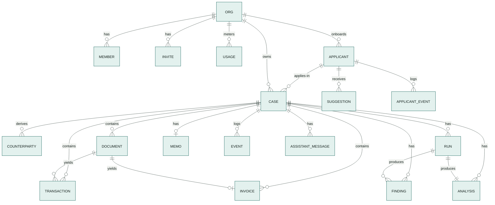

# 09 — Data Model

> Firestore is the system of record ([ADR-003](adr/ADR-003-firestore-system-of-record.md)); Cloud
> Storage holds files. This page is normative: repository code and `contracts/openapi.yaml` follow it.

---

## 1. Conventions

| Topic | Rule |
|---|---|
| Field names | `camelCase` in Firestore and JSON; `snake_case` in Python. Pydantic models use `alias_generator=to_camel, populate_by_name=True`. |
| IDs | ULIDs with a type prefix: `case_`, `doc_`, `run_`, `evt_`, `msg_`, `apl_` (applicant), `ivt_` (invite). Content-derived IDs are deterministic (see §4). |
| Case reference | `KRD-` + 6 Crockford base32 characters derived from the case ULID (e.g. `KRD-8F3K2Q`). Display only. |
| Timestamps | Firestore `Timestamp` (UTC), set by the server. Document dates (transaction date, invoice date) are `YYYY-MM-DD` strings. They are calendar dates, not instants. |
| Months | `YYYY-MM` strings. |
| Enums | UPPER_SNAKE strings. |
| Org scoping | Every workspace document lives under `orgs/{orgId}/…`. There are no top-level case or applicant collections. Server-only data lives under `orgPrivate/{orgId}/…`, which clients can never read. |
| Workspace | "Workspace" in the UI = organization (`org`) in data and code. |

---

## 2. Money

- **Python:** `Decimal`, wrapped in `Money(amount: Decimal, currency: str)`. **Never `float`.**
- **Firestore:** integer **minor units** in fields suffixed `Minor` (`amountMinor: 125000000` =
  IDR 1,250,000.00; IDR has exponent 2 in ISO 4217) plus a `currency` field on the parent object.
- **API JSON:** `{"amount": "1250000.00", "currency": "IDR"}`. Decimal string, 2 decimal places.
- **Ratios and metrics:** decimal strings (`"1.42"`) in facts; never floats in storage.
- **Display:** the frontend formats with one helper (`formatMoney`) as `IDR 1,250,000`.

---

## 3. Collections



### 3.1 `orgs/{orgId}` (workspace)

| Field | Type | Notes |
|---|---|---|
| `name` | string | Shown as the workspace name |
| `country` | string | ISO 3166-1 alpha-2; `ID` only in the prototype |
| `timezone` | string | IANA, e.g. `Asia/Jakarta` |
| `defaultLanguage` | string | `en` (the only available language; see `contracts/plans.v1.yaml`) |
| `currency` | string | `IDR` (fixed in the prototype) |
| `policyVersion` | string | e.g. `scorecard.v1` |
| `policyOverrides` | map? | P1. `assumedAnnualRate`, `targetDscr`, `requiredMonths`, `minMonths`, `updatedBy`, `updatedAt`; bounded by `policyOverrideBounds` |
| `subscription` | map | `planId` (`free_trial`), `status` (`TRIALING`, `TRIAL_EXPIRED`, `ACTIVE`), `trialStartedAt`, `trialEndsAt`, `limitOverrides?` (server-set, e.g. for the demo workspace) |
| `createdBy`, `createdAt` | | |

`subscription.status` is derived on read from `trialEndsAt` and stored when it changes (a scheduled
job is not needed).

### 3.1a `orgs/{orgId}/usage/{yyyy-mm-dd}`

| Field | Type | Notes |
|---|---|---|
| `runsStarted` | int | Incremented in the same transaction that starts a run; enforces the plan's `runsPerDay` and `RUN_QUOTA_PER_ORG_PER_DAY` (UTC day) |
| `pagesRead`, `ocrPages`, `parserPages`, `geminiTokensIn`, `geminiTokensOut` | int | Daily usage totals for cost tracking ([`21`](21-cost-analysis.md)) |

### 3.1b `orgs/{orgId}/usageMonthly/{yyyy-mm}`

| Field | Type | Notes |
|---|---|---|
| `casesCreated` | int | Incremented in the case-creation transaction; enforces `casesPerMonth` |
| `pagesReserved` | int | Uncached pages reserved at run start; enforces `extractedPagesPerMonth` |
| `pagesRead`, `pagesCached`, `ocrPages`, `parserPages` | int | Actuals written when a run finishes |
| `aiSpendUsd` | string decimal | Sum of `runs.usage.estimatedUsd`; enforces `aiSpendUsdPerMonth` |

### 3.2 `orgs/{orgId}/members/{uid}`

| Field | Type | Notes |
|---|---|---|
| `email`, `displayName` | string | |
| `role` | `analyst` \| `risk_lead` \| `admin` | Mirror of the custom claim, for display. **Authorization uses the claim.** `admin` can do everything `risk_lead` can, plus workspace settings, members and plan. |
| `language` | string | `en` |
| `createdAt` | timestamp | |

### 3.2a `orgs/{orgId}/invites/{inviteId}` (P1)

| Field | Type | Notes |
|---|---|---|
| `inviteId` | string | `ivt_…` |
| `email` | string | Lower-cased; must equal the invitee's verified Firebase email |
| `role` | enum | Role granted on acceptance |
| `status` | `PENDING` \| `ACCEPTED` \| `REVOKED` \| `EXPIRED` | |
| `createdBy`, `createdAt`, `expiresAt` (+7 days), `acceptedBy?`, `acceptedAt?` | | |

### 3.3 `orgs/{orgId}/cases/{caseId}`

| Field | Type | Notes |
|---|---|---|
| `caseId`, `reference` | string | |
| `status` | `DRAFT` \| `PROCESSING` \| `READY_FOR_REVIEW` \| `ESCALATED` \| `APPROVED` \| `DECLINED` \| `INFO_REQUESTED` \| `FAILED` | [`05`](05-architecture.md) §6 |
| `applicantId` | string | Link to §3.13 |
| `applicant` | map | Snapshot for lists and the memo: `type` (`INDIVIDUAL`, `COMPANY`), `displayName`, `legalForm?`, `industry`, `yearsOperating?`, `snapshotAt`. Refreshed from the applicant while `DRAFT`/`INFO_REQUESTED`; frozen afterwards |
| `request` | map | `amountMinor` (int), `currency` (`IDR`), `tenorMonths` (int), `purpose`, `installmentOverrideMinor?` |
| `counts` | map | `documents`, `documentsDone`, `documentsFailed` |
| `currentRunId` | string? | |
| `progress` | map | `stage`, `pct` (0–100), `message`, `updatedAt`. **Realtime channel.** |
| `summary` | map? | `score`, `grade`, `recommendation`, `hardStops[]`, `worstVerdict`, `openFindings` {`critical`,`high`,`medium`,`low`} |
| `decision` | map? | `outcome`, `reason`, `conditions[]`, `decidedBy`, `decidedByRole`, `decidedAt`, `overrodeRecommendation` (bool) |
| `policyVersion` | string | Policy used by the current run |
| `policyHash` | string | Hash of the effective policy (version + workspace overrides) used by the current run |
| `createdBy`, `assigneeUid` | string | |
| `createdAt`, `updatedAt` | timestamp | |

### 3.4 `…/cases/{caseId}/documents/{docId}`

| Field | Type | Notes |
|---|---|---|
| `docId`, `fileName`, `contentType` | string | `contentType` from magic bytes |
| `sizeBytes`, `pageCount` | int | |
| `sha256` | string | Unique per case |
| `gcsPath` | string | Object path, never a public URL |
| `status` | `UPLOADED` \| `SCREENING` \| `INSPECTING` \| `CLASSIFYING` \| `EXTRACTING` \| `CHECKING` \| `DONE` \| `SKIPPED` \| `FAILED` \| `QUARANTINED` | **Realtime channel.** |
| `docType` | `BANK_STATEMENT` \| `SALES_INVOICE` \| `PURCHASE_INVOICE` \| `TAX_INVOICE` \| `RECEIPT` \| `OTHER` \| `UNKNOWN` | `UNKNOWN` until classified |
| `classification` | map? | `DocClassification` + `runId` + `model` |
| `screening` | map? | `verdict` (`CLEAN`, `INJECTION_SUSPECTED`, `ERROR`, `SKIPPED`), `quarantined` (bool), `filters[]`, `runId` |
| `pdf` | map? | `producer`, `creator`, `creationDate`, `modDate`, `revisions` (int), `hasTextLayer`, `fonts[]`, `encrypted`, `inspectedAt`; P1: `revisionDiff[] {page, bbox, before, after}` |
| `pages` | array (≤ plan `pagesPerDocument`) | `{pageNo, width, height, imagePath, thumbPath, sha256, textLayer (USABLE, UNUSABLE, NONE), blank, witness (TEXT_LAYER, OCR), status (PENDING, READ, CACHED, SKIPPED, FAILED), agreement?, aiRows?, witnessOnlyRows?, escalated}`. **Realtime channel** for "page n of m read". |
| `sourceUploadId`, `partOf` | string? | P1: parts created by "Split and upload" share the original upload's ID; `partOf` = `part 2 of 3` |
| `extraction` | map? | `method` (`AI_TEXT_LAYER`, `AI_OCR`, `AI_MIXED`, `AI_ONLY`, `WITNESS_ONLY`, `THOROUGH`), `agreement` (string decimal), `fieldsCompared`, `fieldsAgreed`, `aiRows`, `witnessOnlyRows`, `pagesTextLayer`, `pagesOcr`, `pagesEscalated`, `model`, `promptVersion`, `processorVersions`, `runId` |
| `statementMeta` | map? | `bankName`, `accountHolder`, `accountMasked` (`••••1234`), `matchedAccountId?` (declared account it matches, via §3.17), `holderAddress?`, `currency`, `periodStart`, `periodEnd`, `openingMinor`, `closingMinor`, `provenance` (map field → Provenance) |
| `invoiceMeta` | map? | `invoiceId` (link to §3.6) |
| `integrity` | map? | `verdict` (`CLEAN`, `SUSPICIOUS`, `TAMPERED`, `UNVERIFIABLE`), `score` (0–100), `findingIds[]`, `runId` |
| `error` | map? | `code`, `message` |
| `uploadedBy`, `uploadedAt` | | |

### 3.5 `…/cases/{caseId}/transactions/{txId}`

| Field | Type | Notes |
|---|---|---|
| `txId` | string | `tx_{sha1(docId|rowIndex)[:16]}` |
| `docId`, `accountMasked` | string | |
| `rowIndex`, `page` | int | |
| `date` | `YYYY-MM-DD` | |
| `month` | `YYYY-MM` | Denormalized for queries |
| `description`, `descriptionRaw`, `counterparty` | string | `counterparty` normalized (rules, refined by the categorizer) |
| `counterpartyId` | string? | Link to §3.16 for the current run |
| `direction` | `CREDIT` \| `DEBIT` | |
| `amountMinor`, `balanceAfterMinor?` | int | |
| `currency` | string | |
| `consensus` | map | `status` (`AGREED`, `CONFLICT`, `SINGLE_SOURCE`), `sources[]` (`GEMINI`, `TEXT_LAYER`, `OCR`, `DOCAI`), `raw` {source: printed string}, `witnessOnly` (bool) |
| `bbox` | map? | `{x0,y0,x1,y1}` normalized |
| `cashflowClass`, `category` | enums | [`08`](08-risk-engine.md) §4.1 |
| `riskTags` | array | |
| `categorizedBy` | `RULE` \| `MODEL` \| `ANALYST` | |
| `categoryConfidence` | string decimal | |
| `matchedInvoiceIds` | array | |
| `runId` | string | Run that last categorized it |

### 3.6 `…/cases/{caseId}/invoices/{invoiceId}`

| Field | Type | Notes |
|---|---|---|
| `invoiceId` | string | `inv_{sha1(docId)[:16]}` |
| `docId` | string | |
| `kind` | `SALES` \| `PURCHASE` \| `TAX` | |
| `invoiceNumber`, `issuerName`, `issuerTaxId?`, `issuerAddress?`, `buyerName`, `buyerTaxId?` | string | |
| `paymentAccount` | map? | `bankName`, `accountMasked`, `matchedAccountId?` (from the payment instructions) |
| `issueDate`, `dueDate?` | `YYYY-MM-DD` | |
| `currency` | string | |
| `subtotalMinor`, `taxMinor`, `totalMinor` | int | |
| `lines` | array | `{description, quantity (decimal string), unitPriceMinor, amountMinor}` (bounded by page limit) |
| `provenance` | map | field → Provenance |
| `match` | map | `status` (`MATCHED`, `PARTIAL`, `UNMATCHED`, `NOT_DUE`), `method` (`EXACT`, `NET_OF_TAX`, `SPLIT`, `PARTIAL`, `NONE`), `txIds[]`, `matchedAmountMinor`, `score` |
| `runId` | string | |

### 3.7 `…/cases/{caseId}/findings/{findingId}`

The `Finding` model of [`08`](08-risk-engine.md) §1 in camelCase, plus:

| Field | Type | Notes |
|---|---|---|
| `severityRank` | int | 0 = CRITICAL … 4 = INFO, for ordering |
| `docId?` | string | Denormalized from the first evidence ref, for filtering |
| `statusReason`, `statusChangedBy`, `statusChangedAt` | | Set when acknowledged or dismissed |
| `createdAt` | timestamp | |

A re-run creates findings under the **new** `runId`. Old findings stay for audit; the UI shows the
current run's findings. An analyst's dismissal is carried forward to the new run when the same
`code` + anchor appears again, with a note.

### 3.8 `…/cases/{caseId}/runs/{runId}`

| Field | Type | Notes |
|---|---|---|
| `runId`, `status` | `QUEUED` \| `RUNNING` \| `SUCCEEDED` \| `FAILED` | **Realtime channel.** |
| `trigger` | `ANALYST` \| `RETRY` | |
| `requestedBy` | string | |
| `queuedAt`, `startedAt?`, `finishedAt?` | timestamp | |
| `stages` | array | `{name, status (PENDING, RUNNING, DONE, SKIPPED, FAILED), startedAt, finishedAt, durationMs, model?, tokensIn?, tokensOut?, note?}` |
| `promptVersions`, `modelVersions`, `processorVersions` | map | |
| `policyVersion` | string | |
| `usage` | map | `pagesRead`, `pagesCached`, `ocrPages`, `parserPages`, `geminiTokensIn`, `geminiTokensOut`, `estimatedUsd` (string) |
| `pagesReserved` | int | Uncached pages reserved against the plan at run start; released by the actuals at the end |
| `error` | map? | `code`, `message` |

### 3.9 `…/cases/{caseId}/analysis/{runId}`

| Field | Type | Notes |
|---|---|---|
| `runId`, `computedAt` | | |
| `coverage` | map | `months[]`, `start`, `end`, `accountsMasked[]` |
| `monthly` | array | `{month, operatingInflowMinor, operatingOutflowMinor, ownerDrawingsMinor, debtServiceMinor, nocfMinor, cadsMinor, adbMinor, minBalanceMinor, negativeDays, byCategoryMinor {category: int}}` |
| `facts` | array | `{id, label, value (decimal string), unit, inputs[]}` |
| `scorecard` | map | `score`, `grade`, `components[] {id, weight, metric, value, points, contribution}`, `hardStops[] {id, recommendation, reason}` |
| `recommendation` | map | `outcome`, `conditions[]`, `maxSupportableAmountMinor`, `maxSupportableInstallmentMinor`, `proposedInstallmentMinor` |
| `reconciliation` | map | `salesInvoicedMinor`, `salesMatchedMinor`, `ratio`, `counts` {`matched`,`partial`,`unmatched`,`notDue`} |

### 3.10 `…/cases/{caseId}/memo/current`

| Field | Type | Notes |
|---|---|---|
| `runId` | string | |
| `status` | `DRAFT` \| `EDITED` \| `FINAL` | `FINAL` once a decision is recorded |
| `sections` | array | `{key, title, bodyMarkdown}`; keys: `summary`, `business`, `cashflow`, `integrity`, `revenue`, `risks`, `recommendation` |
| `grounding` | map | `status` (`VERIFIED`, `UNVERIFIED`), `problems[] {sectionKey, sentence, number, reason}`, `checkedAt` |
| `model`, `promptVersion` | string | |
| `attempts` | int | |
| `editedBy?`, `editedAt?`, `finalizedAt?` | | |

### 3.11 `…/cases/{caseId}/events/{eventId}` (append-only audit)

| Field | Type | Notes |
|---|---|---|
| `eventId` | string | |
| `type` | enum | `CASE_CREATED`, `CASE_UPDATED`, `DOCUMENT_UPLOADED`, `DOCUMENT_REMOVED`, `RUN_QUEUED`, `RUN_STARTED`, `RUN_SUCCEEDED`, `RUN_FAILED`, `FINDING_ACKNOWLEDGED`, `FINDING_DISMISSED`, `TRANSACTION_RECATEGORIZED`, `MEMO_EDITED`, `DECISION_RECORDED` |
| `actor` | map | `type` (`USER`, `SYSTEM`), `uid?`, `role?` |
| `at` | timestamp | |
| `data` | map | Small, event-specific (e.g. `{from, to, reason}`) |

The repository exposes **no update or delete** for events.

### 3.12 `…/cases/{caseId}/assistantMessages/{messageId}` (P1)

`{messageId, uid, role (USER, ASSISTANT), text, citations[], createdAt}`. Display copy only; the agent's
working memory is the Agent Platform session.

### 3.13 `orgs/{orgId}/applicants/{applicantId}`

| Field | Type | Notes |
|---|---|---|
| `applicantId` | string | `apl_…` |
| `type` | `INDIVIDUAL` \| `COMPANY` | Fixed after creation |
| `displayName`, `displayNameLower` | string | Company `legalName` or individual `fullName`; lower-case copy for prefix search |
| `individual` | map? | `fullName`, `tradingName?`, `occupation?`, `industry`, `yearsOperating?`, `idLast4?` (**last 4 digits only**; the full national ID is never collected) |
| `company` | map? | `legalName`, `tradingName?`, `legalForm` (`LIMITED_COMPANY`, `PARTNERSHIP`, `COOPERATIVE`, `OTHER`), `registrationNumber?`, `taxId?`, `industry`, `yearsOperating`, `website?` |
| `address` | map? | `line1`, `line2?`, `city`, `province?`, `postalCode?`, `country` |
| `contact` | map? | `email?`, `phone?` |
| `bankAccounts` | array (≤ 10) | `{accountId, bankName, accountMasked, holderName, currency, purpose (OPERATING, PAYROLL, SAVINGS, OTHER), source (DECLARED, DETECTED), addedBy, addedAt}`; the hash lives in §3.17 |
| `relatedParties` | array (≤ 20) | `{partyId, name, nameNormalized, kind (INDIVIDUAL, COMPANY), roles[] (BENEFICIAL_OWNER, DIRECTOR, SHAREHOLDER, GUARANTOR, AUTHORIZED_SIGNATORY), ownershipPct? (decimal string), idLast4?, source (DECLARED, DETECTED)}` |
| `aliases` | array | Accepted alternative names (e.g. the trading name printed on statements), used for holder and issuer matching |
| `keyCounterparties` | array (P1) | Accepted key clients/suppliers `{name, role (CLIENT, SUPPLIER), lastSharePct, acceptedAt}` |
| `pendingSuggestions`, `caseCount` | int | Counters for lists |
| `createdBy`, `createdAt`, `updatedAt` | | |

Sole traders are `INDIVIDUAL` with a `tradingName`; partnerships, limited companies and cooperatives
are `COMPANY`.

### 3.14 `orgs/{orgId}/applicants/{applicantId}/suggestions/{suggestionId}`

| Field | Type | Notes |
|---|---|---|
| `suggestionId` | string | Deterministic (§4) so a re-run never duplicates a suggestion |
| `field` | enum | `BANK_ACCOUNT`, `TAX_ID`, `ADDRESS`, `LEGAL_NAME`, `RELATED_PARTY`, `KEY_CLIENT`, `KEY_SUPPLIER` |
| `value` | map | Field-specific, e.g. `{bankName, accountMasked, holderName}`, `{taxId}`, `{name, kind, sharePct}` |
| `display` | string | One line for the UI |
| `confidence` | `HIGH` \| `MEDIUM` \| `LOW` | `HIGH` when every value used is `AGREED` by two readings; `MEDIUM` for single-source or derived-from-transactions; `LOW` for heuristics |
| `basis` | string | Short reason, e.g. "Statement header, agreed by both readings" |
| `evidence` | array | `EvidenceRef` (doc, page, bbox, or transaction/invoice IDs) |
| `sourceCaseId`, `sourceRunId` | string | |
| `status` | `PENDING` \| `ACCEPTED` \| `REJECTED` \| `CONFLICT` | `CONFLICT` when the profile already holds a different value for a single-valued field (tax ID, legal name) |
| `conflictWith` | string? | The current profile value |
| `decidedBy`, `decidedAt`, `reason?` | | |
| `createdAt` | timestamp | |

### 3.15 `orgs/{orgId}/applicants/{applicantId}/events/{eventId}` (append-only)

Same shape as §3.11, types `APPLICANT_CREATED`, `APPLICANT_UPDATED`, `BANK_ACCOUNT_ADDED`,
`BANK_ACCOUNT_REMOVED`, `RELATED_PARTY_ADDED`, `RELATED_PARTY_REMOVED`, `SUGGESTION_ACCEPTED`,
`SUGGESTION_REJECTED`. `data` never contains full account or ID numbers.

### 3.16 `…/cases/{caseId}/counterparties/{counterpartyId}`

| Field | Type | Notes |
|---|---|---|
| `counterpartyId` | string | Deterministic (§4) |
| `runId` | string | Run that derived it; the UI shows the current run's |
| `name`, `aliases[]` | string | Normalized name and the raw spellings seen |
| `kind` | `PERSON` \| `BUSINESS` \| `GOVERNMENT` \| `BANK` \| `UNKNOWN` | From the categorizer (model) or rules |
| `roles` | array | `CLIENT`, `SUPPLIER`, `LENDER`, `OWN_ACCOUNT`, `RELATED_PARTY`, `GOVERNMENT`, `OTHER_PAYEE`, `OTHER_PAYER` ([`08`](08-risk-engine.md) §4.3) |
| `inflowMinor`, `outflowMinor`, `totalFlowMinor` | int | |
| `txCount`, `firstDate`, `lastDate` | | |
| `invoiceCount`, `invoicedMinor`, `matchedMinor` | int | From sales/purchase invoices naming this party |
| `shareOfOperatingInflow` | string decimal? | |
| `source` | `RULE` \| `MODEL` \| `INVOICE` \| `PROFILE` | Where the name came from |
| `sampleTxIds` | array (≤ 10) | Evidence links |

### 3.17 `orgPrivate/{orgId}/accountHashes/{accountId}` (server only)

`{hash, applicantId?, firstSeenDocId?}` where `hash = sha256(orgId + ":" + digits)`. Used to match
statement and invoice accounts against declared ones without storing full numbers in readable
documents. Clients cannot read `orgPrivate` (rules deny everything outside `orgs/`). **Production
note:** use an HMAC with a key from Secret Manager instead of a plain salted hash.

### 3.18 `system/signup` (server only)

`{workspacesCreated}` incremented in the workspace-creation transaction; enforces `MAX_WORKSPACES`.

---

## 4. Deterministic IDs

| Entity | ID |
|---|---|
| Transaction | `tx_` + first 16 hex of `sha1(docId + "|" + rowIndex)` |
| Invoice | `inv_` + first 16 hex of `sha1(docId)` |
| Finding | `fnd_` + first 16 hex of `sha1(runId + "|" + code + "|" + anchor)`; `anchor` = `docId:rowIndex`, `docId`, `invoiceId`, or `case` |
| Bank account | `acc_` + first 16 hex of `sha1(applicantId + "|" + bankNameNormalized + "|" + digits)` |
| Related party | `rp_` + first 16 hex of `sha1(applicantId + "|" + nameNormalized)` |
| Suggestion | `sug_` + first 16 hex of `sha1(applicantId + "|" + field + "|" + normalizedValue)` (stable across runs and cases) |
| Counterparty | `cp_` + first 16 hex of `sha1(runId + "|" + nameNormalized)` |

---

## 5. Indexes (`contracts/firestore.indexes.json`)

| Collection group | Fields | Serves |
|---|---|---|
| `cases` | `status` ASC, `createdAt` DESC | Case list filtered by status |
| `findings` | `runId` ASC, `severityRank` ASC, `code` ASC | Findings of the current run, most severe first |
| `findings` | `runId` ASC, `docId` ASC, `severityRank` ASC | Findings for one document |
| `transactions` | `month` ASC, `date` ASC | Transactions by month |
| `transactions` | `category` ASC, `date` ASC | Filter by category |
| `transactions` | `riskTags` CONTAINS, `date` ASC | Filter by risk tag |
| `transactions` | `docId` ASC, `rowIndex` ASC | Rows of one statement |
| `invoices` | `kind` ASC, `issueDate` ASC | Reconciliation table |
| `cases` | `applicantId` ASC, `createdAt` DESC | Cases of one applicant |
| `applicants` | `type` ASC, `updatedAt` DESC | Applicant list filtered by type |
| `applicants` | `type` ASC, `displayNameLower` ASC | Name prefix search with a type filter |
| `suggestions` | `status` ASC, `createdAt` DESC | Pending suggestions first |
| `counterparties` | `runId` ASC, `totalFlowMinor` DESC | Counterparties of the current run, largest first |
| `counterparties` | `runId` ASC, `roles` CONTAINS, `totalFlowMinor` DESC | Filter by role |
| `invites` (collection group) | `email` ASC, `status` ASC | Pending invites for a signed-in email (P1) |

---

## 6. Security rules (`contracts/firestore.rules`)

**Clients read, the server writes.** The browser may read its own org's data (used for realtime
progress); every write goes through the API, whose Admin SDK bypasses rules.

```
rules_version = '2';
service cloud.firestore {
  match /databases/{database}/documents {
    function inOrg(orgId) {
      return request.auth != null && request.auth.token.orgId == orgId;
    }
    match /orgs/{orgId}/{document=**} {
      allow read: if inOrg(orgId);
      allow write: if false;
    }
    match /{document=**} {
      allow read, write: if false;
    }
  }
}
```

The frontend uses listeners only as a **change signal** (status, progress, stages) and fetches full
data through the API. The API remains the single data contract ([`11`](11-frontend.md) §5).
Server-only data (account hashes, sign-up counter) lives under `orgPrivate/` and `system/`, which the
catch-all rule denies.

---

## 7. Cloud Storage layout

Bucket `{PROJECT_ID}-kredibel-docs` in `asia-southeast1`; uniform bucket-level access; public access
prevention enforced; lifecycle: delete objects after 90 days (synthetic data).

```
orgs/{orgId}/cases/{caseId}/documents/{docId}/
  original.{pdf|png|jpg}
  pages/{n}.png                         150 dpi render (the AI reader's input and the viewer's image)
  thumbs/{n}.png                        300 px wide
  extraction/pointers.json              which cache objects this document used (audit)
  revisions/r{k}.pdf                    earlier revisions (P1)
orgs/{orgId}/uploads/{uploadId}/original.pdf   P1: untouched original of a split upload (forensics source)
orgs/{orgId}/cache/extraction/{sha256}/        content-addressed reader output (cost control, docs/21 §5)
  classification-{model}-{promptId}@{version}.json
  p{n}/gemini-{model}-{promptId}@{version}.json
  p{n}/ocr-{processorVersion}.json
  p{n}/docai-{form|invoice}-{processorVersion}.json      P1 escalation / thorough mode
```

Files are only served through the API after an org check (no signed URLs, no public URLs).

---

## 8. Retention & deletion

- Prototype: synthetic data, 90-day object lifecycle; Firestore data kept for the competition period.
- `scripts/reset_demo.py` deletes one org's cases and objects for a clean demo.
- Production note: retention periods follow the lender's policy and applicable law; deletion must
  cascade Firestore subcollections and GCS prefixes together.
