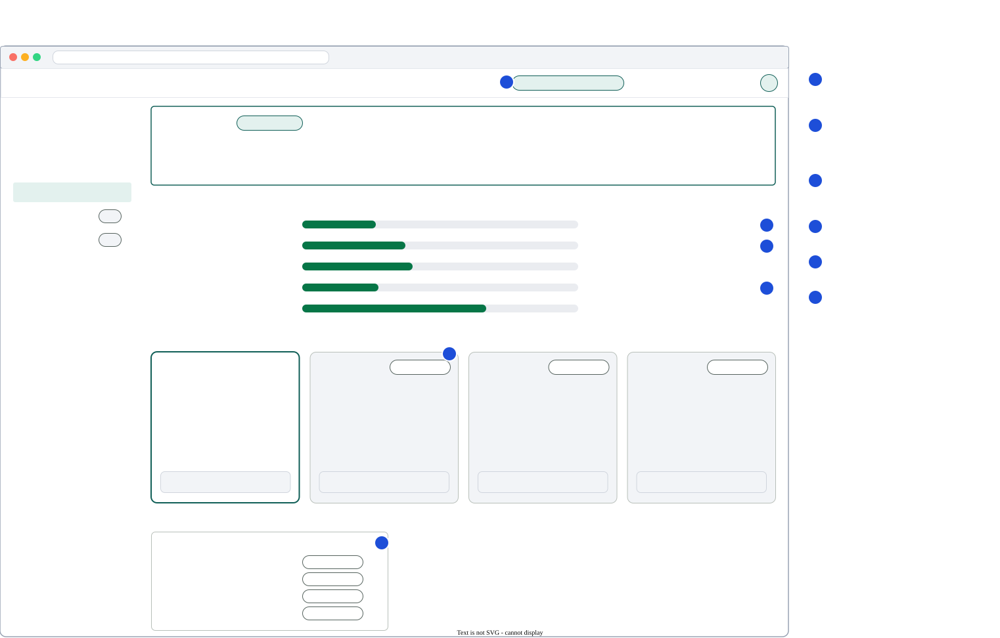
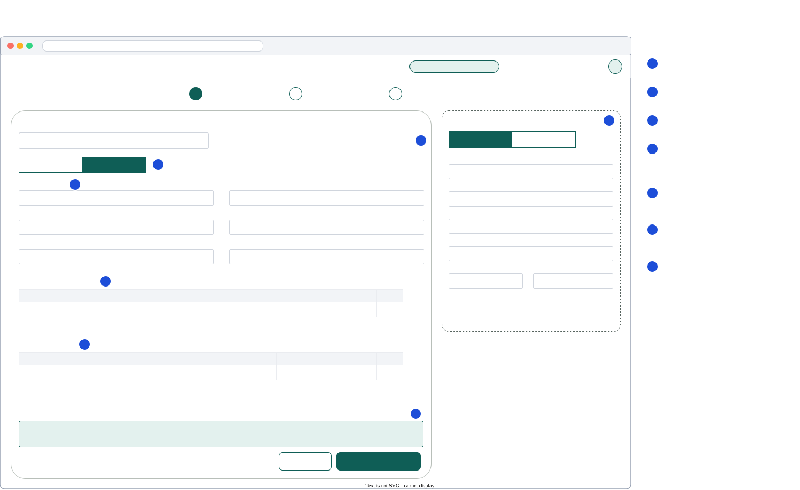
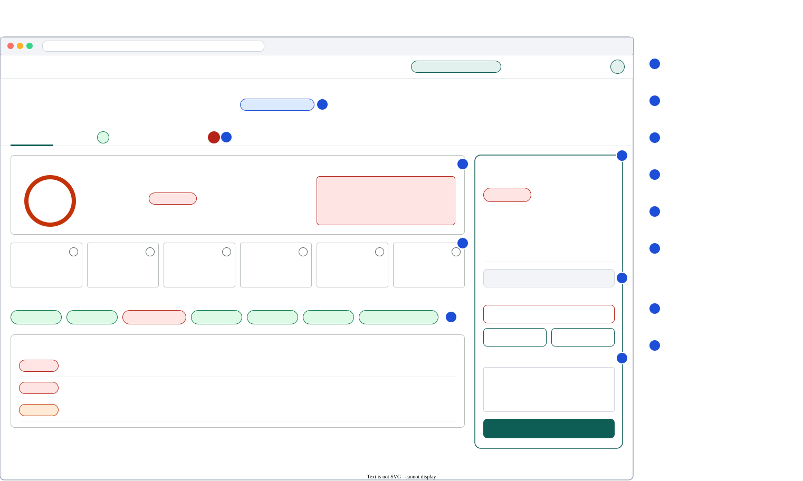
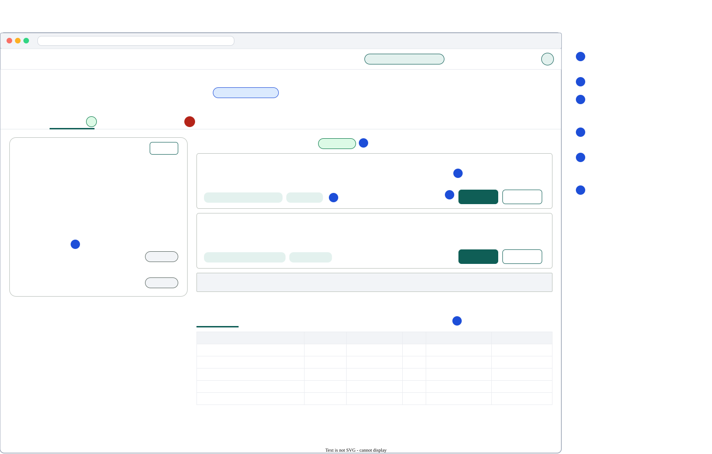
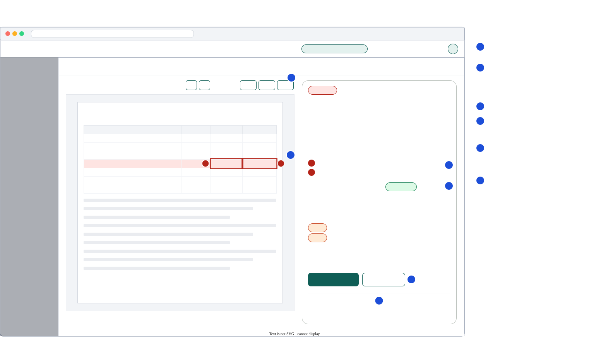

# 11 — Frontend

> The lender's workspace: onboarding, applicants, cases, evidence and decisions, plus a small
> settings area with the plan. Visual language and components are in
> [`12-design-system.md`](12-design-system.md). The UI is **English**; it is built for more languages
> (§10) but only English is selectable today.

---

## 1. Principles

1. **Evidence first.** Any number or finding is one click from the page it came from.
2. **Live, not refresh.** Pipeline progress streams in; the analyst never presses F5.
3. **Calm under alarm.** Severity is clear but not shouty: one red thing at a time, with a reason.
4. **The decision is the destination.** Every screen leads to the decision panel, and the panel
   explains why an action is blocked.
5. **The API is the contract.** Firestore listeners are a change signal only; data comes from the API
   ([`09`](09-data-model.md) §6).
6. **The AI proposes, the person disposes.** Anything the AI detects about an applicant appears as a
   suggestion with its evidence and an Accept / Reject choice; nothing changes silently.
7. **Honest about limits.** Plan limits, trial days and "coming soon" features are visible before a
   user hits them, never as a surprise error.

---

## 2. Stack

React 19 · Vite · TypeScript (strict) · Tailwind CSS v4 (tokens from [`12`](12-design-system.md)) ·
TanStack Query v5 · React Router v7 (data routers) · react-hook-form + zod · Firebase JS SDK (Auth,
Firestore listeners) · `react-pdf` (pdf.js) · Recharts · `i18next` + `react-i18next` ·
`openapi-typescript` for API types · Vitest + Testing Library + MSW · Playwright (smoke).

The production build is copied into the backend image and served by `kredibel-web` at `/`
(same origin as `/api`, so no CORS).

---

## 3. Structure (Feature-Sliced Design)

```
frontend/src/
├── app/            providers (QueryClient, Auth, Router), route table, global styles, error boundary
├── pages/          route components: Login, Onboarding, CaseList, CaseNew, CaseWorkspace,
│                   ApplicantList (P1), ApplicantDetail, Settings, NotFound
├── widgets/        page sections: AppHeader (trial badge), TrialBanner, CaseHeader, RiskSummary,
│                   PipelineProgress, DocumentsPanel, FindingsPanel, EvidenceViewer, CashflowPanel,
│                   ReconciliationPanel, ApplicantPanel, SuggestionsPanel, CounterpartiesPanel,
│                   MemoPanel, DecisionPanel, ActivityPanel, PlanAndUsage, RunTimeline (P1),
│                   AssistantDrawer (P1)
├── features/       user actions: sign-in, create-workspace, create-case (wizard), onboard-applicant,
│                   upload-documents, split-upload (P1), start-analysis, review-finding,
│                   decide-suggestion, decide-case, update-workspace, invite-member (P1),
│                   edit-memo (P1), ask-assistant (P1), recategorize-transaction (P1)
├── entities/       workspace, plan, applicant, suggestion, counterparty, case, document, finding,
│                   transaction, invoice, analysis, memo, event: query hooks, mappers, UI atoms
└── shared/         api/ (client, generated schema.d.ts, problem), firebase/, ui/ (design system),
                    lib/ (formatMoney, formatDate, citations, bbox), config/,
                    i18n/ (setup, languages, locales/en/*.json)
```

Import rule: a layer may import only from layers below it (`app → pages → widgets → features →
entities → shared`). Enforced by `eslint-plugin-boundaries`.

---

## 4. Routes

| Path | Page | Auth | Notes |
|---|---|---|---|
| `/login` | Login | public | Email/password + Google |
| `/onboarding` | Onboarding | ✔, no workspace | Create a workspace (or accept an invite, P1). Every other route redirects here while `me.needsWorkspace` |
| `/` | → redirect `/cases` | ✔ | |
| `/cases` | CaseList | ✔ | Filter by status; search by applicant/reference |
| `/cases/new` | CaseNew (wizard) | ✔ | Applicant → Loan request → Documents; creates the case at step 2 |
| `/cases/:caseId` | CaseWorkspace | ✔ | Default tab depends on status (below) |
| `/cases/:caseId/:tab` | CaseWorkspace | ✔ | `overview`, `applicant`, `documents`, `findings`, `cashflow`, `reconciliation`, `memo`, `activity` |
| `/applicants` | ApplicantList | ✔ | P1 page (the picker in the wizard is P0) |
| `/applicants/:applicantId` | ApplicantDetail | ✔ | Profile, suggestions across cases, cases of this applicant |
| `/settings/:section` | Settings | ✔ | `workspace`, `language`, `plan`, `policy` (P1), `members` (P1) |
| `/cases/:caseId/evidence/:findingId` | CaseWorkspace + EvidenceViewer open | ✔ | Deep link for a finding |
| `*` | NotFound | — | |

Default tab: `DRAFT`/`INFO_REQUESTED` → `documents`; `PROCESSING` → `overview` (with pipeline);
others → `overview`.

---

## 5. Data & realtime

### 5.1 Server state

TanStack Query, one hook per endpoint in `entities/*/api.ts`:

| Query key | Endpoint | Stale time |
|---|---|---|
| `['me']` | `GET /api/me` | 5 min (refetched after workspace creation and token refresh) |
| `['plans']` | `GET /api/plans` | ∞ |
| `['workspace']` | `GET /api/workspace` | 60 s (usage meters) |
| `['applicants', {q, type, cursor}]` | `GET /api/applicants` | 30 s |
| `['applicant', applicantId]` | `GET /api/applicants/{id}` | 0 after a suggestion decision |
| `['suggestions', applicantId, status]` | `GET …/suggestions` | invalidated on decide |
| `['counterparties', caseId, runId, role]` | `GET …/counterparties` | ∞ per run |
| `['cases', {status, cursor}]` | `GET /api/cases` | 10 s |
| `['case', caseId]` | `GET /api/cases/{id}` | 0 (driven by listener) |
| `['documents', caseId]` | `GET …/documents` | 0 |
| `['analysis', caseId, runId]` | `GET …/analysis` | ∞ per run |
| `['findings', caseId, runId, filters]` | `GET …/findings` | ∞ per run, invalidated on PATCH |
| `['transactions', caseId, filters, cursor]` | `GET …/transactions` | ∞ per run |
| `['invoices', caseId, runId]` | `GET …/invoices` | ∞ per run |
| `['memo', caseId, runId]` | `GET …/memo` | ∞ per run |
| `['events', caseId]` | `GET …/events` | 10 s |

Mutations invalidate the narrowest keys (`decide-case` → `case`, `events`, `memo`).

### 5.2 Realtime channel

`shared/firebase/listeners.ts` exposes:

- `useCaseLive(caseId)`: `onSnapshot(orgs/{orgId}/cases/{caseId})`, picking `status`, `progress`,
  `currentRunId`, `counts`, `updatedAt`.
- `useRunLive(caseId, runId)`: `stages`, `status`.
- `useDocumentsLive(caseId)`: `status`, `docType`, `integrity.verdict` and `pages[].status` per
  document (drives "Reading page 4 of 18").

When a watched field changes, the hook updates a small live view model **and** invalidates the
matching query keys. If a listener errors (e.g. rules or network), the hook falls back to polling
`GET /api/cases/{id}` every 3 s and shows a subtle "live updates paused" indicator.

### 5.3 API client

`shared/api/client.ts`: a typed `fetch` wrapper using generated `paths` types; adds
`Authorization: Bearer ${await user.getIdToken()}`; parses `application/problem+json` into
`ApiError {status, code, title, detail, extras}`. `401` → sign out and redirect to `/login`;
`403 WORKSPACE_REQUIRED` → `/onboarding`; `403 PLAN_LIMIT_REACHED` / `TRIAL_EXPIRED` → the
`PlanLimitDialog` (what limit, how much is used, link to **Plan & usage**).

---

## 6. Screens

### 6.0 Onboarding (workspace) and the app frame

- **First sign-in:** one screen, "Set up your workspace": workspace name, country (Indonesia; other
  markets listed as "coming soon"), time zone. Below the form: "You start on the **Free trial**:
  30 days, 3 members, 300 pages per month. Paid plans are coming soon." Submit → `POST
  /api/workspaces` → refresh the ID token → `/cases`.
- **App header:** workspace name, a **trial badge** ("Free trial · 23 days left"), user menu
  (Settings, Sign out). A **TrialBanner** appears in the last 7 days and after expiry ("Your trial has
  ended. Cases stay readable; new analyses are paused.").



*Source: [`ui-plans.drawio.svg`](diagrams/ui-plans.drawio.svg). Edit in VS Code with the draw.io extension.*

### 6.1 Case list

Table: reference · applicant (with an Individual/Company icon) · amount (right-aligned, tabular) ·
status badge · grade badge · critical/high finding counts · created. Row click → workspace. Empty
state: "No cases yet" + **New case** button. Filters: status chips.

### 6.2 New case: a three-step wizard

1. **Applicant.** Search an existing applicant (picker) **or** onboard a new one: a segmented control
   **Individual | Company**, then the type's fields (zod mirrors `ApplicantCreate`):
   - *Individual:* full name, trading name (optional, for sole traders), occupation, industry, years
     operating, last 4 digits of the national ID (optional).
   - *Company:* legal name, legal form (limited company, partnership, cooperative, other),
     registration number, tax ID, industry, years operating.
   - *Optional, collapsed:* address and contact; **bank accounts** (bank, account number, holder,
     purpose); **people** (beneficial owners, directors, shareholders, guarantors, signatories with
     ownership %). A hint says: "Skip what you don't have. Kredibel will suggest these from the
     documents, with the page they came from."
2. **Loan request.** Amount (IDR with thousand separators), tenor (months), purpose, optional
   installment override. Submit → `POST /api/cases` (with `applicantId` or the inline applicant).
3. **Documents.** The Documents tab's dropzone, inline, with plan limits shown ("up to 20 files,
   20 pages and 20 MB each"); **Run analysis** when ready.



*Source: [`ui-applicant-onboarding.drawio.svg`](diagrams/ui-applicant-onboarding.drawio.svg). Edit in VS Code with the draw.io extension.*

### 6.3 Case workspace layout



*Source: [`ui-case-workspace.drawio.svg`](diagrams/ui-case-workspace.drawio.svg). Low-fidelity wireframe; the numbered annotations are part of the spec. Edit in VS Code with the draw.io extension.*

The decision panel is a sticky right column on ≥1280 px and a bottom sheet below that. It is hidden
while `DRAFT`/`PROCESSING`.

### 6.4 Overview tab

- **RiskSummary card:** score gauge (0–100) with grade, recommendation, hard stops with reasons,
  maximum supportable amount vs requested.
- **Key metric tiles:** avg monthly operating inflow, avg CADS, DSCR proxy, ADB, negative days, revenue
  verification ratio. Each tile has a "?" popover with the formula and inputs (from `explain` data in
  facts) and a link to the cash-flow tab.
- **Document integrity strip:** one chip per statement month and one grouped chip for invoices (worst
  invoice verdict), each with verdict colour, icon and text; click → evidence viewer at that document's
  worst finding (grouped chip → Documents tab filtered to invoices).
- **Top findings:** the 3 most severe, each with title, one-line explanation, "View evidence".
- While `PROCESSING`: replaced by **PipelineProgress**: case-level stages (from the run) and a
  per-document row showing its current status. Each stage ticks as the listener reports it.

### 6.5 Documents tab

- Dropzone (in `DRAFT`/`INFO_REQUESTED`): multiple files, client-side pre-checks against the plan's
  limits (type by extension for UX only, size, page count read with pdf.js), parallel uploads (max 3)
  with per-file progress; server errors shown inline per file (`DUPLICATE_DOCUMENT`,
  `TOO_MANY_PAGES`, …). For `TOO_MANY_PAGES`, P0 says "Upload one file per month"; P1 offers
  **Split and upload** ("This PDF has 47 pages. Split into 3 parts of up to 20 pages?").
- Document list: thumbnail, file name, type badge, pages, **Digital / Scanned** badge (from page
  triage), reading method and agreement %, verdict badge, status, and while processing "Reading page
  4 of 18". Row click → document detail drawer: metadata (producer, dates, revisions), per-page
  table (text layer, witness, agreement, escalated), list of its findings.
- **Run analysis** button (primary) with the count of documents; disabled with reason when not allowed.

### 6.5a Applicant tab

Three blocks, top to bottom ([spec 014](specs/014-applicant-profile-intelligence/spec.md)):

1. **Profile:** type, names, IDs, address, bank accounts (masked, `Declared` or `Detected` badge),
   people with roles and ownership. **Edit** opens the same form as the wizard.
2. **Suggestions from the documents** (badge with the pending count): one card per suggestion with
   the value, confidence, basis ("Statement header, agreed by both readings") and an evidence chip
   that opens the page with the box highlighted; **Accept** / **Reject** (reject asks for an optional
   reason). `CONFLICT` cards show both values side by side ("Profile says … / Documents say …").
3. **Counterparties:** tabs Clients · Suppliers · Lenders · Related parties · Other; table of name,
   roles, inflow/outflow, transactions, invoices matched, share of operating inflow; row click → the
   Cash flow tab filtered to that counterparty.



*Source: [`ui-applicant-profile.drawio.svg`](diagrams/ui-applicant-profile.drawio.svg). Edit in VS Code with the draw.io extension.*

### 6.6 Findings tab

Grouped by severity (Critical → Info), then by document. Each row: severity badge (icon + text),
code, title, document/page, status. Filters: severity, category, document, status. Row click → evidence
viewer. Actions: **Acknowledge**; **Dismiss** (dialog with a required reason).

### 6.7 Evidence viewer

Opens as a large right-side drawer (route `/cases/:id/evidence/:findingId`).



*Source: [`ui-evidence-viewer.drawio.svg`](diagrams/ui-evidence-viewer.drawio.svg). Edit in VS Code with the draw.io extension.*

- Renders the PDF page with `react-pdf` (text PDFs) or the server-rendered PNG (images/scans).
- Overlays: absolutely positioned boxes from normalized bboxes × rendered size; severity colour **and**
  a numbered marker; hover shows the label.
- Multiple evidence refs: list on the right, clicking pans/zooms to each.
- Keyboard: `j`/`k` next/previous finding, `+`/`-` zoom, `Esc` close.
- Evidence without a bbox: page shown with a notice "Exact location not available (scanned page)".

### 6.8 Cash flow tab

- Monthly bars: operating inflow vs outflow; line: ADB; markers for negative-balance days.
- Category breakdown per month (table with sparkline per category).
- Transactions table: date, description, counterparty, amount (signed, tabular), category chip,
  risk-tag chips, "categorized by" icon (rule/model/analyst), consensus status icon. Filters: month,
  category, risk tag, text. Row click → evidence viewer at that row.
- P1: inline re-categorize (select) → `PATCH` → banner "Analysis is out of date. Re-run".

### 6.9 Reconciliation tab

- Summary: invoiced sales vs matched (two horizontal bars) and the ratio.
- Table of sales invoices: number, buyer, issue/due date, total, status chip (Matched, Partial,
  Unmatched, Not due), matched transactions (links), score. Unmatched rows are highlighted and
  link to their `R01` finding.

### 6.10 Memo tab

- Renders `bodyMarkdown` per section with a safe markdown renderer (no raw HTML).
- Citation markers become **CitationChips**: `fact:` → popover with value, label, formula, inputs;
  `finding:` → opens the evidence viewer; `doc:…#pN` → opens the page.
- Grounding badge: **Verified** (green) or **Unverified figures** (amber banner listing problems).
- P1: Edit mode per section (textarea with marker autocomplete); Save → `PUT` → new grounding result.

### 6.11 Decision panel

| Situation | UI behaviour |
|---|---|
| Open critical findings | **Approve** disabled; tooltip and inline list "Resolve 2 critical findings first" with links |
| Recommendation `DECLINE` or hard stop, user is `analyst` | **Approve** disabled; hint "Only a risk lead can override. Escalate instead." |
| User is `risk_lead` or `admin` overriding | Approve enabled; reason required; confirm dialog states the override |
| `DECLINE`, `REQUEST_INFO`, `ESCALATE` | Reason required (min 10 chars) |
| `APPROVE_WITH_CONDITIONS` recommended | Conditions pre-filled from analysis, editable list |
| After decision | Panel shows outcome, who, when, reason; memo marked Final |

Server errors are still handled (`409 OPEN_CRITICAL_FINDINGS`, `403 ROLE_REQUIRED`), because the UI
rules are hints and the server enforces.

### 6.12 Activity tab

Audit events timeline (who, what, when, details). P1: **RunTimeline** shows each pipeline stage
with duration, model and token counts: the "agent trace" view.

### 6.12a Settings

Narrow on purpose. Sections in a left rail:

| Section | Who can edit | Content |
|---|---|---|
| Workspace | admin | Name, country (read-only: Indonesia), time zone |
| Language & formats | admin (workspace default), everyone (own) | Language: **English** (selected); Bahasa Indonesia, Bahasa Melayu, Thai, Vietnamese shown disabled with "Coming soon". Currency IDR and date format shown read-only |
| Plan & usage | everyone sees, admin acts | Current plan and trial days left; usage meters (cases this month, pages this month, runs today, AI spend this month, seats); plan cards: **Free trial** (current), **Starter**, **Professional**, **Enterprise** with "Coming soon" badges and disabled buttons |
| Credit policy (P1) | admin, risk lead | The active scorecard (read-only) and four bounded overrides: assumed annual rate, target DSCR, required months, minimum months. Saving shows "Applies to new runs" |
| Members (P1) | admin | Members with roles; invite by email with a role; remove; seats used vs plan |

### 6.13 Assistant drawer (P1)

Floating "Ask about this case" button → drawer with conversation; suggested questions ("Why is March
flagged?", "Which invoices were never paid?", "What drives the DSCR?"). Replies render citation chips.

---

## 7. States & errors

- Every data panel has **loading** (skeletons matching the final layout), **empty** (explains what
  will appear and what action creates it) and **error** (problem title + retry) states.
- `FAILED` case: banner with the run's error message and **Retry analysis**.
- Network offline: toast; mutations disabled.

---

## 7a. Plan limits in the UI

- Limits come from `GET /api/workspace` (`subscription.limits`, `usage`), so the UI can warn early:
  the dropzone says "12 of 300 pages left this month" when fewer than 50 remain; **Run analysis**
  shows the pages this run will use ("Uses ~28 new pages; 14 are cached").
- The server is the authority: a `403 PLAN_LIMIT_REACHED` opens the `PlanLimitDialog`; a
  `403 TRIAL_EXPIRED` shows the TrialBanner and disables create, upload and run buttons with a tooltip.
- Coming-soon features (thorough mode, more seats, other languages) are visible and disabled with a
  "Coming soon" badge; none of them is clickable.

---

## 8. Accessibility

WCAG 2.1 AA contrast; focus-visible rings; all icons have labels; severity uses colour **plus** icon
**plus** text; charts have a table alternative ("View as table"); the evidence viewer is keyboard
operable; dialogs trap focus and restore it.

---

## 9. Testing

| Level | Tool | Covers |
|---|---|---|
| Unit | Vitest | `formatMoney`, citation parser, bbox scaling, decision-panel rules |
| Component | Testing Library + MSW | each widget's loading/empty/error/success; decision panel guards |
| Contract | `tsc` against generated `schema.d.ts` | API drift breaks the build |
| Smoke E2E | Playwright | new user → create workspace → new case wizard (company applicant) → upload S2 → run (mock or real) → open A01 evidence → accept a suggestion → decline |
| i18n | Vitest + ESLint | `i18next/no-literal-string` in `src/` (tests excluded); every key in `locales/en` is used; missing keys fail the build |

---

## 10. Internationalization

- **English is the primary and only selectable language.** The app is built so adding one is a
  translation job, not a refactor.
- All user-visible strings live in `shared/i18n/locales/en/{common,case,applicant,settings,errors}.json`
  and are read with `useTranslation()`. ESLint `i18next/no-literal-string` blocks hard-coded strings
  in components.
- `shared/i18n/languages.ts` mirrors the `languages` list of `GET /api/plans`; `coming_soon` entries are
  rendered disabled.
- Numbers, money and dates go through `Intl` helpers with the active locale (`en`) and the workspace
  currency (`IDR`): `formatMoney` → `IDR 1,250,000`.
- API errors are mapped by `code` to `errors.json` messages; the server's English `title`/`detail` is
  the fallback.
- **Documents can be in any language.** The UI language does not limit what Kredibel can read.
- The memo and finding explanations are generated in English (prompts state `Write in English`);
  the language is stored on the memo for later localization.
