# 11 — Frontend

> The finance workspace in the browser: a dashboard, the documents, each month's reconciliation, one
> review queue, risk with evidence, clients and suppliers, the Finance Assistant (P1) and a small
> settings area with the plan. It works from a 360 px phone to a wide desktop. Visual rules, tokens
> and components are in [`12-design-system.md`](12-design-system.md); the high-fidelity mocks are in
> [`design/mocks/`](../design/mocks/index.html) and their screenshots appear below. The UI is
> **English**; it is built for more languages (§10) but only English is selectable today.

---

## 1. Principles

1. **One sentence first.** Every page opens with where things stand in plain words ("2 of 6 months
   are reconciled. 9 things need you.") before any chart or table.
2. **Evidence one tap away.** Any number, match or finding opens the page it came from with the value
   lit ([`12`](12-design-system.md) §6.3).
3. **The person settles the rest.** What Kredibel could not settle goes to one review queue; each item
   offers only the actions that make sense for its kind ([`10`](10-api-contract.md) §4).
4. **Live, not refresh.** Uploads, reading and reconciliation stream in; nobody presses F5.
5. **Calm under alarm.** Severity is clear but not shouty: one red thing at a time, always with a
   reason and a next step.
6. **The API is the contract.** Firestore listeners are a change signal only; data comes from the API
   ([`09`](09-data-model.md) §6).
7. **The AI suggests, the user accepts.** Profile details, ledger column mappings and uncertain
   matches appear as suggestions with their evidence; nothing changes silently.
8. **Honest about limits.** Trial days, usage and coming-soon features are visible before anyone hits
   a limit, never as a surprise error.
9. **Responsive by construction.** Every screen is designed and tested at 390, 834 and 1440 px (§9).
   Layout adapts by window size class; components adapt to their container
   ([`12`](12-design-system.md) §5).

---

## 2. Stack

React 19 · Vite · TypeScript (strict) · Tailwind CSS v4 with the generated theme
(`app/styles/tailwind-theme.css`, from [`contracts/design/tokens.json`](../contracts/design/tokens.json))
· Radix UI primitives (dialog, popover, tooltip, tabs, radio group, select, collapsible) ·
`class-variance-authority` + `tailwind-merge` for variants · the mocks' `kit.css` as the component
stylesheet and their icon set (`shared/ui/Icon`, [ADR-019](adr/ADR-019-one-component-stylesheet-for-mocks-and-app.md)) ·
`@fontsource-variable/archivo` · TanStack Query v5 · React Router v7 (data routers) ·
react-hook-form + zod · Firebase JS SDK (Auth, Firestore listeners) · `react-pdf` (pdf.js) ·
`d3-sankey` (layout only; we draw the SVG) · Recharts (bars and lines) · `i18next` + `react-i18next` ·
`openapi-typescript` for API types.

Quality tooling: Vitest + Testing Library + MSW · Storybook 9 (stories per component state, a11y
addon) · Playwright (smoke E2E and visual regression at 390/834/1440) · `@axe-core/playwright` ·
Lighthouse CI.

The production build is copied into the backend image and served by `kredibel-web` at `/` (same
origin as `/api`, so no CORS). Every page but the dashboard is its own chunk (`React.lazy` in
`app/router.tsx`), Firebase Auth starts without the popup/redirect resolver (the sign-in iframe
loads when someone signs in) and the Firestore SDK loads on the first live subscription
(`shared/firebase/live.ts`), so the first paint ships the shell, the dashboard and Auth only.

---

## 3. Structure (Feature-Sliced Design)

```
frontend/src/
├── app/        providers (QueryClient, Auth, Router), route table, error boundary,
│               styles/ (tokens.css and tailwind-theme.css GENERATED by `make tokens`, base.css)
├── pages/      public/ (Landing, Pricing, HowItWorks, Security, Faq, Contact, Privacy, Terms),
│               Login, Onboarding, Dashboard, Documents, Document, Months, Month, Review, Risk,
│               Counterparties, Counterparty, Assistant (P1), Labels (P1), Runs (P1), Settings, NotFound
├── widgets/    AppShell (sidebar, rail, top bar, bottom nav, upload dock), TrialBanner, PublicShell
│               (PublicHeader, PublicFooter), public/ (DepthStage, PaperArtefact, ScrollStory,
│               FlowRibbon, Lamp, Reveal: the public site's depth scenes, docs/12 §12), StatusHero,
│               KpiGrid, MoneyFlow (SankeyChart, StatementBars, FlowList, FlowTable, FlowLinesDrawer),
│               CashFlow (MonthBars, CashFlowWaterfall), MonthStrip, ReviewPreview, AlertList,
│               UploadTray, DocumentTable, MonthHeader, Explanation, BankLineTable, MatchReason,
│               ReviewQueue, FixPanel, EvidenceViewer, SuggestionCard, PlanAndUsage, MoreSheet,
│               RunGraph (P1), AssistantChat (P1), LabelTable and LabelPanel (P1),
│               RunTable, RunWaterfall and EventInspector (P1)
├── features/   sign-in, create-workspace, upload-documents, confirm-ledger-mapping, resolve-review-item,
│               review-finding, decide-suggestion, update-profile, manage-bank-accounts,
│               ask-assistant (P1), forget-memory (P1), sign-off-month (P1), invite-member (P1),
│               decide-label (P1), bulk-confirm-labels (P1), switch-framework-view
├── entities/   workspace, plan, document, bank-line, invoice, receipt, ledger-entry, month, match,
│               review-item, finding, counterparty, suggestion, run, event, label: query hooks,
│               mappers, atoms
└── shared/     api/ (client, generated schema.d.ts, problem), firebase/, ui/ (design system: one
                folder per component with `.tsx`, `.stories.tsx`, `.test.tsx`), lib/ (formatMoney,
                formatDate, citations, bbox, useSizeClass), config/, i18n/ (setup, locales/en/*.json)
```

Import rule: a layer may import only from layers below it (`app → pages → widgets → features →
entities → shared`), enforced by `eslint-plugin-boundaries`. Pages and widgets compose components;
they never set colours, font sizes or shadows ([`12`](12-design-system.md) §0).

---

## 4. Navigation, routes and flows

### 4.1 Navigation

| Group | Item (short label in the rail) | Route | Count badge |
|---|---|---|---|
| — | Dashboard | `/dashboard` (`/` is the public landing, spec 020) | — |
| — | Company profit and loss (opened from the dashboard's P&L panel; the Dashboard item stays current) | `/profit-loss` | — |
| Books | Documents | `/documents` | total, neutral (sidebar only) |
| Books | Reconciliation (Reconcile) | `/months` | — |
| Books | Review | `/review` | open items, alert colour |
| Books | Risk | `/risk` | months at High or Critical with open findings, alert colour |
| Insight | Clients and suppliers (Clients) | `/counterparties` | — |
| Insight | Assistant (P1) | `/assistant` | — |
| AI quality | Labels (P1) | `/labels` | labels that need a check, neutral |
| AI quality | Runs (P1, owner only) | `/runs` | — |
| Footer | Profile: avatar, name and role; opens Settings (no separate Settings item) | `/settings/profile` | — |

The logo, the workspace switcher (one workspace in P0; its subtitle shows the type, currency and
accounting framework), the trial status and a global **Upload** action are always reachable: in the
sidebar and top bar from 600 px, as the floating **Upload** button and the bottom navigation
(Dashboard, Documents, Review, Risk, More) below 600 px. **More** opens a sheet with Reconciliation,
Clients and suppliers, Assistant, Labels, Runs and Settings; `Esc` or a tap outside closes it.

The sidebar foot has two rows and nothing else, so the labelled sidebar shows every item without
scrolling in a window 768 px tall (below that only the navigation scrolls; the logo and the foot stay
put):

- **Trial status**: compact row with "Free trial: 23 days left" alongside "286 of 400 pages", and a 3px progress bar; the row opens Plan and usage. After expiry it reads "Your free trial has ended". From 600 to
  1199 px the rail hides it and the top bar's trial badge carries it (AC-013-12).
- **Profile**: the avatar, name and role, with a settings icon; it opens Settings (the profile section
  first) and is marked current on every Settings page. In the rail it is the avatar alone.

### 4.2 Routes

| Path | Page | Notes |
|---|---|---|
| `/` | Landing | Public ([spec 020](specs/020-public-site/spec.md)). Signed-in visitors redirect to `/dashboard`. A 3D ink hero where the two readings converge on one printed figure, the four-chapter reading room, then one live duplicate decision (docs/12 §12) |
| `/pricing` | Pricing / Plans | Public. Free trial available, paid tiers coming soon, no price |
| `/how-it-works` | How it works | Public. The seven steps and the reading cost |
| `/security` | Security & trust | Public |
| `/faq` | FAQ | Public |
| `/contact` | Contact | Public. A mailto link; no backend form |
| `/privacy`, `/terms` | Privacy Policy, Terms of Service | Public |
| `/login` | Login | Public. Email and password, or Google |
| `/onboarding` | Onboarding | Signed in, no workspace yet. Every other route redirects here while `me.needsWorkspace` |
| `/dashboard` | Dashboard | Period picker in the top bar (default: the months with data) |
| `/documents` | Documents | Filters by type and state; `?upload=1` opens the upload tray focused |
| `/documents/:docId` | Document | Page viewer, read values, its findings, matches and events |
| `/months` | — | Opens the current calendar month (`/months/<this month>`): reconciliation is monthly |
| `/months/all` | Months | One row per month with state, matched share and risk level; `?view=` `bank` (lines by support), `documents` (invoices and receipts by payment evidence, approval and manual payment confirmation) or `currency` (documents waiting for an agreement) |
| `/months/:month` | Month | `yyyy-mm`. Tabs (`?tab=`): `lines` (default), `documents`, `ledger`, `findings` |
| `/review` | Review | Queue; filters by kind and month |
| `/review/:itemId` | Review | Same page with the item open (split view from 980 px of container, full page below) |
| `/risk` | Risk | Findings grouped by month and severity |
| `/risk/:findingId` | Risk + EvidenceViewer | Deep link to a finding's evidence |
| `/counterparties`, `/counterparties/:id` | Clients and suppliers | List and detail with totals by month and accounts seen |
| `/assistant`, `/assistant/:threadId` | Assistant (P1) | |
| `/labels`, `/labels/:labelId` | Labels (P1) | Filters `task`, `status` (lowest confidence first); the ID opens the label in a drawer over the list |
| `/runs`, `/runs/:runId` | Runs (P1) | Owner only. Filters `kind`, `status`, `hasCorrections`; the ID opens the span waterfall; `?span=` selects a call |
| `/settings/:section` | Settings | `profile`, `bank-accounts`, `language`, `plan`, `members` (P1). Compact: `/settings` is a list of sections |
| `*` | NotFound | |

### 4.3 Screen map

How the screens link, with the mocks as thumbnails:

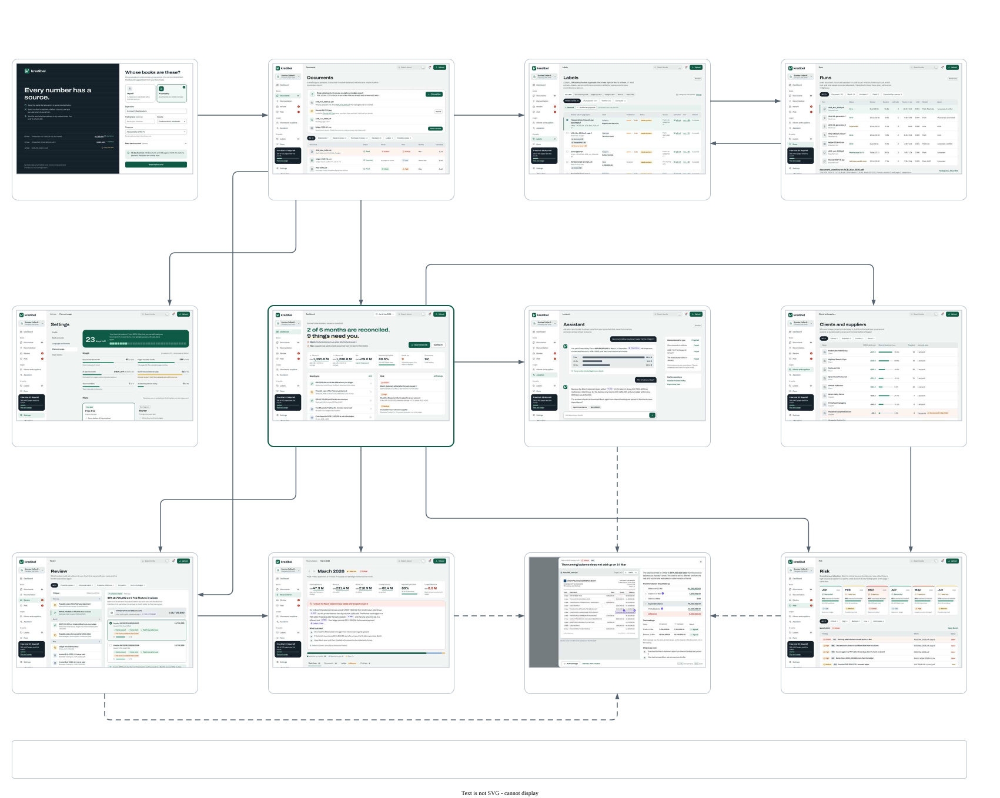

*Source: [`screen-flow.drawio.svg`](diagrams/screen-flow.drawio.svg). Open it in VS Code with the draw.io extension to edit; the file stays a valid SVG.*

The same map as text. Every arrow is a link a person can follow; the dashed ones open an overlay.

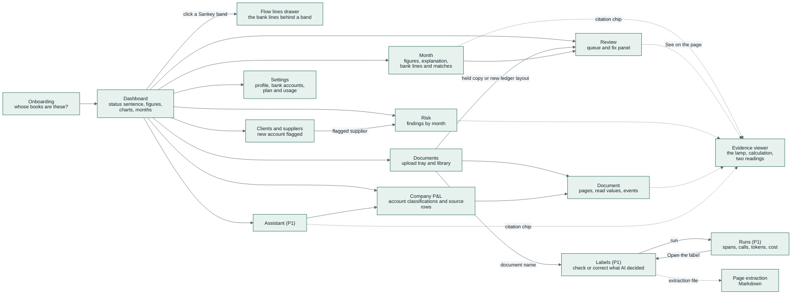

The mocks in [`design/mocks/`](../design/mocks/index.html) are linked the same way, so they work as a
clickable prototype: every navigation item, card, row, chip and button leads to another mock, and a
small script (`assets/proto.js`) switches the segmented controls (framework, chart view, label task),
picks a review candidate and selects a table row. Start at `dashboard.html`.

### 4.4 The main flow: from upload to a reconciled month

Amber rounded boxes are what the person does; green boxes are what the screen shows. The order of
uploads never changes the result ([ADR-015](adr/ADR-015-scope-finance-workspace-not-loan-review.md)).

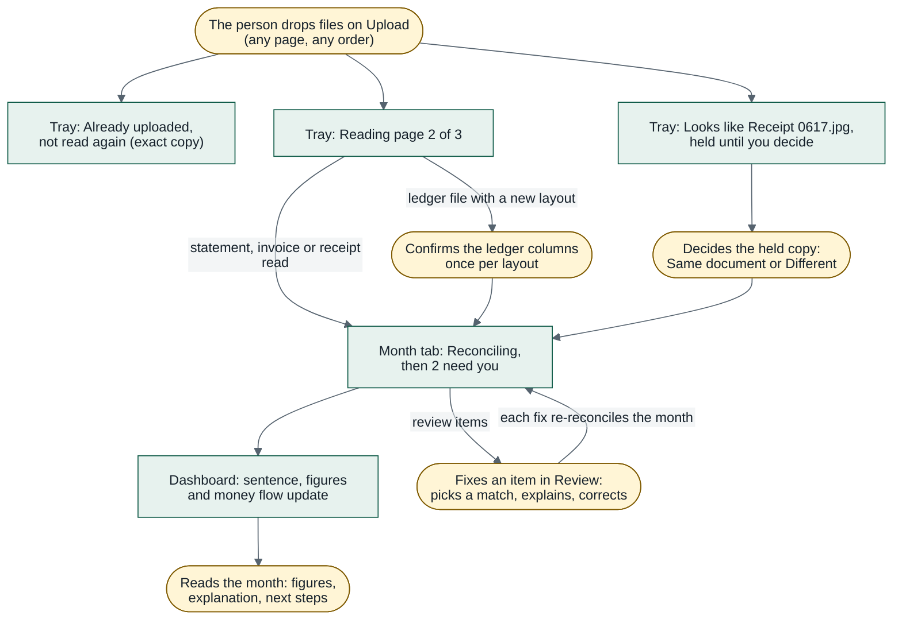

---

## 5. Data and realtime

### 5.1 Server state

TanStack Query, one hook per endpoint in `entities/*/api.ts`:

| Query key | Endpoint | Stale time |
|---|---|---|
| `['me']` | `GET /api/me` | 5 min (refetched after workspace creation and token refresh) |
| `['plans']` | `GET /api/plans` | ∞ |
| `['workspace']` | `GET /api/workspace` | 60 s (usage meters) |
| `['dashboard', period]` | `GET /api/dashboard` | 0 (driven by month listeners) |
| `['money-flow', period, view, framework]` | `GET /api/money-flow` | 0 (driven by month listeners) |
| `['cash-flow', period, framework]` | `GET /api/cash-flow` | 0 (driven by month listeners) |
| `['documents', filters, cursor]` | `GET /api/documents` | 0 (driven by document listeners) |
| `['document', docId]` | `GET /api/documents/{id}` | 0 |
| `['months']` | `GET /api/months` | 0 |
| `['month', month]` | `GET /api/months/{month}` | 0 |
| `['bank-lines', filters, cursor]` | `GET /api/bank-lines` | invalidated with its month |
| `['invoices' \| 'receipts' \| 'ledger-entries', filters]` | `GET /api/…` | invalidated with its month |
| `['review-items', filters]` | `GET /api/review-items` | 0 |
| `['findings', filters]` | `GET /api/findings` | invalidated with its month |
| `['counterparties', filters]` | `GET /api/counterparties` | 60 s |
| `['suggestions', status]` | `GET /api/suggestions` | invalidated on decide |
| `['run', runId]` | `GET /api/runs/{id}` | 0 while running (P1 run graph) |
| `['events', subject]` | `GET /api/events` | 10 s |
| `['labels', filters, cursor]` | `GET /api/labels` | 0; invalidated on decide and bulk confirm |
| `['label', labelId]` | `GET /api/labels/{id}` | 0 |
| `['runs', filters, cursor]` | `GET /api/runs` | 30 s |
| `['run-events', runId]` | `GET /api/runs/{id}/events` | ∞ once the run has finished |

Mutations invalidate the narrowest keys: resolving a review item invalidates `review-items` and the
month's keys; the month's listener then brings the new figures.

### 5.2 Realtime channel

`shared/firebase/listeners.ts`:

- `useDocumentsLive()`: `status`, `docType`, `pages[].status`, `heldAsDuplicate` on recent documents
  (drives the upload tray and "Reading page 2 of 3").
- `useMonthsLive()`: `state`, `generation`, `updatedAt` per month (drives the month tabs and the
  "Reconciling March" indicator).
- `useRunLive(runId)` (P1): `stages` for the run graph.

When a watched field changes, the hook updates a small live view model **and** invalidates the
matching query keys. If a listener errors, the hook falls back to polling every 3 s and shows a
quiet "Live updates paused" indicator.

### 5.3 The fix loop

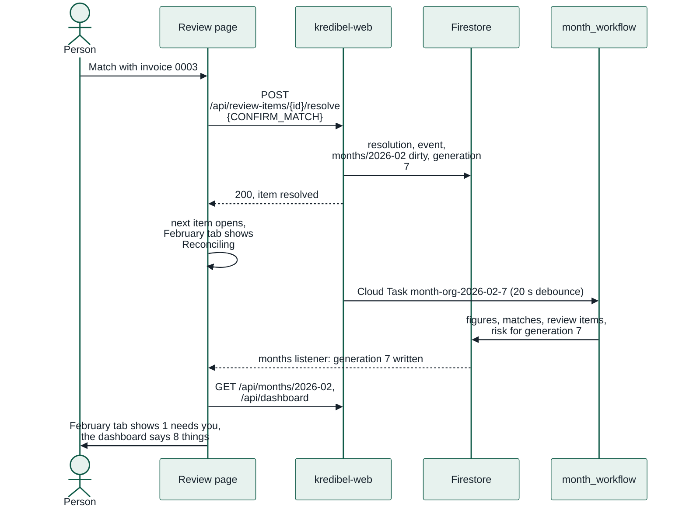

### 5.4 API client

`shared/api/client.ts`: a typed `fetch` wrapper on the generated `paths` types; adds
`Authorization: Bearer ${await user.getIdToken()}`; parses `application/problem+json` into
`ApiError {status, code, title, detail, extras}`. `401` → sign out and `/login`;
`403 WORKSPACE_REQUIRED` → `/onboarding`; `403 PLAN_LIMIT_REACHED` / `TRIAL_EXPIRED` → the
`PlanLimitDialog` (which limit, how much is used, a link to **Plan and usage**).

---

## 5a. Responsive behaviour

Size classes and the shell are defined in [`12`](12-design-system.md) §5. `shared/lib/useSizeClass`
returns `compact | medium | expanded | large` from `matchMedia` on the token breakpoints; components
prefer CSS (Tailwind variants and container queries) and use the hook only for behaviour CSS cannot
express (drawer versus full page).

| Screen | Compact (< 600) | Medium and expanded (600–1199) | Large (≥ 1200) |
|---|---|---|---|
| App frame | Top bar (mark or back, title, bell); bottom nav; floating **Upload** | Rail with short labels and the avatar (opens Settings); top bar with breadcrumbs, search and **Upload** | Labelled sidebar with workspace, trial status and profile (opens Settings) |
| Dashboard | Sentence, figures in 2 columns, **Needs you**, risk, then the charts one under the other (money flow as ranked bars), months scroll with snap | Figures in 2 columns; Needs you and Risk stacked; charts full width, medium drawings (Sankey from 640 px of panel) | Figures in 6 columns; Needs you beside Risk; charts full width, one per row, wide drawings from 960 px of panel; months in one row |
| Labels (P1) | Rows as cards (subject, value, confidence, status); the label drawer fills the screen, the form above the extraction | Shared table; the drawer with the form beside the extraction and provenance | Shared table with source, extraction, run and dataset columns; the same drawer |
| Runs (P1) | Runs as cards; span waterfall with the bar under each name; inspector below | Table; waterfall beside names | Table; waterfall; inspector below with the call beside its request and response |
| Documents | **Choose files** and **Photo of a receipt**; rows as cards (risk, status) | Drop area; table from 760 px of container | Drop area and full table |
| Month | Figures in 2 columns; explanation; bank lines as cards with the match chip and reason | Figures in 2 columns; table | Figures in 6 columns; table |
| Review | Queue as a list; an item opens full page with a sticky primary action | Same; split view from 980 px of container | Queue beside the fix panel, `j`/`k` to move |
| Evidence viewer | Full screen; page zoomed to the evidence with **Whole page**; finding below; sticky actions | Full screen; page above the finding | Drawer with page and finding side by side |
| Assistant (P1) | Chat only; remembered items in a sheet | Chat; aside below | Chat with the remembered panel beside |
| Settings | List of sections → section page with back | Section links scroll at the top | Section list on the left |

---

## 6. Screens

The screenshots come from the mocks (`make mock-shots`) and show the demo workspace of
[`18`](18-synthetic-data.md): Sunrise Coffee Roasters, January to June 2026, with scenarios S1 to S4
together (the edited March statement, the duplicates, the changed supplier account, the unpaid bills). Where the text and a mock disagree on behaviour, the text
wins; on looks, the mock and [`12`](12-design-system.md) win.

### 6.1 Onboarding

<p>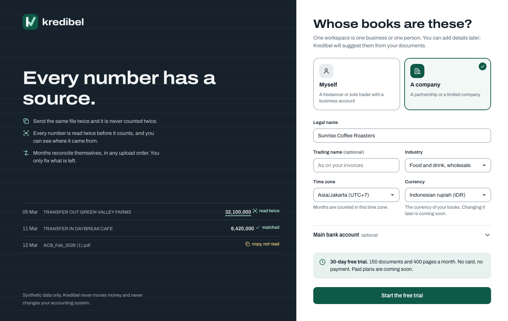 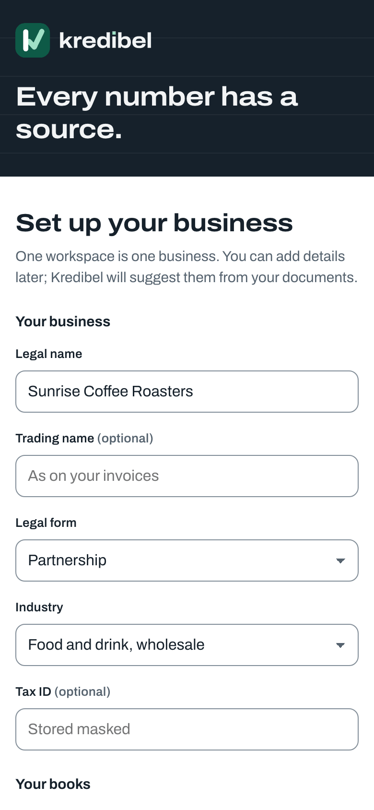</p>

- For a business only (no "myself or a company" question), in three sections:
  **Your business** (legal name, trading name optional, legal form, industry, tax ID optional),
  **Your books** (the currency of the books: IDR, MYR, SGD, JPY or USD, suggested from the time zone
  and fixed afterwards; the accounting framework, IFRS or US GAAP, as a segmented choice; the time
  zone, in which months are counted), and an optional **Main bank account** whose holder starts as
  the legal name.
- The trial terms are stated before the button: "30-day free trial. 150 documents and 400 pages a
  month. No card, no payment. Paid plans are coming soon." (numbers from `GET /api/plans`)
  **Start the free trial** → `POST /api/workspaces` → refresh the ID token → the dashboard's empty
  state with its upload action (AC-013-2). If the refreshed token still has no workspace, "Finishing
  setup…" and one retry after 2 s.
- The brand panel shows three ledger lines with what Kredibel does to each (read twice, matched,
  copy not read). It is the only decorative surface in the product.

### 6.2 Dashboard

<p>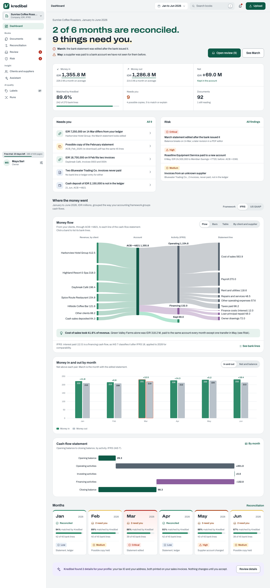 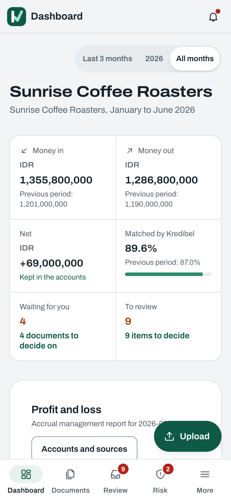</p>

<p>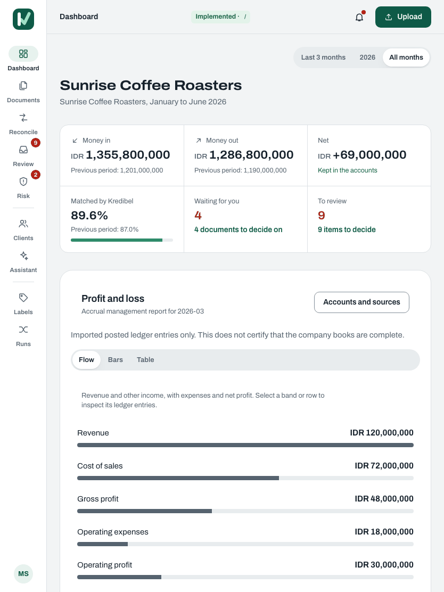</p>

The mock and the page draw the same synthetic payload (`contracts/design/fixtures/dashboard.json`,
spec 019 AC-019-2) and the page's own words (`dashboard.json`); a browser check compares their
visible headings, segmented controls and panel links at 390, 834 and 1440 px. Top to bottom:

- **Period:** a segmented control (**Last 3 months**, the current year, **All months**) that drives
  every figure and chart on the page.
- **Header:** the workspace name, then "Sunrise Coffee Roasters, January to June 2026".
- **Figures:** money in and money out against the previous period of equal length, net (kept in or
  taken from the accounts), matched by Kredibel (share, with the previous period and a small meter),
  waiting for you (documents to decide on) and to review (open items), the last two in the alert
  colour when above zero and linking to the documents and the queue.
- **Profit and loss:** the company P&L panel of spec 018 (§6.2a) with **Accounts and sources**.
- **Where the money went:** a section with a **Framework** switch (IFRS or US GAAP, default the
  workspace's `profile.accountingFramework`; switching it here does not change the setting) and three
  chart panels. **Charts never share a row:** each panel takes the full content width beside the
  navigation and they stack in one column ([`12`](12-design-system.md) §2.3).
  1. **Money flow** with four views: **Flow** (Sankey: revenue by client → bank account → activity →
     statement line, in the framework's wording, such as Cost of sales or Cost of goods sold),
     **Bars** (statement lines grouped by activity), **Table**, and **By client and supplier** (the
     counterparties view, [`08`](08-risk-engine.md) §5.1). The foot prints the unit ("Amounts in
     millions.") and the note the API writes about what the framework changes ("IFRS: interest paid
     is a financing cash flow…"). Clicking a band, bar or row opens the **flow lines drawer** with its
     bank lines. Possible copies are left out until decided. On phones the flow becomes two ranked
     lists, **Where it came from** and **Where it went**. The Sankey is an accessible group of
     focusable bands and nodes, never an image.
  2. **Money in and out by month:** grouped bars with the net above each pair, the month with a
     Critical or High risk outlined and named in the subtitle; second view **Net and balance**.
  3. **Cash-flow statement:** opening balance → operating → investing → financing → closing balance
     as a waterfall, with **By month** to the month table.
- **Reconciliation & Findings:** the status sentence ("2 of 6 months are reconciled. 3 findings are
  open."), up to two Critical or High reasons with severity icons, **See March** (the worst month) and
  **Ask about this**, which opens the assistant with the question filled in.
- **Risk**, **To review** and **Where the money went** in short: the open findings (severity badge,
  title, month, opening the evidence viewer), the first five review items in the queue's order (kind
  tile, title, kind and month, opening the fix panel) and the three largest sources and uses as ranked
  bars. Two columns from 980 px of content, three from 1100 px, stacked below.
- **Months:** one binder tab per month with state, matched share, statements present of expected and
  the risk level; a critical month is tinted. Clicking opens the month.
- **Profile suggestions** (planned, [spec 014](specs/014-profile-and-counterparties/spec.md)): the
  mock keeps the card at the end, labelled as planned; the page does not draw it yet.

### 6.2a Company profit and loss (spec 018)

The dashboard adds a full-width **Profit and loss** panel before the cash-flow framework section.
The IFRS/US GAAP toggle applies only to cash flow. **Accounts and sources** opens `/profit-loss`
with the same period. The report page offers Flow/Bars/Table, a month picker and period input, coverage, exclusions and journal gaps,
account P&L/subledger selectors with **Confirm classification**, and source document/row links.
Owners/accountants can confirm; other roles read. Empty means usable classified ledger entries are
not available, not zero profit. A failed request has **Try again**. All words use `profitLoss.json`.
While the workspace has no ledger export (`basis: CASH`), the panel and the page say **Cash-basis
report … from your bank lines**, the flow names categories by their labels (Sales receipts, Purchases
for sale or production, Payroll), and the classification table becomes **Category labels**, read-only,
badged "From the category policy" (`profit-loss-cash.html`).

The Flow joins revenue accounts and separate other income at total income, then shows cost of sales,
operating subledgers, finance costs, tax and net profit. It uses the report totals and exact decimal
aggregation, never clamps losses or reversals. Negative groups/losses use signed clickable rows.
At narrow panel widths the same source-linked rows replace the diagram. A selected node, band or
row opens the source-entry drawer with the selected reported total; mixed income and expense
source rows are never naively added into a second, conflicting subtotal.

Bars use HTML at their actual font size rather than scaling SVG text. At compact widths each bar
sits below its label and signed amount; controls wrap, source links wrap, tables scroll within their
panel. Medium/large layouts retain the same full-width stack. No primary action is fixed over content.
The assistant's deterministic P&L answer includes the same period and **Open profit and loss**.

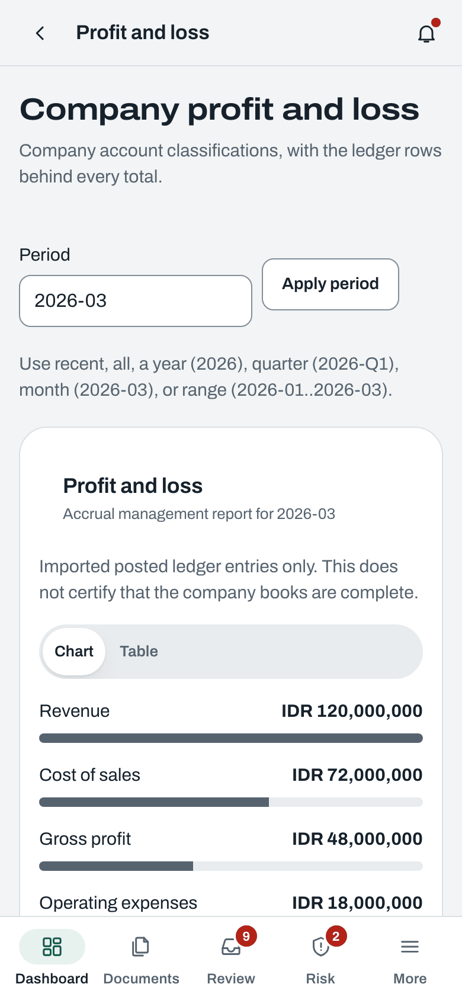
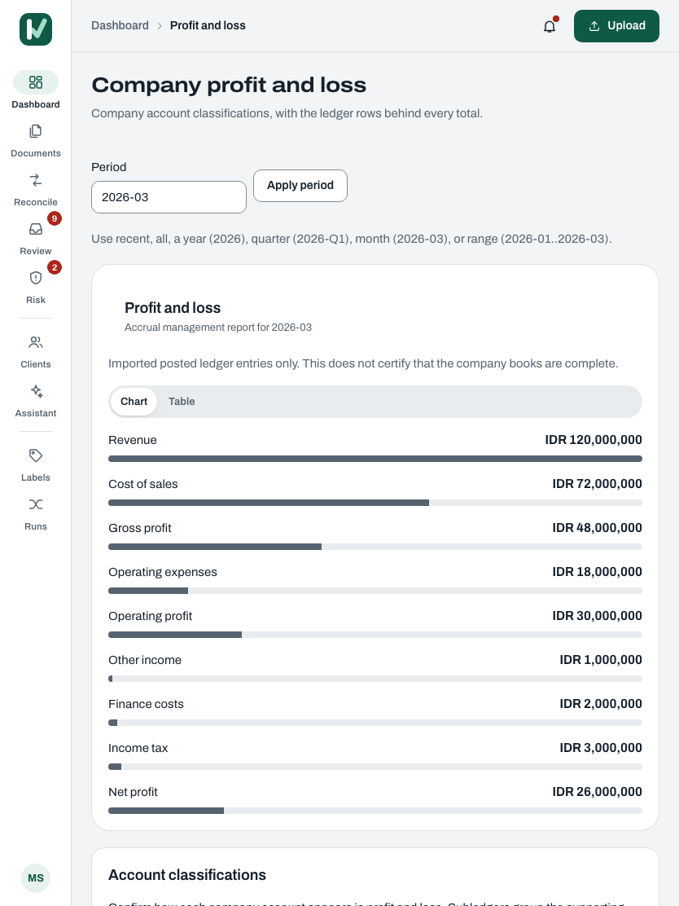
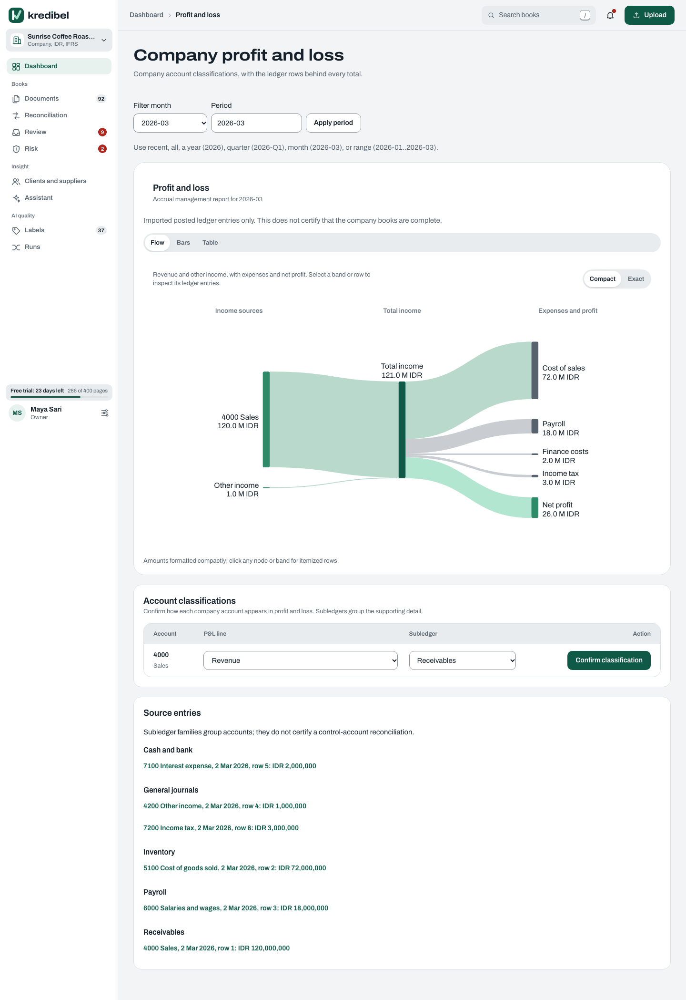

The editable draw.io screen map predates this addition; the Mermaid map above is current. Update
the draw.io source using its extension when that editor is available (never hand-edit the SVG).

### 6.3 Documents

<p>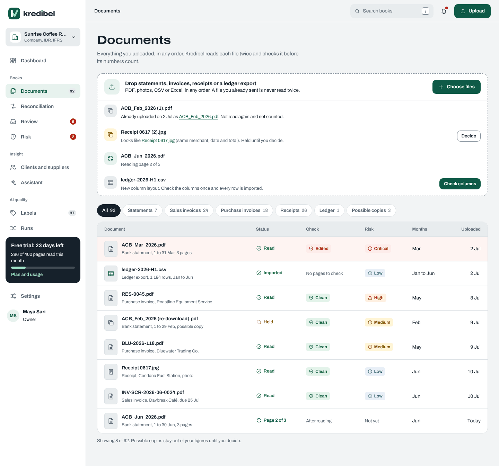 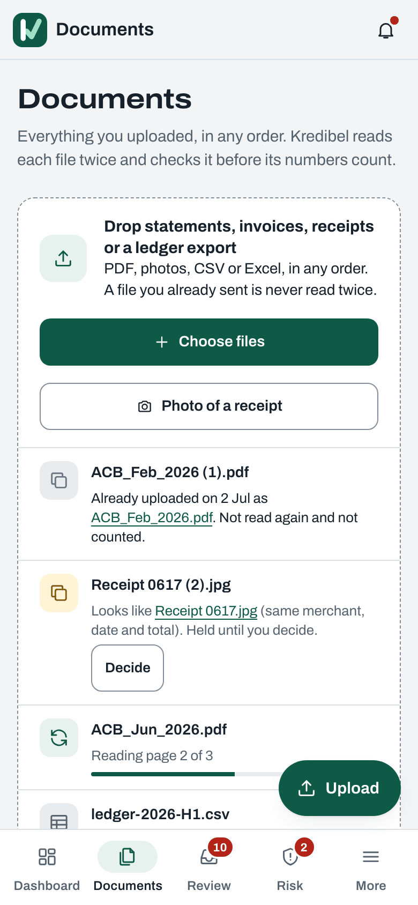</p>

- **Upload tray:** many files at once, any type and order. Client-side pre-checks against the plan
  (size, page count read with pdf.js) are early warnings only. Each file gets a row that changes live.

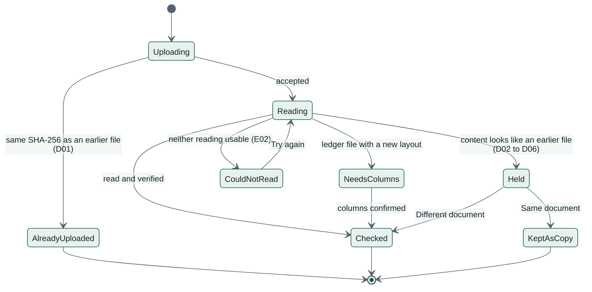

| Tray state | What the row says | Action |
|---|---|---|
| AlreadyUploaded | "Already uploaded on 2 Jul as ACB_Feb_2026.pdf. Not read again and not counted." | — |
| Reading | "Reading page 2 of 3" with a progress bar | — |
| Held | "Looks like Receipt 0617.jpg (same merchant, date and total). Held until you decide." | **Decide** |
| NeedsColumns | "New column layout. Check the columns once and every row is imported." | **Check columns** |
| CouldNotRead | "Could not read this file." | **Try again** |

- **Library:** one table of the workspace's documents (`DataTable`: 10 a page, search by name, type,
  status or month, sortable columns), chips by type with counts (Statements, Sales invoices, Purchase
  invoices, Receipts, Ledger, Possible copies); table of document (type icon, name, what it is), status, check (Clean,
  Edited, Not checked), risk level, months, uploaded. A row with a critical finding is tinted. On
  compact each row is a card with risk and status.
- **Document page** (`/documents/:docId`, mock `document.html`):

  <p>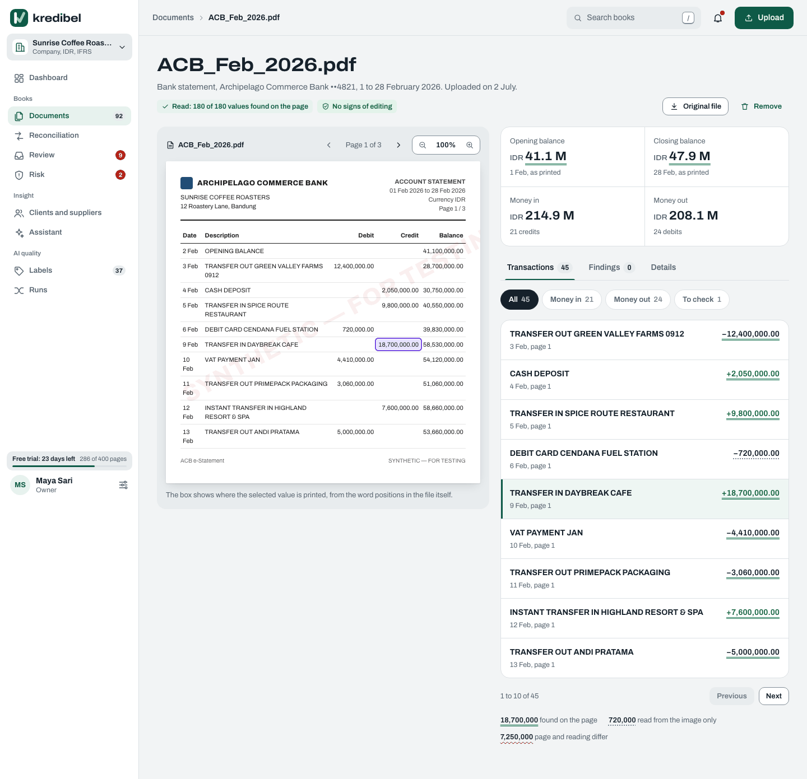 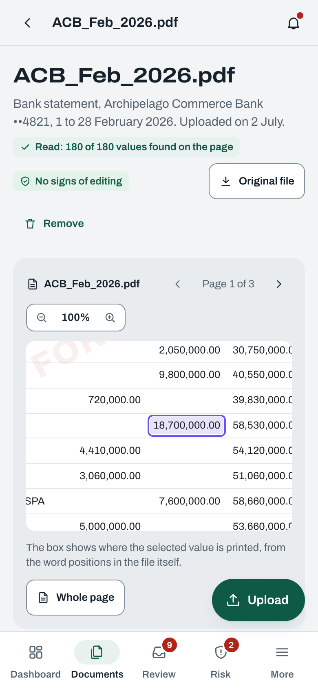</p>

  - **Header:** file name; what it is (type, bank and account, period) and when it was uploaded;
    the type badge, how it was read ("Read: 180 of 180 values found on the page") and its check;
    **Original file**, **Remove document** (which asks once, in a banner).
  - **Page viewer** (left, sticky from 980 px): the file, whether the page is digital or scanned,
    one page at a time with previous and next, zoom in steps from 50 to 200 %, and the lamp on the
    value being looked at. A phone opens at 200 % centred on the lamp. The page image scrolls
    inside its window, which keyboard users can focus.
  - **What was read** (right): for a statement, the opening and closing balances as printed and
    the money in and out of its lines, added exactly as decimals; then tabs. **Transactions** (or
    **Invoices**, **Receipts**): the shared table with chips All, Money in, Money out, To check (a
    value only one source read, or readings that differ) and search; 10 a page; each amount with
    its reading mark and the legend. **Findings**: the document's open findings with facts, next
    step and **Show on page**. **Details**: type, bank, account, period, currency, pages (digital or
    scanned), values found, upload date.
  - Choosing a transaction, an invoice value or a finding's evidence moves the viewer to its page
    and lights it.
  - **Ledger export** (`document-ledger.html`): no page viewer; the figures are the rows imported,
    the period and the type (spreadsheet); the **Ledger entries** tab says how many rows were
    imported, links **View in Profit and loss** and names the months. A file with a new layout
    (`document-ledger-columns.html`) has imported nothing yet: a banner says "New column layout.
    Check which column is which, once, and every row is imported." and **Check columns** opens its
    review item (§6.5, spec 005 AC-005-11). Standard English layouts are confirmed by code.
  - The mock and the page draw the same synthetic document (`contracts/design/fixtures/document.json`);
    the browser check serves the mock's synthetic page as the page image and compares header,
    figures, tabs, filters and columns.
  - Later: the matches it takes part in (spec 007), its events, and P1 "How this was processed"
    (run graph, [`17`](17-observability.md) §5).
- **Page images and the original file** are API routes that need the ID token, which an ``
  or a plain link cannot send: the SPA fetches them through the API client and shows them from object
  URLs (`PageImage`, `downloadOriginal` in `entities/document`).

### 6.4 Month

<p>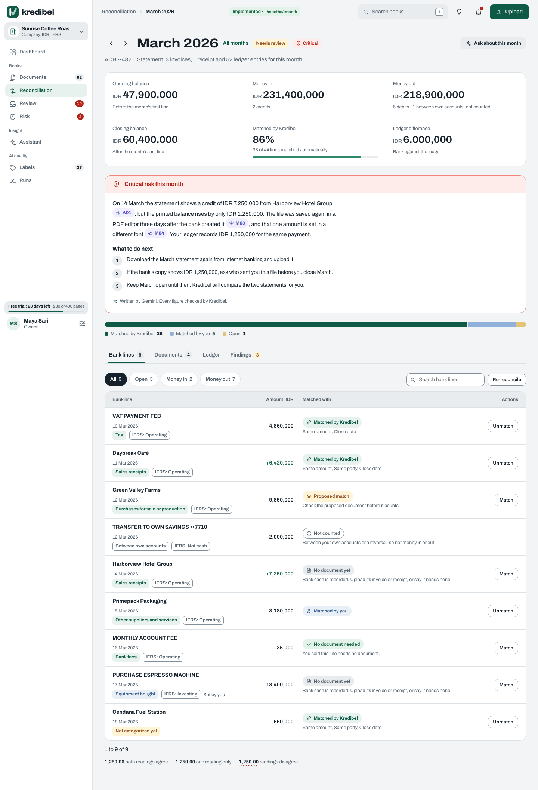 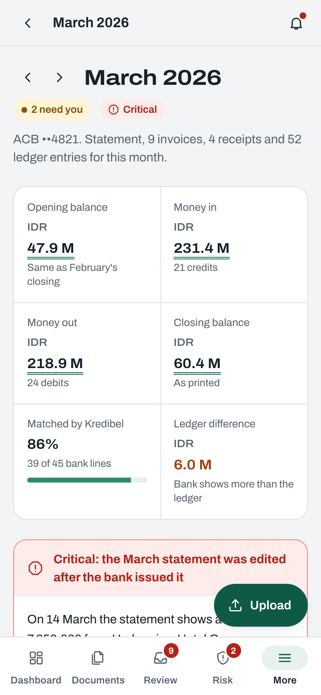</p>

The mock and the page draw the same synthetic month (`contracts/design/fixtures/month.json`,
spec 019 AC-019-3); the browser check compares header, figures, citations, tabs, filters,
columns, support chips and actions at three widths.

- **Header:** month name with previous and next, **All months**, the state badge, the Critical
  badge when the level is critical, and **Ask about this month** (the assistant with the question
  filled in); below it, the month's note ("ACB ••4821. Statement, 3 invoices, 1 receipt and 52
  ledger entries for this month.") or the standing subtitle.
- **Figures:** opening balance (before the month's first line), money in and money out with their
  counts, closing balance (after the month's last line), matched by Kredibel (share, "38 of 44
  lines matched automatically", a small meter) and the ledger difference ("Bank against the
  ledger", or "No ledger imported yet"). A missing fact shows a dash, never a number.
- **Explanation** (when the level is MEDIUM or higher): "Critical risk this month" as a heading,
  the Gemini summary with its `[[finding:…]]` markers as citation chips that carry the finding's
  code (A01) and open its evidence (other markers are dropped), **What to do next** as a numbered
  list, and the by-line "Written by Gemini. Every figure checked by Kredibel." If the grounding
  guard failed, the template text is shown and the by-line says "Written from a template".
- **Match meter:** matched by Kredibel, matched by you, open.
- **Opens on the current month** from the navigation; previous and next move a month; **All months**
  (`/months/all`, `months.html`) lists every month in the shared table, newest first, with its
  state, risk and statements, chips All, Needs review, Collecting, Reconciled and search; a row
  opens its month. A month with no statement, document or figure says so ("Nothing for October
  2026 yet") and offers its latest month with data and the upload, instead of a page of dashes.
- **Tabs:** Bank lines (default), Documents, Ledger, Findings, with their counts. Documents: the
  month's invoices and receipts with their payment evidence, each opening its document. Ledger:
  until a ledger is imported it says none is and offers the upload; the difference count on the
  tab is planned with the ledger views (T007-10c). Findings: the month's open findings, each
  opening its evidence.
- **Bank lines:** the shared table with chips All, Open, Money in, Money out, search and
  **Re-reconcile**; columns Bank line (counterparty or description, date, the category badge in
  its cash-flow colour, "IFRS: Operating", and "Set by you" for a person's category), Amount
  (signed, reading mark), **Matched with** as a support chip (matched by Kredibel, matched by you,
  proposed match, no document needed, not counted, no document yet) with the match reasons or the
  support's plain-words reason, and **Actions** (**Match** opens the match sheet; **Unmatch** on a
  matched line). The reading legend closes the table.
- P1: **Sign off** when the month is reconciled; **Reopen** with a reason. Tinting a line tied to
  a finding and an **Evidence** link on it are planned with spec 015.

#### Bank evidence and document support (ADR-025, spec 007)

Ordinary-flow prototype: [Reconciliation](../design/mocks/reconciliation.html). The March mock above
remains the integrity investigation example. Processing **Done** means extraction finished, never
that payment is verified. Show independent labels for bank evidence, document support and integrity.

| Evidence | Label and action |
|---|---|
| Bank row, no invoice/receipt | **Bank recorded** and **No supporting document**; attach documents or record why none is required; neutral, not a fraud alert |
| One row pays several invoices | **Matched to 2 documents**; expand each allocation, bank amount, difference, party/reference/date reasons |
| Several transfers pay one invoice | **Paid in 2 transfers**; show both bank dates/amounts and remaining invoice balance |
| Document before covering statements | **Waiting for statement**; upload statement or confirm payment manually; never accuse it of being unpaid yet |
| User approves document | **Document approved**; payment state is unchanged |
| User confirms payment without bank match | **Payment confirmed by you** with **No bank evidence**; actor/date/reason, payment date/method/amount, partial balance; excluded from bank cash totals |

**Approve document** and **Confirm payment manually** are distinct actions, available from document
detail even without a review item. The latter asks for payment date, method, amount/currency and a
reason. The confirmation explains that it does not create bank evidence. Later matches preserve the
audit record. Details/allocations stack on phones, with ordinary 44 px action buttons. Every panel
needs loading, empty, error and populated states when implemented in T007-10; the static mock is
design work, not a claim these actions already exist in the application.

The workspace currency is fixed at onboarding. A document that prints no currency is read in the
workspace currency and its row says **No currency printed: read as IDR**. A different printed currency opens
**Confirm document currency**: “This document says IDR. Use its amounts as MYR without conversion?”
Actions: **Use amounts as MYR** or **Replace document**. Until agreed, show **Currency needs
confirmation** and exclude the document from totals/matching. Keep its printed currency visible
after acceptance; the confirmation is audited. No exchange-rate fields, conversions or FX totals.

<p>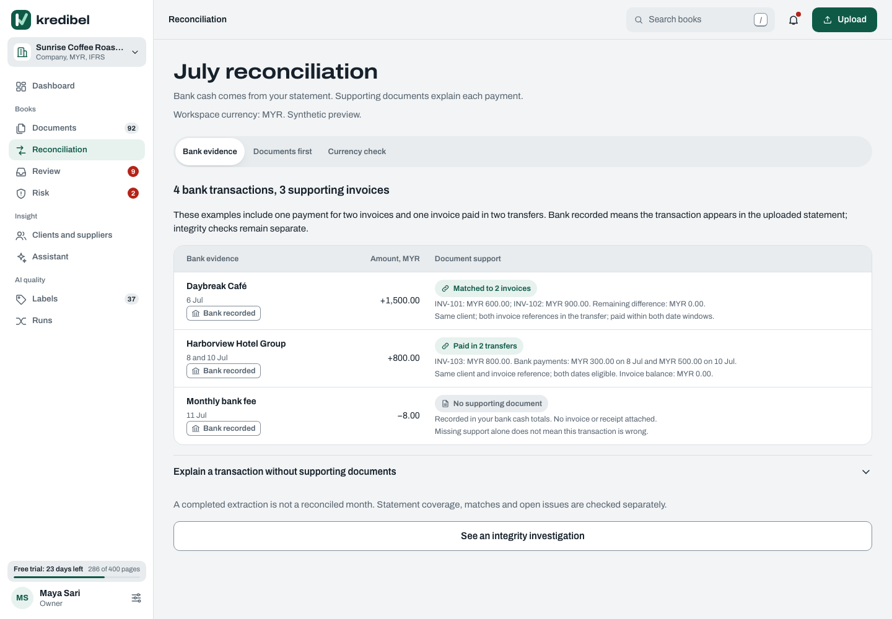 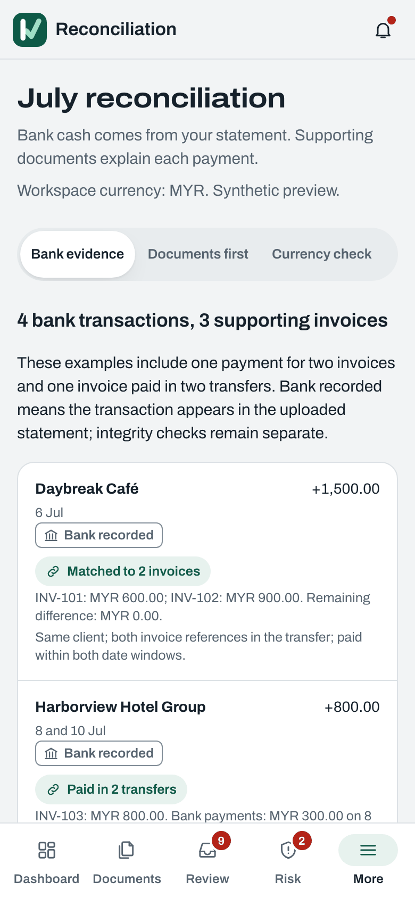</p>

### 6.5 Review

<p>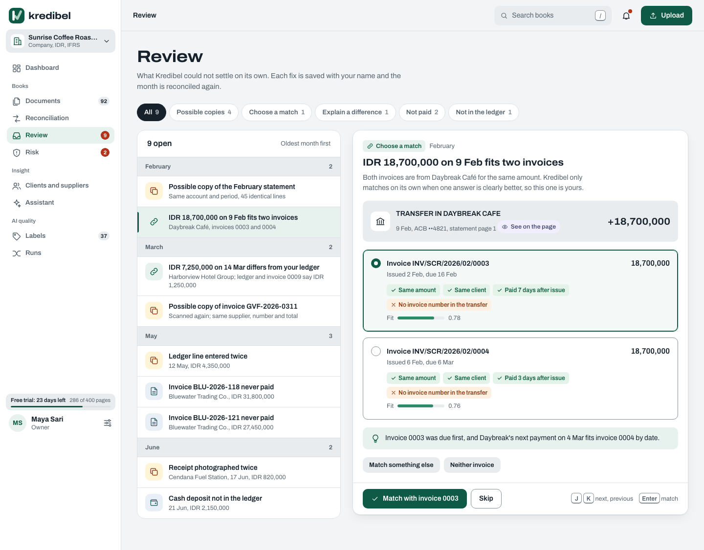 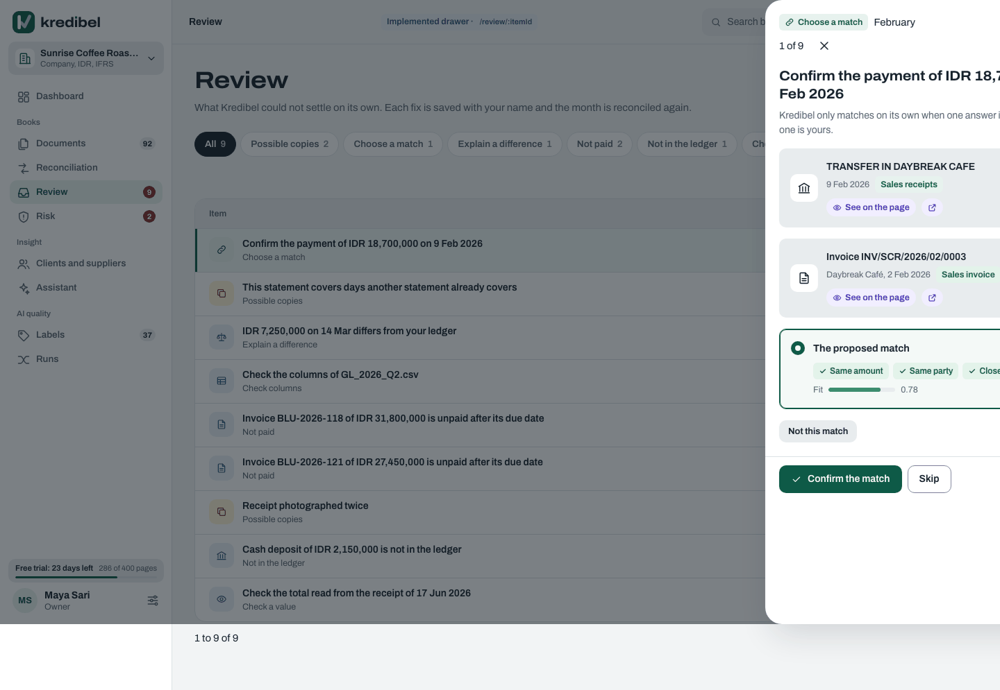 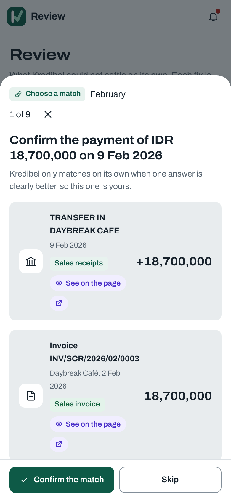</p>

<p>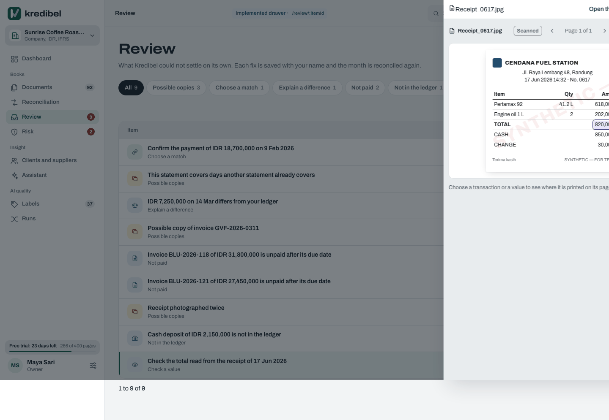</p>

Three mocks share the queue (`review.html`, `review-match.html`, `review-correction.html`), drawn
from the same synthetic items as the browser check (`contracts/design/fixtures/review.json`).

- **Queue:** the shared `DataTable` ([`12`](12-design-system.md) §7): chips by kind with counts,
  search, 10 items a page, a month column; each item with a kind tile, a title that names the money,
  and its kind. An item opens the **fix drawer** over the queue (a side drawer from 760 px, a
  bottom sheet below). The eight kinds of [`08`](08-risk-engine.md) §7 have these names on screen:

| Kind | Chip | Kind | Chip |
|---|---|---|---|
| `POSSIBLE_DUPLICATE` | Possible copies | `LEDGER_DIFFERENCE` | Explain a difference |
| `PROPOSED_MATCH` | Choose a match | `LOW_CONFIDENCE_VALUE` | Check a value |
| `UNMATCHED_DOCUMENT` | Not paid | `CONFIRM_TYPE` | Confirm type |
| `UNMATCHED_BANK_LINE` | Not in the ledger | `CONFIRM_LEDGER_MAPPING` | Check columns |

- **Fix drawer:** the kind and month, the position ("2 of 9") and **Close**; a title ("Confirm the
  payment of IDR 18,700,000 on 9 Feb 2026"); why it is here ("Kredibel only matches on its own when
  one answer is clearly better, so this one is yours."); the **subjects** (the bank line with its
  category, the invoice or receipt with its kind, or the two files of a possible copy), each with
  **See on the page** (the page opens in a preview beside the panel, which widens the drawer) and a
  link to the document; for a proposed match **the proposed match** as a radio card with its reason
  tags (✓ Same amount, ✓ Same party, ✓ Close date) and the fit score; for an unpaid document the
  bank lines that could be its payment; the other allowed actions as quiet buttons (**Not this
  match**, **Correct it**, **Leave it, with a reason**); the primary action named after the choice
  (**Confirm the match**, **The value is right**) and **Skip**.
- **Checking columns** (`review-mapping.html`, spec 005 T005-11): a ledger export with a new
  layout asks once which column of the file holds each field. The drawer shows the file, the
  **MappingEditor** (Date, Description, Account code, Account name, Reference and the amount columns,
  each a select over the file's header with **Not in the file**; the amounts' layout, debit and
  credit columns or one signed amount with **Positive amounts are** debits or credits; the date
  format; the decimal separator) and **The first rows, as this mapping reads them** (the file's
  values, mapped columns tinted, and "1 Apr 2026 · 4000 · Credit 24,480,000" or why a row could not
  be read). Code proposes the mapping from the header words and the value shapes; **Confirm
  columns** is enabled only when the required fields and one amount layout are chosen (the API
  applies the same rule, 422 otherwise). The confirmed mapping is kept for the layout, so the next
  file with it is read at once; more than 2% rows that cannot be read reopen the item with their
  count (AC-005-12).
- **Correcting a value** (`review-correction.html`, T009-03a): a value only one source read opens
  with its receipt or invoice page in the preview; **Correct it** shows "The total as printed" with
  the hint "Amounts as digits (476976.00), dates as YYYY-MM-DD. What was read is kept beside it."
  and **Save the correction** (enabled once there is text). The correction survives re-reading.
- Only actions allowed for the kind are shown ([`10`](10-api-contract.md) §4). After a fix the next
  item opens with "Saved. March is being reconciled again. Next: 5 left", and the month shows
  "Reconciling" until the month run finishes (§5.3). An unpaid document lists up to three unmatched
  bank lines of its direction within 10% of its total; leaving an item needs a reason.
- On phones the drawer is a bottom sheet with the primary action pinned; the navigation badge shows
  the open count.
- Keyboard: `j`/`k` next and previous, `Enter` the primary action, `Esc` close; keys are the queue's
  only while nobody is typing in a field. The hint written from facts ("Invoice 0003 was due first")
  is planned (spec 015).

### 6.6 Evidence viewer

<p> 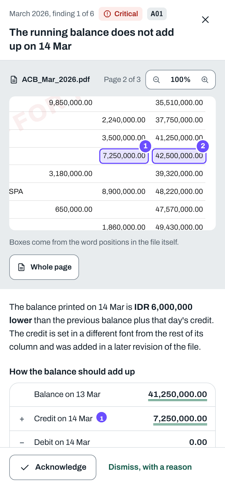</p>

Opens as a drawer at 1200 px and wider and full screen below (`/risk/:findingId`, or from any
citation chip).

- Renders the PDF page with `react-pdf` (text PDFs) or the server-rendered PNG (images and scans).
- **The lamp** ([`12`](12-design-system.md) §6.3): boxes from normalized bboxes × rendered size in
  evidence violet with numbered markers that match the calculation rows. It sweeps once when the
  viewer opens. On compact the page opens zoomed to the evidence with **Whole page**.
- **Finding pane:** what was found (consequence first); **How the balance should add up** (a
  calculation with reading marks); **Two readings** (Gemini and the witness side by side with the
  result; a CRITICAL arithmetic finding needs values both agreed on); **What to do next**.
- **Acknowledge**, or **Dismiss, with a reason** (at least 10 characters); either writes an event.
- Evidence without a box: the whole page with "Exact location not available (scanned page)".

### 6.7 Risk, and Clients and suppliers

<p>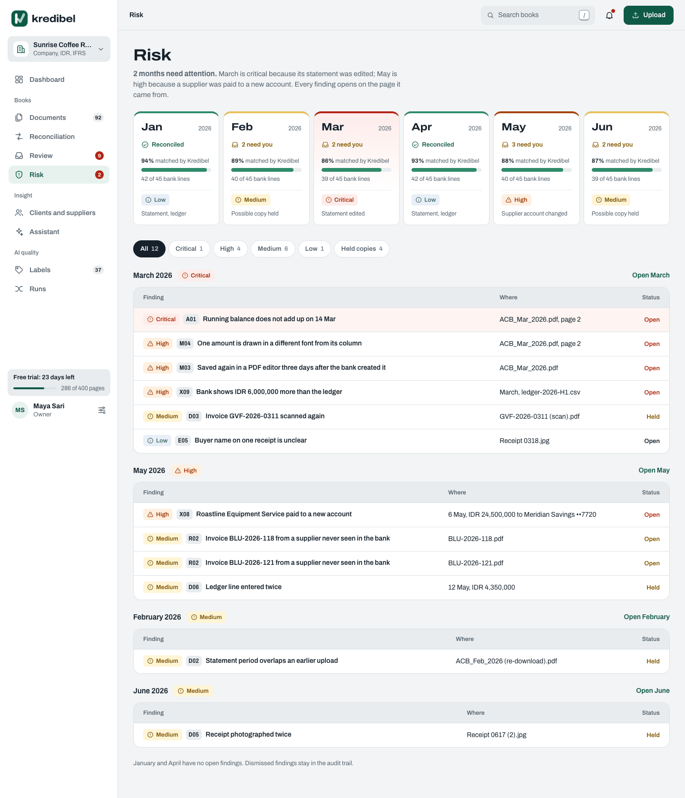 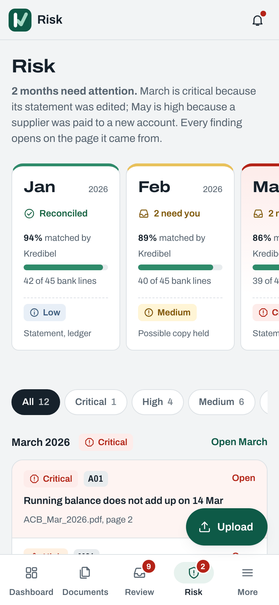</p>

- **Risk:** one sentence on the months that need attention and why, the month tabs with their
  levels, chips by severity and **Held copies** with counts, then findings grouped by month (worst
  month first): severity badge, code (`A01`) beside the title, where (document and page, or the bank
  line), status (Open, Held, Acknowledged). A row opens the evidence viewer; the month heading links
  to the month.

<p>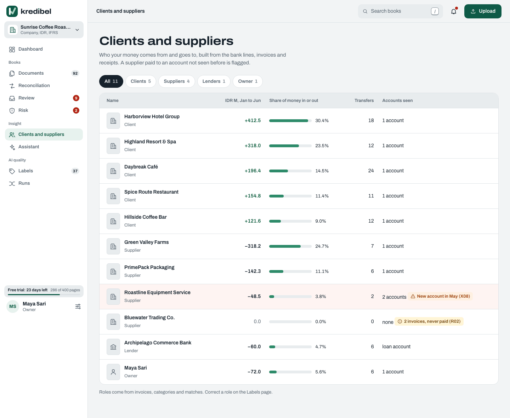 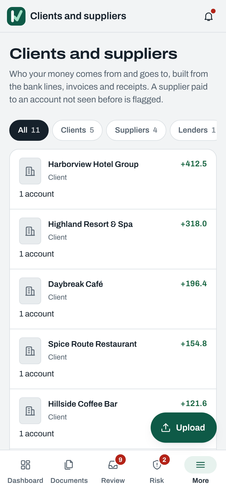</p>

- **Clients and suppliers:** chips All, Clients, Suppliers, Lenders, Owner with counts; table of
  name and role, amount for the period (signed), share of money in or out (bar and %), transfers,
  accounts seen. A new account for a known supplier is flagged (`X08`) and a supplier with unpaid
  invoices and no transfers is flagged (`R02`); both rows link to Risk. A row opens its detail:
  totals by month, accounts seen with first and last dates, and its bank lines. A wrong role is
  corrected on the Labels page (`COUNTERPARTY_ROLE`).
  Built 15 Oct 2026 (`CounterpartiesPage`, `CounterpartyPage`) on the shared fixture
  `contracts/design/fixtures/counterparties.json`; the mocks `clients.html` and `counterparty.html` are
  generated from it and compared in `tests/visual/counterparties.spec.ts`. Profile suggestions found
  in the documents appear on the dashboard (`SuggestionCard`): what was found, its confidence and
  evidence count, and Accept or Reject in place (spec 014, AC-014-7).

### 6.8 Finance Assistant (P1)

<p>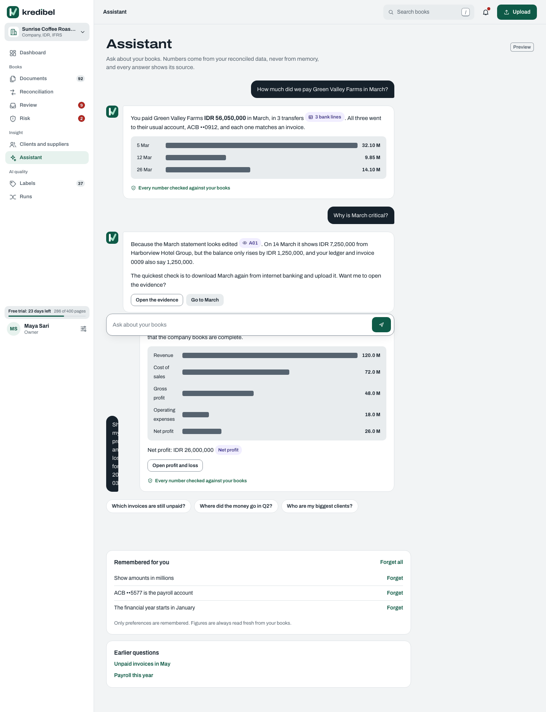 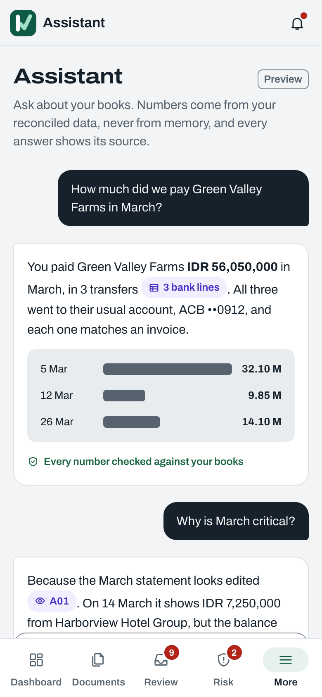</p>

<p>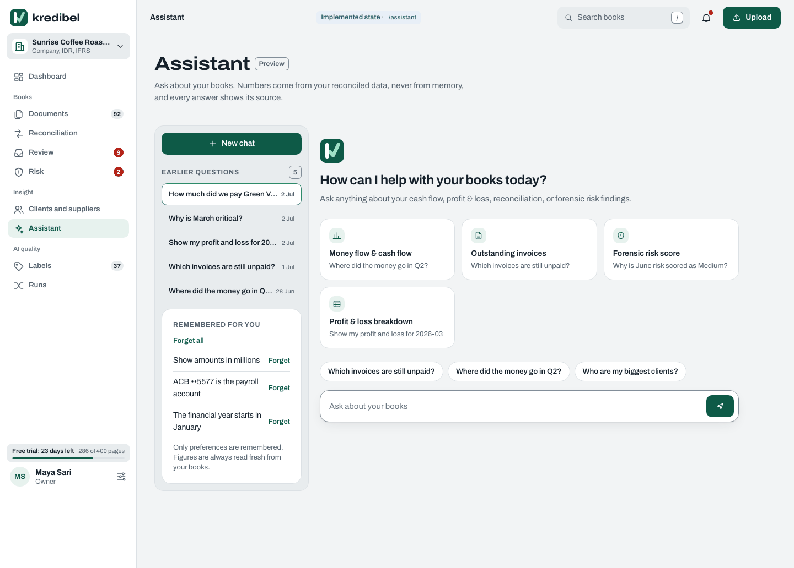 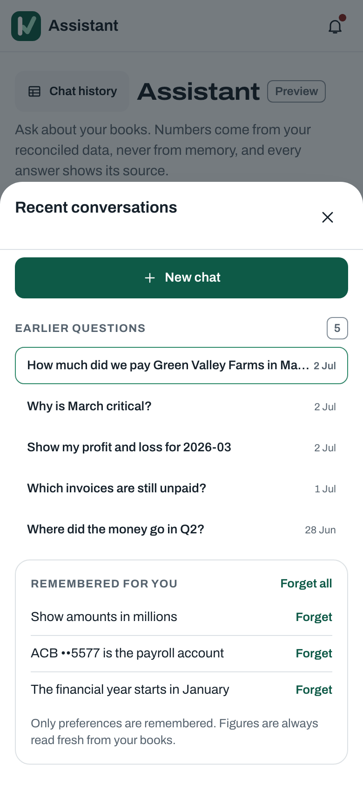</p>

Three states share the layout (`assistant.html`, `assistant-welcome.html`, `assistant-history.html`),
with the page's words from `assistant.json`; a browser check compares the headings, prompt cards,
suggested questions and composer of the welcome state with its mock at three widths (spec 019).

- **Header:** the title with a **Preview** badge, the one-line promise, and on narrow screens the
  **Chat history** button.
- **History:** a rail on the left from 900 px of app width (**New chat**, **Earlier questions** with
  their count and dates, and **Remembered for you**); below that width the same content opens in a
  drawer from **Chat history** (a dialog that **Close history**, the scrim or `Esc` closes). The rail
  and the drawer never show together.
- **Welcome:** an empty thread shows "How can I help with your books today?" and four prompt cards
  (money flow and cash flow, outstanding invoices, forensic risk score, profit and loss breakdown);
  each sends its question. The page never scrolls on first paint; it follows the conversation only
  when a message arrives or an answer is being written.
- **Conversation:** questions about the workspace's books, answered from read-only tools with
  citation chips (the citation's label, such as "3 bank lines", never a bare ID) and, when useful, a
  small bar chart or an interactive diagram link ([ADR-014](adr/ADR-014-finance-assistant-tools-rag-memory.md)).
  "Every number checked against your books" appears when the grounding guard passed; a template
  answer says so instead. Answers can end in actions that are links (**Open the evidence**, **Go to
  month**); the assistant never changes data.
- **Activity:** while an answer streams, the bubble shows the activity trail (the steps and tool
  lookups, expanded while running, collapsible after) and the typing dots, then the text with a caret.
- **Remembered for you:** the preferences in Memory Bank with **Forget** and **Forget all**; "Only
  preferences are remembered. Figures are always read fresh from your books."
- **Composer:** three suggested questions above a labelled text field and **Send** (disabled until
  there is text, and while an answer streams). It works from the keyboard at 360 and 1600 px.

### 6.9 Settings: profile, bank accounts, plan and usage

<p>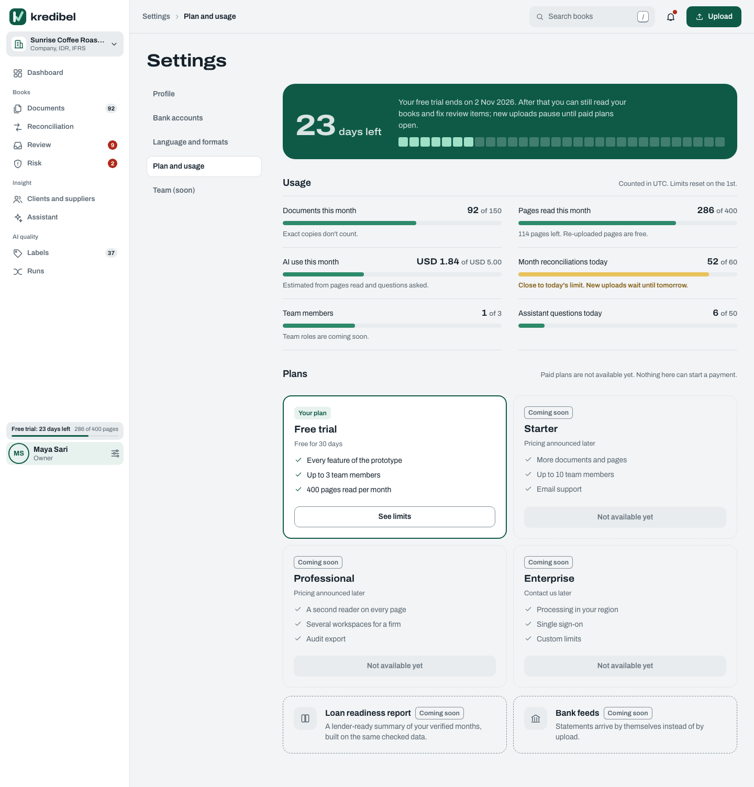 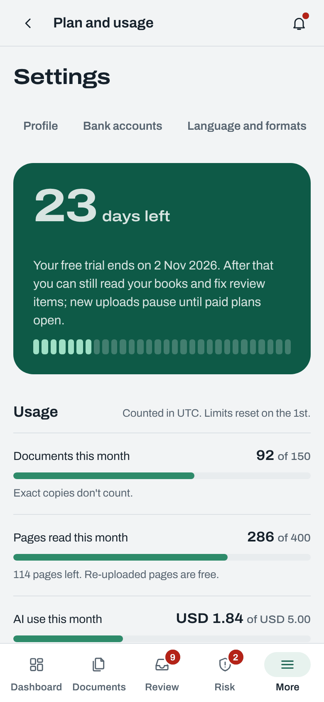</p>

| Section | Content |
|---|---|
| Profile | Type (read-only after onboarding), the accounting framework (**IFRS** or **US GAAP**, which sets the cash-flow classes; changing it reclassifies every month, AC-016-8), names, tax ID, address, industry, time zone; pending suggestions with evidence and **Accept** / **Reject**. Mock: `settings-profile.html` |
| Bank accounts | Bank, masked number, holder, purpose; `Declared` or `Detected` (from an accepted suggestion) |
| Language and formats | **English** (selected); other languages disabled with "Coming soon"; the workspace currency read-only with "Changing the currency is coming soon"; date format read-only |
| Plan and usage | Trial hero (days left as a 30-cell track, end date, what happens after); usage meters from `contracts/plans.v1.yaml` (documents, pages read, AI use, month reconciliations today, members, assistant questions) that warn at 80%; plan cards **Free trial** (current), **Starter**, **Professional**, **Enterprise** with "Coming soon", no price and disabled buttons; coming-soon features **Loan readiness report** and **Bank feeds**. Nothing here starts a payment |
| Members (P1) | Members with roles (owner, accountant, reviewer, viewer); invite by email; seats used |

### 6.10 Logo and brand

<p>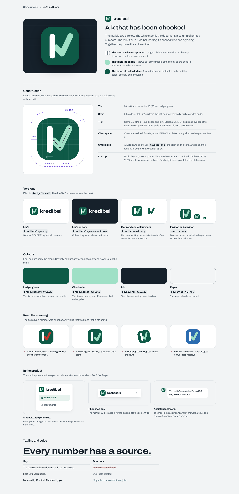 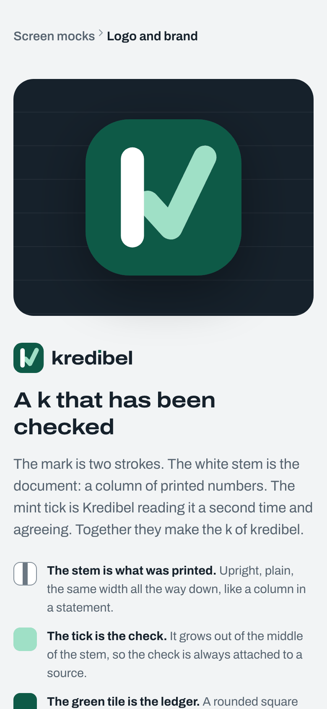</p>

The mark, its construction and where it is used are in [`12`](12-design-system.md) §9 and the
[`brand`](../design/mocks/brand.html) page.

### 6.11 Labels (P1)

<p>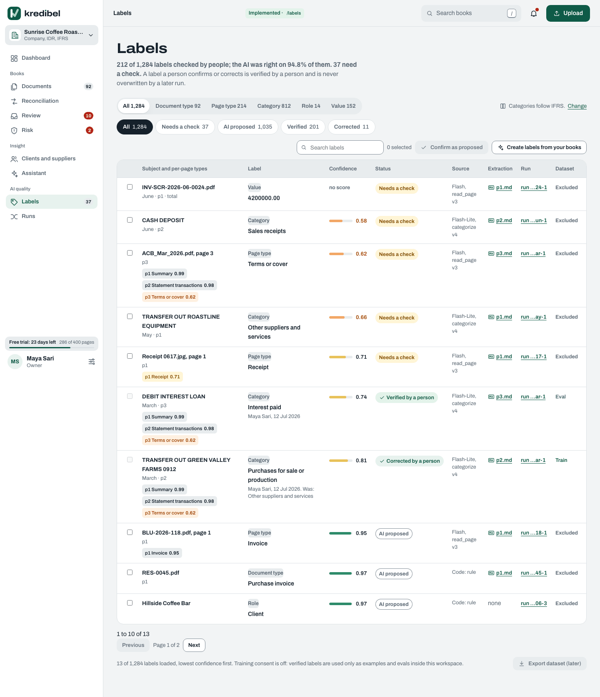 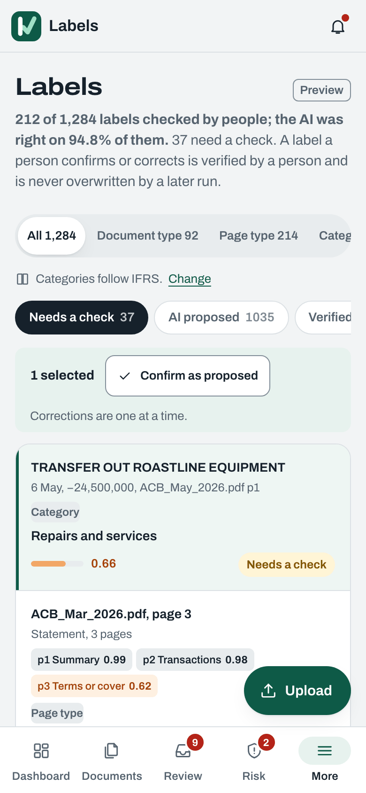</p>

Every decision the AI made that a person can check: document type, page type, category, counterparty
role and read values ([ADR-016](adr/ADR-016-human-verified-labels-and-learning-loop.md),
[spec 016](specs/016-labels-and-learning/spec.md)).

- **Header sentence** from the `summary` returned with `GET /api/labels`: "212 of 1,284 labels checked by people; the
  AI was right on 94.8% of them. 37 need a check."
- **Filters:** a segmented control by task (All, Document type, Page type, Category, Role, Value,
  with counts) above the shared table (docs/12 §7), whose chips filter by status (All, Needs a
  check, AI proposed, Verified, Corrected) with the workspace's counts, and a search over the loaded
  labels. The framework in use is stated with a link to change it in Settings. Order: lowest
  confidence first.
- **Table:** subject (file and page, or the bank line) with its **per-page type chips** (`p1 Summary
  0.99`, `p3 Terms or cover 0.62`, low ones tinted); the value; confidence as a small meter; status
  (Needs a check, AI proposed, Verified by a person, Corrected by a person); source (model, rule,
  match or person); the **extraction file** (`p2.md`, the page as Markdown); the run; dataset use
  (Eval, Train, Excluded). On phones each row is a card.
- **Bulk:** select several and **Confirm as proposed**; corrections are one at a time.
- **Create labels from your books** (`POST /api/labels/sync`): books read before labels existed
  get theirs, a `CATEGORY` label for every categorized bank line (even one matched with 0.99), a
  `DOC_TYPE` label for every document and a `FIELD_VALUE` label for every value the readings did
  not agree on. Safe to repeat; a person's decision never changes. Every month run does the same
  for its month, and a category set on the month page is recorded as the person's decision.
- **Label drawer** (the kit's drawer, as the evidence viewer; Esc closes): what the AI proposed with its confidence and reason, a field to correct it (the
  category list shows each category's statement line under the workspace's framework), **Apply to
  similar lines from …** (creates a workspace rule), an optional note, **Confirm** or **Save
  correction**; beside it, the extraction preview with **Open p1.md** and the provenance (model,
  prompt version, run and span, dataset use).
- The footer says that verified labels are used only as examples and evals inside this workspace
  while training consent is off; **Export dataset** stays disabled until P2.

<p>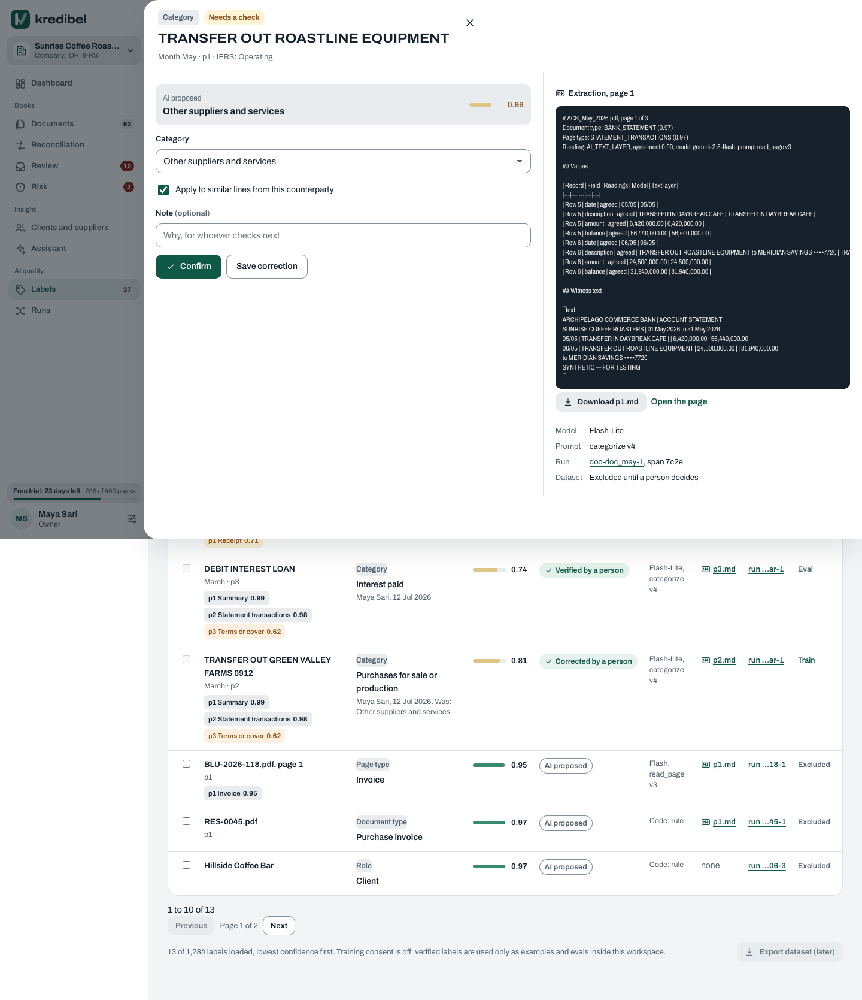 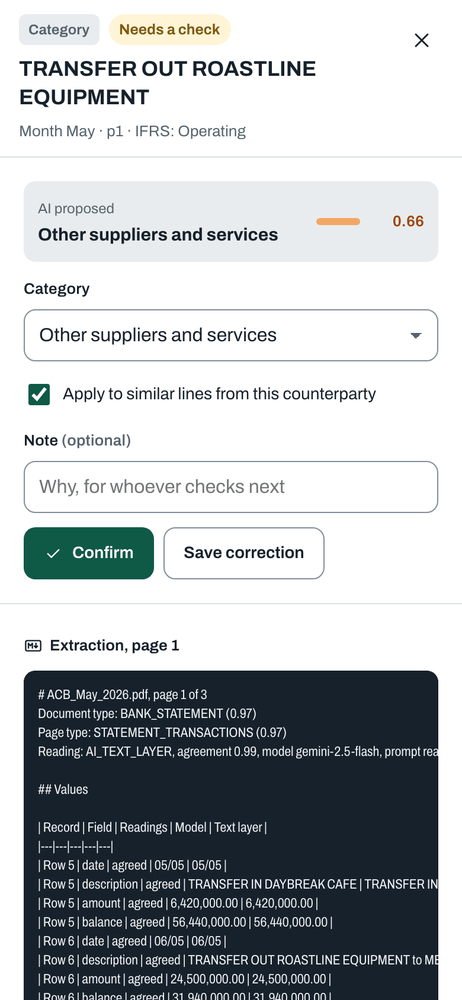</p>

### 6.12 Runs (P1, owner only)

<p> 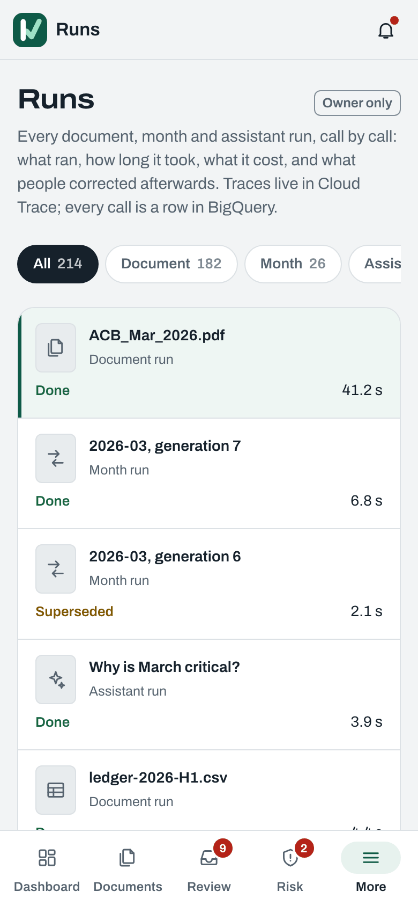</p>

The in-app view of [ADR-017](adr/ADR-017-agent-observability-on-google-cloud.md): what a tracing tool
shows, for the owner, without leaving Kredibel ([`17`](17-observability.md) §8).

- **Runs table** from `GET /api/runs`: run (document, month or assistant question), status, started,
  duration, LLM calls, tokens in and out, cost in USD, models, labels it produced. Chips by kind,
  **Failed** and **Corrected by a person**.
- **Span waterfall** for the selected run (`GET /api/runs/{id}/events`): workflow, nodes and calls
  on one time axis, model calls in evidence violet, code in slate; each bar shows its duration and one
  line of detail (model, tokens, output).
- **Inspector** for the selected call: model, prompt version, latency, tokens, span and trace;
  **Open the label**, **Cloud Trace** and **BigQuery rows**; the request and response when content
  was captured (synthetic data only, `AI_CONTENT_CAPTURE=synthetic`), otherwise "Content not
  captured for real data".

---

## 7. States and errors

- Every data panel has **loading** (skeletons matching the final layout at each size class),
  **empty** (says what will appear and the action that creates it: "No documents yet. Drop a bank
  statement to start.") and **error** (problem title + **Try again**).
- A month with no statement shows **Collecting** and lists what it has ("4 invoices, no statement
  yet").
- A month waiting for its run shows **Reconciling**; its old figures stay visible, dimmed.
- Network offline: a toast; uploads queue in the tray and resume.

---

## 7a. Plan limits in the UI

- Limits and usage come from `GET /api/workspace`, so the UI warns early: the tray says "14 of 400
  pages left this month" when fewer than 50 remain.
- The server is the authority: `403 PLAN_LIMIT_REACHED` opens the `PlanLimitDialog`; `403
  TRIAL_EXPIRED` shows the TrialBanner ("Your trial has ended. Your books stay readable; new uploads
  are paused.") and disables Upload with its reason.
- Coming-soon plans and features are visible and disabled with a "Coming soon" badge; none is
  clickable.

---

## 8. Accessibility

WCAG 2.1 AA: contrast (token pairs checked by `make tokens`, components by axe); focus-visible rings;
icons labelled or hidden; severity uses colour **plus** icon **plus** text; reading marks differ in
shape; the Sankey has a table alternative and a ranked-list form; the evidence viewer and review queue
are keyboard operable; dialogs and drawers trap and restore focus; targets ≥ 44 px on touch; usable at
200% zoom and at 360 px without sideways page scroll; `prefers-reduced-motion` respected. Checklist:
[`12`](12-design-system.md) §10.

---

## 9. Testing

| Level | Tool | Covers |
|---|---|---|
| Unit | Vitest | `formatMoney`, citation parser, bbox scaling, Sankey layout input, allowed actions per review kind, `useSizeClass` |
| Component | Testing Library + MSW | each widget's loading, empty, error and success states; the fix panel per kind |
| Stories | Storybook 9 + test runner | every `shared/ui` component in each state; interaction tests; axe on every story |
| Visual regression | Playwright `toHaveScreenshot` | the 8 screens of §6 at 390, 834 and 1440 px with fixed data and fonts; baselines change only in a reviewed PR |
| Accessibility E2E | `@axe-core/playwright` | each screen at each width: no serious or critical violations |
| Performance | Lighthouse CI (mobile profile) | `/` and `/months/:month`: performance ≥ 85, accessibility ≥ 95, best practices ≥ 95; JS ≤ 250 KB gzip on first load. Locally: `VITE_PREVIEW_ROUTES=1 npx vite build`, `vite preview`, then Lighthouse on `/preview/shell` (the synthetic dashboard); 15 Oct 2026: performance 83, accessibility 100, 373 KB transferred. The first load carries the shell, the dashboard, Auth and the public pages (the landing is the first paint at `/`, spec 020); every other app page is a `React.lazy` chunk; the landing `/`: performance 80, accessibility, best practices and SEO 100 |
| Contract | `tsc` against generated `schema.d.ts` | API drift breaks the build |
| Smoke E2E | Playwright | new user → company workspace → upload S1 in a shuffled order → exact copy recognised → confirm ledger columns → resolve the 18.7 M match → March shows its critical explanation → open A01 evidence; once at 1440 px and once at 390 px |
| i18n | Vitest + ESLint | `i18next/no-literal-string` in `src/`; every key in `locales/en` is used; missing keys fail the build |
| Styles | `tools/checks/no_raw_styles.py` | no raw colours, arbitrary values or inline styles outside the allow-list |

Details and CI wiring: [`15`](15-testing-and-evaluation.md) §2.6.

---

## 10. Internationalization

- **English is the primary and only selectable language.** Adding one is a translation job, not a
  refactor.
- All user-visible strings live in `shared/i18n/locales/en/{common,dashboard,documents,months,review,
  risk,assistant,settings,errors}.json` and are read with `useTranslation()`.
- Numbers, money and dates go through `Intl` helpers with the active locale (`en`) and the workspace
  currency (chosen at onboarding, [ADR-020](adr/ADR-020-workspace-currency-chosen-at-onboarding.md)): `formatMoney` → `IDR 1,250,000`, `MYR 1,250.50`; compact `IDR 1,355.8 M`.
- Layouts leave room for longer strings (labels wrap; no fixed-width buttons).
- API errors are mapped by `code` to `errors.json`; the server's English `title`/`detail` is the
  fallback.
- **Documents can be in any language.** The UI language does not limit what Kredibel can read.
- Explanations and assistant answers are generated in English; the language is stored with them.
