# 17 — Observability

> Know what every run did, how long it took, what it cost, and why it failed, without ever logging a
> customer's data. The same traces feed the **run graph** users see in the app (P1). Everything
> LangSmith would give us comes from Google Cloud instead ([ADR-017](adr/ADR-017-agent-observability-on-google-cloud.md)):
> Cloud Trace for the waterfall, BigQuery for the run history, the ADK dev UI for local debugging, and
> labels for people's feedback.

---

## 1. Signals

| Signal | Tool | Content |
|---|---|---|
| Logs | Cloud Logging (structured JSON to stdout via `structlog`) | One line per request and per node start, finish or error |
| Traces | Cloud Trace via OpenTelemetry: ADK's built-in spans plus FastAPI and HTTP-client instrumentation | Request → task → workflow → node → model, tool and external call spans |
| Run stages | Firestore `runs/{runId}.stages` | Product-visible record of a run: node, status, duration, model, tokens, span ID |
| Metrics | Cloud Monitoring (log-based metrics) | Counts and latencies below |
| Errors | Error Reporting (from structured error logs) | Grouped exceptions |
| Agent events (P1) | BigQuery Agent Analytics plugin → `kredibel_agent_analytics.agent_events` | Every LLM request and response, tool call, node output and error with trace and span IDs, tokens and latency (§8) |
| Feedback (P1) | Firestore `labels` (ADR-016), joined by `spanId` | A person's confirm or correct of a value an LLM call proposed (§10) |

---

## 2. Traces from ADK

ADK emits OpenTelemetry spans for its own work, following the GenAI semantic conventions:

| Span | Emitted for | Useful attributes |
|---|---|---|
| `invoke_agent` | an ADK `Agent` node (mapper, categorizer, explainer) and the assistant | agent name |
| `call_llm`, `generate_content` | each Gemini call | model, input and output tokens, finish reason |
| `execute_tool` | each assistant tool call (P1) | tool name, duration, error |

We add our own spans: `workflow:<name>` around each run (with `runId`, `orgId`), `node:<name>` for
every node (function or LLM), and adapter spans for Document AI, Firestore and Cloud Storage, so one
document or month run is one trace. The trace ID is stored on
the run (`runs.traceId`) and each stage keeps its `traceSpanId`.

**Export to Cloud Trace** (import paths confirmed in spike S2):

```python
# backend/app/observability/tracing.py — sketch
from google.adk.telemetry import google_cloud
from google.adk.telemetry.setup import maybe_set_otel_providers

def setup_tracing(settings) -> None:
    hooks = google_cloud.get_gcp_exporters(enable_cloud_tracing=True)
    maybe_set_otel_providers(otel_hooks_to_setup=[hooks])
```

The same setup runs locally, so a developer can open one workflow run in Cloud Trace.

**Content capture follows the data** (`AI_CONTENT_CAPTURE`, [ADR-017](adr/ADR-017-agent-observability-on-google-cloud.md)).
Outside Agent Runtime, ADK records prompts and responses in span attributes unless
`ADK_CAPTURE_MESSAGE_CONTENT_IN_SPANS=false`.

| `AI_CONTENT_CAPTURE` | Allowed when | Spans | Agent events (§8) |
|---|---|---|---|
| `off` (default) | always; the only value with real data | `ADK_CAPTURE_MESSAGE_CONTENT_IN_SPANS=false`: model, tokens, durations, never prompts, page images or outputs | `content` and `content_parts` dropped |
| `synthetic` | `DATA_CLASS=synthetic` (the prototype project, local development); validated at start-up | payloads captured, so Trace Explorer shows prompts and responses | text logged through a masking formatter; page images never; large text offloaded to the `kredibel-agent-content` bucket (30 days) |

---

## 3. Log schema

Every log line includes:

```json
{
  "severity": "INFO",
  "message": "node.finished",
  "service": "kredibel-worker",
  "version": "a1b2c3d",
  "orgId": "org_01J…",
  "runId": "run_01J…",
  "runKind": "DOCUMENT",
  "docId": "doc_01J…",
  "month": null,
  "node": "read_page",
  "page": 2,
  "witness": "TEXT_LAYER",
  "durationMs": 4210,
  "model": "gemini-3.8-flash",
  "tokensIn": 1920,
  "tokensOut": 1310,
  "outcome": "ok",
  "logging.googleapis.com/trace": "projects/<PROJECT_ID>/traces/<traceId>"
}
```

**Never logged:** document text, bank-line descriptions, names, account numbers, prompts with
document content, model outputs, assistant questions and answers. Debugging content lives in the raw
reader JSON in GCS (access controlled), referenced by path.

---

## 4. Log-based metrics

| Metric | Filter / extraction | Use |
|---|---|---|
| `kredibel/run_duration_ms` | `message="run.finished"` → `durationMs`, label `runKind` | NFR-01 |
| `kredibel/run_failed` | `message="run.finished" AND outcome="failed"`, label `runKind` | alert |
| `kredibel/month_superseded` | `message="run.finished" AND outcome="superseded"` | debounce working as intended |
| `kredibel/node_duration_ms` | `message="node.finished"`, label `node` | find slow stages |
| `kredibel/model_tokens` | `tokensIn + tokensOut`, label `model` | cost |
| `kredibel/pages_read` | `message="page.read"`, labels `witness` (`TEXT_LAYER`, `OCR`), `cached` | cost; share of scanned pages |
| `kredibel/ocr_pages` | `message="ocr.processed"` → `pages` | cost |
| `kredibel/page_agreement` | `message="page.verified"` → `agreement` (distribution) | reading quality |
| `kredibel/duplicates_detected` | `message="duplicate.detected"`, label `code` (`D01`…`D07`) | duplicate volume; exact copies saved |
| `kredibel/auto_match_rate` | `message="month.reconciled"` → `autoMatchRate` (distribution) | NFR-05 in real use |
| `kredibel/review_items_created` | `message="review_item.created"`, label `kind` | where people spend time |
| `kredibel/review_items_resolved` | `message="review_item.resolved"`, labels `kind`, `action` | which fixes are common (tuning) |
| `kredibel/grounding_fallback` | `message="grounding.fallback"`, label `caller` (`explainer`, `assistant`) | explanation quality |
| `kredibel/plan_limit_hit` | `message="plan.denied"`, label `limit` | trial limits too tight, or abuse |
| `kredibel/workspaces_created` | `message="workspace.created"` | sign-up volume vs `MAX_WORKSPACES` |
| `kredibel/assistant_questions` | `message="assistant.answered"`, labels `grounding`, `toolCalls` (P1) | assistant use and cost |
| `kredibel/schema_retry` | `message="llm.schema_retry"` | prompt quality |

---

## 5. Run graph (P1)

Each run's stages are shown in the app as a **graph of nodes**, so a user (and a judge) can see what
the agents did with one document or one month:

```mermaid
%%{init: {"theme": "base", "themeVariables": {"fontFamily": "Arial, Helvetica, sans-serif", "fontSize": "14px", "primaryColor": "#E7F2EE", "primaryBorderColor": "#0E5A47", "primaryTextColor": "#16212B", "lineColor": "#56636F", "secondaryColor": "#E8ECEE", "tertiaryColor": "#FFFFFF", "clusterBkg": "#F2F4F5", "clusterBorder": "#B9C2CA", "noteBkgColor": "#FFF5D6", "noteTextColor": "#16212B"}, "htmlLabels": false, "flowchart": {"htmlLabels": false, "padding": 16, "nodeSpacing": 40, "rankSpacing": 50, "wrappingWidth": 220}, "sequence": {"wrap": true, "useMaxWidth": true, "noteFontFamily": "Arial, Helvetica, sans-serif", "messageFontFamily": "Arial, Helvetica, sans-serif", "actorFontFamily": "Arial, Helvetica, sans-serif"}}}%%
flowchart LR
    A["load_document<br/>0.2 s"] --> B["inspect_file<br/>0.9 s"]
    B --> C["classify_document<br/>gemini lite, 1.4 s"]
    C --> D1["read_page 1<br/>gemini, 4.2 s"]
    D1 --> D2["read_page 2<br/>gemini, 3.9 s"]
    D1 --> D3["read_page 3<br/>gemini, 4.4 s"]
    C --> W["witness_pages<br/>text layer, 0.6 s"]
    D2 --> V["verify_pages<br/>agreement 0.97"]
    D3 --> V
    W --> V
    V --> K["check_document<br/>6 findings"]
    K --> X["detect_content_duplicates<br/>none"]
    X --> Y["categorize_bank_lines<br/>41 rules, 6 model"]
    Y --> Z["finalize_document<br/>TAMPERED, month 2026-03 queued"]
```



| Source | How |
|---|---|
| Nodes and edges | `runs/{runId}.stages[]` (`node`, `parent` for fan-out such as pages, `status`, `startedAt`, `endedAt`, `model`, `tokensIn`, `tokensOut`, a one-line `summary` written by the node) |
| Layout | Static positions per workflow (both shapes are known) with fan-out stacked; drawn with the same SVG primitives as the money flow |
| Details | Clicking a node shows duration, model, tokens, outcome and a **"View trace"** link to Cloud Trace (`traceId`, `traceSpanId`) for the team |
| Live | The graph listens to the run document, so nodes turn from pending to running to done while a document is read |

The run graph shows only metadata, never document content, so it is safe for every role.

---

## 6. Alerts (email to the team)

| Alert | Condition |
|---|---|
| Run failures | `run_failed` ≥ 2 in 15 min |
| Slow runs | p95 `run_duration_ms` > 3 min for documents or > 1 min for months over 30 min |
| Worker 5xx | Cloud Run `request_count` with 5xx > 5 in 10 min |
| Budget | 50% / 90% of budget |
| Sign-up surge | `workspaces_created` ≥ 5 in 1 hour |
| Low agreement | p50 `page_agreement` < 0.9 over 1 hour (reader or witness regression) |
| Grounding fallbacks | `grounding_fallback` > 20% of explanations over 1 hour |

---

## 7. Dashboards

A **Looker Studio** report on the BigQuery dataset (P1): p50 and p95 latency, tokens, errors and
estimated cost by node, model and prompt version, and the corrected share from §10.

One Cloud Monitoring dashboard "Kredibel": runs per hour by kind, run duration p50/p95, failures and
superseded month runs, node duration by stage (stacked), tokens by model, pages read by witness,
page agreement, duplicates by code, auto-match rate, review items created and resolved by kind,
grounding fallbacks, plan limit hits, workspaces created, Cloud Run instance count and latency for
both services.

---

## 8. Run history in BigQuery (P1)

The ADK **BigQuery Agent Analytics plugin** is attached to both workflows and the assistant
(`backend/app/observability/agent_analytics.py`, spec 017):

```python
# sketch; arguments confirmed when the dependency is pinned
from google.adk.plugins.bigquery_agent_analytics_plugin import BigQueryAgentAnalyticsPlugin

plugin = BigQueryAgentAnalyticsPlugin(
    project_id=settings.project_id,
    dataset_id="kredibel_agent_analytics",
    location="asia-southeast1",
    gcs_bucket_name=settings.agent_content_bucket,      # large content offload (synthetic only)
    log_multi_modal_content=False,                      # never page images
    content_formatter=mask_account_and_id_numbers,
    payload_column_denylist=[] if settings.capture_synthetic else ["content", "content_parts"],
)
app = App(name="document_workflow", root_agent=..., plugins=[plugin])
```

Table `agent_events` (partitioned by day, clustered by event type, agent and user) holds one row per
event: `timestamp`, `event_type`, `agent`, `session_id`, `invocation_id`, `user_id` (`{orgId}:system`
or `{orgId}:{uid}`), `trace_id`, `span_id`, `parent_span_id`, `content`, `attributes` (model, tokens,
finish reason, tool provenance), `latency_ms`, `status`, `error_message`. The plugin also creates a
view per event type (`v_llm_request`, `v_llm_response`, …). Example: slowest node calls this week by
prompt version:

```sql
SELECT agent, JSON_VALUE(attributes, '$.prompt_version') AS prompt_version,
       APPROX_QUANTILES(latency_ms, 100)[OFFSET(95)] AS p95_ms, COUNT(*) AS calls
FROM `kredibel_agent_analytics.agent_events`
WHERE event_type = 'LLM_RESPONSE' AND DATE(timestamp) >= DATE_SUB(CURRENT_DATE(), INTERVAL 7 DAY)
GROUP BY agent, prompt_version ORDER BY p95_ms DESC;
```

The **Runs page** (`/runs`, owner only, [`11`](11-frontend.md) §6.12) reads runs from Firestore and a
run's events through `GET /api/runs/{runId}/events`, which queries BigQuery with a parameterized
filter on `trace_id` and the workspace's `user_id` prefix. A plugin failure never fails a run; it is
counted in `kredibel/agent_events_dropped`.

## 9. Debugging locally (P0)

`make dev-agents` starts the Google ADK dev UI (`adk web app/agents/dev_apps --port 8501`) pointing to
`backend/app/agents/dev_apps/`. It provides interactive visual debugging equivalent to LangSmith:
- **Workflows (`document_workflow`, `month_workflow`)**: Visual DAG graph inspection, interactive execution, step-by-step state delta inspection, and real-time event streaming across node transitions.
- **LLM Agent Nodes and Assistant**: Each node (classifier, page reader, ledger mapper, categorizer, explainer) and the Finance Assistant runs with fixture tools by default (recorded inputs from synthetic scenarios) or live Gemini with `LIVE=1`. The dev UI shows exact prompt templates, input tokens, completion tokens, tool invocations, and output schemas.
- **Traces and spans**: Full call trees with latency and state payloads. Prompts in `backend/app/agents/prompts/*.md` can be adjusted and re-tested in place with instant hot-reload. Synthetic content capture is enabled (`AI_CONTENT_CAPTURE=1`).

## 10. Feedback, datasets and evals (P1)

A label keeps the `traceId` and `spanId` of the call that proposed its value, so a person's correction
lands on the exact LLM call, like feedback in LangSmith. Labels are exported to BigQuery with the eval
reports (`kredibel_learning.labels`, later also the tuning export), so one query answers "which prompt
version or model gets corrected most?":

```sql
SELECT r.agent, JSON_VALUE(r.attributes, '$.prompt_version') AS prompt_version,
       COUNTIF(l.status = 'CORRECTED') / COUNT(*) AS corrected_share
FROM `kredibel_learning.labels` l
JOIN `kredibel_agent_analytics.agent_events` r ON r.span_id = l.span_id AND r.event_type = 'LLM_RESPONSE'
WHERE l.status IN ('VERIFIED', 'CORRECTED')
GROUP BY 1, 2 ORDER BY corrected_share DESC;
```

Evals use the same labels as ground truth from people (E-LBL, [`15`](15-testing-and-evaluation.md) §5).
