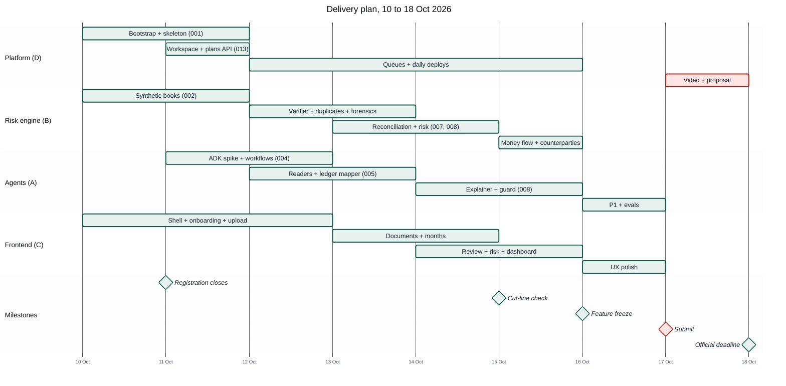

# 19 — Delivery Plan

> From docs to a submitted prototype in eight days. Dates assume the **18 Oct 2026** deadline
> ([`02`](02-research.md) §1.1). Because the deadline's time zone is not published, **we submit on
> 17 Oct** and keep 18 Oct as buffer. Times are Jakarta time (UTC+7).

---

## 1. Team roles

Assign a name to each role at the review meeting. With fewer people, merge as shown.

| Role | Owns | Specs | 3 people | 2 people |
|---|---|---|---|---|
| **A: Agents** | ADK workflows, LLM nodes, prompts, recordings, explainer, assistant, evals, traces, labels and agent analytics | 004, 005 (readers, OCR, ledger mapper), 007 (categorizer), 008 (explainer), 011, 012, 015 ①④, 016 (writers, examples), 017 | A | Person 1 |
| **B: Risk engine** | Normalization, verifier, ledger parser, duplicates, forensics, reconciliation, figures, risk levels, money flow, counterparties, synthetic generator | 002, 005 (verifier, parser), 006, 007, 008 (levels), 010 (flow builder), 014 | B | Person 1 |
| **C: Frontend** | Design system, shell, onboarding, upload, documents, months, review queue, risk and evidence viewer, dashboard and Sankey, settings, Labels and Runs pages | 003 (UI), 007 (UI), 008 (UI), 009, 010, 013 (UI), 014 (UI), 016 (UI), 017 (UI) | C | Person 2 |
| **D: Platform & story** | GCP bootstrap, auth, workspaces and plans API, queues, CI/CD, deploy, observability, demo video, proposal, social post | 001, 003 (API), 004 (queues), 013 (API), submission | C | Person 2 |

---

## 2. Day-by-day

| Day | Date | Goal by end of day | Specs / tasks | Owner |
|---|---|---|---|---|
| **D0** | Sat 10 Oct | Docs reviewed and locked. **Registration confirmed.** GCP project with billing, budget alerts and credits checked ([`21`](21-cost-analysis.md) §7), bootstrap done. Spikes S1–S3 run and recorded in [`02`](02-research.md) §6. Repo scaffolded with tokens, shell and i18n. | review · 001 (phases 1, 4a) · spikes | all |
| **D1** | Sun 11 Oct | **Walking skeleton deployed:** sign-in → onboarding (individual or company, free trial) → empty dashboard on Cloud Run. Plans and entitlements done. S1–S5 generated with truth. Upload with exact-duplicate check and page split working locally. | 001 · 013 (phases 1–3) · 002 · 003 | D · B · C |
| **D2** | Mon 12 Oct | Both workflows run with stub nodes through both queues; month generations and debounce work; live document progress in the library. Classification, Gemini page reader and the witness working on S1. | 004 · 005 (part 1) | A · D · C |
| **D3** | Tue 13 Oct | Verifier, receipts and ledger import; content duplicates and P0 forensics: S2 March `TAMPERED`, S3 duplicates held. Recordings captured for S1–S5. Reconciliation core started. | 005 (part 2) · 006 · 007 (start) | B · A |
| **D4** | Wed 14 Oct | Categorization, reconciliation (S1 ≥ 85% automatic, 0 wrong; S5 = S1), month figures and checks (S4 `X08`), counterparties and suggestions, risk levels. Months page and match picker. | 007 · 014 · 008 (levels) | B · A · C |
| **D5** | Thu 15 Oct | Explainer with grounding guard; **review queue**; Risk page and **evidence viewer**; **dashboard with the money-flow Sankey**; Plan & usage. **CUT-LINE CHECK 20:00:** full P0 path on Cloud Run for S1–S4. | 008 · 009 · 010 · 013 (UI) | A · C |
| **D6** | Fri 16 Oct | P1 in priority order (stop at freeze): ① Model Armor + S6 ② run graph ③ Finance Assistant ④ labels page (016) ⑤ run history in BigQuery and the Runs page (017) ⑥ roles ⑦ month sign-off ⑧ revision diff ⑨ visual forensics ⑩ exports. P0 evals run (E-REC and E-DUP first). **Feature freeze 20:00.** | 015 · 011 · 013 (P1) · 012 | all |
| **D7** | Sat 17 Oct | UX polish, README results from the eval report, rehearsal, **video recorded**, proposal final, final deploy, **SUBMIT by 21:00**. | submission | all |
| **D8** | Sun 18 Oct | Buffer only: fix submission problems. No new features. | — | D |

### 2.1 The cut line (D5, 20:00)

If the full P0 path does not run on Cloud Run for S1–S4 by then:

1. Stop all P1 work.
2. Drop, in this order, until it runs: Settings sections other than Plan & usage → counterparty pages
   (keep `X08`) → the explainer (template text only) → the Sankey (keep the flow table) → receipts
   (statements, invoices and ledger only) → OCR witness (digital PDFs only; scans `UNVERIFIABLE`
   honestly).
3. Keep at all costs: S3 duplicates caught, S2 caught as `TAMPERED` with the evidence viewer, S1
   reconciled with a short review queue, the dashboard, the free trial with server-side limits, and
   onboarding as an individual or a company.

---

## 3. Working agreements

- **Specs first.** Each Antigravity session starts from one `docs/specs/NNN-*/tasks.md`; it implements
  tasks in order and ticks them off. Never two agents on the same spec at once.
- **Small merges, often.** Short-lived branches per spec; `make check` green before merge.
- **Deploy daily** from D1, so deployment problems surface early, not on D7.
- **Two syncs a day** (09:00 and 20:00, 15 min): yesterday/today/blockers + "are we on the plan?"
- **Update [`20-implementation-status.md`](20-implementation-status.md)** in the same commit as a status change.
- **Real numbers only** in README/proposal: from the eval report, dated.

---

## 4. Definition of done (P0 demo)

- [ ] Deployed URL works in a logged-out browser: sign in with the demo account; a **new** Google
      account lands on onboarding, chooses company or individual, and sees "Free trial · 30 days left".
- [ ] Plan & usage shows usage meters, Starter/Professional/Enterprise and the Loan readiness report
      as "Coming soon"; the language picker offers English only.
- [ ] Upload S1 (statements, invoices, receipts, ledger CSV) in one go: live progress per document;
      the ledger mapping is confirmed once; every month ends `RECONCILED` or `NEEDS_REVIEW` with
      ≥ 85% of bank lines matched automatically and the expected short review queue.
- [ ] The dashboard shows money in and out, the month strip and the **money-flow Sankey**; clicking a
      band lists its bank lines.
- [ ] S3: the exact copy is "not read again"; the four content duplicates are held and confirmed in
      the review queue; figures equal S1's.
- [ ] S2: March is `CRITICAL`; the evidence viewer lights the edited value, shows both readings and the
      broken balance; the next step reads "Download the March statement again from internet banking".
- [ ] S4: May is `HIGH` with the supplier's old and new account side by side; two unpaid invoices from
      an unknown supplier are listed.
- [ ] A review item resolved on a phone (390 px) updates its month within seconds.
- [ ] A 21-page PDF is rejected with `TOO_MANY_PAGES`; the scanned S1 variant reads through the OCR
      witness.
- [ ] A user from another workspace sees nothing.
- [ ] `make check` is green on `main`.

---

## 5. Delivery risks

| Risk | Signal | Response |
|---|---|---|
| Spike S1 shows Gemini misreads page images | Field accuracy < 0.98 on S1 | Try `ultra_high` media resolution; crop the table region; if still low, escalate those pages to Form Parser (P1 path pulled into P0) |
| Verifier struggles with a layout (multi-line rows, merged cells) | Agreement < 0.9 on clean S1 | Widen row bands to the next anchor; header-based column ranges; values stay `SINGLE_SOURCE` rather than wrong (honest `E01`) |
| Self-serve sign-up eats the budget during judging | `workspaces_created` alert; budget 50% | `SIGNUP_MODE=invite_only` or `closed`; lower `MAX_WORKSPACES`; kill switch |
| ADK 2.x API differs from the docs | S2 spike fails | Keep node functions and contracts; orchestrate with plain asyncio behind the same workflow interfaces; re-attempt ADK on D6 |
| Matching below 85% or a wrong automatic match | Scenario test on D4 | Raise `autoConfirmScore`, widen windows only with a test; a wrong match is worse than a review item |
| Model quota or availability | 429/404 | Switch `MODEL_*` to the next model in the ladder; reduce `PAGE_CONCURRENCY` |
| Frontend falls behind | D4 without the review queue | Backend owner builds the review queue from the mocks; the Sankey falls back to its table |
| Video takes longer than planned | D7 midday not recorded | Use the scripted 10-shot plan in [`docs/submission/demo-video/script.md`](submission/demo-video/script.md); record screen + voice-over separately |
| Deadline time zone | — | Submit 17 Oct 21:00 UTC+7 |
