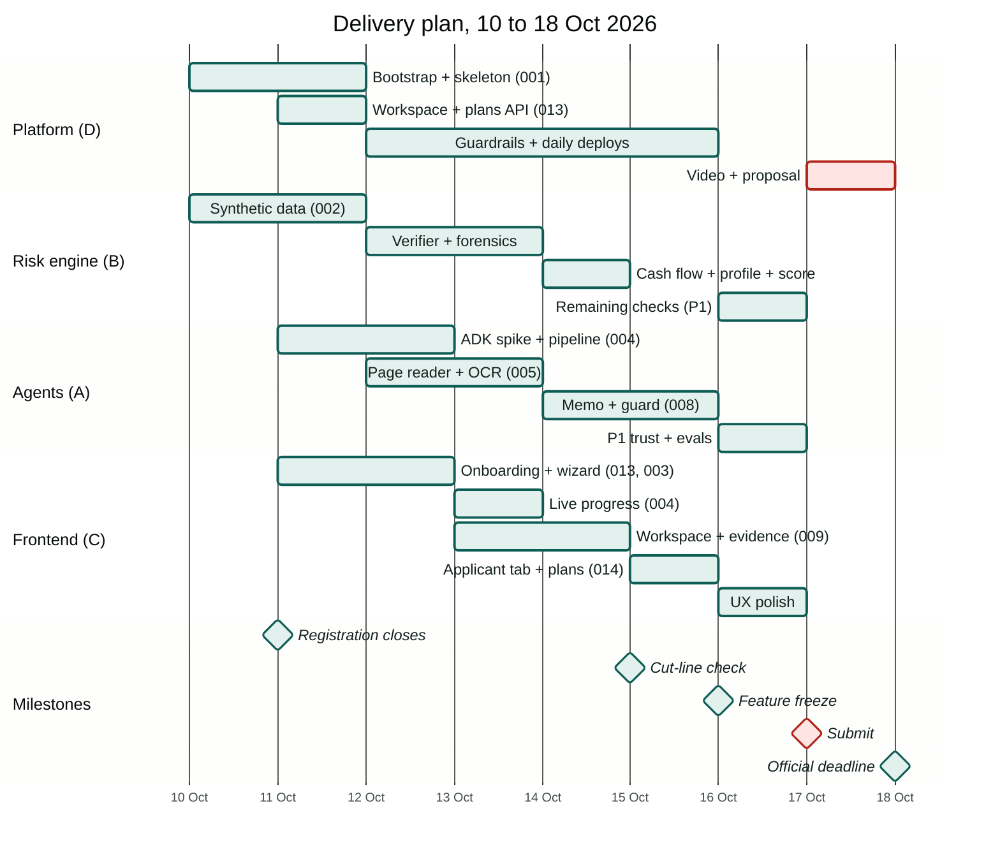

# 19 — Delivery Plan

> From docs to a submitted prototype in eight days. Dates assume the **18 Oct 2026** deadline
> ([`02`](02-research.md) §1.1). Because the deadline's time zone is not published, **we submit on
> 17 Oct** and keep 18 Oct as buffer. Times are Jakarta time (UTC+7).

---

## 1. Team roles

Assign a name to each role at the review meeting. With fewer people, merge as shown.

| Role | Owns | Specs | 3 people | 2 people |
|---|---|---|---|---|
| **A: Agents** | ADK workflow, LLM nodes, prompts, recordings, evals | 004, 005 (page reader, OCR adapter), 008 (memo), 010 ①④, 011, 012, 014 (categorizer names) | A | Person 1 |
| **B: Risk engine** | Normalization, verifier, forensics, metrics, reconciliation, counterparties, profile suggestions, scorecard, synthetic generator | 002, 005 (verifier), 006, 007, 008 (scorecard), 014 (domain), 010 ②⑤ | B | Person 1 |
| **C: Frontend** | Design system, onboarding, wizard, upload, progress, workspace, evidence viewer, applicant tab, settings, decision | 003 (UI), 004 (UI), 009, 013 (UI), 014 (UI), 010 ③ | C | Person 2 |
| **D: Platform & story** | GCP bootstrap, auth, workspaces and plans API, CI/CD, deploy, observability, demo video, proposal, social post | 001, 013 (API), submission | C | Person 2 |

---

## 2. Day-by-day

| Day | Date | Goal by end of day | Specs / tasks | Owner |
|---|---|---|---|---|
| **D0** | Sat 10 Oct | Docs reviewed and locked. **Registration confirmed.** GCP project with billing, budget alerts and credits checked ([`21`](21-cost-analysis.md) §7), bootstrap done. Spikes S1–S5 run and recorded in [`02`](02-research.md) §6 (S1 = page-image reading + witness, [ADR-010](adr/ADR-010-adaptive-extraction-ai-reader-and-witness.md)). Repo scaffolded with the i18n scaffold. | review · 001 (T001-01…05) · spikes | all |
| **D1** | Sun 11 Oct | **Walking skeleton deployed:** sign-in → onboarding (create workspace, free trial) → empty case list on Cloud Run. Plans config and entitlement checks done. S1–S3 generated with truth, applicants and the scanned variant. Applicant onboarding + case wizard + upload with page split working locally. | 001 · 013 (phases 1–3) · 002 · 003 | D · B · C |
| **D2** | Mon 12 Oct | A run goes `QUEUED → RUNNING → READY_FOR_REVIEW` with stub nodes, plan checks at run start, live page-level progress in the UI. Inspection, classification, Gemini page reader and the text-layer/OCR witness working on S1. | 004 · 005 (part 1) | A · C · B |
| **D3** | Tue 13 Oct | Verifier + provenance; P0 forensics; S2 shows `TAMPERED` with correct codes. Recordings captured for S1–S3 and scanned S1. | 005 (part 2) · 006 | B · A |
| **D4** | Wed 14 Oct | Categorization (with counterparty names), metrics, reconciliation, counterparty directory, profile suggestions, case-level checks incl. `X06`, scorecard; S1/S2/S3 give the expected recommendation and suggestions in scenario tests. | 007 · 014 (domain, nodes) · 008 (scorecard) | B · A |
| **D5** | Thu 15 Oct | Memo + grounding guard. Workspace, findings, **evidence viewer**, decision panel, **Applicant tab** (suggestions + counterparties), Plan & usage page. **CUT-LINE CHECK 20:00:** full P0 path on Cloud Run for S1–S3. | 008 (memo) · 009 · 014 (UI) · 013 (UI) | A · C |
| **D6** | Fri 16 Oct | P1 in priority order (stop at freeze): ① Model Armor + S6 ② revision diff ③ related parties + `B07` ④ run timeline ⑤ visual forensics ⑥ split upload ⑦ assistant ⑧ members/policy overrides. P0 evals run (incl. E-EXT cost per page). **Feature freeze 20:00.** | 010 · 014 (P1) · 003 (P1) · 011 · 013 (P1) · 012 | all |
| **D7** | Sat 17 Oct | UX polish, README results from the eval report, rehearsal, **video recorded**, proposal final, final deploy, **SUBMIT by 21:00**. | submission | all |
| **D8** | Sun 18 Oct | Buffer only: fix submission problems. No new features. | — | D |

### 2.1 The cut line (D5, 20:00)

If the full P0 path does not run on Cloud Run for S1–S3 by then:

1. Stop all P1 work.
2. Drop, in this order, until it runs: Settings sections other than Plan & usage → Applicant tab
   counterparties (keep suggestions) → memo writer (show findings + metrics + scorecard only) →
   reconciliation UI (keep the backend) → OCR witness (digital PDFs only; scans `UNVERIFIABLE`
   honestly).
3. Keep at all costs: S2 caught as `TAMPERED` with the evidence viewer, the decision guard, the free
   trial with server-side limits, and applicant onboarding (individual or company).

---

## 3. Working agreements

- **Specs first.** Each Antigravity session starts from one `docs/specs/NNN-*/tasks.md`; it implements
  tasks in order and ticks them off. Never two agents on the same spec at once.
- **Small merges, often.** Short-lived branches per spec; `make check` green before merge.
- **Deploy daily** from D1, so deployment problems surface early, not on D7.
- **Two syncs a day** (09:00 and 20:00, 15 min): yesterday/today/blockers + "are we on the plan?"
- **Update [`20-implementation-status.md`](20-implementation-status.md)** in the same commit as a status change.
- **Real numbers only** in README/proposal: from the eval report, dated.

---

## 4. Definition of done (P0 demo)

- [ ] Deployed URL works in a logged-out browser: sign in with a demo account; a **new** Google account
      lands on onboarding, creates a workspace and sees "Free trial · 30 days left".
- [ ] Plan & usage shows the free trial with usage meters and Starter/Professional/Enterprise as
      "Coming soon"; the language picker offers English only.
- [ ] Onboard Sunrise Coffee Roasters as a company (one account, one beneficial owner), create a case,
      upload S2 documents (Digital badges), run analysis, watch page-level progress (< 3 min).
- [ ] Overview shows grade, recommendation `DECLINE`, hard stop `TAMPERED_DOCUMENT`.
- [ ] Findings list contains A01/A02/M01–M04 on the March statement; the evidence viewer highlights
      the edited row and shows printed vs expected balance and both readings' values.
- [ ] S3 shows unmatched invoices and `REFER`.
- [ ] The Applicant tab shows the tax ID and address suggestions with evidence; accepting one updates
      the profile; counterparties list the six clients and three suppliers.
- [ ] A 21-page PDF is rejected with `TOO_MANY_PAGES`; the scanned S1 variant reads through the OCR
      witness.
- [ ] S1 shows `APPROVE`/`APPROVE_WITH_CONDITIONS` with no high/critical findings.
- [ ] Memo renders with citation chips, grounding badge `Verified`.
- [ ] Analyst cannot approve S2; decline with reason works; the event appears in Activity.
- [ ] A user from another org sees nothing.
- [ ] `make check` is green on `main`.

---

## 5. Delivery risks

| Risk | Signal | Response |
|---|---|---|
| Spike S1 shows Gemini misreads page images | Field accuracy < 0.98 on S1 | Try `ultra_high` media resolution; crop the table region; if still low, escalate those pages to Form Parser (P1 path pulled into P0) |
| Verifier struggles with a layout (multi-line rows, merged cells) | Agreement < 0.9 on clean S1 | Widen row bands to the next anchor; header-based column ranges; values stay `SINGLE_SOURCE` rather than wrong (honest `E01`) |
| Self-serve sign-up eats the budget during judging | `workspaces_created` alert; budget 50% | `SIGNUP_MODE=invite_only` or `closed`; lower `MAX_WORKSPACES`; kill switch |
| ADK 2.x API differs from the docs | S2 spike fails | Keep node functions and contracts; orchestrate with plain asyncio behind the same `case_pipeline` interface; re-attempt ADK on D6 |
| Model quota or availability | 429/404 | Switch `MODEL_*` to the next model in the ladder; reduce `DOC_CONCURRENCY` |
| Frontend falls behind | D4 without workspace skeleton | Backend owner builds the evidence viewer; drop charts to tables |
| Video takes longer than planned | D7 midday not recorded | Use the scripted 10-shot plan in [`docs/submission/demo-script.md`](submission/demo-script.md); record screen + voice-over separately |
| Deadline time zone | — | Submit 17 Oct 21:00 UTC+7 |
