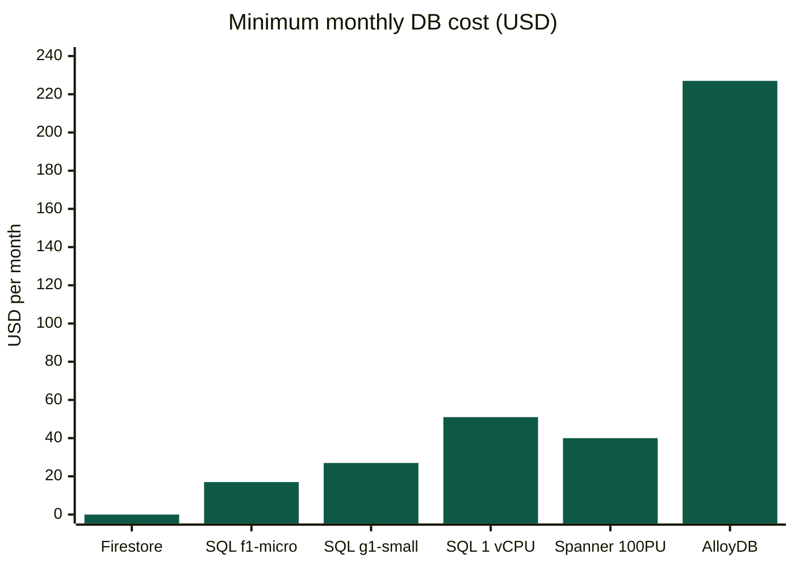
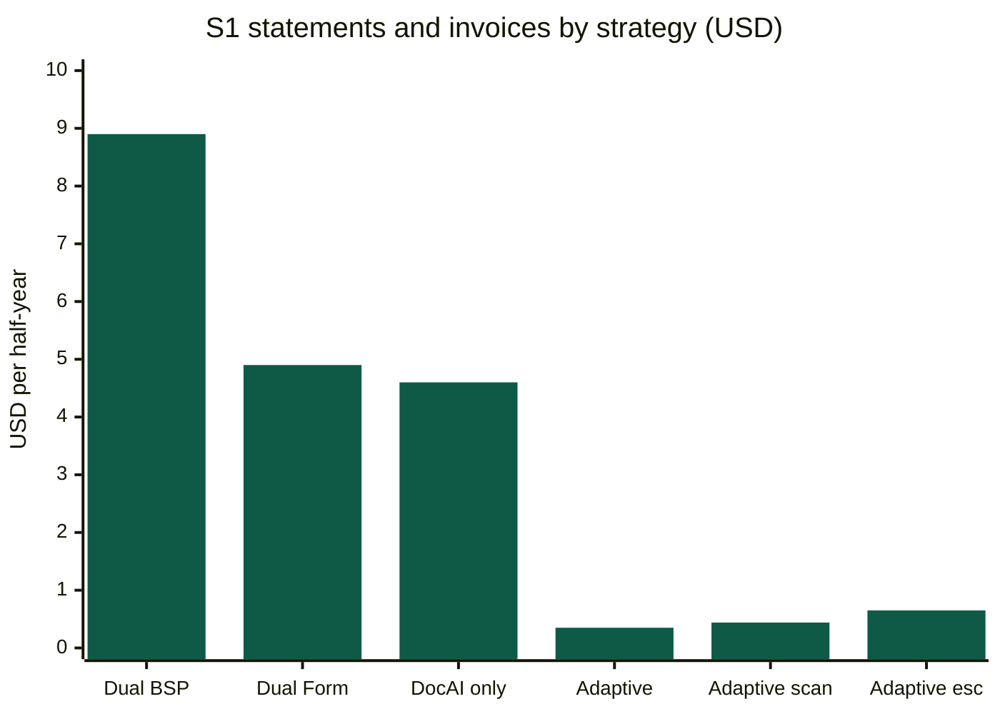
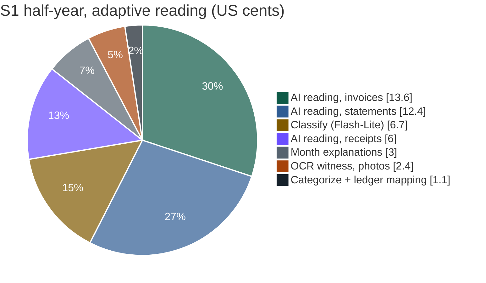

# 21 — Cost Analysis & Database Options

> What Kredibel costs to run during the competition, which database fits the requirements at the
> lowest cost, and the guardrails that keep spend predictable.
> Prices are **list prices checked on 10 Oct 2026**, mostly for `us-central1`; Singapore
> (`asia-southeast1`) is usually somewhat higher. ⚠️ Confirm every figure in the
> [Google Cloud pricing calculator](https://cloud.google.com/products/calculator) before relying on it.

---

## 1. Summary

| Question | Answer |
|---|---|
| Which database? | **Firestore (Standard edition, Native mode, the single `(default)` database)**. It meets every data requirement, and its daily free quota covers our expected workload: about **USD 0** for the competition. |
| What about Cloud SQL for PostgreSQL? | It works, but it is always-on: **≈ USD 9–17/month** for the smallest shared-core instance (no SLA, 0.6 GiB RAM), **≈ USD 50/month** for 1 dedicated vCPU. It also has no realtime push, so the UI would need polling or a second store. Not worth it for this workload. |
| What actually drives cost? | **Reading pages with AI**, not the database. Explanations, categorization and ledger mapping are cents per half-year. |
| How do we read documents? | **Adaptive reading** ([ADR-010](adr/ADR-010-adaptive-extraction-ai-reader-and-witness.md)): Gemini reads each page image; the PDF text layer (free) or Document AI OCR (USD 1.50 per 1,000 pages, scans only) is the independent witness. Document AI parsers are used only to escalate a doubtful page. |
| Cost of a half-year of books (scenario S1: 6 statements, 40 invoices, 24 receipts, 1 ledger file) | **≈ USD 0.45** in total; **≈ USD 0.35** for the statements and invoices alone if every page is digital (≈ 0.44 if scanned). Reading the same statements and invoices with specialized parsers would cost **≈ USD 4.9** (Form Parser + Invoice Parser + Gemini) or **≈ 8.9** (Bank Statement Parser). Exact duplicates and re-uploaded pages cost nothing. |
| Unit costs (adaptive) | ≈ USD 0.02 per 3-page statement · 0.004 per invoice · 0.005 per receipt photo · 0.001 per ledger file (new layout) · ≤ 0.005 per month run · ≈ 0.015 per assistant question (P1) |
| Expected competition spend (10 Oct – 4 Dec) | **≈ USD 60–90** including evals, the assistant (P1) and public free trials during judging (+15% buffer ≈ **100**), with the guardrails in §5. |
| Worst case per free-trial workspace | Capped by the plan at **USD 5 of estimated AI spend per month** ([`contracts/plans.v1.yaml`](../contracts/plans.v1.yaml)); `MAX_WORKSPACES` caps the number of workspaces. |

---

## 2. Database options

### 2.1 What the data layer must do

From [`03`](03-prd.md), [`05`](05-architecture.md) and [`09`](09-data-model.md):

| # | Requirement | Why |
|---|---|---|
| D1 | Push live progress to the browser (≤ 2 s) | NFR-02; live pipeline is a demo moment |
| D2 | Hierarchical, per-workspace data: documents, ~300 bank lines, invoices, receipts, ledger entries, months, matches, review items, findings, events | Data model |
| D3 | Atomic change + audit event (review resolutions, duplicate decisions, manual matches) | FR-034, constitution P5 |
| D3a | Nearest-neighbour search over a few thousand text chunks per workspace (assistant, P1) | ADR-014 |
| D4 | Org isolation in the backend **and** for direct client reads | NFR-06 |
| D5 | Simple filters and ordering (by month, category, severity), cursor pagination | API |
| D6 | Scale to zero; no capacity planning; no VPC work | 7-day build; cost limit |
| D7 | Near-zero cost at demo volume | Budget |

Cross-workspace analytics (for an accounting firm with many clients) are later work and belong in an
analytical store, not the operational one.

### 2.2 Options compared

| Option | Smallest realistic setup | Monthly cost (list) | D1 realtime | D3 atomic | D6 ops | Verdict |
|---|---|---|---|---|---|---|
| **Firestore Standard (Native)** | `(default)` database | **≈ USD 0**: free 50K reads, 20K writes, 20K deletes and 1 GiB per day; then USD 0.03 / 0.09 / 0.01 per 100K reads/writes/deletes | ✅ native listeners | ✅ transactions | ✅ serverless | **Chosen** |
| Cloud SQL for PostgreSQL, `db-f1-micro` (shared core) | 0.6 GiB RAM, 10 GiB SSD | ≈ USD 7.7 compute + 1.7 storage; + ≈ 7.3 if it holds a public IPv4 → **≈ USD 9–17** | ❌ (poll or add a channel) | ✅ | ⚠️ connector/IP, migrations, pool limits; no SLA | Fallback only |
| Cloud SQL `db-g1-small` | 1.7 GiB RAM | ≈ USD 25.6 + storage | ❌ | ✅ | ⚠️ | Not needed |
| Cloud SQL dedicated 1 vCPU / 3.75 GiB | — | ≈ USD 49 + storage (HA doubles it) | ❌ | ✅ | ⚠️ | Not needed |
| AlloyDB for PostgreSQL | 2 vCPU / 16 GiB primary | ≈ USD 227+ | ❌ | ✅ | ⚠️ VPC required | Too expensive |
| Spanner (granular, 100 processing units) | regional | from ≈ USD 40+ | ❌ | ✅ | ✅ | Over-built for this |
| BigQuery | — | free tier: 10 GiB storage, 1 TiB queries | ❌ | ❌ (analytical) | ✅ | P2 analytics export only |
| Firestore Enterprise (MongoDB compatibility) | — | free tier exists; unit-based pricing | ✅ | ✅ | ✅ | No benefit over Standard here |

Sources for the figures: §8.

### 2.3 Our workload against the Firestore free quota

Estimated for importing S1 (a half-year, uploaded in one go) plus one review session:

| Operation | Count | Notes |
|---|---|---|
| Writes | ~5,500 | ~270 bank lines, 64 invoices and receipts, ~600 ledger entries (written once, categories once), ~90 documents with status and page progress, and ~3 month runs per month while uploads arrive (matches, match states, items, findings, figures: ~200 writes each) |
| Reads | ~8,000 | Month runs read their month and its neighbours; UI listeners and table loads |
| Storage | < 10 MB per workspace and half-year | Files live in Cloud Storage, not Firestore |

The free quota (20,000 writes and 50,000 reads per day) covers **~3 full half-year imports per day**,
or hundreds of everyday uploads. Beyond it, a full import costs about **USD 0.01** in Firestore
operations. The month-run debounce (20 s) keeps bursts of uploads from multiplying writes. The free tier applies to **one database per project**, which is
why we use only `(default)` (ADR-003).

### 2.4 If the team still wants PostgreSQL

Use it **only** if a hard requirement appears (complex ad-hoc SQL, an existing Postgres skill set the
team insists on). Then:

1. `db-f1-micro`, Enterprise edition, single zone, 10 GiB SSD, no HA. Accept no SLA.
2. Connect from Cloud Run with the **Cloud SQL connector and IAM database auth**. Use a public IP
   (≈ USD 7/month) or private IP through **Direct VPC egress**; avoid a Serverless VPC Access
   connector (extra always-on instances).
3. Keep each service's connection pool small (≤ 5) because the micro instance allows few connections.
4. **Stop the instance** outside working hours (`gcloud sql instances patch --activation-policy=NEVER`)
   to pay only for storage while it's stopped.
5. Keep **Firestore for the live progress channel** anyway (or switch the UI to 3-second polling), so
   D1 still holds. That means two stores: one more reason to stay on Firestore alone.
6. Bonus: Postgres would let ADK use its `DatabaseSessionService` for assistant sessions.

---

## 3. Cost model per document and per half-year

### 3.1 Prices used

| Service | Price used | Source |
|---|---|---|
| Document AI Enterprise Document OCR | **USD 1.50 per 1,000 pages** (USD 0.60 above 5M pages/month) | Document AI pricing |
| Document AI Form Parser | USD 30 per 1,000 pages | Document AI pricing |
| Document AI Invoice Parser | USD 0.10 for every 10 pages in a document | Document AI pricing |
| Document AI Bank Statement Parser | USD 0.75 per classified document | Document AI pricing |
| Document AI Layout Parser / Custom Extractor | USD 10 / USD 30 per 1,000 pages | Document AI pricing (not used; for comparison) |
| Document AI free tier | none listed (the USD 300 new-customer credit applies) | Document AI pricing |
| `gemini-3.8-flash` | USD 0.75 in / 3.75 out per 1M tokens (introductory to 31 Dec 2026) | third-party price tracker |
| `gemini-3.5-flash-lite` | USD 0.30 in / 2.50 out per 1M tokens | third-party price tracker |
| `gemini-embedding-001` | USD 0.15 per 1M input tokens | third-party price tracker |
| Gemini image input | **1,120 tokens per image** at media resolution `high` (2,240 at `ultra_high`); native PDF input is 560 tokens per page at `medium` | Gemini media-resolution docs |
| Model Armor (standalone) | 2M tokens/month free, then USD 0.10 per 1M | Security Command Center pricing |
| Cloud Run | free 180K vCPU-s, 360K GiB-s, 2M requests per month | Cloud Run pricing |
| Cloud Tasks | first 1M operations/month free | Cloud Tasks pricing |

### 3.2 Cost per page, by reading method

| Method | Statement page (~25 rows) | Invoice page | Receipt |
|---|---|---|---|
| **AI reader:** Gemini Flash on the page image | **≈ USD 0.0069** | **≈ USD 0.0034** | **≈ USD 0.0025** |
| **Witness:** PDF text layer (digital pages) | USD 0 | USD 0 | USD 0 (e-receipts) |
| **Witness:** Document AI Enterprise OCR (scans, photos) | USD 0.0015 | USD 0.0015 | USD 0.0015 |
| Escalation: Form Parser | USD 0.030 | USD 0.030 | — |
| Escalation: Invoice Parser | — | USD 0.10 (1–10 pages) | USD 0.10 |
| Bank Statement Parser (not used) | USD 0.75 per document (≈ 0.25 per page for 3 pages) | — | — |
| Ledger file | — | — | — |

A ledger export is parsed by code: the only model call is Flash-Lite proposing the column mapping
for a new layout (≈ USD 0.0005), plus classification.

Token assumptions for one Gemini page read: 1,120 image tokens + ≈ 800 tokens of prompt, schema and
page-1 context in; ≈ 45 output tokens per statement row (≈ 1,225 per page) or ≈ 450 per invoice page,
plus 20% for thinking at the lowest setting. **E-PERF** ([`15`](15-testing-and-evaluation.md)) measures
the real numbers; replace these estimates with measurements once available.

### 3.3 Strategies compared, S1's statements and invoices (18 statement pages, 40 one-page invoices)

"The rest" is the same for every strategy: classification with Flash-Lite (≈ 0.044 for 58 files),
categorization of ~270 bank lines (rules first, ≈ 0.01), the six month explanations (≈ 0.03) and the
ledger mapping (≈ 0.001): **≈ USD 0.09**.

| Strategy | Reading pages | The rest | **Total** | Independent check (P6) |
|---|---|---|---|---|
| A. Dual: Bank Statement Parser + Invoice Parser + Gemini | 4.50 + 4.00 + 0.26 | 0.09 | **≈ USD 8.9** | yes |
| B. Dual: Form Parser + Invoice Parser + Gemini | 0.54 + 4.00 + 0.26 | 0.09 | **≈ USD 4.9** | yes |
| C. Document AI only (Form Parser + Invoice Parser) | 4.54 | 0.09 | **≈ USD 4.6** | no |
| D. Gemini only | 0.26 | 0.09 | **≈ USD 0.35** | no |
| **E. Adaptive, all pages digital (chosen)** | 0.26 + 0 | 0.09 | **≈ USD 0.35** | **yes** |
| E′. Adaptive, all pages scanned | 0.26 + 0.09 | 0.09 | **≈ USD 0.44** | yes |
| F. Adaptive + escalating 10 statement pages (P1, worst case) | 0.26 + 0.30 | 0.09 | **≈ USD 0.65** | yes, 3 sources on those pages |
| G. Thorough mode (evals; future paid tier) | 0.26 + 0.54 + 4.00 | 0.09 | **≈ USD 4.9** | yes, 3 sources everywhere |

Adding S1's 24 receipts (16 of them photos with an OCR witness) adds ≈ USD 0.08, for **≈ USD 0.45**
for the whole half-year.

D and E cost the same because the text-layer witness is free; E adds the independent check that a
fraud verdict needs. That is the whole argument for the adaptive design.

### 3.4 A busier business

Costs scale with pages and documents, so the gap grows with volume. One month of a busier business:
a 20-page statement, 120 one-page invoices and 60 receipt photos:

| Strategy | Reading | Total per month |
|---|---|---|
| B. Dual, Form Parser + Invoice Parser (+ Expense Parser for receipts) + Gemini | 0.60 + 12.00 + 6.00 + 0.70 | **≈ USD 19** |
| E. Adaptive (receipts with OCR witness) | 0.14 + 0.41 + 0.15 + 0.09 | **≈ USD 0.95** with classification and the month run |

### 3.5 Where the money goes in the chosen design

### 3.6 Decisions

- **`EXTRACTION_MODE=adaptive`** is the default for every plan; `thorough` is for evals and a future
  paid tier (shown as "coming soon").
- **Per page, not per document:** pages are the unit of reading, caching, escalation and plan
  accounting; Document AI's online page limits stop mattering because no request exceeds 15 pages.
- **Specialized Document AI parsers only on demand** (escalation, P1). The Bank Statement Parser is not
  used: at USD 0.75 per document it costs more than reading a whole half-year adaptively.
- **Ledger files never go to a model row by row:** code parses them; the model sees only the header
  and value shapes once per layout.
- **Classification is the next lever:** at ≈ USD 0.00075 per file it is now 15% of S1; a rule-based
  pre-classifier for obvious cases (CSV/XLSX are always ledger exports; a known bank's first-page
  layout) can skip the call.
- **Gemini reads images, not the PDF:** native PDF input would be ≈ USD 0.0004 cheaper per page but
  would show the model the text layer and remove the witness's independence.
- **Spike S1** confirms the per-page token counts, Gemini's field accuracy on page images (`high` vs
  `ultra_high`), and the verifier's agreement; **E-PERF** replaces every estimate with measurements.

### 3.7 Finance Assistant (P1)

| Item | Estimate | Basis |
|---|---|---|
| One question | **≈ USD 0.015** | ~3 Flash calls per turn (tool loop) with ~6K input tokens each (instruction, memories, tool results, chunks) and ~600 output tokens in total |
| Retrieval chunks for S1 | ≈ USD 0.01 | ~120 chunks × ~500 tokens with `gemini-embedding-001` |
| Firestore vector search | ≈ USD 0 | Billed as reads; a few per question |
| Sessions and Memory Bank | to confirm | Third-party summaries quote storage per GiB-month and processing per vCPU-hour with a small free tier; at our volume we expect cents. `ASSISTANT_MEMORY=off` removes it |
| RAG Engine alternative | ≈ USD 40+ per month fixed | `RagManagedDb` runs on Spanner (Basic tier 100 processing units); not chosen ([ADR-014](adr/ADR-014-finance-assistant-tools-rag-memory.md)) |
| DeepEval run (20 cases, 5 metrics, Gemini judge) | ≈ USD 0.5–1 per run | Judge calls on Flash |

The plan caps questions (`assistantQuestionsPerDay` 50) and all AI use shares the workspace's monthly
AI spend limit (USD 5 on the free trial).

### 3.8 Labels and agent analytics (P1)

| Item | Estimate | Basis |
|---|---|---|
| Labels for S1 | ≈ 400 Firestore writes | One per document, page and bank line (≈ 92 + 60 + 270), batched; inside the free quota |
| Verified examples in prompts | + ≈ 1,500 input tokens per categorizer or classifier call | Five short examples; cents per half-year |
| Label embeddings | ≈ USD 0 | Only labels a person decided, with `gemini-embedding-001` |
| Agent events in BigQuery | ≈ USD 0.01–0.10 per month | ~1,000 events per half-year of books; Storage Write API and storage billed per GiB, queries per TiB scanned (tables partitioned by day) |
| Content offload bucket (synthetic only) | ≈ USD 0 | Text only, 30-day lifecycle |
| Tuning (later, not in the budget) | per training token | Agent Platform tuning pricing, checked when a consented dataset exists |

---

## 4. Competition budget (10 Oct – 4 Dec 2026)

Assumes the page cache (§5) and recordings for tests.

| Bucket | Volume | Estimate |
|---|---|---|
| Unique documents read (S1–S6 × 5 seeds + scanned and photo variants; identical pages are cached across scenarios) | ≈ 5 half-years of books plus variants | ≈ USD 3 |
| Spikes S1/S3 and escalation/thorough comparison (Form Parser, Invoice Parser on S1 seed 1) | 18 statement pages, 40 invoices | ≈ USD 5 |
| Development runs (cached reading; month runs and explanations re-run) | ~150 imports | ≈ USD 5–8 |
| Eval runs (Gemini cache bypassed) | ~60 scenario runs × ≈ USD 0.45 | ≈ USD 27 |
| Assistant development and DeepEval (P1) | ~1,000 questions, ~10 eval runs | ≈ USD 20 |
| Demo and judging (seeded workspace + live uploads) | ~50 uploads, a few S1 imports | ≈ USD 5–10 |
| Public free trials during judging (`MAX_WORKSPACES=15`, most stay small) | realistic: 10 trials × ~100 pages | ≈ USD 5–15 (hard cap 15 × USD 5/month) |
| Infrastructure (Cloud Run, Storage, Artifact Registry, Build, Logging, Firestore, BigQuery agent events) | 2 months | ≈ USD 3–8 |
| **Total** | | **≈ USD 60–90** (+15% buffer ≈ **100**) |
| Add Cloud SQL instead of Firestore | | + ≈ USD 20–35 (micro, 2 months) or + ≈ USD 100 (1 vCPU) |

Specialized parsers on every page would cost about 10× more for the same books; adaptive reading pays
for opening the free trial to judges.

New Google Cloud customers get **USD 300 in free credits** (per the Cloud SQL pricing page). If a team
member's billing account qualifies, the whole competition fits inside the credit. Check before
creating the project.

---

## 5. Cost controls built into the design

| Control | Where | Effect |
|---|---|---|
| **Adaptive reading** | One AI reading per page; free text-layer witness; OCR only for scans and photos ([`07`](07-document-intelligence.md) §5) | ≈ 10× cheaper than dual parsers for the same books |
| **Exact duplicates are free** | SHA-256 check before anything is stored or read ([`07`](07-document-intelligence.md) §3.1) | Re-sent files cost nothing and don't count against the plan |
| **Ledger files parsed by code** | Model sees only header and shapes, once per layout | A 5,000-row export costs the same as a 5-row one |
| **Month-run debounce and generations** | 20 s delay; older runs stop without writing | A burst of uploads makes one month run, not twenty |
| **Explainer skip** | Not called when the month's facts and findings are unchanged | Re-runs after small fixes cost nothing |
| **Page triage** | Blank pages skipped; unusable text layers routed to OCR, not to a second AI | No paid call for empty pages |
| **Page-level extraction cache** | `orgs/{orgId}/cache/extraction/{sha256}/p{n}/…` ([`09`](09-data-model.md) §7) | Re-uploading demo files costs nothing to read; cache hits don't count against plan pages |
| **Escalation budget** (P1) | `escalationPagesPerMonth` (30) and `EXTRACTION_ESCALATION` | Parser spend per workspace is bounded |
| **Plan entitlements** | `contracts/plans.v1.yaml`: documents and pages per month, month runs per day, assistant questions per day, **AI spend per month** ([`specs/013`](specs/013-workspace-and-plans/spec.md)) | One workspace can't run up the bill |
| **Sign-up controls** | `SIGNUP_MODE` (`open`, `invite_only`, `closed`), `MAX_WORKSPACES` | Bounds the number of free trials |
| **Recorded outputs for tests** | `backend/tests/scenarios/recordings/` ([`15`](15-testing-and-evaluation.md) §6) | CI and `make check` never call paid services |
| **No Pro model** | Flash and Flash-Lite for every call | Predictable per-page and per-question costs |
| **Thinking kept low** | Classification, reading, mapping and categorization use the lowest thinking setting | Fewer billed output tokens |
| **Run quotas** | `RUN_QUOTA_PER_ORG_PER_DAY` (default 80) and per-user rate limits (uploads 20/min, re-runs 5/min); `429 RUN_QUOTA_EXCEEDED` | Global ceiling above plan limits |
| **Kill switch** | `RUNS_ENABLED=false` → `503 RUNS_DISABLED`; existing data stays readable | Instant stop without taking the demo down |
| **Scale to zero** | Cloud Run min instances 0 (1 only while recording the video) | No idle compute |
| **Budget alerts** | Budget = team limit, alerts at 50% / 90% / 100% to the team email | Early warning |
| **Artifact Registry cleanup** | Keep the 3 most recent images | Storage stays under the free 0.5 GB or close to it |
| **Log hygiene** | No document content in logs; default retention | Stays within the 50 GiB free logging allotment |
| **Lifecycle on the bucket** | Delete objects after 90 days | Storage doesn't accumulate |

---

## 6. What we deliberately did not choose, for cost reasons

| Option | Why not |
|---|---|
| Always-on databases (Cloud SQL, AlloyDB, Spanner) | Pay 24/7 for a workload that is idle most of the day |
| Two paid readers on every page (ADR-004 as default) | ≈ 10× the cost of adaptive reading for the same corroboration |
| Bank Statement Parser | USD 0.75 per document, more than a whole adaptive half-year |
| Gemini Batch prediction (≈ 50% cheaper) | Asynchronous with long turnaround; a document should be read within a minute of upload |
| RAG Engine with `RagManagedDb` | Spanner-backed, a fixed monthly cost far above our usage; Firestore vector search instead (ADR-014) |
| Agent Runtime for the pipeline | Extra always-on/compute billing; Cloud Run's free tier covers our runs (ADR-002) |
| Firebase Hosting + CDN | Not needed at demo scale; one Cloud Run service serves the SPA (ADR-008) |
| Serverless VPC Access connector | Always-on connector instances; nothing in our design needs a VPC |
| Gemini Pro | Flash and Flash-Lite are sufficient for reading, mapping, categorizing, explaining and the assistant |

---

## 7. Spend checklist (owner: role D)

- [ ] Billing account linked; check eligibility for the USD 300 new-customer credit.
- [ ] Budget created with alerts at 50/90/100% (day 0).
- [ ] Spike S1 done: `EXTRACTION_MODE=adaptive` confirmed, media resolution chosen, per-page token counts recorded.
- [ ] Enterprise OCR processor created in `us` (`DOCAI_OCR_PROCESSOR_ID`); Form/Invoice Parser processors only if escalation is built.
- [ ] Memory Bank and Sessions pricing read on the official page before `FEATURE_ASSISTANT` is turned on for the demo.
- [ ] Trial limits in `contracts/plans.v1.yaml` reviewed; `SIGNUP_MODE` and `MAX_WORKSPACES` set before sharing the link.
- [ ] `RUN_QUOTA_PER_ORG_PER_DAY` set before sharing the prototype link.
- [ ] Artifact Registry cleanup policy applied.
- [ ] After the video: min instances back to 0.
- [ ] After judging ends: set `RUNS_ENABLED=false` and `SIGNUP_MODE=closed`, or delete the project.

---

## 8. Sources

- [Cloud SQL pricing](https://cloud.google.com/sql/pricing)
- [Firestore pricing](https://firebase.google.com/docs/firestore/enterprise/pricing), [Firestore quotas](https://docs.cloud.google.com/firestore/quotas)
- [Document AI pricing](https://cloud.google.com/document-ai/pricing) (checked 10 Oct 2026: Enterprise OCR, Form Parser, Invoice Parser, Bank Statement Parser)
- [Gemini media resolution](https://ai.google.dev/gemini-api/docs/media-resolution) (image and PDF token counts)
- [Cloud Run pricing](https://cloud.google.com/run/pricing)
- [Model Armor pricing (Security Command Center pricing page)](https://cloud.google.com/security-command-center/pricing)
- [RAG Engine billing](https://docs.cloud.google.com/vertex-ai/generative-ai/docs/rag-engine/rag-engine-billing), [Understanding RagManagedDb](https://docs.cloud.google.com/gemini-enterprise-agent-platform/build/rag-engine/understanding-ragmanageddb)
- [Firestore vector search](https://docs.cloud.google.com/firestore/docs/vector-search)
- Gemini model prices (third-party tracker, synced 8 Oct 2026): [benchlm.ai](https://benchlm.ai/google/api-pricing). Confirm on Google's pricing page.
- AlloyDB minimum (third-party): [Bytebase AlloyDB pricing](https://www.bytebase.com/dbcost/alloydb-pricing/)
- Spanner granular instances: [Google Cloud blog announcement](https://goo.gle/3AVJY27)
