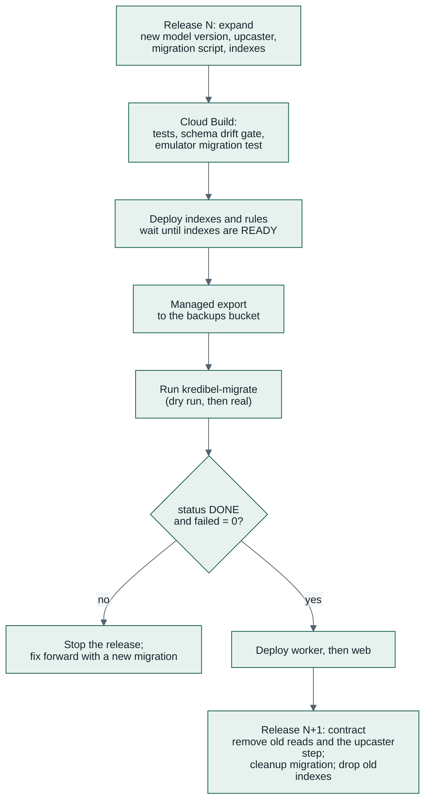

# 22 — Data Migrations

> How the Firestore data model changes without downtime, without losing data and without guessing
> which shape a document has. Decision: [ADR-013](adr/ADR-013-versioned-documents-and-forward-migrations.md).
> Data model: [`09`](09-data-model.md). Deployment: [`16`](16-infrastructure-and-deployment.md) §8.

---

## 1. Goals and rules

| # | Rule |
|---|---|
| M1 | Every document has `schemaVersion`; the code always works with the latest version |
| M2 | Reads upcast old versions in memory; writes always write the latest version |
| M3 | Migrations are forward-only, idempotent, resumable, batched, rate-limited and recorded |
| M4 | Breaking changes ship as expand → migrate → contract over at least two releases |
| M5 | Indexes deploy before the code that queries them; they are removed only in a contract release |
| M6 | Audit events, decisions and per-run snapshots are never rewritten |
| M7 | A backup exists before any backfill or cleanup on a shared environment |
| M8 | A persistence-model change without a version bump fails `make check` (schema drift gate) |
| M9 | Every document stores its parent IDs as fields (portability, collection-group queries) |

---

## 2. What kind of change is it?

| Change | Breaking? | How |
|---|---|---|
| Add an optional field | No | Add to the model with a default; no version bump needed if the default is correct for old documents (the drift gate asks you to confirm) |
| Add a required field or a derived field (e.g. `displayNameLower`) | Yes | Bump version; upcaster computes it; backfill migration; then queries may rely on it |
| Rename a field | Yes | Expand: write the new name, upcaster maps old → new; migrate; contract: cleanup migration deletes the old name |
| Change type or unit (e.g. string amount → `amountMinor`) | Yes | Same as rename, with a new field name (never reuse a name with a new meaning) |
| Split or merge collections | Yes | Expand: write both places from the new code; migrate: copy; contract: stop reading the old place, then delete it |
| New collection | No | Created on first write; add indexes and rules first |
| Add an enum value | Usually no | Readers must accept unknown values (`UNKNOWN_*` fallback); add the value to OpenAPI first |
| Remove an enum value | Yes | Map old → new value in the upcaster; backfill; then remove |
| New composite index | No | Deploy indexes, wait until `READY`, then deploy code that queries it |
| Remove an index | No | Only in a contract release, after no code queries it |
| Security rules | Depends | Rules deny by default; deploy with the code that needs them; test with the emulator |
| Deterministic ID scheme | Yes | New IDs only for new runs; old runs keep theirs (they are immutable) |
| Cloud Storage layout | Yes | Copy to the new prefix, switch pointers, delete the old prefix in a contract release |
| Policy or plan thresholds | No data change | New file version (`risk.v2.yaml`); runs record the policy hashes |
| Prompt or model version | No data change | New cache keys (`promptId@version`, model); old cache entries expire |

---

## 3. Schema versions and upcasters

```python
# backend/app/adapters/firestore/models/document.py
class DocumentDocV2(FirestoreModel):
    SCHEMA_VERSION: ClassVar[int] = 2
    schema_version: int = 2
    org_id: str
    doc_type: DocType
    status: DocStatus
    duplicate: DuplicateDoc | None      # v2: kind, code, ofDocId, decision grouped
    held_as_duplicate: bool = False
    ...

# backend/app/adapters/firestore/upcasters/documents.py
@upcaster("documents", from_version=1)
def documents_v1_to_v2(doc: dict) -> dict:
    """v1 kept duplicateOf/duplicateKind/duplicateDecision at the top level."""
    out = {k: v for k, v in doc.items()
           if k not in {"duplicateOf", "duplicateKind", "duplicateDecision"}}
    if doc.get("duplicateOf"):
        out["duplicate"] = {"ofDocId": doc["duplicateOf"], "kind": doc["duplicateKind"],
                            "code": "D01_EXACT_FILE_DUPLICATE" if doc["duplicateKind"] == "EXACT"
                                    else doc.get("duplicateCode", "D02_STATEMENT_PERIOD_DUPLICATE"),
                            "decision": doc.get("duplicateDecision", "PENDING")}
    out["schemaVersion"] = 2
    return out
```

- `upcast(collection, doc)` applies steps until `schemaVersion == latest`; a document **newer** than
  the code knows raises `SchemaTooNewError` (an old revision must not overwrite new data; the
  request fails with `503 RETRY_LATER` and the newer revision serves the retry).
- Upcasters are **pure** and unit-tested with stored fixtures of every old version
  (`backend/tests/fixtures/firestore/<collection>/v<N>.json`). They stay until the contract
  migration for that version has run in every environment.
- Documents without `schemaVersion` are version 1.

---

## 4. Migration scripts

```
backend/migrations/
├── __init__.py               registry: discovers NNNN_*.py in order
├── runner.py                 paging, batching, preconditions, checkpoint, rate limit, dry run
├── 0001_documents_duplicate_object.py
└── 0002_cleanup_documents_v1_fields.py
```

```python
# backend/migrations/0001_documents_duplicate_object.py  (illustrative)
from app.adapters.firestore.upcasters.documents import documents_v1_to_v2
from migrations import Migration

MIGRATION = Migration(
    id="0001_documents_duplicate_object",
    description="Group duplicate fields under `duplicate` (documents v1 -> v2)",
    kind="backfill",                     # backfill | cleanup | gcs | index-dependent
    collection_group="documents",
    from_version=1,
    to_version=2,
    transform=documents_v1_to_v2,        # the same function the read path uses
    requires_indexes=[],                 # composite indexes that must be READY first
)
```

**Runner semantics** (`python -m migrations run [--only ID] [--dry-run] [--limit N]`):

| Concern | Behaviour |
|---|---|
| Order | By number; a migration starts only when every earlier one is `DONE` |
| Paging | Collection-group query ordered by `__name__`, pages of 300, cursor checkpointed after each page |
| Idempotency | Skips documents with `schemaVersion >= to_version`; transform must be deterministic |
| Concurrency safety | Each write carries `last_update_time` precondition; a conflict (the app wrote meanwhile) re-reads and re-applies once, then counts as `conflict` (the next run picks it up) |
| Batching | `BulkWriter` with at most 500 operations per second to start, +50% every 5 minutes (Firestore 500/50/5 guidance); capped by `MIGRATION_MAX_OPS_PER_SEC` |
| Dry run | Reads, transforms and validates against the target model; writes nothing; reports counts and 5 sample diffs |
| Validation | Every transformed document is validated by the target persistence model before writing; invalid ones are counted as `failed` with their path, never written |
| Failure | Status `FAILED` with the error; rerunning resumes from the checkpoint |
| Logging | Structured logs with `migration_id`, counts per page; no document content |

---

## 5. Registry and lock

`system/migrations/{migrationId}` (server only):

| Field | Type | Notes |
|---|---|---|
| `status` | enum | `PENDING`, `RUNNING`, `DONE`, `FAILED` |
| `kind`, `collectionGroup`, `fromVersion`, `toVersion` | | from the script |
| `startedAt`, `finishedAt` | timestamp | |
| `processed`, `updated`, `skipped`, `conflicts`, `failed` | int | |
| `cursor` | string | last document path of the last finished page |
| `dryRun` | bool | dry runs are recorded under `system/migrations/{id}/dryRuns/{runAt}` instead |
| `gitSha`, `imageDigest`, `operator` | string | who and what ran it (`operator` = the job's SA or the developer's email) |
| `backupUri` | string | export location taken before the run, if any |

`system/migrationLock`: `{holder, leaseUntil}` acquired in a transaction for 10 minutes and renewed
every page. A second runner exits with "another migration is running".

---

## 6. Running migrations

| Where | Command |
|---|---|
| Local, against the emulator | `make migrate` (uses `FIRESTORE_EMULATOR_HOST`) |
| Dry run in an environment | `make migrate-dry ENV=prod` → `gcloud run jobs execute kredibel-migrate --args=run,--dry-run --wait` |
| Real run in an environment | `make migrate ENV=prod` (asks for confirmation; takes the export first) |
| Status | `make migrate-status ENV=prod` (reads `system/migrations`) |

`kredibel-migrate` is a **Cloud Run job** built from the same image (`APP_ROLE=migrate`, entrypoint
`python -m migrations run`), service account `kredibel-migrate` with `roles/datastore.user`,
`roles/datastore.importExportAdmin` and object access to the backups bucket only. Task timeout
60 minutes, 1 task, max retries 1 (the runner resumes from its checkpoint).

---

## 7. Release flow



Why this order: old revisions still serving traffic during the deploy read new documents through
their own upcaster only if the document is not newer than they know; the backfill runs **before**
the new code deploys only when the new code needs it (indexes, queries on the new field). When the old
code cannot read the new version, the expand release first ships the upcaster **without** writing the
new version (a "read-ready" release), and the next release starts writing it.

---

## 8. Backups and recovery

| Mechanism | Setting | Use |
|---|---|---|
| Point-in-time recovery | Enabled on `(default)`, 7-day window | Read or export the database as of a minute before a bad migration |
| Scheduled backups | Daily, 7-day retention | Restore the whole database to a new database ID, then copy back what is needed |
| Managed export before a migration | `gs://<PROJECT_ID>-kredibel-backups/<yyyymmdd>-<migrationId>/` | Precise, per-migration restore point; lifecycle deletes exports after 30 days |
| GCS object versioning | On for the documents bucket, noncurrent versions kept 7 days | Undo a bad Cloud Storage layout migration |

**Recovery runbook:** stop writes for the affected org (`RUNS_ENABLED=false`, or `SIGNUP_MODE=closed`
plus a maintenance banner), export the affected collection group at a timestamp before the incident
(PITR), import it into a scratch database, compare, and write the corrected documents back with a
new forward migration. Prefer roll-forward; a full restore replaces newer good data.

---

## 9. Indexes, rules and Cloud Storage

- `contracts/firestore.indexes.json` is the only source of indexes. Cloud Build deploys it with
  `firebase deploy --only firestore:indexes` and waits for `READY` (`gcloud firestore indexes
  composite list`) before running migrations that declare `requires_indexes`.
- Rules are deployed with the release that needs them and verified with the emulator tests
  ([`14`](14-security-and-compliance.md)); `system/` and `orgPrivate/` stay server-only.
- Vector indexes (assistant retrieval, [ADR-014](adr/ADR-014-finance-assistant-tools-rag-memory.md))
  are versioned with the embedding model: a new embedding model means a new field
  (`embedding_v2`) and a backfill, never re-embedding in place.
- Cloud Storage moves are copy-then-switch: write the new prefix, update pointers in Firestore by
  migration, keep the old prefix until the contract release.

---

## 10. Testing and gates

| Test | Where | Proves |
|---|---|---|
| Upcaster unit tests | `tests/unit/upcasters/` | every stored old version upcasts to a valid latest document |
| Migration unit tests | `tests/unit/migrations/` | transform is deterministic; applying it twice changes nothing |
| Emulator migration test | `tests/integration/test_migrations.py` | seed v1 documents, run the runner, assert all at the new version and counts match; kill the runner half-way, rerun, assert completion without duplicates; a concurrent app write is not lost |
| Schema drift gate | `tools/checks/schema_drift.py` in `make check` | persistence models match `contracts/data/schema-snapshot.json`; a changed model needs a version bump, an upcaster and a migration (or an explicit "optional field" note) |
| Rules tests | emulator | `system/**` and `orgPrivate/**` unreadable by clients |

---

## 11. Portability to Cloud SQL or AlloyDB

Firestore stays the system of record ([`21`](21-cost-analysis.md) §2). If relational reporting,
cross-workspace analytics or a regulator's requirement ever outgrows it, the path is short because of
rule M9 and the repository ports:

1. **Schema:** one table per collection; the document ID is the primary key; parent IDs become foreign
   keys; `*Minor` fields `BIGINT`; enums `TEXT` with check constraints; nested maps that are always read
   whole (`provenance`, `explain`) as `JSONB`; arrays of IDs as join tables.
2. **Adapter:** `adapters/sql_repo.py` implements the same `DocumentRepository`, `MonthRepository`,
   `ReviewRepository`, … ports (SQLAlchemy 2 + `asyncpg`); migrations there use Alembic.
3. **Data:** managed export → BigQuery load (one table per collection group) → SQL transforms that reuse
   the latest-version shape → CSV in Cloud Storage → `gcloud sql import csv`. Analytics can stop at
   BigQuery (cross-workspace analytics for an accounting firm) without moving the app at all.
4. **Cutover:** freeze writes (`RUNS_ENABLED=false`, maintenance banner), final incremental copy of
   documents changed since the export (`updatedAt` > export time), switch the repository binding by
   configuration, unfreeze. The realtime progress channel then needs its own signal (Firestore kept
   for progress only, or polling; [`21`](21-cost-analysis.md) §2.4).

| Collection | Table | Key columns |
|---|---|---|
| `orgs` | `workspaces` | `id`, `plan_id`, `country` |
| `orgs/*/members` | `members` | `(org_id, uid)`, `role` |
| `orgs/*/bankAccounts` | `bank_accounts` | `id`, `org_id`, `account_masked`, `ledger_account_code` |
| `…/documents` | `documents` | `id`, `org_id`, `doc_type`, `status`, `sha256` (unique per org), `verdict` |
| `…/bankLines` | `bank_lines` | `id`, `org_id`, `doc_id`, `account_id`, `date`, `month`, `amount_minor`, `category`; `consensus` as `JSONB` |
| `…/invoices`, `…/receipts` | `invoices`, `receipts` | `id`, `org_id`, `doc_id`, `month`, `total_minor`, payment state |
| `…/ledgerEntries` | `ledger_entries` | `id`, `org_id`, `doc_id`, `date`, `account_code`, `debit_minor`, `credit_minor` |
| `…/months` | `months` | `(org_id, month)`, `state`, `generation`; figures and flows as `JSONB` |
| `…/matches` | `matches` + `match_members` (join table) | `id`, `org_id`, `month`, `kind`, `status`, `method` |
| `…/reviewItems` | `review_items` | `id`, `org_id`, `kind`, `status`, `month`; suggestion as `JSONB` |
| `…/findings` | `findings` | `id`, `org_id`, `code`, `scope`, `severity`, `status` |
| `…/counterparties`, `…/suggestions` | `counterparties`, `suggestions` | `id`, `org_id` |
| `…/runs` | `runs` | `id`, `org_id`, `kind`, `target`; stages as `JSONB` |
| `…/events` | `events` (append-only, no `UPDATE` grant) | `id`, `org_id`, `type`, `at` |
| `…/retrievalChunks` (P1) | `retrieval_chunks` with `pgvector` (AlloyDB or Cloud SQL) | `id`, `org_id`, `doc_id`, `embedding vector(768)` |

---

## 12. Cost

Firestore bills reads, writes and deletes ([`21`](21-cost-analysis.md) §2.3). A backfill reads and
writes each affected document once: 10,000 documents ≈ 10,000 reads + 10,000 writes ≈ USD 0.012 after
the daily free quota, plus an export of a few megabytes. Dry runs cost only reads. PITR and backups
are billed as storage (a few cents a month for our data size).

---

## 13. Checklist for a data-model change (also in the `data-migration` skill)

1. Classify the change with §2. Breaking? Plan expand and contract releases.
2. Add the new persistence model version and bump `SCHEMA_VERSION`.
3. Write the upcaster and fixtures of the old version; unit-test both.
4. Write the migration (and its dry-run expectations); emulator test including the interrupted run.
5. Update `contracts/data/schema-snapshot.json` (`make schema-snapshot`), [`09`](09-data-model.md),
   `contracts/openapi.yaml` if the API changes, and indexes if queries change.
6. Release: indexes → export → dry run → run → deploy. Record the result in
   [`20`](20-implementation-status.md).
7. Next release: contract (remove old reads, cleanup migration, drop unused indexes).
