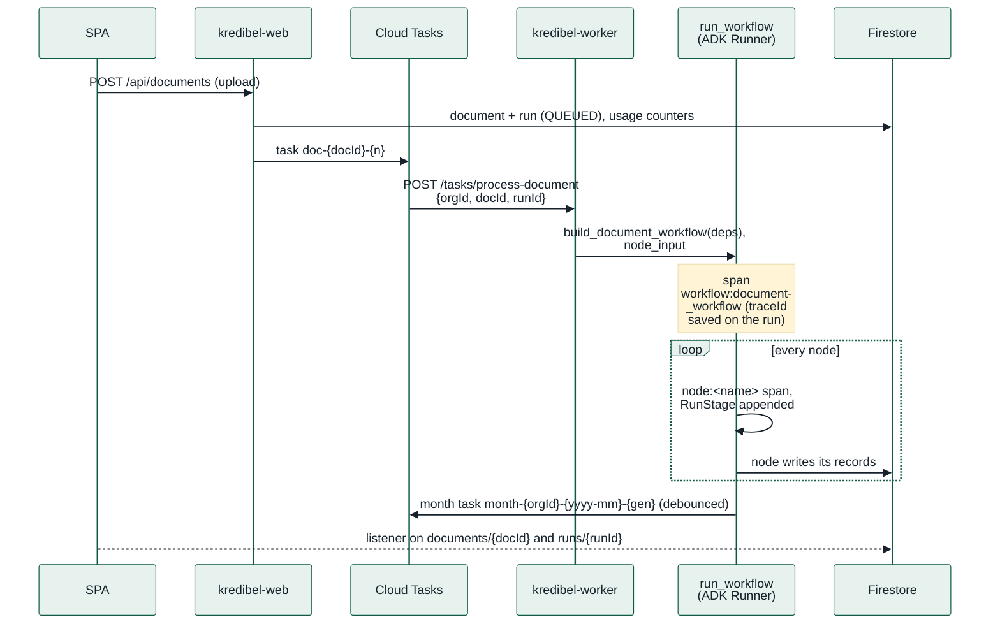
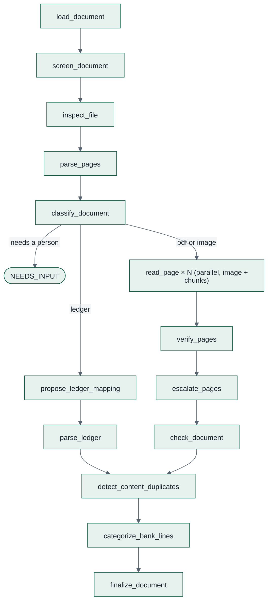
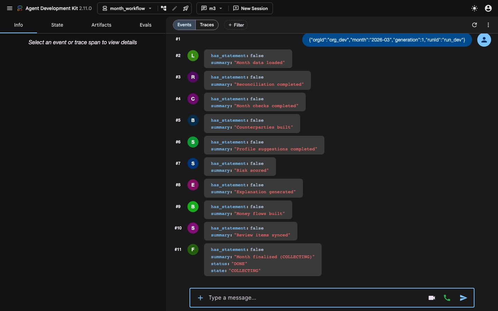
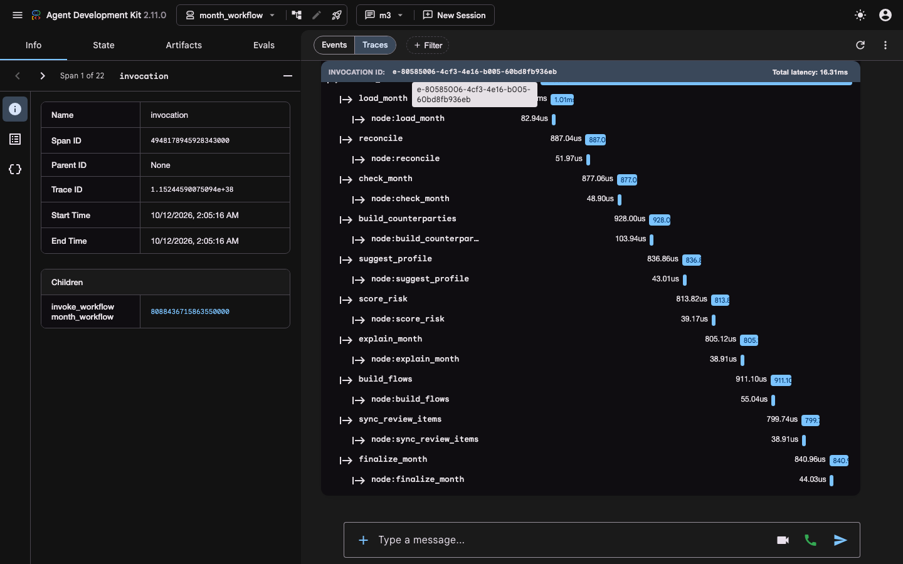
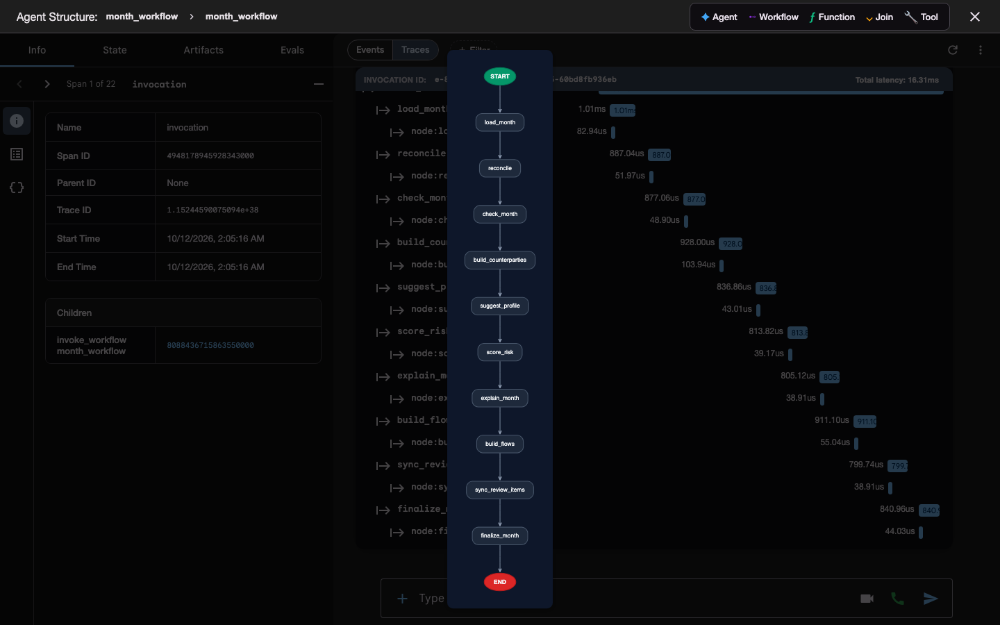

# 23 — How the agents work, and how to trace them

> A practical guide for people who know **LangGraph and LangSmith** and are new to **Google ADK**. It
> explains how Kredibel's workflows run, how to open any of them in a LangSmith-like debugger on your
> laptop, and how to find a production run's trace. Design and decisions live in
> [`06`](06-agent-design.md) (agents), [`17`](17-observability.md) (observability) and
> [ADR-017](adr/ADR-017-agent-observability-on-google-cloud.md); this page is the how-to.
> Verified on **google-adk 2.11.0**.

---

## 1. In one minute

- An **ADK `Workflow`** is a graph of **nodes**, like a LangGraph `StateGraph`. A node is a Python
  function (`@node`) or an LLM `Agent`. We have two workflows: `document_workflow` (reads one
  uploaded file) and `month_workflow` (reconciles one month).
- A **`Runner`** executes a workflow inside a **session** (like a LangGraph thread). Our sessions live
  only for one run; the real data is in Firestore, not in ADK state.
- Every run emits **OpenTelemetry spans**. Locally you see them in the **ADK dev UI**
  (`make dev-agents`, the LangSmith-like screen); in production they go to **Cloud Trace**, and each
  run in Firestore stores its `traceId`.

---

## 2. LangGraph and LangSmith, translated

| You know (LangGraph / LangSmith) | In ADK and Kredibel | Where |
|---|---|---|
| `StateGraph` | `google.adk.Workflow(name=..., edges=[("START", a), (a, b), ...])` | `backend/app/agents/workflows/` |
| Node function | `@node` function, wrapped by our `stage(deps, "name")` | `backend/app/agents/nodes/`, `stages.py` |
| LLM node (`ChatModel` + prompt) | ADK `Agent` with an output schema; prompt in a Markdown file | `agents/llm/`, `agents/prompts/*.md` (from spec 005) |
| Conditional edges, `Send` / map-reduce | A **dynamic** workflow: one orchestrator node calls `await ctx.run_node(child, input)` in plain Python, `asyncio.gather` for fan-out | `document_workflow.py` |
| Graph state | `ctx.state` (we keep only the run input there: `node_input`); each node returns a dict that the next node receives | — |
| Checkpointer / thread | `SessionService` + `session_id` (we use one in-memory session per run; `session_id` = `runId`) | `app/agents/runtime.py` |
| `interrupt()` (human in the loop) | ADK's `RequestInput`; **we do not use it**: anything that needs a person becomes a review item and a new run ([`06`](06-agent-design.md) §9) | — |
| `graph.invoke()` | `async for event in runner.run_async(user_id, session_id)` | `app/agents/runtime.py` |
| LangSmith run tree | ADK spans (`invocation`, `invoke_workflow`, `invoke_node`, `call_llm`, `execute_tool`) plus ours (`workflow:<name>`, `node:<name>`) | dev UI **Traces**; Cloud Trace |
| LangSmith run inputs and outputs | ADK **events**: one per node, with its output and graph path | dev UI **Events** |
| LangGraph Studio graph view | dev UI **Agent structure** (the graph button) | — |
| LangSmith datasets and evals | Dev UI **Evals** tab for quick checks; our scenario evals and DeepEval suite ([`15`](15-testing-and-evaluation.md) §5) | P1 |
| LangSmith run history, feedback | BigQuery agent analytics and the Runs page; labels join feedback to the exact call ([ADR-016](adr/ADR-016-human-verified-labels-and-learning-loop.md), [ADR-017](adr/ADR-017-agent-observability-on-google-cloud.md)) | P1 (spec 017) |

---

## 3. How a run flows through the system



- **Composition:** `main.AppDeps.document_workflow_runner` / `month_workflow_runner` build the
  workflow with real adapters and call `app/agents/runtime.run_workflow`, which opens the
  `workflow:<name>` span, stores the trace ID on the run, binds it to every log line, creates the
  session (`user_id = "{orgId}:system"`, `session_id = runId`) and drives the runner.
- **Nodes** are built by factories in `app/agents/nodes/doc_nodes.py` and `month_nodes.py`. Each is
  wrapped by `stage()` (`app/agents/stages.py`), which reads the input
  (`node_input_dict`), binds `orgId`, `runId`, `node` to logs, opens the `node:<name>` span and
  appends a `RunStage` (status, timing, model, tokens, span ID) to `orgs/{orgId}/runs/{runId}`.
- **Retries:** Cloud Tasks redelivers; nodes are idempotent by deterministic IDs
  ([`06`](06-agent-design.md) §8). A third failed attempt marks the document `FAILED` (`E02`).

### 3.1 `document_workflow` (dynamic)

One orchestrator node calls the steps in code, so branches and the page fan-out are ordinary
Python. Today most steps are stubs; specs 005 to 008 fill them in.



Because it is dynamic, its **graph view shows one node** (`document_workflow`); the steps appear in
**Events** and **Traces**, each with its path such as `document_workflow@1/…/read_page@3`.

### 3.2 `month_workflow` (static)

Ten nodes in a fixed line; the graph view draws them all.

`load_month → reconcile → check_month → build_counterparties → suggest_profile → score_risk →
explain_month → build_flows → sync_review_items → finalize_month`

---

## 4. Debug locally: the ADK dev UI (`make dev-agents`)

### 4.1 Trace uploads through the running application

```bash
make trace-up             # Docker: local Jaeger, http://localhost:16686
make trace-smoke          # verifies ingestion and prints a working trace URL; no credentials
make dev-traced           # API :8000 + inline worker; uses your normal local .env
# In another terminal:
make dev-frontend         # app http://localhost:5173
```

Upload through the app, then open **http://localhost:16686**, choose service **kredibel-all**
(or the configured `K_SERVICE`) and **Find Traces**. Each `workflow:document_workflow` trace contains
the classification, page reading, verification, categorization and finalization nodes. Direct Gemini
requests appear as `generate_content <model>` with attempt number, prompt version, tokens and errors.
A month run is a separate `workflow:month_workflow` trace linked by `orgId` and `month`.
To open one directly, use `http://localhost:16686/trace/<traceId>` from `GET /api/runs/{runId}`.

`dev-traced` changes telemetry only; it uses the same storage/auth/model configuration as
`dev-backend`. Use a synthetic workspace for generated documents. `trace-smoke` creates only a
two-span synthetic trace and never touches workspace data or Gemini. Jaeger stores traces in memory;
`make trace-down` stops it and clears that history. Both viewer and collector bind only to loopback.

Cloud Run keeps `TRACE_EXPORT=cloud`. `adk web --otel_to_cloud` is for Google Cloud export;
local export here uses `TRACE_EXPORT=otlp` and `OTEL_EXPORTER_OTLP_TRACES_ENDPOINT`.
We use the locked OTel SDK/exporter already in the repository, with
[Jaeger 2.22](https://www.jaegertracing.io/docs/2.22/getting-started/), without LangSmith.

### 4.2 Inspect fixture workflows in ADK

```bash
make dev-agents            # http://localhost:8501  (adk web on backend/app/agents/dev_apps)
```

Each folder under `backend/app/agents/dev_apps/` is one app: today `document_workflow` and
`month_workflow`, built on in-memory fakes with sample data, so nothing touches Firestore or Gemini.
`--reload_agents` picks up code changes without a restart.

1. Pick the app in the top-left list and press **New Session**. (Choose **No Thanks** on the "Help
   improve ADK" prompt: it is Google's usage telemetry of the tool, not ours.)
2. Type the run input as **JSON** in the message box and send it:
   - document: `{"orgId": "org_dev", "docId": "doc_sample_1", "runId": "run_dev"}`
   - month: `{"orgId": "org_dev", "month": "2026-03", "generation": 1, "runId": "run_dev"}`

   (Any other text works too when the session state already holds `node_input`; that is how
   production starts a run.)
3. **Events**: one bubble per node with its output, in order. Click one to see the full event, the
   state delta and its span.

   

4. **Traces**: the run as a waterfall, like a LangSmith run tree: ADK's `invoke_node` span for each
   step with our `node:<name>` span inside it, durations, and a detail panel (IDs, timing, children,
   attributes). Once LLM nodes exist, their `call_llm` spans appear here with model and tokens, and
   prompts when content capture is on (§6).

   

5. **Agent structure** (the graph button next to the app name): the workflow graph.

   

6. **State** shows `ctx.state`; **Evals** can save a session as an eval case (quick regression checks;
   the real eval suites are in [`15`](15-testing-and-evaluation.md) §5).

**Scripting the same thing** (the UI calls this API):

```bash
B=http://localhost:8501
curl -X POST $B/apps/month_workflow/users/dev/sessions/s1 -H 'Content-Type: application/json' -d '{}'
curl -X POST $B/run -H 'Content-Type: application/json' -d '{"app_name":"month_workflow","user_id":"dev",
  "session_id":"s1","new_message":{"role":"user","parts":[{"text":"{\"orgId\":\"org_dev\",\"month\":\"2026-03\",\"generation\":1,\"runId\":\"r1\"}"}]}}'
curl $B/dev/apps/month_workflow/debug/trace/session/s1     # every span of the session as JSON
curl $B/dev/apps/month_workflow/build_graph               # the graph as JSON
```

Known ADK 2.11 quirk: the older image endpoint `/dev/apps/<app>/graph` returns 500 for workflows;
the UI uses `build_graph`, which works.

---

### 4.3 Reproduce invoice/receipt reconciliation without real data

```bash
make demo-reconciliation          # offline: HTTP upload + real workflows, recorded readings
make trace-up
make demo-reconciliation-traced   # same run, traced; prints direct Jaeger URLs
```

Open **http://localhost:16686** and choose service **kredibel-reconciliation-demo**. The script
uploads the five PDFs in `backend/tests/fixtures/reconciliation/` into in-memory repositories,
first with the statement first, then with the supporting documents first. Both runs must produce
three automatic bank matches (sales invoice, purchase invoice, card receipt), a paid-cash receipt
with no bank match, and identical figures. Bank rows without documents remain `NO_SUPPORT`.
Both receipts omit printed currency; the fixture replay simulates explicit user agreement to IDR.
It never changes a real workspace, uses no Google credentials, and calls no model. Actual Gemini
request spans are visible when uploading through `make dev-traced` (§4.1).

The summary and trace URLs are written to `/tmp/kredibel-reconciliation-demo.json`.
`make reconciliation-fixtures` regenerates this subset from the S1 builder and its truth; no figures
are hand-edited. This is a focused workflow regression, not the full six-month S1/S4/S5 evaluation.
The trace also names unfinished downstream nodes as skipped; risk explanations, money flows and
review-item sync are still separate implementation tasks.

## 5. Trace a run in production (Cloud Trace)

On Cloud Run `TRACE_EXPORT=cloud`, so `app/observability/tracing.setup_tracing()` installs ADK's Google
Cloud exporter at start-up and every run becomes one trace:

```
workflow:document_workflow            orgId, runId, docId          (ours: app/agents/runtime.py)
└─ invocation                                                       (ADK)
   └─ invoke_workflow document_workflow   gen_ai.conversation.id = runId
      └─ invoke_node document_workflow
         ├─ invoke_node load_document
         │  └─ node:load_document     orgId, runId, node, docId    (ours: stages.py)
         ├─ invoke_node read_page …   (one per page, in parallel)
         │  └─ call_llm / generate_content   model, tokens          (ADK, from spec 005)
         └─ …
```

**Find a run's trace**

1. From the run: `orgs/{orgId}/runs/{runId}.traceId` (Firestore console, or `GET /api/runs/{runId}`).
   Open `https://console.cloud.google.com/traces/explorer;traceId=<traceId>?project=cloud-hack2skill`.
2. From a log line: every line logged during a run carries `logging.googleapis.com/trace`; in Logs
   Explorer, expand the entry and choose **View trace details**. To list a run's lines:

   ```
   resource.type="cloud_run_revision"
   jsonPayload.runId="run_01J…"
   ```
3. In Trace Explorer, filter by span name `workflow:month_workflow` or attribute `runId`.

Each stage on the run also stores `traceSpanId`, so the SPA's progress line and, in P1, the Runs page
can link straight to the failing span.

---

## 6. What is recorded, and what never is

| Setting | Value | Effect |
|---|---|---|
| `TRACE_EXPORT` | `cloud` on Cloud Run, `otlp` for local Jaeger, `none` by default | Where spans go |
| `AI_CONTENT_CAPTURE` | `off` (default, the only value allowed with real data) | Spans keep model, tokens, durations and IDs; never prompts, page text or outputs (`ADK_CAPTURE_MESSAGE_CONTENT_IN_SPANS=false`) |
| | `synthetic` (only with `DATA_CLASS=synthetic`; start-up refuses otherwise) | Prompts and responses appear in span attributes, so Trace Explorer and the dev UI show them |

Logs never contain document text, names or account numbers ([`17`](17-observability.md) §3).

---

## 7. Adding an agent or a node: the checklist

1. Write the node in `agents/nodes/` with `stage(deps, "<name>")`; return a dict (with `summary`, and
   `model`, `tokens_in`, `tokens_out` for LLM calls so the run stage records them).
2. LLM node: `Agent` in `agents/llm/` with a Pydantic output schema; prompt in
   `agents/prompts/<name>.md` (no prompt text in Python, AC-001-12).
3. Add or update a dev app in `agents/dev_apps/<name>/agent.py` exposing `root_agent`, on fakes or
   recorded fixtures. `tests/integration/test_dev_apps.py` loads every dev app the way `adk web` does
   and runs it, so a dev app that cannot open fails `make check`.
4. Open it with `make dev-agents` and check Events, Traces and the graph before you push.

---

## 8. Troubleshooting

| Symptom | Cause and fix |
|---|---|
| Dev UI lists the apps but a run fails with `No module named 'app'` | `adk web` was started without `PYTHONPATH=.` in `backend/`; use `make dev-agents` |
| `Input should be a valid dictionary … input_value='run'` | An old node signature typed as `dict`; nodes take `Any` and call `node_input_dict()` (fixed in `stages.py`) |
| Traces tab shows the invocation with "0us" and nothing under it | Spans without `gcp.vertex.agent.invocation_id`; `stage()` sets it, so this means a node bypasses `stage()` |
| No trace in Cloud Trace for a production run | `TRACE_EXPORT` not `cloud` on that service, or the service account lacks `roles/cloudtrace.agent` (bootstrap step 4) |
| A task's trace holds only its three request spans; the worker logs `Failed to export span batch code: 400` | The resource lacks `gcp.project_id` (`Resource is missing required attribute "gcp.project_id"`); `setup_tracing` merges ADK's `get_gcp_resource` (fixed) |
| A local run has no trace | Run `make trace-up`, `make trace-smoke`, then `make dev-traced`; select `kredibel-all` in Jaeger. With real data, content capture stays off |
| A run has no `traceId` | It ran before tracing was configured, or outside `run_workflow` |
