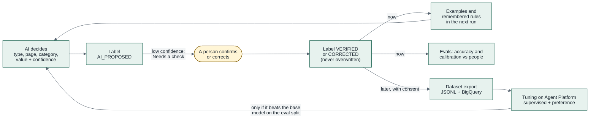

# ADR-016 — Human-verified labels and the learning loop

**Status:** Accepted (labels P1, tuning later) · **Date:** 2026-10-11 · **Related:**
[ADR-005](ADR-005-deterministic-scoring-llm-explains.md), [ADR-007](ADR-007-hitl-review-queue.md),
[ADR-010](ADR-010-adaptive-extraction-ai-reader-and-witness.md), [ADR-012](ADR-012-profile-with-ai-suggestions.md),
[ADR-017](ADR-017-agent-observability-on-google-cloud.md)

## Context

Kredibel's models make many small decisions: what kind of document a file is, what each page is
(transactions, summary, terms, blank), which category a bank line belongs to, and the values read
from a page. Each comes with a confidence. People already fix some of them: a review item corrects a
value, the user changes a bank line's category. Today those fixes improve the books but teach the
system nothing, and nobody can see how often the AI was right.

We want every AI decision to become a **label** a person can check, so that:

1. the person sees where the AI was unsure and fixes it in one place;
2. a fix is recorded as **verified by a person**, never overwritten by a later AI run;
3. verified labels make the AI better **now** (examples and remembered rules) and **measurable**
   (accuracy and calibration against people);
4. later, with the workspace's consent, verified labels become **training data** for tuned models.

Categories also depend on the accounting framework: interest paid is a financing cash flow under
IFRS (IAS 7 as amended by IFRS 18) and an operating one under US GAAP (ASC 230). The workspace must
choose.

## Decision

1. **One `labels` collection** (`orgs/{orgId}/labels`, [`09`](../09-data-model.md) §3.19). A label has
   a task (`DOC_TYPE`, `PAGE_TYPE`, `CATEGORY`, `COUNTERPARTY_ROLE`, `FIELD_VALUE`), a subject (document,
   page, bank line, counterparty, field), the latest **AI value** with its confidence, source (model,
   rule or match), model, prompt version and the run and span that produced it, the **final value**
   and a status: `AI_PROPOSED`, `VERIFIED` (a person confirmed it) or `CORRECTED` (a person replaced
   it). Its ID is deterministic, so re-runs update the AI value of the same label.
2. **People win, forever.** A run never changes the final value of a `VERIFIED` or `CORRECTED` label;
   if it disagrees, it sets `aiDisagreesWithPerson`, which evals count.
3. **Decisions flow back into the books.** Correcting a `CATEGORY` or `DOC_TYPE` writes an event and
   marks the affected months dirty, like a review fix. The existing review item kinds stay for what
   blocks reconciliation; the Labels page is for everything else.
4. **Accounting framework per workspace** (`profile.accountingFramework`: `IFRS` default, or
   `US_GAAP`). The category vocabulary and each category's cash-flow class per framework live in
   `contracts/policy/categories.v1.yaml`; code derives the class, never a model.
5. **Every read page has an extraction file** in Markdown (`extractions/{docId}/p{n}.md` in Cloud
   Storage): page type and confidence, reading method, witness text, line items and both readings of
   every value. The Labels page links to it; it is also the text form of a page for retrieval and
   datasets.
6. **Learning without training, now** (`contracts/policy/learning.v1.yaml`):
   - the categorizer and classifier receive up to five **verified examples from the same workspace**
     (nearest by embedding, Firestore vector search) in the prompt;
   - **"Apply to similar lines"** turns a person's category correction into a workspace rule for that
     counterparty and direction, applied by code before the model (the person chose it);
   - evals report AI accuracy and **confidence calibration** against person-checked labels
     ([`15`](../15-testing-and-evaluation.md) §5).
7. **Training, later (not in the prototype).** An owner can export a versioned dataset (JSONL in the
   Gemini tuning format to Cloud Storage, and a BigQuery table) from `VERIFIED` and `CORRECTED` labels,
   masked by `learning.v1.yaml`, **only with the workspace's consent** (`learning.shareVerifiedLabels`,
   off by default). Pairs where a person corrected the AI are kept as preference data. Planned use:
   **supervised fine-tuning** and **preference tuning** of Gemini on Gemini Enterprise Agent Platform
   for the classifier and categorizer; a tuned model replaces the base model only if it beats it on the
   held-out eval split (20%, fixed by label ID), and the switch is configuration (`MODEL_*`).

## Why not reinforcement learning

Reinforcement learning needs a reward signal and many interactions; Kredibel's feedback is a person's
verdict on single decisions. That is exactly what supervised fine-tuning (the right answer) and
preference tuning (the corrected answer preferred over the AI's) use, and both are managed services on
Google Cloud. "Learning from people" here means: examples now, measurement now, tuning when there is
enough consented data.

## Consequences

- Workflows write a label for every classification and categorization (cheap: one Firestore write per
  decision, batched).
- The Labels page ([`11`](../11-frontend.md) §6.11) is the place to check AI work; the review queue
  stays short and about the books.
- Evals gain a real-world ground truth from people, alongside the synthetic truth.
- Prompts get a small "verified examples" block; the gateway keeps it to the same workspace.
- No customer data is used for training without consent, masking and a minimum dataset size; the
  prototype uses synthetic data only (P8).
- Tunable model versions and dataset limits are checked when the first export is ready (they change
  more often than this decision).

## Alternatives considered

| Option | Why not (now) |
|---|---|
| Store corrections only on the business records (bank line, document) | No single place to see AI accuracy, no provenance (model, prompt, run), no dataset |
| Put every low-confidence label in the review queue | Floods the queue with things that do not block the books |
| Tune a model during the hackathon | No real data, no consent; synthetic labels would only teach the generator's patterns |
| A third-party labeling tool | Google Cloud only (P7); the labels belong next to the books they describe |
