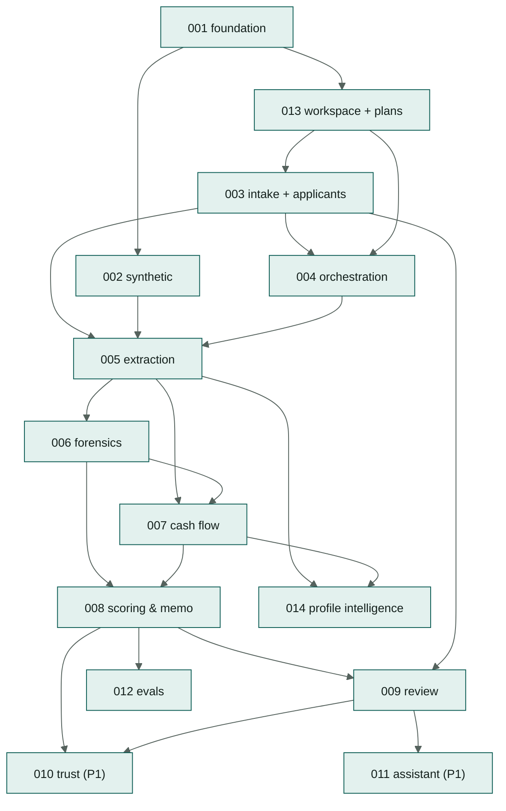

# Specs

Each folder is one feature, written spec-first: **`spec.md`** (what and why, with acceptance
criteria) → **`plan.md`** (how, which files) → **`tasks.md`** (ordered, test-first checklist).
The per-feature layout matches spec-kit conventions; the folder lives at `docs/specs/` so all SDD
documents sit under `docs/`. Paths to other docs are relative (`../01-…`, `../../contracts/…`).

## Index and build order

| # | Spec | Priority | Owner role | Depends on | Day |
|---|---|---|---|---|---|
| 001 | [Foundation](001-foundation/spec.md) | P0 | D (+C) | — | D0–D1 |
| 013 | [Workspace, plans & settings](013-workspace-and-plans/spec.md) | P0 (phases 1–4) / P1 (members, policy overrides) | D + C | 001 | D1 (backend, onboarding) · D5–D6 (settings UI) |
| 002 | [Synthetic data](002-synthetic-data/spec.md) | P0 (S1–S3, applicants, scan variant) / P1 | B | 001 | D0–D1 |
| 003 | [Case intake (applicant onboarding, cases, uploads)](003-case-intake/spec.md) | P0 | C (+B/D) | 001, 013 | D1–D2 |
| 004 | [Analysis orchestration](004-analysis-orchestration/spec.md) | P0 | A (+C) | 001, 003, 013 | D2 |
| 005 | [Document extraction (adaptive reading)](005-document-extraction/spec.md) | P0 / P1 (escalation) | A + B | 002, 003, 004 | D2–D3 |
| 006 | [Document forensics](006-document-forensics/spec.md) | P0 | B | 005 | D3 |
| 007 | [Cash flow & reconciliation](007-cashflow-and-reconciliation/spec.md) | P0 | B | 005, 006 | D4 |
| 008 | [Scoring & memo](008-scoring-and-memo/spec.md) | P0 | B + A | 006, 007 | D4–D5 |
| 009 | [Review & decision](009-review-and-decision/spec.md) | P0 (+P1 section) | C | 003, 008 | D4–D5 |
| 010 | [Trust extensions](010-trust-extensions/spec.md) | P1 | A, B, C | 006, 008, 009 | D6 |
| 011 | [Case assistant](011-case-assistant/spec.md) | P1 | A (+C) | 008, 009 | D6 |
| 012 | [Evals & results](012-evals/spec.md) | P1 (P0 suites always) | A | 002, 008 | D6 |
| 014 | [Applicant profile intelligence](014-applicant-profile-intelligence/spec.md) | P0 (counterparties, header suggestions, `X06`, Applicant tab) / P1 | B + C (+A) | 003, 005, 007 | D4–D5 |

Spec numbers are identifiers, not the build order: 013 was added later but is built right after 001,
because 003 and 004 call its entitlement checks.



The frontend parts of 009 can start on D3 against MSW mocks generated from `contracts/openapi.yaml`.

## How a coding agent works a spec

1. Read `AGENTS.md`, then the spec's `spec.md`, `plan.md` and every doc they link.
2. Take the first unchecked task in `tasks.md`. For **TDD** tasks, write the failing test first and
   run it.
3. Implement the smallest change that makes it pass; run `make check`.
4. Tick the task (`- [x]`), commit as `feat(NNN): …` with `Tasks: TNNN-xx` in the body.
5. If the spec is wrong or unclear, stop and propose a spec change. Do not silently diverge.
6. When the spec's tasks are done, update `docs/20-implementation-status.md`.

The `/sdd-implement-task` and `/sdd-new-spec` skills in `.agents/skills/` encode this loop.

## Spec template (for new features)

```markdown
# Spec NNN — Title
| | |
|---|---|
| **Status** | Draft / Ready |
| **Priority** | P0 / P1 / P2 |
| **Owner role** | … |
| **Depends on** | … |
| **Requirements** | FR-…, NFR-… |

## Summary
## User stories
### US-NNN-1: …
- **AC-NNN-1** Given …, when …, then …
## Out of scope
## Edge cases
```
