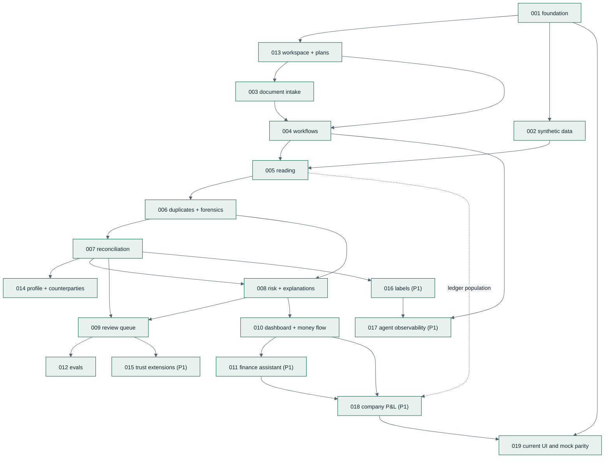

# Specs

Each folder is one feature, written spec-first: **`spec.md`** (what and why, with acceptance
criteria) → **`plan.md`** (how, which files) → **`tasks.md`** (ordered, test-first checklist).
The per-feature layout matches spec-kit conventions; the folder lives at `docs/specs/` so all SDD
documents sit under `docs/`. Paths to other docs are relative (`../01-…`, `../../contracts/…`).

## Index and build order

| # | Spec | Priority | Owner role | Depends on | Day |
|---|---|---|---|---|---|
| 001 | [Foundation](001-foundation/spec.md) | P0 | D (+C) | — | D0–D1 |
| 013 | [Workspace, plans, settings and roles](013-workspace-and-plans/spec.md) | P0 / P1 (roles) | D + C | 001 | D1 (backend, onboarding) · D5 (settings UI) |
| 002 | [Synthetic data](002-synthetic-data/spec.md) | P0 / P1 (S6) | B | 001 | D0–D1 |
| 003 | [Document intake](003-document-intake/spec.md) | P0 | C + D | 001, 013 | D1–D2 |
| 004 | [Workflows: documents and months](004-workflows/spec.md) | P0 | A (+D) | 001, 003, 013 | D2 |
| 005 | [Reading](005-reading/spec.md) | P0 / P1 (escalation) | A + B | 002, 003, 004 | D2–D3 |
| 006 | [Duplicates and document forensics](006-duplicates-and-forensics/spec.md) | P0 | B | 005 | D3 |
| 007 | [Categorization and month reconciliation](007-reconciliation/spec.md) | P0 | B (+A) | 004, 005, 006 | D3–D4 |
| 014 | [Profile suggestions and counterparties](014-profile-and-counterparties/spec.md) | P0 / P1 | B + C | 005, 007, 013 | D4 |
| 008 | [Fraud risk and explanations](008-risk-and-explanations/spec.md) | P0 | B + A + C | 006, 007 | D4–D5 |
| 009 | [Review queue](009-review-queue/spec.md) | P0 | C + B | 005–008 | D4–D5 |
| 010 | [Dashboard and money flow](010-dashboard-and-money-flow/spec.md) | P0 | C (+B) | 007, 008 | D5 |
| 012 | [Evals and results](012-evals/spec.md) | P0 suites / P1 suites | A | 002, 005–009 | D6 |
| 011 | [Finance Assistant](011-finance-assistant/spec.md) | P1 | A (+C) | 007, 008, 010 | D6 |
| 015 | [Trust extensions](015-trust-extensions/spec.md) | P1 | A, B, C | 004, 006, 008, 009 | D6 |
| 016 | [Labels and learning from people](016-labels-and-learning/spec.md) | P1 (writers early) · export later | A, B, C | 005, 007, 013 | D3 (writers) · D6 (page) |
| 017 | [Agent observability](017-agent-observability/spec.md) | P0 (traces, dev UI) · P1 (BigQuery, Runs page) | A, D, C | 004, 016 | D2 (traces) · D6 |
| 018 | [Company classifications and P&L](018-subledger-profit-and-loss/spec.md) | P1 | B + C + A | 010, 011; ledger population 005 | After P0 |
| 019 | [Current UI and mock parity](019-ui-parity/spec.md) | P0 maintenance | C + D | Implemented screens 001–018 | Continuation |
| 020 | [Public site](020-public-site/spec.md) | P0 (submission) | C (+D) | 001, 013 | D7 |
| 021 | [Demo company and guided tour](021-demo-and-guided-tour/spec.md) | P0 (submission demo) | B, C | 002, 013, 016, 017 | D8 |
| 022 | [Extraction store and knowledge base](022-extraction-store/spec.md) | P0 (A, B), P1 (C) | A, B, C | 005, 016, 011 | D8 |
| 023 | [Reading and matching quality](023-reading-and-matching-quality/spec.md) | P0 (A), P1 (B) | A, B, C | 005, 007, 016, 022 | D9 |
| 024 | [Demo account, expectations and transactions](024-demo-account-and-expectations/spec.md) | P0 (A, B), P1 (C, D) | A, B, C | 002, 007, 013, 021 | D9 |

Spec numbers are identifiers, not the build order: 013 is built right after 001, because 003 and 004
call its entitlement checks.



The frontend parts of 009 and 010 can start on D3 against MSW mocks generated from
`contracts/openapi.yaml` and the HTML mocks in `design/mocks/`.

## How a coding agent works a spec

1. Read `AGENTS.md`, then the spec's `spec.md`, `plan.md` and every doc they link.
2. Take the first unchecked task in `tasks.md`. For **TDD** tasks, write the failing test first and
   run it.
3. Implement the smallest change that makes it pass; run `make check`.
4. Tick the task (`- [x]`), commit as `feat(NNN): …` with `Tasks: TNNN-xx` in the body.
5. If the spec is wrong or unclear, stop and propose a spec change. Do not silently diverge.
6. When the spec's tasks are done, update `docs/20-implementation-status.md`.

The `/sdd-implement-task` and `/sdd-new-spec` skills in `.agents/skills/` encode this loop.

## Spec template (for new features)

```markdown
# Spec NNN — Title
| | |
|---|---|
| **Status** | Draft / Ready |
| **Priority** | P0 / P1 / P2 |
| **Owner role** | … |
| **Depends on** | … |
| **Requirements** | FR-…, NFR-… |

## Summary
## User stories
### US-NNN-1: …
- **AC-NNN-1** Given …, when …, then …
## Out of scope
## Edge cases
```
