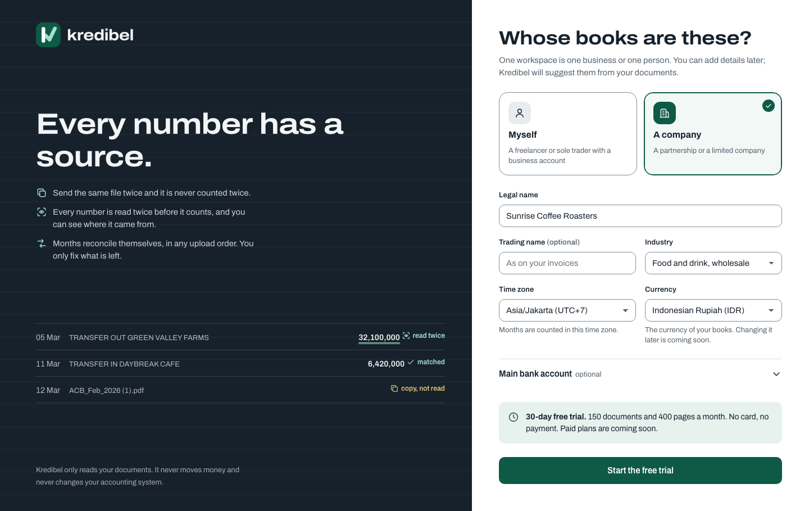
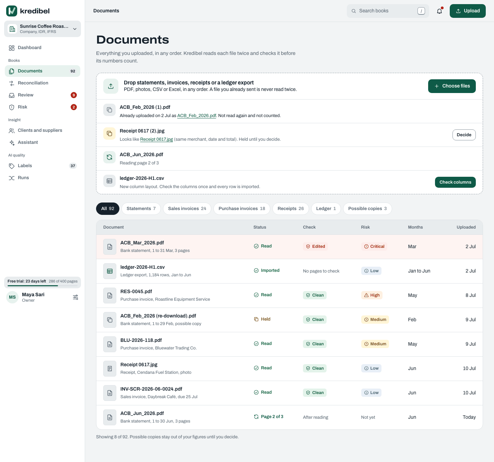
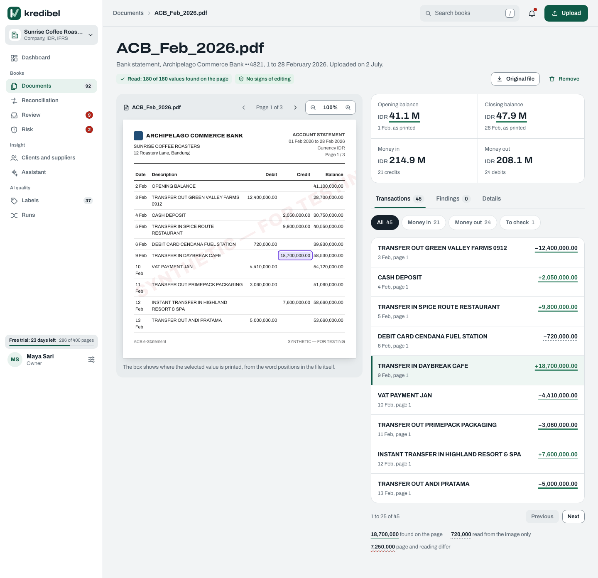
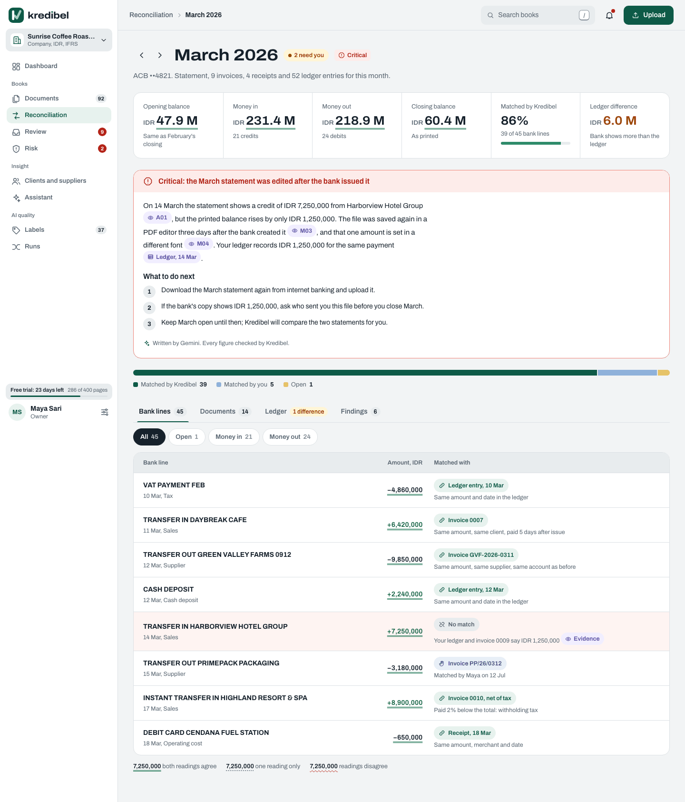
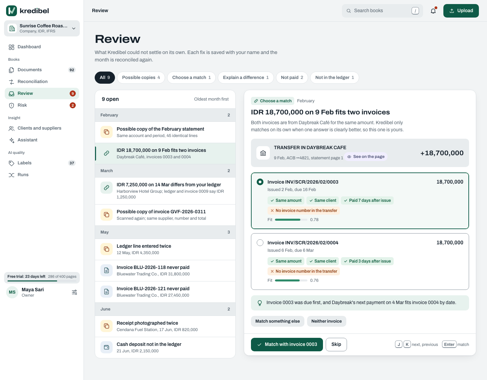
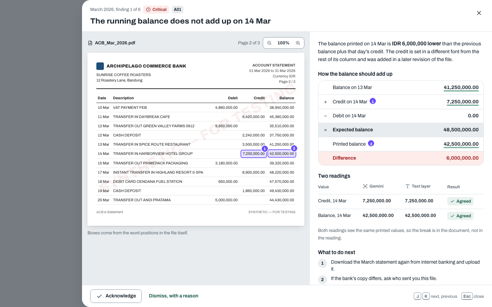
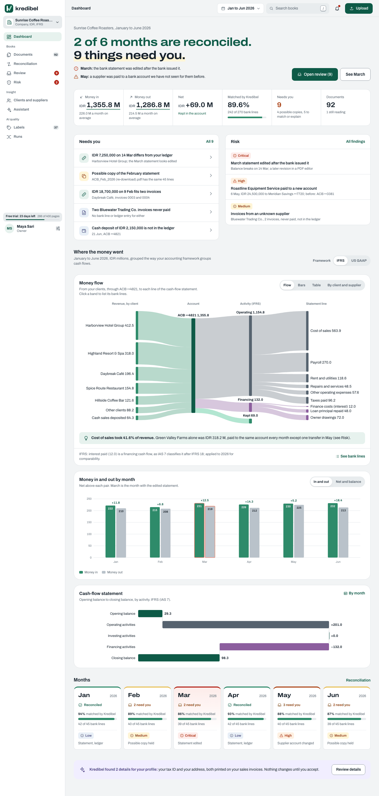
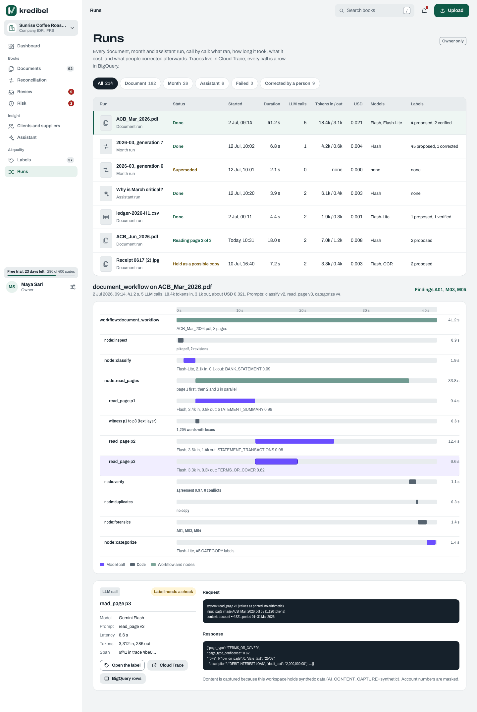

# Kredibel — End-to-End Walkthrough & Video Submission Guide

> **Purpose:** Step-by-step visual execution playbook for creating the **AI Builder Cup** demo video (≤ 3:00),
> mapping synthetic test data to live screens, verified outcomes, and verbatim narration.
>
> Follows [`demo-script.md`](demo-script.md), [`proposal.md`](proposal.md), and [`docs/23-agents-and-tracing-guide.md`](../23-agents-and-tracing-guide.md).

---

## 1. Quick reference: Synthetic test data & expected outcomes

The walkthrough uses the verified S1 synthetic fixtures in `backend/tests/fixtures/reconciliation/`:

| Document | Type | Expected Result | Evidence & Payment State |
|---|---|---|---|
| `statement-2026-03.pdf` | Bank Statement | 24 transactions, opening 184,048,975 IDR, closing 147,727,195 IDR | Reconciles March; 21 bank lines remain `Bank recorded · No supporting document` |
| `inv-sales-2026-03-01.pdf` | Sales Invoice (Daybreak Café) | 19,597,050.00 IDR, due 15 Mar | `AUTO` match to 21 Mar deposit; status: `PAID_BANK` |
| `inv-purchase-2026-03-01.pdf` | Purchase Invoice (Green Valley Farms) | 27,250,500.00 IDR, due 15 Mar | `AUTO` match to 14 Mar withdrawal; status: `PAID_BANK` |
| `receipt-2026-03-01.pdf` | Till Roll Receipt (Swift Courier) | 355,200.00 IDR, CARD | `AUTO` match to 8 Mar card settlement; status: `PAID_BANK` |
| `receipt-2026-03-02.pdf` | Till Roll Receipt (Cendana Fuel) | 649,128.00 IDR, CASH | No bank line needed; status: `PAID_CASH` |

*Order-independence check:* Uploading these in **either order** (statement first, or invoices/receipts first) produces the exact same 3 automatic matches, identical month figures, and zero duplicate charges (`make demo-reconciliation`).

---

## 2. Step-by-Step E2E Video Recording Script (3:00)

### Step 1 (0:00–0:15) — Clean Workspace & Onboarding
- **Action:** Open clean browser at `1440×900` to `/onboarding`.
- **Screen:** `01-onboarding.png`
- **What to show:**
  - Workspace type selection: **Company** (Sunrise Coffee Roasters).
  - Reporting currency selection: **IDR** (or **MYR**).
  - Timezone: `Asia/Jakarta`.
  - Click **Start the free trial**.
- **Voiceover:**
  > *"Small businesses close their books by hand. Invoices, supplier bills and receipts arrive all month; statements arrive at month end. Kredibel checks your books automatically."*



---

### Step 2 (0:15–0:40) — Document Upload & Realtime Ingestion
- **Action:** Go to `/documents`, open Upload Sheet, and drop `statement-2026-03.pdf`, `inv-sales-2026-03-01.pdf`, `inv-purchase-2026-03-01.pdf`, `receipt-2026-03-01.pdf`, and `receipt-2026-03-02.pdf` in any order.
- **Screen:** `02-documents-upload.png`
- **What to show:**
  - Realtime progress line updating as Cloud Tasks / worker processes pages.
  - Drop the same statement a second time: banner shows **"Already uploaded — not read again"** (Exact SHA-256 duplicate `D01`).
- **Voiceover:**
  > *"Upload your documents in any order. Exact copies are recorded and never read again. Kredibel processes every page with Document AI OCR and Gemini 2.5 Flash."*



---

### Step 3 (0:40–1:05) — Grounded Extraction & Document Inspection
- **Action:** Click into `statement-2026-03.pdf` detail page.
- **Screen:** `03-document-grounding.png`
- **What to show:**
  - Side-by-side view: PDF page viewer on the left, structured extracted values on the right.
  - Value grounding citations (ADR-023): hovering over an opening balance or transaction lights up the exact bounding box and chunk on the PDF image.
  - 100% agreement badge between Gemini reading and PDF text-layer witness.
  - Verdict: **CLEAN**.
- **Voiceover:**
  > *"Every number has a source. Gemini reads the page image, the text layer acts as an independent witness, and every value is grounded in the page's words. Disagreement is flagged before any accusation."*



---

### Step 4 (1:05–1:40) — Reconciliation & Payment Evidence
- **Action:** Navigate to `/months/2026-03` (or `reconciliation.html`).
- **Screen:** `04-reconciliation-evidence.png`
- **What to show:**
  - **Matched to documents:** Daybreak Café sales invoice and Green Valley Farms purchase invoice matched to bank lines (`PAID_BANK`).
  - **Card receipt:** Swift Courier matched to card transaction (`PAID_BANK`).
  - **Cash receipt:** Cendana Fuel marked `PAID_CASH` without needing a statement.
  - **Bank recorded only:** Bank fees, utilities, and tax payments honestly labelled `Bank recorded · No supporting document`.
- **Voiceover:**
  > *"Statements anchor cash movement, while invoices and receipts explain each payment. Cash expenses are acknowledged as paid in cash. Bank transactions without invoices remain transparently recorded without false alarms."*



---

### Step 5 (1:40–2:05) — Category Correction & Audit Trail
- **Action:** Select an `UNKNOWN` bank transaction (e.g. 4,644,000 IDR), click category dropdown, and select **Utilities**.
- **Screen:** `05-category-correction.png`
- **What to show:**
  - Operating expenses update immediately.
  - Category update persists across workflow re-runs (`PATCH /api/bank-lines/{txId}`).
  - User decisions win: AI never overwrites a confirmed human correction.
- **Voiceover:**
  > *"What AI cannot match goes to a review queue. When you correct a category, the decision is audited and month figures recompute instantly. A re-run never undoes your work."*



---

### Step 6 (2:05–2:25) — Tamper Detection & Evidence Viewer
- **Action:** Show the tampered March scenario (`S2`).
- **Screen:** `06-tamper-detection.png`
- **What to show:**
  - Status: **TAMPERED** (`CRITICAL` fraud risk).
  - Evidence viewer: highlights the edited transaction, font mismatch, second revision in PDF metadata, and broken mathematical balance.
- **Voiceover:**
  > *"When a document is manipulated, deterministic forensics flag it. In this March statement, a second revision and altered font caused a balance arithmetic break. Gemini explains the risk and next steps with exact citations."*



---

### Step 7 (2:25–2:45) — Executive Dashboard & Sankey Cash Flow
- **Action:** Navigate to `/` (Dashboard).
- **Screen:** `07-dashboard-sankey.png`
- **What to show:**
  - Net cash figure (`-36,321,780 IDR`), Money In (`86,381,560 IDR`), Money Out (`122,703,340 IDR`).
  - Month strip showing reconciled status.
  - Interactive **Sankey money flow**: visual stream from revenue/receipts to operational expenses and bank balances.
- **Voiceover:**
  > *"Here is where your money went. The executive dashboard shows money in, money out, and an interactive Sankey cash flow verified directly against your bank records."*



---

### Step 8 (2:45–3:00) — Observability & Architecture Close
- **Action:** Show Jaeger / Cloud Trace waterfall at `http://localhost:16686` or Cloud Trace Explorer.
- **Screen:** `08-observability-traces.png`
- **What to show:**
  - `workflow:document_workflow` and `workflow:month_workflow` waterfall spans.
  - Model tokens, latency, prompt versioning, and zero hallucinations.
  - Architecture slide: Google Cloud, Cloud Run, Gemini, Document AI, Firestore, Cloud Tasks.
- **Voiceover:**
  > *"Built natively on Google Cloud: ADK workflows on Cloud Run, Gemini 2.5, Document AI, and Firestore. Kredibel: every number has a source."*




---

## 3. How to regenerate walkthrough screenshots

All visual reference screens are rendered from tokens and HTML mocks via Playwright:

```bash
# 1. Regenerate HTML mocks
make mocks

# 2. Capture all mock screenshots at 1440, 834, and 390 px:
make mock-shots

# Output images are saved in:
# docs/assets/mocks/<screen>-desktop.png
# docs/assets/mocks/<screen>-tablet.png
# docs/assets/mocks/<screen>-mobile.png
```
